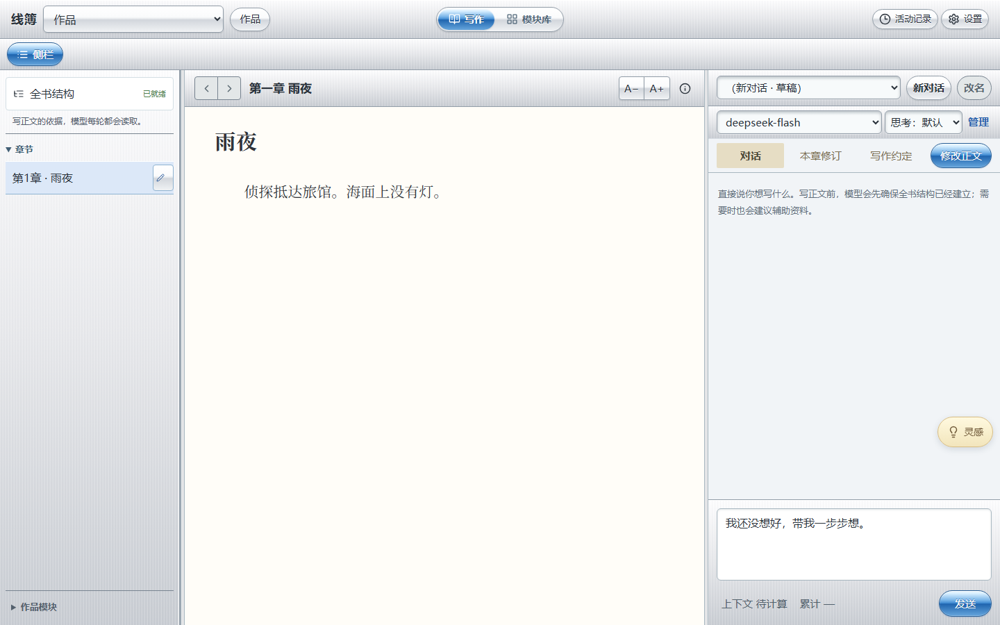
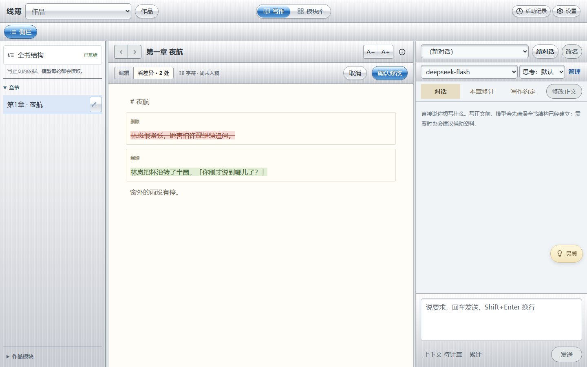
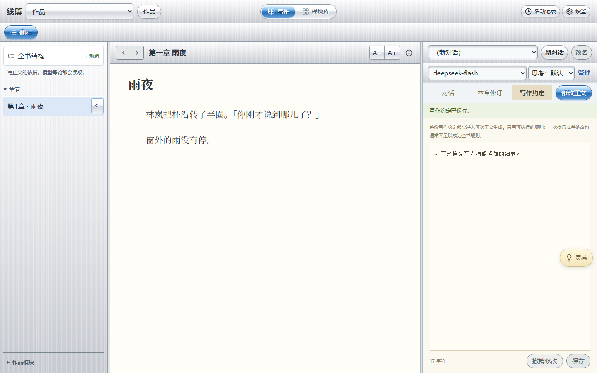

# ClueLedger · 线簿

[简体中文](README.md) · [English](README.en.md)

**An AI writing workspace for long-form mystery fiction.**

Discuss your story, read chapters, revise prose, organize lasting story material, and review revisions in one workspace. You decide the direction; ClueLedger helps with the current project and the goal of each request.

Current version: **1.2.0**. This page describes the current feature set. The v1.3 chapter clue registry is deferred, with its design and implementation [preserved for future work](dev-notes/v1.3/README.md).



*Captured from the current Chinese-language interface on 2026-11-05, using isolated test projects and demonstration content.*

[Write through conversation](#write-through-conversation) · [Revise prose](#revise-prose) · [Writing agreements](#writing-agreements) · [Ideas and modules](#ideas-and-modules) · [Get started](#get-started)

## Write through conversation

Keep the project directory, manuscript, and conversation together. Start from an idea or describe what you want to do with an existing chapter:

> I want to write about a disappearance at a snowbound inn. Help me establish the book's structure first.

> Let's discuss the suspense in Chapter 2. Don't change the manuscript yet.

> Change the end of Chapter 3 to a snowy night. Only edit that chapter and keep the dialogue.

**Book structure (全书结构)** holds the story direction, chapter plan, and lasting constraints. The model reads it for each turn. A new project can establish its structure through conversation before drafting prose; later changes to structure and project material also begin in conversation.

Use the directory to select chapters, inspect the structure, and read project modules. Prose opens in reading mode. Expand task details in the conversation or open **Activity (活动记录)** to revisit the work.

## Revise prose

To edit a chapter yourself, select it and choose **Edit prose (修改正文)** in the conversation area.

1. Edit the manuscript.
2. Choose **View changes (看差异)** to review additions, deletions, and rewrites.
3. Choose **Confirm changes (确认修改)** to save, or cancel to keep the original.

Saved edits create revision records. Open **Chapter revisions (本章修订)** or **View differences (查看差异)** on the latest revision to compare the text. Request model analysis when you want help understanding the changes.



## Writing agreements

Keep the project's lasting writing preferences in **Writing agreements (写作约定)**, such as dialogue style, narrative distance, or requirements for describing settings. Edit and save them directly; subsequent prose generation reads these agreements.

Revision analysis distinguishes effects on writing agreements, book structure, module material, and the current scene. You decide which suggestions to adopt.



## Ideas and modules

- **Capture ideas:** click the floating **Ideas (灵感)** button or press **Alt + I** to save dialogue, character secrets, or plot ideas. Search, edit, inspect history, or restore recently deleted notes.
- **Bring material into conversation:** attach ideas or selected passages to the current draft and add your request. Attaching material does not send it.
- **Organize lasting story material:** keep character profiles, backgrounds, earlier cases, and objects in modules, add them when needed, and read them from the sidebar.
- **Reuse material:** create and edit modules, inspect versions, and add them to a project from Module Library. Request changes to project material through conversation; project copies and the global library are managed separately.

The model can suggest creating or adding relevant modules and continue the original task after your choice. Declining a suggestion still allows writing to continue.

## Records and model settings

**Activity (活动记录)** shows conversations, tasks, model requests, and file changes. Revision records show the actual text changes.

Configure connections and models in **Settings → Model Settings (设置 → 模型设置)**, or switch the current selection from the conversation area. Without a model connection, you can still read local content, record ideas, manually revise prose, and organize Module Library. Generation and analysis require an available connection.

## Get started

1. Choose a project folder in **Projects → Open / New (作品 → 打开 / 新建)**.
2. Connect and select a model in **Settings → Model Settings**.
3. Describe the story direction and your goal in conversation, establishing the book structure first.
4. Select chapters to read, discuss, draft, or revise. Choose **Edit prose** for manual revisions.
5. Save lasting requirements in Writing agreements and organize detailed character and background material into modules as needed.

The current interface does not offer manuscript upload/import or direct chapter creation by the author. New chapters are created through the conversation workflow.

Running from source requires Python 3.12+, Node.js, and uv. From the repository root:

```powershell
uv sync
npm --prefix frontend ci
npm --prefix frontend run build
uv run python -m hastings.server
```

Open the [local writing workspace](http://127.0.0.1:8000). See the [frontend guide](frontend/README.md) for development and validation, and [development records](dev-notes/README.md) for version status.

ClueLedger is built on [Tau Agent](https://github.com/huggingface/tau). Its MIT license and copyright information are preserved in the [third-party notices](THIRD_PARTY_NOTICES.md).
