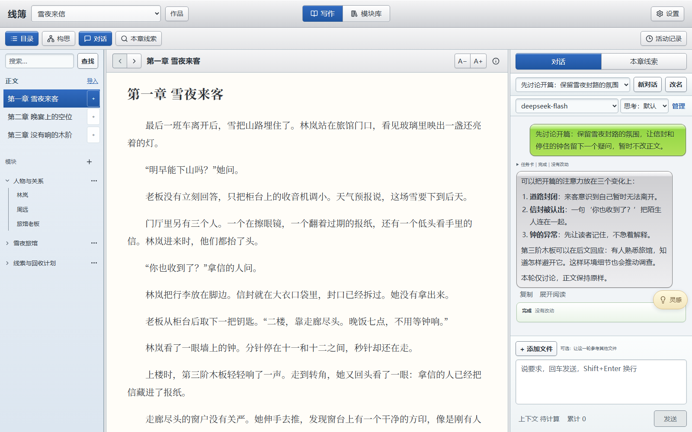
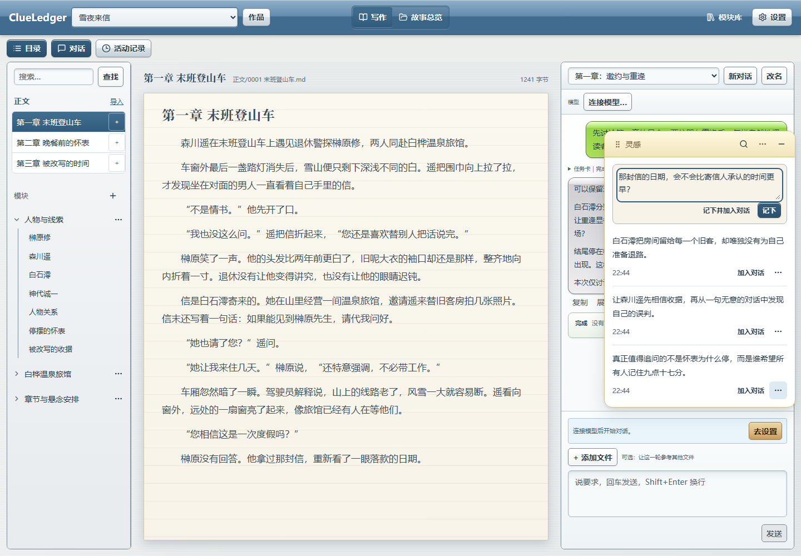
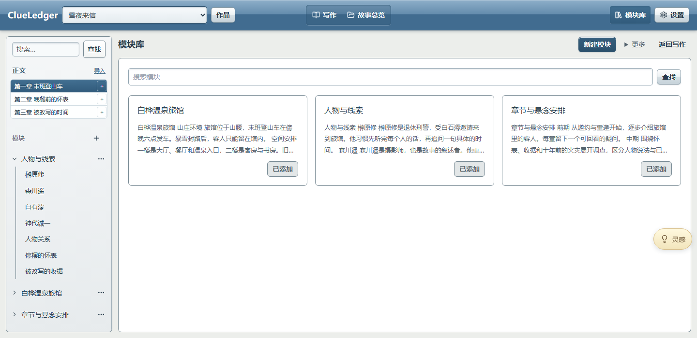
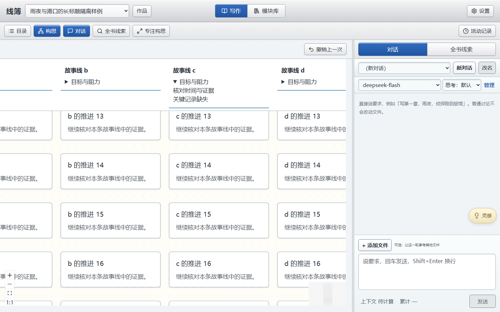

# ClueLedger · 线簿

[简体中文](README.md) · [English](README.en.md)

**Keep ideas, characters, and clues connected to their sources throughout your novel.**

ClueLedger is an AI writing workspace for mystery fiction. Capture ideas, discuss your plot, read and revise chapters, save character profiles and worldbuilding notes, and review story development through a structure map and book-wide clues—all in one place.

You decide where the story goes. ClueLedger brings your writing goals, existing material, and source passages together.

ClueLedger is built on [Tau Agent](https://github.com/huggingface/tau), with a writing experience designed for mystery fiction. Tau's MIT license and copyright information are preserved in the [third-party notices](THIRD_PARTY_NOTICES.md).

*Screenshots use example content in the Chinese-language interface. The structure screenshot demonstrates multiple storylines and frozen column headings. English feature names below describe the corresponding Chinese controls.*

[Capture ideas](#capture-ideas) · [Write through conversation](#write-through-conversation) · [Save and reuse story material](#save-and-reuse-story-material) · [Review the whole story](#review-the-whole-story) · [Get started](#get-started)

## Capture ideas

A line of dialogue, a character's secret, or an unexplained detail can wait in your notes while you keep writing.

Click the floating **Ideas (灵感)** button to open a writing box and your recent notes. Drag the button or panel to a convenient spot, or press **Alt + I** to open and close it.

- **Save (记下)**: keep an idea for later.
- **Save and add to conversation (记下并加入对话)**: save it and attach it to the current conversation.
- **Add to conversation (加入对话)**: select an existing idea, then explain how you want to discuss or use it.

Edit notes in place, search them, review their history, or restore them from Recently Deleted. Adding an idea to a conversation does not send a message; you can finish your instructions before starting.

## Write through conversation

The writing workspace keeps your chapter list, manuscript, and conversation together. Start with a blank project, or import an existing manuscript and continue discussing or revising it.

Describe what you want to accomplish in the current request:

> Let's discuss the suspense in Chapter 1 first. Don't change the manuscript yet.

> Use Chapter 2 as a reference and change the end of Chapter 3 to a snowy night. Only edit Chapter 3 and keep the dialogue.

> Check the chronology across these three chapters. Point out issues with supporting passages, without editing anything yet.

Discussion, writing, and review can be requested separately. Revise the manuscript through conversation. When other chapters or notes matter, add them as references and specify what may be changed.

Use the left sidebar to switch between chapters and modules while keeping the manuscript in view. Hide the sidebar or conversation to focus on reading. Expand the task information in a conversation or open **Activity (活动记录)** to revisit what happened.

## Save and reuse story material

Save character profiles, worldbuilding, clue plans, and chapter outlines as modules. A module can hold one character or a collection of related notes.

Create a module with just a name and some text. Organize it with headings that suit your material. Once added to a project, it appears in the writing sidebar, with its headings available as navigation links.

**How to use it:** click the plus sign beside **Modules (模块)** in the sidebar, then choose existing material or create a new module. Return to the writing workspace to read it, or edit and save it directly.

Everyday edits affect only the current project. Choose **Save a copy to Module Library (另存到模块库)** when you want to reuse your revised material elsewhere. Multiple projects can use the same starting material while keeping their own changes.

## Review the whole story

Open **Story Structure (构思)** in the writing workspace to review how the story develops across stages and storylines. Start from a blank structure, or ask the conversation to create one from your existing modules, organizing the material into event nodes, clues, and connections.

### Follow parallel storylines and their convergence

Storylines appear in columns, with stages progressing downward. Each card shows a key action or change, while connections explain how developments affect one another. A shared convergence appears once across the participating columns. Select a node to read its full arrangement below and open related clues.

Column headings stay at the top of the canvas as you scroll down. They follow horizontal movement and zoom to stay aligned with their cards. Expand **Goals and obstacles (目标与阻力)**, focus on a stage, or use **Focus on Structure (专注构思)** for more space. Cards are arranged automatically; pan, scroll, and zoom the whole canvas to navigate.

### Connect plans to clues and manuscript evidence

After selecting a node, choose **View related clues (查看相关线索)** to see its arrangements on the right. With no node selected, browse book-wide clues. Follow a clue to another planned use or an existing manuscript passage, then return to your place in the structure.

Author truth, future plans, and material already written in the manuscript are presented separately. You can plan clues before drafting prose; planned introductions and resolutions do not become manuscript facts automatically.

Larger creation tasks can prepare a draft in batches before committing the complete structure. If a task needs attention, its draft remains with the original task. Review required constraints and their strength before confirming and continuing. Whether a setting or style preference becomes a requirement remains your decision.

## Get started

1. **Open or create a project.** Use **Projects (作品)** to choose an existing project or create a folder for a new story. Add an existing manuscript through **Import (导入)** in the sidebar.
2. **Choose a model.** Connect and select your model in **Settings → Model Settings (设置 → 模型设置)**. You can still record ideas, edit modules, and read existing material before connecting.
3. **Capture your first idea.** Open Ideas and write down a story concept. Add it to a conversation when you want to discuss it.
4. **Set the goal for this request.** Ask for discussion, new writing, revisions to specific chapters, or a review. Add reference material when needed.
5. **Build a structure and check clues.** Keep reusable material in modules, organize story development in Story Structure, and inspect plans and manuscript evidence through book-wide clues.

## A few things to know

| Your question | How ClueLedger handles it |
|---|---|
| Does saving an idea automatically put it into the novel? | No. Add it to a conversation and explain how you want to use it. |
| Will discussing a possibility change the manuscript? | Ordinary discussion does not edit it. You can also explicitly say, “Let's discuss this first; don't make changes yet.” |
| Will editing a module affect other projects? | Saving within a project affects only that project. Save a copy to Module Library when you want to reuse the changes. |
| Will an interrupted structure task lose its draft? | Prepared work stays with the original task. Follow its instructions to complete arrangements or confirm constraints and continue; it becomes a formal structure only after the complete commit. |
| Can the structure map decide whether my story makes sense? | It helps you review development, follow clues, and check source passages. Character motives, deductions, and the ending still need your judgment. |
