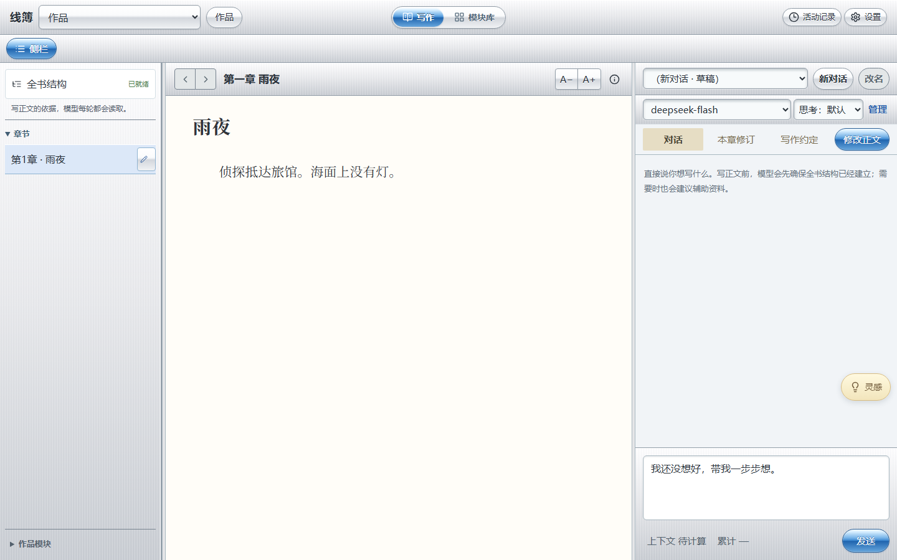
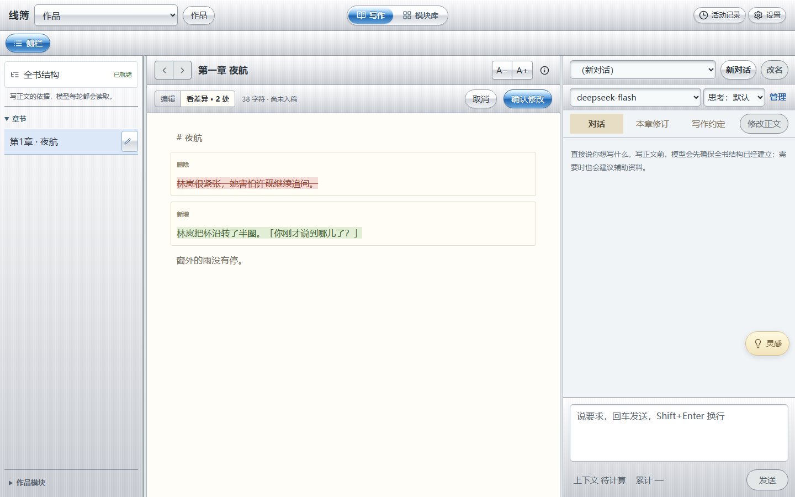
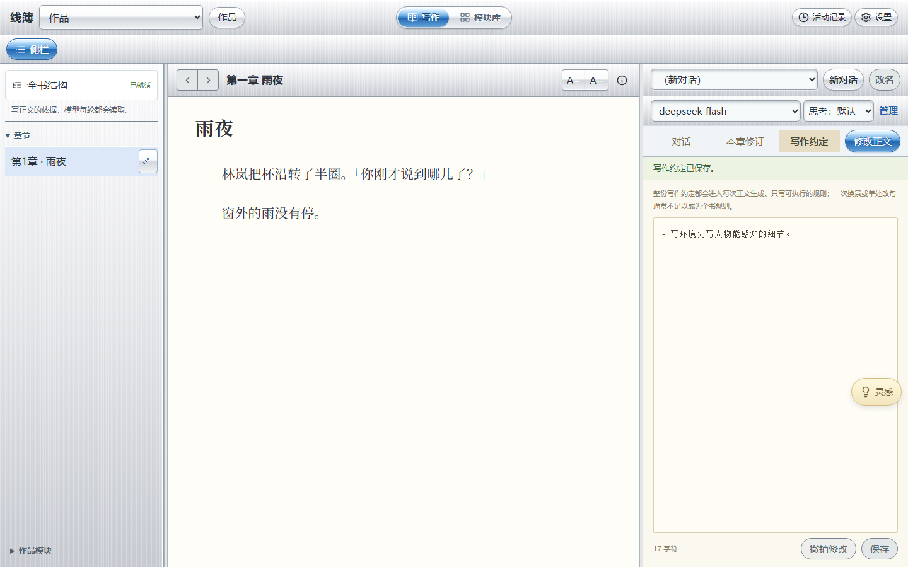

# 线簿 · ClueLedger

[简体中文](README.md) · [English](README.en.md)

**面向悬疑长篇创作的 AI 写作工作台。**

在同一个工作区讨论故事、阅读章节、修改正文、整理长期设定，并回看每次修订。你决定创作方向，线簿围绕当前作品和本次要求协助写作。

当前版本：**1.2.0**。以下展示当前版本的功能；v1.3 章节线索登记暂不上线，设计与实现[保留供后续恢复](dev-notes/v1.3/README.md)。



*截图于 2026-11-05 从当前界面生成，使用隔离测试作品；内容为演示数据。*

[对话写作](#对话写作) · [正文修订](#正文修订) · [写作约定](#写作约定) · [灵感与模块](#灵感与模块) · [开始使用](#开始使用)

## 对话写作

写作台并列显示作品目录、稿纸和对话。可以从一个想法开始，也可以围绕已有章节提出本次目标：

> 我想写一个暴雪封山旅馆里的失踪案，先帮我建立全书结构。

> 先讨论第二章的悬念，暂时不改正文。

> 把第三章结尾改成雪夜，只改这一章，保留人物对话。

左侧「全书结构」保存故事方向、章节安排和长期约束，是模型每轮读取的写作依据。空作品可在对话中先建立结构，再开始正文；后续调整结构和作品资料也从对话提出。

目录用于切换章节、查看结构和阅读作品模块。正文默认处于阅读状态；需要核对处理过程时，可以展开对话中的任务信息，或打开「活动记录」查看。

## 正文修订

需要亲手改稿时，选择当前章节，在对话区点击「修改正文」进入修订模式。

1. 在稿纸上修改文字。
2. 点击「看差异」，核对新增、删除与改写的内容。
3. 点击「确认修改」入稿；取消修订保留原文。

已保存的修改会留下修订记录。通过「本章修订」或最近修订的「查看差异」，可以回看前后文本；需要进一步理解修改时，再按需让模型分析。



## 写作约定

将这部作品需要持续遵循的表达习惯写在「写作约定」中，例如对白方式、叙述距离或环境描写要求。约定可以直接编辑、保存，后续正文生成时会读取。

修订分析会区分写作约定、全书结构、模块资料与当前场景的影响，是否采用建议由作者决定。



## 灵感与模块

- **随手记灵感**：点击悬浮「灵感」按钮或按 **Alt + I**，记录对白、人物秘密或情节想法；支持搜索、修改、历史与最近删除恢复。
- **带入对话**：将灵感或阅读时选中的文字加入当前草稿，再补充要求。加入不会自动发送。
- **整理长期资料**：人物小传、故事背景、旧案和物件等资料可以保存为模块，按需要装入作品并从侧栏阅读。
- **跨作品复用**：模块库支持新建、编辑、查看版本与添加到作品。作品中的资料调整通过对话提出，作品内修改与全局模块库分别管理。

创作中，模型也可以建议创建或装入相关模块。作者选择后继续原任务；不接受建议也可以继续写作。

## 记录与模型设置

「活动记录」用于回看会话、任务、模型请求和文件变化。修订记录呈现具体改稿差异，帮助作者了解内容如何变化。

在「设置 → 模型设置」配置连接和模型，或从对话区切换当前选择。尚未连接模型时，仍可阅读本地内容、记录灵感、手动修订正文和整理模块库；模型生成与分析需要可用连接。

## 开始使用

1. 在「作品 → 打开 / 新建」中选择作品文件夹。
2. 在「设置 → 模型设置」中连接并选择模型。
3. 在对话中描述故事方向与本次目标，让模型先建立全书结构。
4. 选择章节阅读，继续讨论、起草或修改；需要手动改稿时进入「修改正文」。
5. 将长期要求保存在写作约定中，人物和背景等详细资料按需整理为模块。

当前版本不提供正文上传导入或作者直接新建章节的界面入口。新章节从对话创作流程产生。

从源码运行需要 Python 3.12+、Node.js 和 uv。在仓库根目录执行：

```powershell
uv sync
npm --prefix frontend ci
npm --prefix frontend run build
uv run python -m hastings.server
```

随后打开 [本地写作台](http://127.0.0.1:8000)。开发运行与验证方式见[前端说明](frontend/README.md)，各版本状态见[开发记录](dev-notes/README.md)。

线簿基于 [Tau Agent](https://github.com/huggingface/tau) 构建。Tau 的 MIT 许可证与版权信息见[第三方许可声明](THIRD_PARTY_NOTICES.md)。
