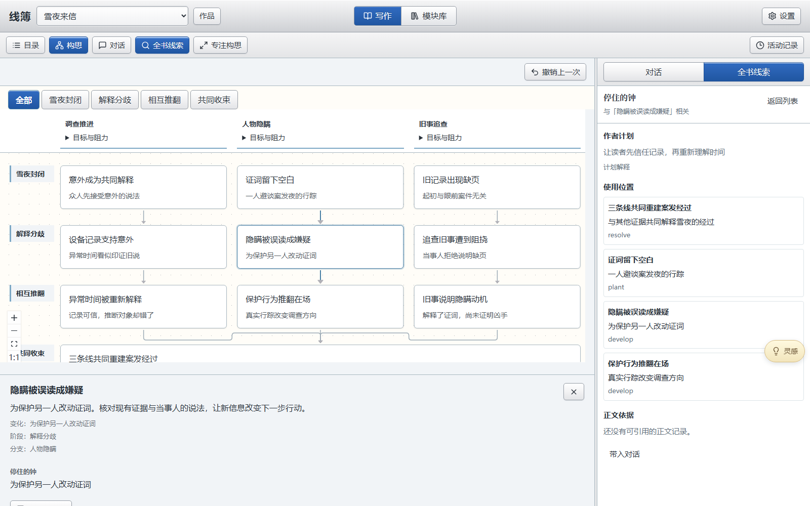

# 线簿 · ClueLedger

[简体中文](README.md) · [English](README.en.md)

**让灵感、人物与线索，在长篇创作中始终有据可查。**

线簿是一款面向悬疑小说的 AI 写作工作台。在同一个地方记录想法、讨论情节、阅读与修改章节，保存人物和世界设定，再通过构思图与全书线索核对故事的发展。

你决定故事往哪里走，线簿帮助你把创作要求、已有内容和原文依据放在一起。

线簿底层基于 [Tau Agent](https://github.com/huggingface/tau)，在其基础上构建面向悬疑小说的创作体验。Tau 的 MIT 许可证与版权信息见[第三方许可声明](THIRD_PARTY_NOTICES.md)。

*以下截图于 2026-10-31 使用当前界面与示例作品《雪夜来信》重新拍摄。*

[随手记灵感](#随手记灵感) · [通过对话推进写作](#通过对话推进写作) · [保存与复用设定](#保存与复用设定) · [回看故事全貌](#回看故事全貌) · [开始使用](#开始使用)

## 随手记灵感

想到一句对白、一个人物秘密，或一处尚未解释的细节，都可以先记下来，继续手头的创作。

点击悬浮的“灵感”按钮，就能看到输入框和最近的记录。按钮与面板都可以拖动，也可以用 **Alt + I** 随时打开或收起。

- **记下**：保存想法，留待以后使用。
- **记下并加入对话**：保存后，带到当前对话中。
- **加入对话**：选取已有灵感，再写下你希望如何讨论或使用它。

记录可以原处修改，也可以搜索、查看历史，或从“最近删除”中恢复。灵感加入对话后不会自动发送；你可以继续补充要求，再决定何时开始。

## 通过对话推进写作

写作台将章节目录、正文阅读和模型对话放在一起。可以从空白作品开始，也可以导入已有正文，接着讨论或修改。

把本次目标说清楚，模型就能围绕相应内容工作：

> 先讨论第一章的悬念，暂时不改正文。

> 参考第二章，把第三章结尾改成雪夜。只改第三章，保留人物对话。

> 检查这三章的时间顺序，指出问题并附上原文依据，先不要修改。

讨论、创作和检查可以分别提出。正文通过对话修改；需要参考其他章节或资料时，可以将它们加入对话，并说明哪些地方允许改动。

左侧目录用于切换章节和模块，中间保留完整阅读空间。目录与对话都能收起，方便专注阅读；需要回看处理过程时，可以展开对话中的任务信息或打开“活动记录”。

## 保存与复用设定

人物小传、世界设定、线索安排和章节计划，都可以保存为模块。一份模块既可以只写一个人物，也可以把一组相关资料放在一起。

新建时只需填写名称与正文，按自己的习惯使用小标题组织内容。添加到作品后，模块会出现在写作侧栏，小标题也会成为可点击的阅读目录。

**使用方法：** 点击侧栏“模块”旁的加号，选择已有内容或新建模块；添加后回到写作页，点击名称即可阅读，也可以直接编辑并保存。

日常保存只影响当前作品。需要在其他作品中复用修改后的内容时，选择“另存到模块库”。同一份设定可以用于多部作品，每部作品继续保留自己的安排。

## 回看故事全貌

点击写作台的“构思”，按故事阶段与故事线查看整体发展。可以从空白开始创建，也可以在对话中提出“根据现有模块生成构思”，将资料组织成事件节点、线索与连接。

### 看多条故事线如何推进与汇合

故事线横向并列，阶段自上而下展开。节点显示关键行动或局面变化，推进关系说明各处怎样相互影响；共同收束的节点跨列显示一次。点击节点，在下方查看完整安排，再进入相关线索。

故事线表头固定在画布顶部，向下浏览时仍能看到名称；横向移动和缩放时，表头与对应列同步。可以展开“目标与阻力”、按阶段收起其他内容，或使用“专注构思”扩大阅读空间。卡片按结构自动排布，整张画布可平移、滚动和缩放。

### 从构思追踪线索与正文依据

选中节点后，打开“全书线索”，右侧显示此处涉及的安排；未选节点时可以浏览全书线索。沿线索打开其他使用位置，或查看已有正文依据，再返回原来的构思位置。

作者真相、未来计划与正文实际写出的内容分别呈现。尚无正文时可以先设计线索；计划中的埋设与回收不会自动成为已经发生的正文事实。

较大的创建任务可以分批准备草稿，完整核对后再整体提交。需要处理时，草稿会保留在原任务中；必需约定须核对内容及强度后确认，再继续。背景或风格上的偏好是否作为必需要求，仍由作者决定。

## 开始使用

1. **打开或新建作品。** 在“作品”中选择已有作品，或为新故事建立一个文件夹；已有正文可以通过目录中的“导入”加入。
2. **选择模型。** 在“设置 → 模型设置”中连接并选择你使用的模型。尚未连接时，也可以先记录灵感、编辑模块和阅读已有内容。
3. **留下第一个想法。** 打开“灵感”，记下一段故事构想；需要讨论时，将它加入对话。
4. **提出本次目标。** 说明是先讨论、撰写内容、修改指定章节，还是只检查问题；需要时加入参考材料。
5. **建立构思，核对线索。** 将需要长期使用的设定加入模块，通过“构思”组织故事发展，并从全书线索查看计划和正文依据。

## 使用时的几个约定

| 你关心的问题 | 线簿的处理方式 |
|---|---|
| 记下灵感，会自动写进小说吗？ | 不会。选择加入对话，并提出创作要求后，再决定如何使用。 |
| 只想讨论一个方案，会改动正文吗？ | 普通讨论不修改正文；也可以明确说“先讨论，暂时不改”。 |
| 修改一份模块，会影响其他作品吗？ | 作品内保存只影响当前作品；需要复用时再另存到模块库。 |
| 构思生成中途停下，草稿会丢失吗？ | 已准备的草稿保留在原任务中；按提示补齐安排或确认约定后继续，整体提交前不会成为正式构思。 |
| 构思图能代替我判断故事是否合理吗？ | 它帮助你看故事发展、追踪线索和核对原文，人物动机、推理与结局仍需要作者判断。 |
