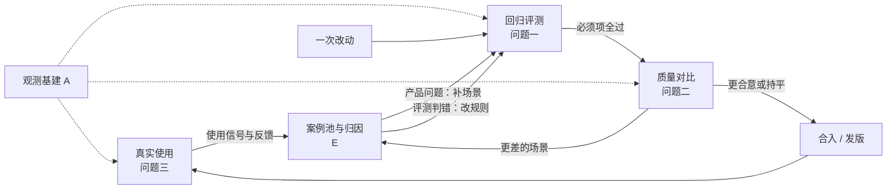

# 评测体系设计

更新于 2026-11-18（修订：总览改为按「评测要支持的决定」组织；2026-11-16 版按白皮书四块组织，对应关系见第 0.6 节）。参考：[Agent 评测白皮书 01：评测全览](https://tech.meituan.com/2026/09/10/Agent-Evaluation-White-Paper-01.html)（[本地](refer/meituan-agent-eval-whitepaper-01.md)）；[看了那么多 Agent 评测文章，为什么依然搭不出自己的评测体系？](https://mp.weixin.qq.com/s?__biz=MzY4ODQ5MTgxNg==&mid=2247483697&sn=bff0defbd34bf4798ce255700156bebc&idx=1)（Gene化论 / Pexo，CIAO；[本地](refer/ciao-agent-eval-pexo-gene.md)）。

状态说明：第 A 节、第 B 节中标注「已实现」的部分对应 `evaluation/` 现有代码；第 0.3 节、第 C—E 节以及第 B 节中标注「待实现」的部分是本次修订提出的方案，尚未实施；第 0.3 节的承诺清单与第 C 节中标注「待作者确认」的规则需作者确认后才作为依据。

## 0. 总览

### 0.1 评测要支持的三个决定

评测的用途是帮作者（同时是唯一的开发者）做决定。线簿需要靠评测回答三个问题，三者的判断者、证据来源和成本都不同，分开设计：

| 编号 | 要回答的问题 | 支持的决定 | 谁来判 | 证据 | 章节 | 现状 |
| --- | --- | --- | --- | --- | --- | --- |
| 一 | 这次改动有没有破坏既有行为 | 这次改动能不能合入、能不能发版 | 程序 | 固定场景下作品前后差异与运行记录 | B | 已实现；案例 1 条，尚未通过 |
| 二 | 写出来的内容合不合作者的意 | 这次改动值不值得保留（提示词、上下文、模型的取舍） | 作者对新旧两版做盲选；是非题由模型先答、作者抽查 | 同一场景下两个版本的产出 | C | 待实现 |
| 三 | 真实使用中哪里不行 | 下一步改什么；补哪些场景 | 作者的实际行为 | 修订、候选、提问、撤销等使用记录 | D | 待实现 |

三者的衔接：



问题一只能说明「没有变坏」；问题二说明「有没有变好」；问题三说明「该看哪里」。只做问题一时，评测通过与作者是否满意之间没有联系。

### 0.2 为什么改组织方式

2026-11-16 版按「评测体系由哪几块组成」组织（离线、在线、Case、观测）。按该版实施后的事实：

| 事实 | 出处 |
| --- | --- |
| v1.0 旧评测 16 条案例第一轮全部停在待复核，结论依赖一个人逐条人工复核 | `dev-notes/versions/v1.0/artifacts/s8/eval-final-console.txt` |
| 重建后程序能判的检查项只有操作规范：只改授权区域、保留片段、经候选入稿、输入含目标章 | `evaluation/harness/checks.py` |
| 作者意图是否达成只在人工项里；模型评委与写作质量列为「暂不做」；在线部分留空 | 2026-11-16 版第 0 节 |
| 评测器约 3900 行、工作台前端约 3000 行、评测器自身的测试约 1600 行；案例 1 条；有记录的两次冒烟（smoke-2、smoke-3）都没有改动正文 | `evaluation/`、`frontend/src/eval-workbench/`、`tests/evaluation/`；[workbench-design.md](workbench-design.md) 第 1、9 节 |
| smoke-3 中模型没有改稿，而是向作者提问；案例格式不能表达「模型提问后怎么办」，这次失败归为产品问题还是案例问题无法在案例中写明 | 同上 |

由此得到三条结论：

1. 程序判分覆盖的操作规范，产品自身的写前检查与候选核对已经在约束；它是回归检查，不回答「好不好」。
2. 「好不好」需要判断者。全靠人工复核不可持续（旧评测），全部排除模型判断则无人可判（重建版）。可行的做法是降低每次判断的成本：作者只做两版比较，是非题交给模型先答。
3. 没有其他用户时，作者自己的使用记录就是「真实反馈」，不需要等在线流量才设计。

### 0.3 「好」的定义：对作者的承诺（草案，待作者确认）

评测标准从作者能感知的承诺出发，每条对应证据与判断者。场景与检查项都应能追溯到其中一条；追溯不到的检查项不设为必须项。

| 编号 | 承诺 | 证据 | 判断者 | 问题 |
| --- | --- | --- | --- | --- |
| P1 | 只动我让动的地方 | 作品前后差异 | 程序 | 一 |
| P2 | 我要求保留的原文逐字保留 | 运行后文件 | 程序 | 一 |
| P3 | 未经我确认，不入稿、不装入或新建模块 | 运行记录、作品状态 | 程序 | 一 |
| P4 | 该问才问：要求明确时直接做；缺关键信息时先问，不替我做决定 | 本轮行为类型（执行 / 提问 / 说明不能做） | 程序 | 一 |
| P5 | 我说过的要求不丢，长对话与历史压缩之后仍然有效 | 模型输入快照；针对该要求的是非题 | 程序 + 是非题 | 一、二 |
| P6 | 新内容接得上前文，不改写已定的线索、设定与全书结构 | 针对前文事实的是非题 | 模型初判，作者抽查 | 二 |
| P7 | 遵守写作约定 | 针对约定条目的是非题；两版盲选 | 模型初判，作者抽查 | 二 |
| P8 | 写出来的内容我愿意留下 | 两版盲选；真实使用中的保留比例 | 作者 | 二、三 |

P6 是悬疑长篇区别于一般写作工具的部分：线索与设定跨章有效，单章内的局部改稿场景测不到它（见 B.2）。

### 0.4 取舍

本项目由一个人开发和复核，在线模型按调用计费。

- **做**：凭运行记录能复现一次失败；一组覆盖作者主要路径的场景；发版前的回归运行；两版对比；使用信号汇总；从失败记录到场景的路径。
- **停止加深**：评测工作台的报告、基线确认与豁免界面；每案 3 次的完整门禁。已实现的部分保留可用，不再追加投入，直到场景数达到 B.2 的目标。
- **不做**：给单篇产出打文学质量分、风格分；灰度对照、影子流量、留出集。
- **推后**：候选核对过程集（B.5），等失败记录指向核对环节再做。

### 0.5 建设顺序与状态

已完成部分沿用原阶段编号；本次修订新增的步骤编号为 R1—R7，按顺序展开，不并行。

| 步 | 内容 | 文档 | 状态 |
| --- | --- | --- | --- |
| 阶段 0 | 最小可归因：受理时作品版本；模型输入可取得；详情分区；失败可见 | [observation-development-plan.md](observation-development-plan.md) | 确定性与 e2e 已通过（在线单例待手测） |
| 阶段 1 | 拆除旧 `eval/` 与旧测试目录 | [stage1-retire-old-eval.md](stage1-retire-old-eval.md) | 已完成 |
| 阶段 2 | 改稿评测集、程序判分、冒烟/门禁、工作台 W1—W7 | [stage2-revise-suite.md](stage2-revise-suite.md)、[workbench-design.md](workbench-design.md) | 已实现；现有案例在线冒烟未通过（smoke-3） |
| R1 | 确认第 0.3 节承诺清单 | 本文 | 待作者确认 |
| R2 | 案例格式增加行为类型与预设回复（B.3）；修正 B.10 的两处偏差；现有案例在线跑通一次 | 实施计划待写 | 未开始 |
| R3 | 检查项拆为通用规则与场景专属两类（B.4） | 实施计划待写 | 未开始 |
| R4 | 沿作者路径把场景补到 12—15 个（B.2） | 实施计划待写 | 未开始 |
| R5 | 质量对比：是非题模型初判、两版盲选（C） | 实施计划待写 | 未开始 |
| R6 | 使用信号汇总与反馈入口（D） | 实施计划待写 | 未开始；建议在 v1.4 上线前完成 |
| R7 | 案例池与归因写回（E） | 实施计划待写 | 未开始 |
| 推后 | 候选核对过程集；每案 3 次门禁、基线确认与豁免；多用户对照实验 | — | 触发条件见 0.4、B.9、D.4 |

### 0.6 与白皮书四块的对应

白皮书的四块仍可作为对照，不再作为本文的章节结构：

| 白皮书模块 | 本文落点 |
| --- | --- |
| 离线评测 / 回测 | B（回归）+ C（质量对比） |
| 在线评测与监控 | D（使用信号）；多用户对照实验推后 |
| Case 挖掘与归因 | E |
| 观测基建 | A |

CIAO 用于回归评测内部的拆测与归因类别（B.1），不作为顶层结构。

---

## A. 观测基建

底线：凭一次运行记录能复现失败（受理时作品版本、模型输入可取得、详情分区、失败可见）。建设细节见[观测开发计划](observation-development-plan.md)。产品侧已落地的接口归入第 F 节「观测」行。

---

## B. 回归评测：这次改动有没有破坏既有行为

固定场景、固定检查标准、尽可能贴近生产的本地模式执行环境；用于版本变更后的回归与发版前检查。回归只能守住已知问题；未知问题靠第 D 节发现。

### B.1 方法学：软件工程 → CIAO → 线簿

只看最终对错，说不清中间哪一步坏了；只测工具或记忆，又说不清分数与交付的关系。软件工程解决同类问题的方式是：先弄清系统由哪些职责组成、各自测什么，再接起来验收，失败时用可观测证据归因。

| 软件工程 | 在 Agent 评测中的对应 |
| --- | --- |
| 单元测试 | 固定其他条件，测单一职责（组件） |
| 集成测试 | 测子流程或完整任务中的信息传递与衔接 |
| 系统 / 端到端测试 | 接近真实用法验收最终交付 |
| 回归测试 | 固定案例集重复运行，确认修复且无退化 |
| 日志 / 指标 / 调用链 | Trace 与证据，支撑归因与复现 |

#### CIAO 四个视角

字母顺序不表示分数权重，也不规定唯一执行顺序。CIAO 嵌在离线怎么拆测、以及 Case 归因类别里，不与第 0 节总图抢顶层。

| 视角 | 含义 | 线簿中怎么用 |
| --- | --- | --- |
| **C** Component | 各职责能否胜任 | 固定其他条件测核对器、判分逻辑、范围/版本契约等 |
| **I** Integration | 组合起来事情能否办成 | 改稿等端到端案例；同次运行上的过程环节检查 |
| **O** Outcome | 交付对作者有没有价值 | 必须项（作品状态）+ 人工项（意图） |
| **A** Attribution | 出了问题该改哪里 | 最小可归因 Trace；失败转案例时的归因类别 |

**两条用法**（同一套框架）：

- **自底向上（主动优化）**：改组件 → 局部 C 通过 → 相关 I / O 回归 → 再发版。
- **自顶向下（问题排查）**：O 发现偏差 → I 缩小到环节 → C 隔离复现 → 修复后再沿 C→I→O 验收。

#### 线簿上的四组职责（C 的拆法）

按运行职责划分，不要求代码恰好四个模块；同一次失败可涉及多组。

| 职责 | 线簿落点 | 冷启动主要测什么 |
| --- | --- | --- |
| **LLM Core** | 理解作者意图、规划改稿、生成候选与回复 | 暂不单独成集；通过端到端与人工项观察；不把模型自述当证据 |
| **Context** | 系统提示、写作约定、会话历史、作品正文、工具结果的选取与组装；历史压缩 | 质量项：提交候选前输入含目标章；长/短历史变量；阶段 0 可取得模型输入 |
| **Action Interface** | 工具解析与调用、Gate、候选提交与核对编排、写前检查、错误码回写 | 过程环节检查；版本冲突拒绝；核对过程集（阶段 3） |
| **Environment** | 作品文件树、Git/版本、本地模式服务、模型 API | 作品隔离复制；环境变化案例；版本身份记录 |

乘号关系（概念上）：交付依赖四组同时可用；不是四个分数相乘。

不先堆组件测：先让端到端场景跑通，再按失败记录拆风险最高的组件。

### B.2 场景集：沿作者路径划分

场景从**作者可感知的功能**划分，并按一部作品从无到有的顺序排列。同一部基础作品的不同进度（空作品、已有第一章、已有三章）各存一份快照，场景之间共用，减少准备作品的成本。

| 路径上的位置 | 回答的问题 | 对应承诺 | 目标场景数 | 现状 |
| --- | --- | --- | --- | --- |
| 空作品起步 | 同一轮建立全书结构，不提前写正文 | P3、P4 | 2 | 待实现 |
| 起草第一章 | 只写目标章，遵守写作约定与全书结构 | P1、P7 | 2 | 待实现 |
| 续写后续章节 | 接上前文，不改写已定线索与设定 | P1、P6 | 3 | 待实现 |
| 对话改稿 | 按指定范围改正文，保留指定原文 | P1、P2、P4 | 3 | 已实现 1 条 |
| 模块建议 | 确认前不装入或新建模块，确认后完成原请求 | P3 | 2 | 待实现 |
| 长对话后的改稿或续写 | 早先提出的要求在历史压缩后仍被遵守 | P5 | 2 | 待实现 |

合计 12—15 个。先求每个位置都有场景，再在失败多的位置加密。

**长对话**不单独成组，作为场景变量：同一场景分别在 `short` / `long` 历史下跑，比较早先约束是否仍被遵守。

**跨章一致性**（P6）的场景必须基于至少三章的作品快照，并在全书结构或前文中埋有后文需要遵守的事实（例如某人物不知道某件事）。检查方式是第 C.3 节的是非题，不是程序判分。

**过程检查**：从端到端同一次运行的运行记录上计算（I 视角），不另建过程案例集。候选核对过程集（B.5）推后。

### B.3 案例格式

一条案例五部分。前三部分模型可见；后两部分只由评测器读取，不进入作品、提示词或作者消息。

| 部分 | 内容 | 模型可见 |
| --- | --- | --- |
| 作品初态 | 全书结构、写作约定、各章正文、已装入模块 | 是 |
| 会话初态 | 预先写好的公开对话历史（`short` / `long`） | 是 |
| 作者输入 | 按序作者消息，以及选中的章节与参考 | 是 |
| 环境变化 | 运行中途对作品文件的外部修改，可选 | 否 |
| 预期与检查项 | 期望行为、允许修改区域、需保留片段、是非题 | 否 |

修改区域用**原文片段锚点**，不用行号。加载时锚点须在初态中存在且唯一，否则加载失败。需要作者中途回答时，把后续消息写进 `steps`，不用模型模拟作者。

**多轮化归**：把历史与当前输入固定下来，评「在这段现场下接下来对不对」。构造历史用于可控复现与回归；完整会话是否正确保存进上下文，仍依赖真实运行与输入快照，不能只靠手工塞满历史。

#### B.3.1 现行格式（已实现）

```yaml
id: revise_ch1_ending_farm_tonight
version: 1
work: base/被解救的罪人
history: short
steps:
  - author: 把第一章结尾改成舒尔茨答应今晚就带姜戈去农场问那三个名，只改这一章；保留姜戈提起五个坑与三个名的那句对白。
    focus: 正文/0001 拔牙人进镇.md
expect:
  region:
    path: 正文/0001 拔牙人进镇.md
    from: "天黑得比钟点早。"
    to: END
  preserve:
    - "霍布斯说他今年挖了五个坑，账上只有三个名。"
checks:
  - id: only_region_changed
    level: must
  - id: region_actually_changed
    level: must
  - id: preserved_verbatim
    level: must
  - id: committed_via_candidate
    level: must
  - id: chapter_in_model_input
    level: quality
  - id: farm_tonight_present
    level: human
    question: 改后的结尾是否明确约定今晚（或当夜）就去农场查问？
```

现行格式的两个问题：

- 只能表达「模型应当直接改稿」这一种预期。smoke-3 中模型向作者提问后本轮结束，场景无法继续，也无法写明提问是否可接受。
- 每条案例要逐项列出程序检查项。多数检查项对所有同类场景都成立，重复书写提高了新增场景的成本。

#### B.3.2 修订格式（待实现，R2—R3）

```yaml
id: revise_ch1_ending_farm_tonight
version: 2
work: base/被解救的罪人@ch1          # 同一作品的进度快照
history: short
promise: [P1, P2, P4]                 # 追溯到 0.3 的承诺
steps:
  - author: 把第一章结尾改成舒尔茨答应今晚就带姜戈去农场问那三个名，只改这一章；保留姜戈提起五个坑与三个名的那句对白。
    focus: 正文/0001 拔牙人进镇.md
expect:
  behavior: act                       # act 直接执行 / ask 应先提问 / decline 应说明不能做
  if_asked:                           # 模型提问时的预设回复；用后继续本场景
    reply: 按你的理解改，范围就是结尾这一段。
    max: 1                            # 超过次数记为失败
  region:
    path: 正文/0001 拔牙人进镇.md
    from: "天黑得比钟点早。"
    to: END
  preserve:
    - "霍布斯说他今年挖了五个坑，账上只有三个名。"
questions:                            # 是非题，见 C.3
  - id: farm_tonight_present
    text: 改后的结尾是否明确约定今晚（或当夜）就去农场查问？
    expect: yes
```

变化说明：

| 字段 | 作用 | 解决的问题 |
| --- | --- | --- |
| `expect.behavior` | 写明本场景期望的行为类型；实际行为类型由运行记录判定 | 「该不该问」成为可判定的检查项（P4），不再混在改稿失败里 |
| `expect.if_asked` | 模型提问时由评测器按预设内容答复并继续；提问次数单独记录 | 一次提问不再导致整条场景无法判分；`behavior: act` 的场景出现提问记为质量项不通过，不记为必须项失败 |
| `promise` | 追溯到承诺清单 | 报告可按承诺汇总，而不只按案例汇总 |
| `questions` | 取代 `human` 级别检查项 | 与程序检查项分开，进入第 C 节流程 |
| 省略 `checks` | 程序检查项按场景类型自动套用（B.4.1） | 新增场景只需写场景本身 |

`behavior: ask` 的场景用于检验「缺关键信息时先问」：作者输入故意缺少必要信息（例如没有指明章节），期望本轮以提问结束且作品无改动。

### B.4 检查项

#### B.4.1 通用规则（对任何一次运行都成立）

通用规则不依赖具体场景的预期值，因此既用于回归场景，也可直接用于扫描真实使用的运行记录（D.1「过程异常」）。

| 规则 | 级别 | 证据 | 承诺 | 现状 |
| --- | --- | --- | --- | --- |
| 作者授权范围之外的文件与段落不变 | 必须 | 运行前后文件差异、范围登记 | P1 | 以场景锚点形式已实现（`only_region_changed`）；按授权范围判定待实现 |
| 正文入稿有提交回执，入稿途径与产品约定一致 | 必须 | 正文变更记录 | P3 | 已实现，判定有偏差，见 B.10 |
| 作品版本在运行中被外部修改时，旧版本的写入被拒，未覆盖外部修改 | 必须 | 提交结果、错误码、运行后文件 | P3 | 已实现（`stale_candidate_rejected`），无场景使用 |
| 未经作者确认，模块装配不变 | 必须 | 装配记录前后对比 | P3 | 待实现 |
| 实际行为类型与 `expect.behavior` 一致 | 必须 | 运行记录中的提问、写入、结束状态 | P4 | 待实现 |
| 首次写入前，模型输入含目标章全文 | 质量 | 模型输入快照 | P5 | 已实现（`chapter_in_model_input`） |
| 登记的修改范围与作者授权一致 | 质量 | 范围登记工具调用 | P1 | 已实现（`scope_matches_auth`），判定有偏差，见 B.10 |
| 回合数、提问次数、输入输出用量、整轮耗时 | 记录，不判定 | 运行记录 | — | 部分已实现 |

模型回复中「已经改好」之类陈述**不作为**任何检查项的证据。核验依据是作品状态与运行记录，不是模型自述。

#### B.4.2 场景专属项

| 项 | 级别 | 证据 | 承诺 | 现状 |
| --- | --- | --- | --- | --- |
| 锚点区域确有改动（与初态不同） | 必须 | 运行前后同文件区域内文本 | P1 | 已实现（`region_actually_changed`） |
| `preserve` 片段逐字保留 | 必须 | 运行后文件 | P2 | 已实现（`preserved_verbatim`） |
| 是非题 | 见 C.3 | 产出、相关原文 | P5—P7 | 人工复核已实现；模型初判待实现 |

#### B.4.3 过程环节（同次运行上的最早失败点）

运行结束后按序计算；端到端失败时报告**最早**异常环节，供归因使用（已实现，工具名映射有偏差，见 B.10）：

| 顺序 | 环节 | 判定 |
| --- | --- | --- |
| 1 | 范围登记 | 登记路径与作者授权一致 |
| 2 | 读取原文 | 首次写入前，输入中有目标章全文 |
| 3 | 提交候选 | 候选在允许区域内，版本指纹为当时当前版本 |
| 4 | 应用核对 | 核对结论与评测必须项一致 |
| 5 | 修补 | 首次核对未过时，修补后通过核对 |
| 6 | 提交 | 有回执；版本冲突时拒绝并重新读取 |

六个环节按改稿流程定义。起草、空作品起步、模块建议的环节在 R4 补场景时各自定义，不强行套用这六个。

### B.5 候选核对过程集（推后）

未开始。按第 0.4 节推后：等回归或使用信号中出现「有问题的候选被核对放过」的记录再做。以下为保留的设计。

候选核对是产品内由模型执行的检查，放过的候选会直接入稿。本集**单独**衡量该判断：

- 固定一批候选：原文、候选正文、作者要求；部分合格，部分故意埋问题（越界、删保留对话、未完成要求等）。
- 正确结论由作者标注。
- 经本地模式专用接口只跑核对阶段，只取核对结论。

指标：漏判率（有问题却通过）按必须项；误判率（合格却不通过）按质量项。标注集以后也可用于校准模型评委（当前不启用模型评委）。

### B.6 执行环境

| 项目 | 规则 |
| --- | --- |
| 调用入口 | 评测对已启动的本地模式服务走 HTTP：受理轮次、订阅事件、读 Trace 与正文记录。评测代码不 `import` 产品业务模块。 |
| 作品隔离 | 每案例每次试验复制独立作品与应用状态；比较版本时不得复用旧试验产物。 |
| 运行参数 | 回合上限、超时、模型参数用产品默认；模型读仓库根 `.env`。 |
| 输入快照 | 经活动设置开启 `capture_inputs`；只决定是否保存输入，不改变发给模型的内容。 |
| 泄漏检查 | 跑后扫描模型输入：检查项编号、人工问题等评测专用文字不得出现；锚点与保留片段来自原文，不扫。 |
| 环境变化 | 订阅读事件流，在案例指定事件后直接改作品目录文件。 |
| 版本身份 | 记录代码提交、未提交改动指纹、提示词/工具定义指纹（可从输入快照算）、模型名、接口主机名。 |
| 预算 | 每批设模型请求总数上限；耗尽后停止，剩余记未运行。 |

### B.7 谁来评：标准、证据与判断者

#### B.7.1 标准与证据

- 先定**成功标准**：哪些必须满足，哪些只比较质量。标准追溯到第 0.3 节的承诺。
- **运行记录**记模型输入输出、工具请求与返回；**作品与提交回执**提供结果证据。二者核对，不采信模型总结。
- 中间决策按**当时可得信息**评；最终交付按**结果**验收。能查却没查的，纳入相关质量项。
- 证据不足标「无法判断」，不硬给结论。

#### B.7.2 三类判断者

| 判断者 | 适合 | 线簿用法 |
| --- | --- | --- |
| 程序 | 字段、文件差异、回执、错误码、行为类型 | 必须项与多数质量项（B.4） |
| 模型 | 有原文依据的是非题 | 初判，作者抽查并统计一致率（C.3）；不用于给产出打分 |
| 作者 | 两版哪个更合意；是非题抽查与分歧裁决 | 两版盲选（C.2）；工作台复核 |

同一次运行可多项并存；任一必须项失败即失败，不因某一判断者通过就整案放行。

评测运行器负责：准备输入与环境、跑被测系统、采证、调用判断者、出报告。它与产品 Agent 自己的运行时职责分离。

### B.8 判分、复核与评测工作台

#### B.8.1 界面分工

| 界面 | 归属 | 职责 |
| --- | --- | --- |
| 运行追踪 | 线簿前端 | 归因阅读；R7 起「加入案例池」 |
| 评测工作台 | 本机独立页，非产品 | Case 库（只读）、结果浏览与复核归因、选题触发运行；R5 起增加两版盲选 |

工作台由评测命令在本机打开。CLI 与工作台共用 `evaluation.harness.runner_api.run_batch`；工作台可写 `data/evaluation/runs` 与 `reviews.json`，不编辑案例 YAML。设计与实施记录见[评测工作台重设计](workbench-design.md)（W1—W7 已落地）。

按第 0.4 节，工作台在 R5 之前不新增功能。

#### B.8.2 结果分类

| 结果 | 含义 | 计入通过率分母 |
| --- | --- | --- |
| 通过 | 必须项与质量项均过，是非题已有结论且与预期一致 | 是 |
| 失败 | 任一检查项失败 | 是 |
| 待复核 | 是非题未复核或「无法判断」 | 是，不算通过 |
| 基础设施错误 | 网络、限流、服务未起等与产品行为无关 | 否，单独计数 |
| 未运行 | 预算耗尽或中止 | 否，单独计数 |

#### B.8.3 离线重评

检查项与判分逻辑带版本号。判错时改逻辑并升版本，用**已存证据**重评，不重调模型。故每次运行须存齐判分证据（已实现：`evaluation score`）。

### B.9 运行档位

| 档位 | 做法 | 何时 | 现状 |
| --- | --- | --- | --- |
| 冒烟 | 选定场景各 1 次 | 改提示词、工具、上下文或模型后按需手跑 | 已实现 |
| 发版前回归 | 全部场景各 1 次；任一必须项失败即不通过；随后做一轮质量对比（C） | 升版本号前；验收文档引用该次报告 | 运行已实现；质量对比待实现 |
| 完整门禁 | 每案 3 次；质量项通过次数比基线少 ≥2 判为退化 | **暂不作为发版条件** | 代码已实现，保留可用 |

完整门禁暂停使用的原因：场景只有 1 条时，重复 3 次得到的是这一条场景的稳定性，不能说明版本整体是否退化，却占用 3 倍的模型调用。启用条件：场景数达到 12 个，且连续两次发版前回归的必须项全部通过。启用后基线、豁免规则沿用 2026-11-16 版：

- 基线为作者最近一次确认的完整门禁运行；报告列案例对比与版本身份差。
- 可豁免部分或全部门禁项；写入报告（决定人、日期、项、原因），与「运行并通过」分开显示。

失败后先修产品或案例，再单例复跑，不短时间大量重复。评测运行器自身的确定性测试用假证据与假客户端，随普通测试跑，不调在线模型。

### B.10 已知偏差（2026-11-18 按源码核对）

以下两处会使现有检查项的结论不可靠，列入 R2，修正前相关结论需对照运行记录人工确认。

| 位置 | 现象 | 影响 |
| --- | --- | --- |
| `evaluation/harness/evidence.py` `extract_commit_receipts` | 产品的 `story_candidate_committed` 事件携带 `paths` 列表，提取时读取的是 `path` / `target_path`，取不到路径；另一分支把 `run_finished` 中 `recording == "committed"` 的全部 `changed_paths` 都标为 `via: candidate` | `committed_via_candidate` 无法区分「经候选入稿」与「经文件工具直接写入」。按[修订学习实施记录](../revision-learning/notes.md)，作者要求模型改稿时正文由文件工具写入，这一必须项的预期与产品现行路径是否一致需先确认 |
| `evaluation/harness/stages.py` 第 10—13 行 | 环节计算查找的工具名（`declare_scope`、`submit_candidate`、`verify_candidate`、`repair_candidate` 等）在 `src/hastings/` 中不存在；产品实际工具名为 `set_task_scope`、`extend_task_scope`、`submit_story_candidate_review`、`repair_story_candidate` 等 | 范围登记、核对、修补三个环节无法从工具调用上定位，`scope_matches_auth` 的关联证据同样取不到 |

---

## C. 质量对比：写出来的内容合不合作者的意

待实现（R5）。本节回答问题二，结论用于决定一次改动（提示词、上下文装配、工具说明、模型）是否保留。

### C.1 为什么用对比，不用打分

- 写作没有标准答案。给单篇产出打 1—5 分，同一个人隔天的分数也会变，分数差无法解释。
- 「同一要求下，这两版哪个更合意」是作者能快速、稳定回答的问题，并且直接对应要做的决定。
- 对比只需要两次运行的产出，不需要为每个场景维护参考答案。

对比的局限：它只说明两版的相对好坏，不说明绝对水平。因此盲选保留「都不能用」选项，其数量单独报告。

### C.2 两版盲选

| 项目 | 规则 |
| --- | --- |
| 对比单位 | 同一场景、同一作品初态下，两个版本各一次运行的产出（改动后的正文片段或新章） |
| 版本 | 由版本身份区分：代码提交、提示词与工具定义指纹、模型名（B.6 已记录） |
| 前提 | 两次运行的必须项都通过；有一方失败的场景不进入盲选，直接计入回归结论 |
| 呈现 | 作者要求、相关前文、两份产出并排；左右顺序随机，隐藏版本身份，提交后才显示 |
| 选项 | 左边更合意 / 右边更合意 / 差不多 / 都不能用；可填一句原因 |
| 记录 | 写入运行目录，含场景、两次运行、选择、原因、时间 |

报告只列计数，不换算成百分比：12—15 个场景的样本下，百分比会让差距看起来比实际可靠。建议的使用规则（待作者确认）：

| 结果 | 结论 |
| --- | --- |
| 新版「更合意」数 ≥ 旧版，且「都不能用」数不增加 | 保留改动 |
| 新版「更合意」数 < 旧版 | 不保留，或针对变差的场景修改后重比 |
| 多数为「差不多」 | 改动对产出没有可感知的影响；是否保留按其他理由决定（成本、耗时） |
| 任一场景「都不能用」 | 该场景转入案例池归因（E），与本次改动是否保留分开处理 |

一轮盲选的成本：每个场景两次模型运行，加作者每个场景约十几秒的阅读与选择。只在发版前回归以及有意比较两种方案时做，不在每次冒烟后做。

### C.3 是非题与模型初判

是非题检验 P5—P7 这类「有原文依据、可以读出来」的要求，例如：

- 改后的结尾是否明确约定今晚就去农场查问？
- 新章中舒尔茨是否表现出已经知道第二章才揭示的那件事？（期望：否）
- 对白是否都没有使用写作约定禁止的句式？

出题规则：

- 每个场景 1—3 题；答案只能是「是 / 否 / 无法判断」，并写明期望答案。
- 只问可以从产出和给定原文中直接核对的事实，不问「写得好不好」「是否有悬念感」。
- 题目文字不进入作品、提示词或作者消息；泄漏检查沿用 B.6。

判定流程：

| 步骤 | 做法 |
| --- | --- |
| 模型初判 | 输入只含题目、本次产出、题目涉及的原文片段；不含被测模型的回复与思考。要求给出答案并引用产出中的原句作为依据；引用在产出中找不到时，该答案作废并记为「无法判断」 |
| 作者复核 | 前 30 条初判全部复核，统计一致率；之后只复核「与期望不一致」「无法判断」以及随机抽取的一部分 |
| 一致率不足 | 建议阈值 90%（待作者确认）。低于阈值的题型退回全部人工复核，并改写题目使其更可核对；不直接改历史结论 |
| 模型选择 | 用 `.env` 的在线模型；初判模型与版本记入运行目录，更换后重新统计一致率 |

2026-11-16 版因缺少标注而暂不启用模型判断。本次修订把模型的职责限定为有原文依据的是非题，并以作者复核的一致率作为启用条件，不涉及质量评分。

### C.4 结论的呈现

一次发版前回归的报告按承诺汇总，而不只按案例汇总：

| 承诺 | 必须项 | 是非题 | 盲选 |
| --- | --- | --- | --- |
| P1 只动我让动的地方 | 通过场景数 / 场景数 | — | — |
| P6 接得上前文 | — | 与期望一致数 / 题数 | — |
| P8 愿意留下 | — | — | 新版更合意 / 旧版更合意 / 差不多 / 都不能用 |

这张表回答「当前版本在哪条承诺上不可靠」，是决定下一步改什么的依据。

---

## D. 使用信号：真实使用中哪里不行

待实现（R6）。本节回答问题三，取代 2026-11-16 版的「在线评测与监控（空槽）」。

### D.1 信号

写作产品里，作者对产出的处理方式本身就是评价。产品已经记录了其中大部分行为，缺少的是按版本汇总。下表「记录基础」为 2026-11-18 按源码核对到的现有记录；汇总逻辑均未实现。

| 信号 | 定义 | 记录基础 | 说明 |
| --- | --- | --- | --- |
| 保留比例 | 模型写入的正文，在作者后续修订之后仍保留的字符占比 | 修订记录保存每次入稿前后的全文与来源（作者、模型、候选、模型写后作者改） | 主指标，对应 P8；按章、按版本汇总 |
| 模型写后作者改稿 | 来源为「模型写后作者改」的修订次数与改动处数 | 同上 | 改动集中的位置提示模型在哪类内容上不合意 |
| 候选未采用 | 候选生成后未入稿 | 候选记录的状态 | — |
| 撤销 | 模型写入后被撤销 | 变更记录 | — |
| 提问 | 每轮提问次数；作者的答复是否只是重复原要求 | 提问记录 | 重复原要求说明这次提问没有必要，对应 P4 |
| 重说 | 同一会话内，作者紧接着对同一目标再次提出相近要求 | 会话记录 | 先人工查看，不急于做自动识别 |
| 过程异常 | 回合耗尽、核对两次未过、版本冲突、写前检查报错；以及 B.4.1 通用规则在真实运行记录上的失败 | 运行记录 | 2026-11-16 版的「规则扫描」 |

使用方式：

- 汇总页按**版本身份**分组，显示每个版本下各信号的次数与保留比例，可下钻到具体轮次的运行追踪。
- 信号用于**指出该看哪里**，不设阈值，不作为发版条件。使用量小的时候，单个数值的波动没有意义；有意义的是「这一类场景反复出现在撤销与改稿记录里」。
- 归属：汇总页放在产品的活动记录内，仅本地模式或作者本人可见。

### D.2 反馈入口

每轮回复旁提供一个「这次不对」入口：

| 步骤 | 内容 |
| --- | --- |
| 触发 | 作者点击；可选一个原因（改多了 / 没按要求 / 接不上前文 / 不该问 / 其他）并填一句说明 |
| 保存 | 该轮的受理时作品版本、会话历史、作者消息与选中、模型与版本身份 |
| 去向 | 本机案例池草稿（E.2）；不自动成为场景 |

入口不要求填写原因，不打断写作。它的作用是让作者在发现问题的当下花几秒钟留下记录，事后再归因。

### D.3 其他用户的数据范围

v1.4 上线后如有其他作者使用，范围约定如下：

| 数据 | 默认 | 说明 |
| --- | --- | --- |
| 信号的次数与比例（不含正文、不含对话文字） | 汇总 | 按版本身份聚合，不关联到具体作品内容 |
| 正文、对话、模型输入 | 不读取 | 只有作者通过反馈入口主动提交某一轮时，才随反馈保存该轮内容，提交前在界面写明会提交哪些内容 |

入库的场景一律使用改写后的合成内容，不直接使用他人作品（与 E.2 一致）。服务器模式下的采集与告知方式在 v1.4 上线验收前单独确认，本文不作为已定方案。

### D.4 仍不做

多用户对照实验、影子流量、自动巡检调度、监控看板。触发条件：有持续的多用户使用量，且 D.1 的信号不足以判断一次改动的影响。

---

## E. 案例池与归因

待实现（R7）。

### E.1 来源

- 反馈入口（D.2）。
- 使用信号下钻时作者认定的问题轮次（D.1）。
- 回归失败与盲选「都不能用」的运行（B、C）。

### E.2 入池与归因

运行追踪上「加入案例池」导出草稿：受理时作品快照、会话历史、作者消息与选中、当时模型。期望行为、区域、是非题与归因由作者填；B.4.3 最早异常环节作参考。

| 归因 | 去向 |
| --- | --- |
| 上下文装配 / 模型理解 / 工具与写前检查、核对、提交等产品问题 | 改写成场景加入回归；修复后跑发版前回归 |
| 评测判错 | 改规则或题目并升版本，用已有证据重评 |
| 表现良好 | 留作盲选时的参照场景 |
| 不是问题 | 关闭，不入集 |

归因类别沿用 B.1 的四组职责。真实作品快照只留本机忽略目录；入库场景用改写后的合成版。

**保真度核对**在本节打通后做：取真实会话按相同初态与作者消息重跑，对照行为是否一致。

---

## F. 产品需补充的接口

| 归属 | 项目 | 步骤 | 约束 |
| --- | --- | --- | --- |
| 观测 | 受理时作品版本；输入可取得；详情分区；失败可见 | 阶段 0（已完成） | 见[观测开发计划](observation-development-plan.md) |
| 回归 | 评测器按预设内容答复模型提问并继续本轮 | R2 | 使用现有答复接口；先核对现有接口是否足够 |
| 使用信号 | 按版本身份汇总修订、候选、撤销、提问记录 | R6 | 仅作者本人可见；不含他人正文 |
| 使用信号 | 「这次不对」反馈入口与保存 | R6 | 前端入口与后端保存接口同批提交 |
| 案例 | 按结果/错误码跨会话筛轮次 | R7 | 遵守作品归属校验 |
| 案例 | 导出轮次为案例草稿 +「加入案例池」 | R7 | 仅本地模式 |
| 回归 | 单独跑候选核对的接口 | 推后 | 仅本地模式 |

仅本地模式接口在服务器模式返回不可用，文案格式：`[错误码] 位置：现象。建议：…`。

---

## G. 与现有文档的关系

- **阶段文档**：[stage1](stage1-retire-old-eval.md)、[stage2](stage2-revise-suite.md)、[workbench-design](workbench-design.md)、[session-handoff-2026-11-16](session-handoff-2026-11-16.md) 记录当时的实施与结论，其中引用的节号对应 2026-11-16 版及更早版本，不逐份改写。
- **结构讲解**：[structure-walkthrough.md](structure-walkthrough.md)、[structure-map.html](structure-map.html) 描述 `evaluation/` 现有实现；总览只以本文第 0 节为准。
- **当前文档**：引用旧评测基线数字的文档，改为引用新评测结果；新结果产生前删旧数字。
- **审查规则**：[REVIEW.md](../../REVIEW.md) 按 `evaluation/` 与 `data/evaluation/` 的范围说明执行。
- **历史版本文档**：v0.1—v1.1 保留原表述；[开发文档导航](../README.md) 注明其所指旧 `eval/` 运行已移除。

实现入口：[evaluation/README.md](../../evaluation/README.md)。
