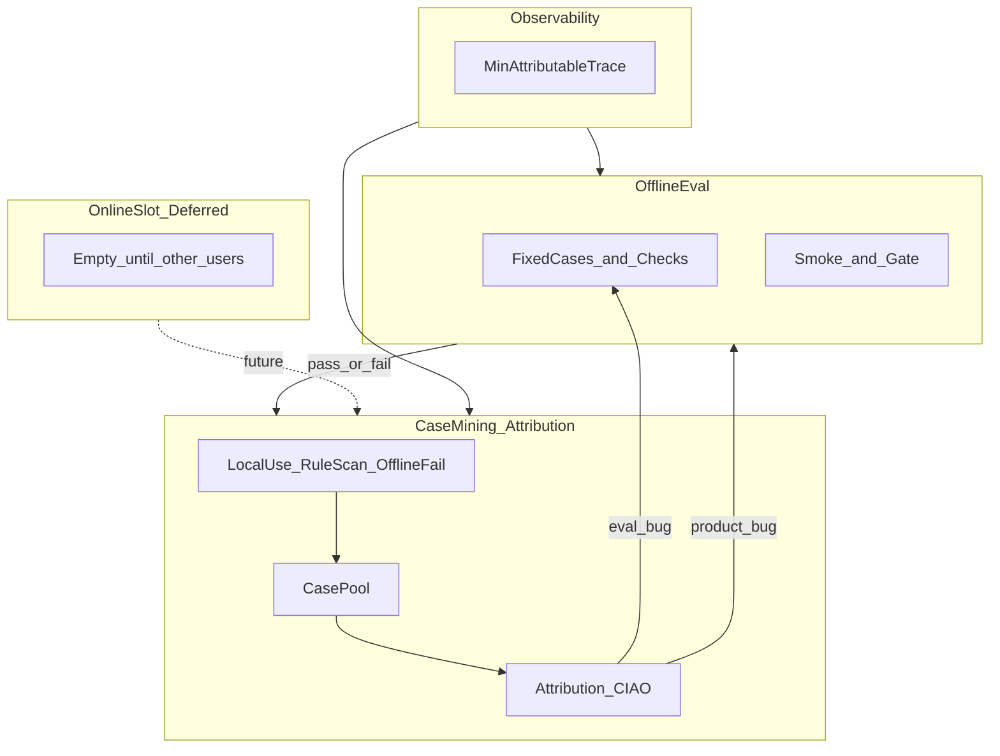
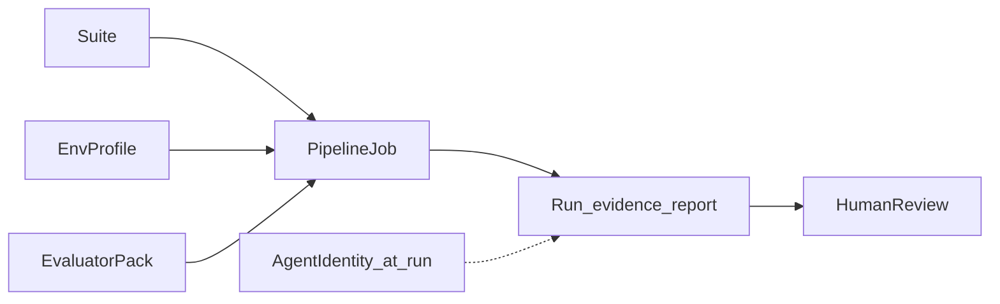

# 评测体系重建设计

更新于 2026-11-18。顶层按「三块能力 + 观测地基」组织；离线块内用 **CIAO** 拆测与归因。参考：[Agent 评测白皮书 01：评测全览](https://tech.meituan.com/2026/09/10/Agent-Evaluation-White-Paper-01.html)（[本地](refer/meituan-agent-eval-whitepaper-01.md)）；[系列 02：商家 AI 助手评测闭环](https://tech.meituan.com/2026/11/17/Agent-Evaluation-White-Paper-02.html)（[本地](refer/meituan-agent-eval-whitepaper-02.md)）；[看了那么多 Agent 评测文章，为什么依然搭不出自己的评测体系？](https://mp.weixin.qq.com/s?__biz=MzY4ODQ5MTgxNg==&mid=2247483697&sn=bff0defbd34bf4798ce255700156bebc&idx=1)（Gene化论 / Pexo，CIAO；[本地](refer/ciao-agent-eval-pexo-gene.md)）。

## 0. 整体评测体系（简化）

评测要回答两个问题：**当前版本的线簿好不好**，以及**不好的地方出在哪个环节**。

完备形态对应白皮书四块：离线评测、在线评测与监控、Case 挖掘与归因、观测基建。本项目暂无其他用户、无线上数据，**按冷启动简化**：在线只留空槽；飞轮靠「离线失败 + 作者本机使用」驱动，不假装已有在线评测。

| 模块 | 本项目占位 | 当前水位 |
| --- | --- | --- |
| 离线评测 / 回测 | `evaluation/` 案例 + must/quality/human + 冒烟/门禁 | 改稿首案已就位，待在线冒烟校准 |
| 在线评测与监控 | **空槽**；触发条件：v1.4 且有其他用户产生真实流量 | L0，不设计细节 |
| Case 挖掘与归因 | 本机失败 / 规则扫描 / 离线失败 → 案例池 → 归因 → 错题集或改检查项 | 设计有、阶段 4 未做 |
| 观测基建 | 最小可归因 Trace（阶段 0） | 已具备底线 |



两条 Loop（入口同为「失败记录 → 归因」）：

| 路径 | 做法 |
| --- | --- |
| 产品迭代 | 本机使用或规则扫描发现问题 → 归因 → 改产品 → 离线门禁确认修复且无退化 |
| 评测迭代 | 发现判错或未覆盖 → 改检查项或补案例 → 用已存证据重评 |

本项目由一个人开发和复核，在线模型按调用计费。取舍：

- **做冷启动所需**：观测达到「凭运行记录能复现一次失败」；有一组能跑的评测集；有发版前回测门禁；有从失败记录到评测案例的路径。
- **暂不做**：在线评测与监控、灰度对照、影子流量、留出集、模型评委、文学质量评分。
- **旧评测**：`eval/` 与旧 `tests/evaluation/` 已在阶段 1 整体删除，不迁移旧数据；新实现在仓库根 `evaluation/`。

### 0.1 逐项展开顺序

总图锁定后只按此顺序展开，不并行摊开终局能力：

1. **离线**：改稿首案在线冒烟 + 工作台人工项（校准检查项）
2. **离线**：候选核对过程集（C）
3. **Case**：失败转案例 + 归因写回
4. **离线**：起草 / 空作品 / 模块等端到端集
5. **在线**：有真实用户后再开设计

### 0.2 建设阶段（按总图顺序）

先最小可归因（观测底线），再离线闭环，再 Case 回流；在线触发后再开。

| 阶段 | 归属总图 | 内容 | 文档 | 状态 |
| --- | --- | --- | --- | --- |
| 0 最小可归因 | 观测 | 受理时作品版本；模型输入可取得；详情分区；失败可见 | [observation-development-plan.md](observation-development-plan.md) | 确定性与 e2e 已通过（在线单例待手测） |
| 1 拆除旧评测 | — | 删除旧 `eval/` 与旧测试目录 | [stage1-retire-old-eval.md](stage1-retire-old-eval.md) | 已完成 |
| 2 改稿评测集 | 离线 | 基础作品、案例、程序判分、冒烟/门禁、工作台报告+复核 | [stage2-revise-suite.md](stage2-revise-suite.md) | T0–T6 完成；待作者在线冒烟 |
| 3 候选核对过程集 | 离线 · C | 本地模式核对接口；漏判/误判 | 实施计划待写 | 未开始 |
| 4 失败转案例 | Case 挖掘 | 规则扫描、加入案例池、归因与错题集 | 实施计划待写 | 未开始 |
| 5 其余端到端集 | 离线 | 起草续写、空作品起步、模块建议；长对话作变量 | 实施计划待写 | 未开始 |
| — 在线 | 在线空槽 | AB / 影子 / 巡检 / 多用户监控 | 触发后再写 | 未开始 |

---

## A. 观测基建

底线：凭一次运行记录能复现失败（受理时作品版本、模型输入可取得、详情分区、失败可见）。建设细节见[观测开发计划](observation-development-plan.md)。产品侧已落地的接口归入第 E 节「观测」行。

---

## B. 离线评测 / 回测

固定评测集、固定检查标准、尽可能贴近生产的本地模式执行环境；用于版本变更后的回测与发版门禁。离线只能守住已知问题；未知靠本机使用与日后在线补。

### B.0 评测资产模型

对照系列 02 评测平台截图的六块资产，线簿冷启动用仓库文件 + 本机工作台承接同等职责，不建 SaaS。工作台一级导航收成四入口（资产 / 开跑 / 报告 / 质检），资产页内切换套件·环境·检查项；本机裁剪（资产只读、无 LLM Judge 编辑器）；详见[评测工作台重设计](workbench-design.md)。

#### B.0.1 六块职责与落盘

| 资产 | 职责 | 源真相 |
| --- | --- | --- |
| **Task / Suite** | 可执行题目；Suite 是选题清单 | `evaluation/cases/*.yaml`、`evaluation/suites/*.yaml` |
| **评测环境 Env** | 服务、预算、采证开关等运行条件档案 | `evaluation/envs/*.yaml`；作品初态仍在 `evaluation/works/base/` |
| **Evaluator 包** | 可复用检查注册表（required / diagnostic） | `evaluation/evaluators/*.yaml`；实现在 `harness/checks.py` |
| **Pipeline Job** | 一次绑定 Suite × Env × Evaluator → 批量执行 | `data/evaluation/jobs/<id>/job.json` → `data/evaluation/runs/<run>/` |
| **评测报告** | 完成率、分层检查、成本；可下钻证据 | `runs/<run>/report.json` + 证据包 |
| **人工质检** | human 项复核、归因；校准集后置 | `runs/<run>/reviews.json`；`evaluation/calibration/` 占位 |



硬规则：一次 Job 固定 Suite × Env × Evaluator 包版本；Agent 版本身份在跑时写入 report（代码提交等），不预造假版本文件。改题、改尺子、改被测配置不要混在同一轮解释里。

与双 Loop：产品迭代改 Agent 后用同一 Suite/Evaluator 回归；评测迭代改 Evaluator 或补 Task 后用已存证据重评。与 CIAO：Evaluator 的 required 项主要服务 O/I；diagnostic 服务诊断；C 视角过程集仍单独建设（B.5）。

#### B.0.2 最小 Schema

**案例**（`cases/`）：保留 `work` / `history` / `steps` / `expect`。优先 `evaluator: <包 id>`，可用 `checks_extra` 追加；无 `evaluator` 时仍接受内嵌 `checks`（迁移兼容）。

**Suite**（`suites/`）：`id`、`cases`、`default_env`、`default_evaluator`、`mode`、`repeat`。

**Env**（`envs/`）：`id`、`capture_inputs`、`budget`、`timeout_s`、`work_baseline`（固定从 `works/base` 复制）；`base_url` 由 Job 启动时覆盖。

**Evaluator 包**（`evaluators/`）：`id`、`version`、检查项列表（`id` / `level` / `role` / `impl` / 可选 `question`）。`role: required` 参与任务成功判定；`role: diagnostic` 只进分层报告。须进门禁质量退化的项标 `required` + `level: quality`。LLM Judge 仅预留，当前不启用。

**Job**：`suite`、`env`、`evaluator`、`mode`、`repeat`、`out`、状态与时间；执行仍走 `runner_api.run_batch`。

**报告**：除既有字段外写入 `suite_id`、`env_id`、`evaluator_id`、`evaluator_version`，供版本比较核对基线。

### B.1 方法学：软件工程 → CIAO → 线簿

只看最终对错，说不清中间哪一步坏了；只测工具或记忆，又说不清分数与交付的关系。软件工程解决同类问题的方式是：先弄清系统由哪些职责组成、各自测什么，再接起来验收，失败时用可观测证据归因。

| 软件工程 | 在 Agent 评测中的对应 |
| --- | --- |
| 单元测试 | 固定其他条件，测单一职责（组件） |
| 集成测试 | 测子流程或完整任务中的信息传递与衔接 |
| 系统 / 端到端测试 | 接近真实用法验收最终交付 |
| 回归测试 | 固定案例集重复运行，确认修复且无退化 |
| 日志 / 指标 / 调用链 | Trace 与证据，支撑归因与复现 |

#### CIAO 四个视角

字母顺序不表示分数权重，也不规定唯一执行顺序。CIAO 嵌在离线怎么拆测、以及 Case 归因类别里，不与第 0 节总图抢顶层。

| 视角 | 含义 | 线簿中怎么用 |
| --- | --- | --- |
| **C** Component | 各职责能否胜任 | 固定其他条件测核对器、判分逻辑、范围/版本契约等 |
| **I** Integration | 组合起来事情能否办成 | 改稿等端到端案例；同次运行上的过程环节检查 |
| **O** Outcome | 交付对作者有没有价值 | 必须项（作品状态）+ 人工项（意图） |
| **A** Attribution | 出了问题该改哪里 | 最小可归因 Trace；失败转案例时的归因类别 |

**两条用法**（同一套框架）：

- **自底向上（主动优化）**：改组件 → 局部 C 通过 → 相关 I / O 回归 → 再发版。
- **自顶向下（问题排查）**：O 发现偏差 → I 缩小到环节 → C 隔离复现 → 修复后再沿 C→I→O 验收。

#### 线簿上的四组职责（C 的拆法）

按运行职责划分，不要求代码恰好四个模块；同一次失败可涉及多组。

| 职责 | 线簿落点 | 冷启动主要测什么 |
| --- | --- | --- |
| **LLM Core** | 理解作者意图、规划改稿、生成候选与回复 | 暂不单独成集；通过端到端与人工项观察；不把模型自述当证据 |
| **Context** | 系统提示、写作约定、会话历史、作品正文、工具结果的选取与组装；历史压缩 | 质量项：提交候选前输入含目标章；长/短历史变量；阶段 0 可取得模型输入 |
| **Action Interface** | 工具解析与调用、Gate、候选提交与核对编排、写前检查、错误码回写 | 过程环节检查；版本冲突拒绝；核对过程集（阶段 3） |
| **Environment** | 作品文件树、Git/版本、本地模式服务、模型 API | 作品隔离复制；环境变化案例；版本身份记录 |

乘号关系（概念上）：交付依赖四组同时可用；不是四个分数相乘。

冷启动不先堆组件测：先一条改稿 I+O 冒烟闭环，再按失败拆最高风险的 C（候选核对）。

### B.2 评测集划分（主要是 I + O）

端到端评测集从**作者可感知的功能**划分，一组功能对应一组案例：

| 评测集 | 回答的问题 | 顺序 |
| --- | --- | --- |
| 对话改稿 | 按指定范围改正文，候选核对后入稿 | 第一组，走通全部流程 |
| 章节起草与续写 | 只写目标章，接上前文，遵守写作约定 | 改稿跑通后 |
| 空作品起步 | 同一轮建立全书结构，不提前写正文 | 改稿跑通后 |
| 模块建议 | 确认前不装入/新建模块，确认后完成原请求 | 改稿跑通后 |

**长对话**不单独成组，作为案例变量：同一案例分别在 `short` / `long` 历史下跑，比较早先约束是否仍被遵守，以及压缩是否丢掉作者要求（偏 Context）。

**过程检查**：多数从端到端同一次运行的 Trace 上计算（I 视角），不另建过程案例集。**唯一单独建立的过程集**是候选核对（B.5）：它决定候选能否入稿，需要独立衡量判断是否可靠（C 视角）。

### B.3 案例格式

一条案例五部分。前三部分模型可见；后两部分只由评测器读取，不进入作品、提示词或作者消息。

| 部分 | 内容 | 模型可见 |
| --- | --- | --- |
| 作品初态 | 全书结构、写作约定、各章正文、已装入模块 | 是 |
| 会话初态 | 预先写好的公开对话历史（`short` / `long`） | 是 |
| 作者输入 | 按序作者消息，以及选中的章节与参考 | 是 |
| 环境变化 | 运行中途对作品文件的外部修改，可选 | 否 |
| 预期与检查项 | 允许修改区域、需保留片段、检查项与级别 | 否 |

修改区域用**原文片段锚点**，不用行号。加载时锚点须在初态中存在且唯一，否则加载失败。需要作者中途回答时，把后续消息写进 `steps`，不用模型模拟作者。

**多轮化归**：把历史与当前输入固定下来，评「在这段现场下接下来对不对」。构造历史用于可控复现与回归；完整会话是否正确保存进 Context，仍依赖真实运行与输入快照，不能只靠手工塞满历史。

```yaml
id: revise_ch1_ending_farm_tonight
version: 1
work: base/被解救的罪人
history: short
steps:
  - author: 把第一章结尾改成舒尔茨答应今晚就带姜戈去农场问那三个名，只改这一章；保留姜戈提起五个坑与三个名的那句对白。
    focus: 正文/0001 拔牙人进镇.md
expect:
  region:
    path: 正文/0001 拔牙人进镇.md
    from: "天黑得比钟点早。"
    to: END
  preserve:
    - "霍布斯说他今年挖了五个坑，账上只有三个名。"
checks:
  - id: only_region_changed
    level: must
  - id: preserved_verbatim
    level: must
  - id: committed_via_candidate
    level: must
  - id: farm_tonight_present
    level: human
    question: 改后的结尾是否明确约定今晚（或当夜）就去农场查问？
```

**基础作品**：优先从本机真实作品目录做冻结快照（现行树：`正文/`、`STRUCTURE.md`、`STYLE.md`、`prose-ledger.json`、`.clueledger/`、按需 `灵感本/`、`.git`）；评测说明放在同级 `*.meta/`，不进作品根、不进试验复制。追加或重拍快照时提高 meta 版本号。不使用已废弃的 `设定集/角色小传/`。

### B.4 对话改稿：检查项、过程环节与 CIAO 对照

#### B.4.1 检查项（O 为主，部分质量项贴 Context / Action）

| 级别 | 检查项 | 证据 | 视角 |
| --- | --- | --- | --- |
| 必须 | 仅锚点区域变化，其他文件与本章其他位置不变 | 运行前后文件差异 | O |
| 必须 | 锚点区域确有改动（与初态不同） | 运行前后同文件区域内文本 | O |
| 必须 | `preserve` 片段逐字保留 | 运行后文件 | O |
| 必须 | 正文经候选核对后提交，有提交回执 | 正文变更记录 | O / I |
| 必须 | 环境变化案：旧版本候选被拒，未覆盖外部修改 | 提交结果、错误码、运行后文件 | O + Environment |
| 质量 | 首次提交候选前，模型输入含目标章全文 | 模型输入快照 | C · Context |
| 质量 | 登记的修改范围与作者授权一致 | 范围登记工具调用 | C · Action / I |
| 人工 | 改动满足作者意图（如「当晚去农场」） | 差异、原文、模型回复 | O |

模型回复中「已经改好」之类陈述**不作为**任何检查项的证据。核验依据是作品状态与 Trace，不是 Agent 自述。

#### B.4.2 过程环节（I：同次运行上的最早失败点）

运行结束后按序计算；端到端失败时报告**最早**异常环节，供 A 使用：

| 顺序 | 环节 | 判定 |
| --- | --- | --- |
| 1 | 范围登记 | 登记路径与作者授权一致 |
| 2 | 读取原文 | 首次提交候选前，输入中有目标章全文 |
| 3 | 提交候选 | 候选在允许区域内，版本指纹为当时当前版本 |
| 4 | 应用核对 | 核对结论与评测必须项一致 |
| 5 | 修补 | 首次核对未过时，修补后通过核对 |
| 6 | 提交 | 有回执；版本冲突时拒绝并重新读取 |

同时记录模型回合数、输入输出用量、整轮耗时。

### B.5 候选核对过程集（C）

候选核对是产品内由模型执行的检查，放过的候选会直接入稿。本集**单独**衡量该判断：

- 固定一批候选：原文、候选正文、作者要求；部分合格，部分故意埋问题（越界、删保留对话、未完成要求等）。
- 正确结论由作者标注。
- 经本地模式专用接口只跑核对阶段，只取核对结论。

指标：漏判率（有问题却通过）按必须项；误判率（合格却不通过）按质量项。标注集以后也可用于校准模型评委（当前不启用模型评委）。

### B.6 执行环境

| 项目 | 规则 |
| --- | --- |
| 调用入口 | 评测对已启动的本地模式服务走 HTTP：受理轮次、订阅事件、读 Trace 与正文记录。评测代码不 `import` 产品业务模块。 |
| 作品隔离 | 每案例每次试验复制独立作品与应用状态；比较版本时不得复用旧试验产物。 |
| 运行参数 | 回合上限、超时、模型参数用产品默认；模型读仓库根 `.env`。 |
| 输入快照 | 经活动设置开启 `capture_inputs`；只决定是否保存输入，不改变发给模型的内容。 |
| 泄漏检查 | 跑后扫描模型输入：检查项编号、人工问题等评测专用文字不得出现；锚点与保留片段来自原文，不扫。 |
| 环境变化 | 订阅读事件流，在案例指定事件后直接改作品目录文件。 |
| 版本身份 | 记录代码提交、未提交改动指纹、提示词/工具定义指纹（可从输入快照算）、模型名、接口主机名。 |
| 预算 | 每批设模型请求总数上限；耗尽后停止，剩余记未运行。 |

保真度核对在「失败转案例」打通后做：取真实会话按相同初态与作者消息重跑，对照行为。

### B.7 谁来评：标准、证据与 Grader

#### B.7.1 标准与证据

- 先定**成功标准**：哪些必须满足，哪些只比较质量。
- **Trace** 记模型输入输出、工具请求与返回；**作品与提交回执**提供结果证据。二者核对，不采信 Agent 总结。
- 中间决策按**当时可得信息**评；最终交付按**结果**验收。能查却没查的，纳入相关质量/过程项。
- 证据不足标「无法判断」，不硬给分。

#### B.7.2 三类裁判（当前启用程序 + 人）

| 裁判 | 适合 | 线簿现状 |
| --- | --- | --- |
| 程序（Code as a Judge） | 字段、文件差异、回执、错误码 | 必须项与多数质量项 |
| 模型（LLM as a Judge） | 语义同义、理由是否回应需求 | **暂不用**；人工项有足够标注后再测一致率 |
| 人工（Human as a Judge） | 意图是否达成、体验 | `human` 项 + 工作台复核 |

同一次任务可多项并存；任一必须项失败即失败，不因某一裁判通过就整案放行。

评测 Harness 负责：准备输入与环境、跑被测系统、采证、调 Grader、出报告。它与产品 Agent 自己的运行时职责分离。

### B.8 判分、复核与评测工作台

#### B.8.1 界面分工

| 界面 | 归属 | 职责 |
| --- | --- | --- |
| 运行追踪 | 线簿前端 | A：归因阅读；阶段 4 起「加入案例池」 |
| 评测工作台 | 本机独立页，非产品 | 四入口：资产 / 开跑 / 报告 / 质检（资产只读；报告同屏 KPI+Trace；质检为跨 run 队列） |

工作台由评测命令在本机打开。CLI 与工作台共用 `evaluation.harness.runner_api.run_batch`；工作台可写 `data/evaluation/runs`、`data/evaluation/jobs` 与 `reviews.json`，阶段 4 前不编辑案例 YAML。

#### B.8.2 结果分类

| 结果 | 含义 | 计入通过率分母 |
| --- | --- | --- |
| 通过 | 必须项与质量项均过，人工项已复核通过 | 是 |
| 失败 | 任一检查项失败 | 是 |
| 待复核 | 人工项未复核或「不确定」 | 是，不算通过 |
| 基础设施错误 | 网络、限流、服务未起等与产品行为无关 | 否，单独计数 |
| 未运行 | 预算耗尽或中止 | 否，单独计数 |

#### B.8.3 工作台界面水位

**W1–W7 + 资产台 D0–D3**：证据包、Trace 下钻、复核与归因、运行总览矩阵、Suite/Env/Evaluator 只读、Job 跑批已落地。

**四入口壳（已落地减法）**：导航与页面主任务按[评测工作台重设计](workbench-design.md) §4；报告列表进同屏详情（默认失败试验）；质检独立队列（`GET /api/qa/queue`，写回仍用 `reviews.json`）；开跑为选套件单页；归因保存后可跳开跑 / 资产·检查项。硬校验「资产不完全可比」、校准集标记等见 workbench §9 未做清单。

前后一致性抽查可后做：隐去原结论重判，不一致则改问题描述，不直接改历史结论。

#### B.8.4 后续与离线重评

| 能力 | 何时 |
| --- | --- |
| 工作台选题触发冒烟/门禁 | **已落地**（W7）；CLI 仍可用 |
| 案例池、Trace 草稿编辑 | 阶段 4 |
| 确认基线、登记豁免 | 完整门禁稳定后 |

检查项与判分逻辑带版本号。判错时改逻辑并升版本，用**已存证据**重评，不重调模型。故每次运行须存齐判分证据。

### B.9 回测门禁（回归）

| 规则 | 内容 |
| --- | --- |
| 必须项 | 任案例任试验必须项失败 → 门禁不通过 |
| 质量项 | 每案 3 次；通过次数比基线少 ≥2 → 退化不通过；只少 1 → 提示不阻断 |
| 候选核对过程集 | 漏判按必须项；误判按质量项 |
| 基线 | 作者最近一次确认的完整门禁运行；报告列案例对比与版本身份差 |

运行分两档：

- **冒烟**：每案 1 次；改提示词、工具、上下文或模型后按需手跑。
- **完整门禁**：每案 3 次；升版本号前跑；验收文档引用该次报告。

Harness 自身确定性测试用假证据/假客户端，随普通测试跑，不调在线模型。

**豁免**：可豁免部分或全部门禁项；写入报告（决定人、日期、项、原因），与「运行并通过」分开显示。

同一 Case 可多 Trial；稳定性指标（如 pass@k / pass^k）在案例足够后再引入正式报告，冷启动先保证必须项与质量退化规则可执行。

---

## C. Case 挖掘与归因

本阶段没有线上反馈；Case 源用本机替身。有其他用户后再把「用户反馈 / 在线采样」加进来源表。

### C.1 发现

- 作者本机使用中发现问题。
- 规则扫描：回合耗尽、两次核对未过、版本冲突、写前检查报错、提交后被撤销等。
- 离线冒烟 / 门禁失败样本。

随机抽查与其他用户反馈：有真实用户后再加。

### C.2 入池与归因

运行追踪上「加入案例池」导出草稿：受理时作品快照、会话历史、作者消息与选中、当时模型。预期、检查项与归因由作者填；B.4.2 最早异常环节作参考。

| 归因 | 去向 |
| --- | --- |
| Context / LLM / Action（工具、Gate、核对、提交）等产品问题 | 改写成案例进错题集；修复后跑门禁 |
| 评测判错 | 改检查项升版本，用已有证据重评 |
| 表现良好 | 进黄金集 |
| 不是问题 | 关闭，不入集 |

真实作品快照只留本机忽略目录；入库案例用改写后的合成版。

---

## D. 在线评测与监控（空槽）

触发条件：v1.4 上线且有其他用户产生真实流量。触发前不设计 AB、影子流量、巡检调度、多用户监控指标。

届时再补：在线评测（效果好不好）、在线监控（系统是否正常运转）、二者交集上的巡检。离线守已知，在线发现未知——当前用「作者本机使用 + 规则扫描」临时承担「发现未知」的入口。

---

## E. 产品需补充的接口（按总图归类）

| 归属 | 项目 | 阶段 | 约束 |
| --- | --- | --- | --- |
| 观测 | 受理时作品版本；输入可取得；详情分区；失败可见 | 0 | 见[观测开发计划](observation-development-plan.md) |
| 离线 | 单独跑候选核对的接口 | 3 | 仅本地模式 |
| Case | 按结果/错误码跨会话筛轮次 | 4 | 遵守作品归属校验 |
| Case | 导出轮次为案例草稿 +「加入案例池」 | 4 | 仅本地模式 |
| 在线 | — | 触发后再列 | 暂无 |

仅本地模式接口在服务器模式返回不可用，文案格式：`[错误码] 位置：现象。建议：…`。

---

## F. 与现有文档的关系

- **当前文档**：如 [Agent 面试复盘](../agent-interview.md) 中旧基线数字，改为引用新评测结果；新结果产生前删旧数字。
- **审查规则**：[REVIEW.md](../../REVIEW.md) 按 `evaluation/` 与 `data/evaluation/` 更新范围说明。
- **历史版本文档**：v0.1—v1.1 保留原表述；在 [开发文档导航](../README.md) 注明其所指旧 `eval/` 运行已移除。
- **结构讲解**：[structure-walkthrough.md](structure-walkthrough.md)、[structure-map.html](structure-map.html) 描述 `evaluation/` 实现；总图只以本文第 0 节为准。

实现入口：[evaluation/README.md](../../evaluation/README.md)。
