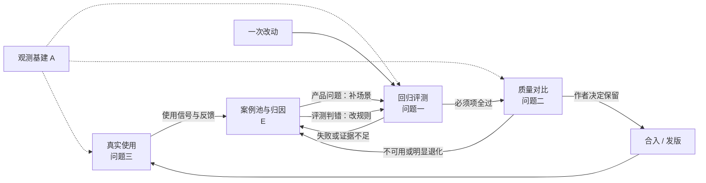

# 评测体系设计

更新于 2026-11-18。参考 [Agent 评测白皮书 01：评测全览](https://tech.meituan.com/2026/09/10/Agent-Evaluation-White-Paper-01.html)（[本地](refer/meituan-agent-eval-whitepaper-01.md)）及 [看了那么多 Agent 评测文章，为什么依然搭不出自己的评测体系？](https://mp.weixin.qq.com/s?__biz=MzY4ODQ5MTgxNg==&mid=2247483697&sn=bff0defbd34bf4798ce255700156bebc&idx=1)（Gene化论 / Pexo，CIAO，[本地](refer/ciao-agent-eval-pexo-gene.md)）。

第 0.3 节八条承诺已由作者确认。本次修订明确了发版条件、作者对两份稿的判断方式，以及先做哪两条案例。第 A 节和第 B 节标注的现有能力沿用原实施状态，新判定规则及第 C—E 节的功能待实施。

## 0. 总览

### 0.1 评测要支持的三个决定

评测帮助作者做三个决定。作者亲自判断哪些约定一旦被破坏就会影响使用，以及每份稿子是否愿意留下。程序核对可查证的授权和作品变化，模型可以先为常规事实题找依据。

| 编号 | 要回答的问题 | 支持的决定 | 谁来判 | 证据 | 章节 | 现状 |
| --- | --- | --- | --- | --- | --- | --- |
| 一 | 授权和关键叙事约定有没有守住 | 这次改动能不能合入、能不能发版 | 程序核对授权与作品状态，作者裁决关键叙事约束 | 作品前后差异、运行记录、相关正文与明确约定 | B | 已有 1 条改稿案例，在线冒烟尚未通过。关键叙事复核待实施 |
| 二 | 两份稿各自能否入稿，哪份更合意 | 这次改动值不值得保留（提示词、上下文、模型的取舍） | 作者分别验稿并盲选；常规事实题可由模型初判 | 同一场景下两个版本的产出 | C | 待实施，首轮手工验证 |
| 三 | 真实使用中哪里不行 | 下一步改什么；补哪些场景 | 作者的实际行为 | 修订、候选、提问、撤销等使用记录 | D | 待实现 |

三者的衔接：



发版须有证据证明本次必跑场景的适用必须项通过。作者再依据可用性、偏好、耗时和成本决定是否保留改动。真实使用中发现的问题可以进入案例池，转成下一次可以验收的场景。

### 0.2 为什么改组织方式

2026-11-16 版按「评测体系由哪几块组成」组织（离线、在线、Case、观测）。按该版实施后的事实：

| 事实 | 出处 |
| --- | --- |
| v1.0 旧评测 16 条案例第一轮全部停在待复核，结论依赖一个人逐条人工复核 | `dev-notes/versions/v1.0/artifacts/s8/eval-final-console.txt` |
| 重建后程序能判的检查项只有操作规范：只改授权区域、保留片段、经候选入稿、输入含目标章 | `evaluation/harness/checks.py` |
| 作者意图是否达成只在人工项里；模型评委与写作质量列为「暂不做」；在线部分留空 | 2026-11-16 版第 0 节 |
| 评测器约 3900 行、工作台前端约 3000 行、评测器自身的测试约 1600 行；案例 1 条；有记录的两次冒烟（smoke-2、smoke-3）都没有改动正文 | `evaluation/`、`frontend/src/eval-workbench/`、`tests/evaluation/`；历史工作台记录见 G |
| smoke-3 中模型没有改稿，而是向作者提问；案例格式不能表达「模型提问后怎么办」，这次失败归为产品问题还是案例问题无法在案例中写明 | 同上 |

由此得到三条结论：

1. 程序判分覆盖的操作规范，产品自身的写前检查与候选核对已经在约束；它是回归检查，不回答「好不好」。
2. 作者的复核时间优先用于关键叙事约束、入稿可用性和两版偏好。常规事实题可由模型先找依据，再由作者抽查。
3. 没有其他用户时，作者自己的使用记录就是「真实反馈」，不需要等在线流量才设计。

### 0.3 「好」的定义：对作者的承诺（已确认，2026-11-18）

评测标准从作者能感知的承诺出发，每条对应证据与判断者。场景与检查项都应能追溯到其中一条；追溯不到的检查项不设为必须项。当前以本表八条为准；后续增删需再确认。

| 编号 | 承诺 | 证据 | 判断者 | 问题 |
| --- | --- | --- | --- | --- |
| P1 | 只动我让动的地方 | 作品前后差异 | 程序 | 一 |
| P2 | 我要求保留的原文逐字保留 | 运行后文件 | 程序 | 一 |
| P3 | 只有得到相应授权才入稿、装入或新建模块 | 作者指令与确认事件、入稿回执、作品前后状态 | 程序 | 一 |
| P4 | 该问才问：要求明确时直接做；缺关键信息时先问，不替我做决定 | 首轮行为、补答是否改变授权、最终结果 | 程序 | 一、二 |
| P5 | 我说过的要求不丢，长对话与历史压缩之后仍然有效 | 模型输入快照；针对该要求的是非题 | 程序 + 是非题 | 一、二 |
| P6 | 新内容接得上前文，不改写已定的线索、设定与全书结构 | 已定事实和揭露时点、相关前文与产出 | 关键约束由作者裁决，常规事实题可由模型初判 | 一、二 |
| P7 | 遵守写作约定 | 针对约定条目的是非题；两版盲选 | 模型初判，作者抽查 | 二 |
| P8 | 写出来的内容我愿意留下 | 每份稿的可用性、两版偏好、实际采用或撤销及反馈 | 作者 | 二、三 |

P6 优先检验线簿在悬疑长篇里的价值。模型可以知道全书真相，写某一章时仍要守住这一刻角色知道什么、读者能看到什么。把作者已经定下、违反后需要返工的约束列为必须项。叙事节奏、暗示方式和遣词留给作者比较（见 B.2、B.4.2）。

### 0.4 取舍

本项目由一个人开发和复核，在线模型按调用计费。

- **先做**：一次指定范围的改稿、一次遵守揭露时点的续写，再把一次真实失败手工转成案例，拿到修复前后的对比证据。
- **验证后扩展**：按已经能说明问题的场景扩充覆盖，逐步加入质量对比界面、使用信号汇总和案例转存。工作台报告、基线确认、豁免和每案重复运行维持现有投入（见 B.9）。
- **不做**：给单篇产出打文学质量分、风格分；灰度对照、影子流量、留出集。
- **推后**：候选核对过程集（B.5），等失败记录指向核对环节再做。

### 0.5 建设顺序与状态

已完成部分沿用原阶段编号。R2、R3 先各跑通一条主案例，R4 先用真实反馈验证修复前后是否可比较，再决定扩充哪些路径。

| 步 | 内容 | 文档 | 状态 |
| --- | --- | --- | --- |
| 阶段 0 | 最小可归因：受理时作品版本；模型输入可取得；详情分区；失败可见 | 历史观测计划（G） | 确定性与 e2e 已通过（在线单例待手测） |
| 阶段 1 | 拆除旧 `eval/` 与旧测试目录 | 历史阶段 1 计划（G） | 已完成 |
| 阶段 2 | 改稿评测集、程序判分、冒烟/门禁、工作台 W1—W7 | 历史阶段 2 与工作台记录（G） | 已实现；现有案例在线冒烟未通过（smoke-3） |
| R1 | 确认第 0.3 节承诺清单 | 本文 | 已完成（2026-11-18） |
| R2 | 修正入稿与过程证据，记录首轮和补答结果，在线跑通「只改第一章结尾」 | [R2 实施计划](plans/r2-implementation-plan.md) | 已有实施计划，待实施 |
| R3 | 跑通「续写时守住揭露时点」，由作者手工确认关键叙事约束。按两条案例的实际需要抽出共用规则 | B.2、B.4 | 待实施 |
| R4 | 从一次真实失败手工制作最小案例，保留修复前后的同案结果并做出取舍。再按作者路径与真实问题扩充案例 | B.2、E.2 | 待实施 |
| R5 | 自动记录版本身份（B.10），实现分别判可用性与两版盲选，再按题型验证模型初判 | C | 待实施 |
| R6 | 汇总已有使用信号并补反馈入口 | D | 待实施；建议在 v1.4 上线前完成 |
| R7 | 案例池与归因写回（E） | 实施计划待写 | 未开始 |
| 推后 | 候选核对过程集；每案 3 次门禁、基线确认与豁免；多用户对照实验 | — | 触发条件见 0.4、B.9、D.4 |

### 0.6 与白皮书四块的对应

白皮书的四块仍可作为对照，不再作为本文的章节结构：

| 白皮书模块 | 本文落点 |
| --- | --- |
| 离线评测 / 回测 | B（回归）+ C（质量对比） |
| 在线评测与监控 | D（使用信号）；多用户对照实验推后 |
| Case 挖掘与归因 | E |
| 观测基建 | A |

CIAO 用于回归评测内部的拆测与归因类别（B.1），不作为顶层结构。

---

## A. 观测基建

一次运行的记录应足够重建当时的现场并复查失败证据（受理时作品版本、模型输入、详情分区、失败状态）。重跑时记录问题是否再次出现。建设细节见 G 节的历史观测计划，产品接口见 F 节。

---

## B. 回归评测：这次改动有没有破坏既有行为

在贴近生产的本地模式下，用固定场景检查一次改动是否守住作者授权、原稿和已定的关键叙事约束。真实使用中的新问题由 D、E 两节收集并转成案例。

### B.1 方法学：软件工程 → CIAO → 线簿

只看最终对错，说不清中间哪一步坏了；只测工具或记忆，又说不清分数与交付的关系。软件工程解决同类问题的方式是：先弄清系统由哪些职责组成、各自测什么，再接起来验收，失败时用可观测证据归因。

| 软件工程 | 在 Agent 评测中的对应 |
| --- | --- |
| 单元测试 | 固定其他条件，测单一职责（组件） |
| 集成测试 | 测子流程或完整任务中的信息传递与衔接 |
| 系统 / 端到端测试 | 接近真实用法验收最终交付 |
| 回归测试 | 固定案例集重复运行，确认修复且无退化 |
| 日志 / 指标 / 调用链 | Trace 与证据，支撑归因与复现 |

#### CIAO 四个视角

字母顺序不表示分数权重，也不规定唯一执行顺序。CIAO 嵌在离线怎么拆测、以及 Case 归因类别里，不与第 0 节总图抢顶层。

| 视角 | 含义 | 线簿中怎么用 |
| --- | --- | --- |
| **C** Component | 各职责能否胜任 | 固定其他条件测核对器、判分逻辑、范围/版本契约等 |
| **I** Integration | 组合起来事情能否办成 | 改稿等端到端案例；同次运行上的过程环节检查 |
| **O** Outcome | 交付对作者有没有价值 | 授权与作品状态、关键叙事复核、入稿可用性 |
| **A** Attribution | 出了问题该改哪里 | 最小可归因 Trace；失败转案例时的归因类别 |

**两条用法**（同一套框架）：

- **自底向上（主动优化）**：改组件 → 局部 C 通过 → 相关 I / O 回归 → 再发版。
- **自顶向下（问题排查）**：O 发现偏差 → I 缩小到环节 → C 隔离复现 → 修复后再沿 C→I→O 验收。

#### 线簿上的四组职责（C 的拆法）

按运行职责划分，不要求代码恰好四个模块；同一次失败可涉及多组。

| 职责 | 线簿落点 | 冷启动主要测什么 |
| --- | --- | --- |
| **LLM Core** | 理解作者意图、规划改稿、生成候选与回复 | 暂不单独成集；通过端到端与人工项观察；不把模型自述当证据 |
| **Context** | 系统提示、写作约定、会话历史、作品正文、工具结果的选取与组装；历史压缩 | 质量项：提交候选前输入含目标章；长/短历史变量；阶段 0 可取得模型输入 |
| **Action Interface** | 工具解析与调用、Gate、候选提交与核对编排、写前检查、错误码回写 | 检查过程环节和版本冲突。候选核对过程集见 B.5 |
| **Environment** | 作品文件树、Git/版本、本地模式服务、模型 API | 作品隔离复制；环境变化案例；版本身份记录 |

乘号关系（概念上）：交付依赖四组同时可用；不是四个分数相乘。

不先堆组件测：先让端到端场景跑通，再按失败记录拆风险最高的组件。

### B.2 场景集：沿作者路径划分

先准备两条场景，分别验证作者能否放心让线簿动稿，以及线簿能否参与悬疑长篇的续写。

1. **只改第一章结尾（R2）**。作者要求舒尔茨答应今晚去农场查问，并保留姜戈提到五个坑和三个名字的原话。核对结尾是否完成要求、原话是否保留、授权范围外是否变化、实际入稿路径是否符合本次授权。另记是否多问了一轮。
2. **续写时守住揭露时点（R3）**。用现有基础作品的第一章和[结构里第二章的安排](../../evaluation/works/base/被解救的罪人/STRUCTURE.md)。作者要求续写第二章，读者可以看见农场外像马蹄印的车辙，运输真相按既定安排保留到后面。作者确认新章推进了车辙线索，同时核对旁白与人物是否提前把棺材运血写成已知事实。允许人物怀疑或猜错。后续可补一条作者明确要求提前揭晓的成对案例，验证评测采用最新授权。

两条通过后，R4 先把一次真实失败转成案例，再扩充覆盖。下表是扩充方向。按需求复用同一作品的不同进度快照，减少准备成本。

| 路径上的位置 | 回答的问题 | 对应承诺 | 目标场景数 | 现状 |
| --- | --- | --- | --- | --- |
| 空作品起步 | 同一轮建立全书结构，不提前写正文 | P3、P4 | 2 | 待实现 |
| 起草第一章 | 只写目标章，遵守写作约定与全书结构 | P1、P7 | 2 | 待实现 |
| 续写后续章节 | 接上前文，不改写已定线索与设定 | P1、P6 | 3 | 待实现 |
| 对话改稿 | 按指定范围改正文，保留指定原文 | P1、P2、P4 | 3 | 已实现 1 条 |
| 模块建议 | 确认前不装入或新建模块，确认后完成原请求 | P3 | 2 | 待实现 |
| 长对话后的改稿或续写 | 早先提出的要求在历史压缩后仍被遵守 | P5 | 2 | 待实现 |

12—15 个是后续覆盖量的参考。先验证每次新增的场景可以帮助做决定，优先补关键承诺或真实写作反复遇到的问题。

**长对话**不单独成组，作为场景变量：同一场景分别在 `short` / `long` 历史下跑，比较早先约束是否仍被遵守。

**跨章一致性**（P6）的场景保留足以核实的相关前文、当前章节位置和全书结构。案例标清哪些属于作者知道的真相、哪些已在正文写出、哪些人物在当前场景知情。作者确认关键约束，常规事实题见 C.3。

**过程检查**：从端到端同一次运行的运行记录上计算（I 视角），不另建过程案例集。候选核对过程集（B.5）推后。

### B.3 案例格式

一条案例五部分。前三部分模型可见；后两部分只由评测器读取，不进入作品、提示词或作者消息。

| 部分 | 内容 | 模型可见 |
| --- | --- | --- |
| 作品初态 | 全书结构、写作约定、各章正文、已装入模块 | 是 |
| 会话初态 | 预先写好的公开对话历史（`short` / `long`） | 是 |
| 作者输入 | 按序作者消息，以及选中的章节与参考 | 是 |
| 环境变化 | 运行中途对作品文件的外部修改，可选 | 否 |
| 预期与检查项 | 期望行为、允许修改区域、需保留片段、是非题 | 否 |

修改区域用**原文片段锚点**，不用行号。加载时锚点须在初态中存在且唯一，否则加载失败。需要作者中途回答时，把后续消息写进 `steps`，不用模型模拟作者。

**多轮化归**：把历史与当前输入固定下来，评「在这段现场下接下来对不对」。构造历史用于可控复现与回归；完整会话是否正确保存进上下文，仍依赖真实运行与输入快照，不能只靠手工塞满历史。

#### B.3.1 现行格式（已实现）

```yaml
id: revise_ch1_ending_farm_tonight
version: 1
work: base/被解救的罪人
history: short
steps:
  - author: 把第一章结尾改成舒尔茨答应今晚就带姜戈去农场问那三个名，只改这一章；保留姜戈提起五个坑与三个名的那句对白。
    focus: 正文/0001 拔牙人进镇.md
expect:
  region:
    path: 正文/0001 拔牙人进镇.md
    from: "天黑得比钟点早。"
    to: END
  preserve:
    - "霍布斯说他今年挖了五个坑，账上只有三个名。"
checks:
  - id: only_region_changed
    level: must
  - id: region_actually_changed
    level: must
  - id: preserved_verbatim
    level: must
  - id: committed_via_candidate
    level: must
  - id: chapter_in_model_input
    level: quality
  - id: farm_tonight_present
    level: human
    question: 改后的结尾是否明确约定今晚（或当夜）就去农场查问？
```

现行格式的两个问题：

- 只能表达「模型应当直接改稿」这一种预期。smoke-3 中模型向作者提问后本轮结束，场景无法继续，也无法写明提问是否可接受。
- 每条案例要逐项列出程序检查项。多数检查项对所有同类场景都成立，重复书写提高了新增场景的成本。

#### B.3.2 修订格式（待实现，R2—R3）

```yaml
id: revise_ch1_ending_farm_tonight
version: 2
work: base/被解救的罪人@ch1          # 同一作品的进度快照
history: short
promise: [P1, P2, P3, P4]             # 追溯到 0.3 的承诺
steps:
  - author: 把第一章结尾改成舒尔茨答应今晚就带姜戈去农场问那三个名，只改这一章；保留姜戈提起五个坑与三个名的那句对白。
    focus: 正文/0001 拔牙人进镇.md
expect:
  behavior: act                       # act 直接执行 / ask 应先提问 / decline 应说明不能做
  if_asked:                           # 对匹配的澄清问题预设答复
    reply: 范围就是第一章结尾，从天黑那一段起；保留指定对白。
    max: 1                            # 达到上限后停止自动答复
  region:
    path: 正文/0001 拔牙人进镇.md
    from: "天黑得比钟点早。"
    to: END
  preserve:
    - "霍布斯说他今年挖了五个坑，账上只有三个名。"
questions:                            # 是非题，见 C.3
  - id: farm_tonight_present
    text: 改后的结尾是否明确约定今晚（或当夜）就去农场查问？
    expect: "yes"
    level: must                       # R2 由作者手工核实任务交付
```

变化说明：

| 字段 | 作用 | 解决的问题 |
| --- | --- | --- |
| `expect.behavior` | 写明场景期望的首轮行为，并用运行记录核对 | 提问时机和改稿结果可以分别判断（P4） |
| `expect.if_asked` | 实际提问与预设答复能对上、且答复不增加原授权时续一轮。记录首轮行为、最终结果及提问次数 | 可以区分多问一轮和最终未完成。问到其他章节、模块确认等授权事项时，保留问题并停止自动答复 |
| `promise` | 追溯到承诺清单 | 报告可按承诺汇总，而不只按案例汇总 |
| `questions` | 保存有明确依据的事实题。交付要求和关键叙事约束可预先标明为必须项，保留出处与适用范围 | 常规题进入 C.3，必须项由作者复核（B.4.2）。首两条场景可先手工记录 |
| 省略 `checks` | 待两个主案例验证规则后，按场景类型套用共用程序检查项（B.4.1） | 同类场景复用已经验证的检查 |

`behavior: ask` 的场景故意缺少必要信息，且当前会话与选中内容无法补足。期望本轮提出相关问题，并在作者回复前保持作品原样。

### B.4 检查项

#### B.4.1 通用规则

按本轮实际操作选用规则。真实运行的扫描只使用能从该轮取得作者授权和相关证据的检查，场景专属的预期留在 B.4.2。

| 作者动作 | 授权边界与检查 |
| --- | --- |
| 请求建议、试写或查看草稿 | 对话或候选可以出现，核对正式稿未变 |
| 在支持直接入稿的入口明确要求改稿 | 原指令提供本轮授权，核对目标、范围和直接入稿回执 |
| 在候选入口发起写作或改稿 | 按入口约定核对候选、核对或采用记录及实际提交回执。需要作者采用的入口，在采用前核对正式稿未变 |
| 提到模块、收到装入或创建建议 | 核对该模块得到明确确认后再装入或新建，之前装配与模块状态保持原样 |

| 规则 | 级别 | 证据 | 承诺 | 现状 |
| --- | --- | --- | --- | --- |
| 作者授权范围之外的文件与段落不变 | 必须 | 运行前后文件差异、范围登记 | P1 | 以场景锚点形式已实现（`only_region_changed`）；按授权范围判定待实现 |
| 正文入稿前具备本入口要求的授权，且有对应的提交回执 | 必须 | 作者指令或确认事件、入稿路径、正文变更记录 | P3 | 已有回执检查，判定有偏差，见 B.10 |
| 作品版本在运行中被外部修改时，旧版本的写入被拒，未覆盖外部修改 | 必须 | 提交结果、错误码、运行后文件 | P3 | 已实现（`stale_candidate_rejected`），无场景使用 |
| 缺少关键授权时先暂停，保持作品不变并询问必要信息 | 必须 | 本轮可用信息、提问与写入事件、作品状态 | P4 | 待实现 |
| 模块装入或新建有作者明确确认 | 必须 | 确认事件、操作对象、装配与模块记录 | P3 | 待实现 |
| 首次写入前，模型输入含目标章全文 | 质量 | 模型输入快照 | P5 | 已实现（`chapter_in_model_input`） |
| 登记的修改范围与作者授权一致 | 质量 | 范围登记工具调用 | P1 | 已实现（`scope_matches_auth`），判定有偏差，见 B.10 |
| 回合数、提问次数、输入输出用量、整轮耗时 | 记录，不判定 | 运行记录 | — | 部分已实现 |

模型回复中「已经改好」之类陈述**不作为**任何检查项的证据。核验依据是作品状态与运行记录，不是模型自述。

#### B.4.2 场景专属项

| 项 | 级别 | 证据 | 承诺 | 现状 |
| --- | --- | --- | --- | --- |
| 锚点区域确有改动（与初态不同） | 必须 | 运行前后同文件区域内文本 | P1 | 已实现（`region_actually_changed`） |
| `preserve` 片段逐字保留 | 必须 | 运行后文件 | P2 | 已实现（`preserved_verbatim`） |
| 明确请求最终完成 | 必须 | 终态、实际产出和作者复核 | 本场景对应的承诺 | 待实施，R2 先手工复核 |
| 要求明确时是否直接执行 | 质量 | 首轮行为与实际提问 | P4 | 待实施（R2） |
| 预先标记的关键叙事约束成立，例如未提前确认真凶、未擅改已定事实 | 必须，由作者裁决 | 有适用范围的作者约定、前文及产出 | P6 | 待实施，R3 先手工复核 |
| 常规事实题 | 质量，见 C.3 | 产出、相关原文 | P5—P7 | 人工复核已实现；模型初判待实施 |

添加关键叙事必须项时，写清约定的出处、适用到哪一章或哪一段，以及怎样的正文算违反。作者明确修改约定时，按本轮有效的约定判断。作者记录结论与依据，证据不足时标为待复核。

#### B.4.3 过程环节（同次运行上的最早失败点）

运行结束后按序计算；端到端失败时报告**最早**异常环节，供归因使用（已实现，工具名映射有偏差，见 B.10）：

| 顺序 | 环节 | 判定 |
| --- | --- | --- |
| 1 | 范围登记 | 登记路径与作者授权一致 |
| 2 | 读取原文 | 首次写入前，输入中有目标章全文 |
| 3 | 提交候选 | 候选在允许区域内，版本指纹为当时当前版本 |
| 4 | 应用核对 | 核对结论与其职责内的评测检查一致 |
| 5 | 修补 | 首次核对未过时，修补后通过核对 |
| 6 | 提交 | 有回执；版本冲突时拒绝并重新读取 |

六个环节按改稿流程定义。R3 的续写和后续新增场景按实际流程定义适用环节。

### B.5 候选核对过程集（推后）

未开始。按第 0.4 节推后：等回归或使用信号中出现「有问题的候选被核对放过」的记录再做。以下为保留的设计。

候选核对是产品内由模型执行的检查，放过的候选会直接入稿。本集**单独**衡量该判断：

- 固定一批候选：原文、候选正文、作者要求；部分合格，部分故意埋问题（越界、删保留对话、未完成要求等）。
- 正确结论由作者标注。
- 经本地模式专用接口只跑核对阶段，只取核对结论。

指标：漏判率（有问题却通过）按必须项；误判率（合格却不通过）按质量项。标注集以后也可用于校准模型评委（当前不启用模型评委）。

### B.6 执行环境

| 项目 | 规则 |
| --- | --- |
| 调用入口 | 评测对已启动的本地模式服务走 HTTP：受理轮次、订阅事件、读 Trace 与正文记录。评测代码不 `import` 产品业务模块。 |
| 作品隔离 | 每案例每次试验复制独立作品与应用状态；比较版本时不得复用旧试验产物。 |
| 运行参数 | 回合上限、超时、模型参数用产品默认；模型读仓库根 `.env`。 |
| 输入快照 | 经活动设置开启 `capture_inputs`；只决定是否保存输入，不改变发给模型的内容。 |
| 泄漏检查 | 跑后扫描模型输入：检查项编号、人工问题等评测专用文字不得出现；锚点与保留片段来自原文，不扫。 |
| 环境变化 | 订阅读事件流，在案例指定事件后直接改作品目录文件。 |
| 版本身份 | 记录代码提交、未提交改动指纹、提示词/工具定义指纹（可从输入快照算）、模型名、接口主机名。现状：报告只记录代码提交短号，其余待实现（B.10）。 |
| 预算 | 每批设模型请求总数上限；耗尽后停止，剩余记未运行。 |

### B.7 谁来评：标准、证据与判断者

#### B.7.1 标准与证据

- 先定**成功标准**：哪些必须满足，哪些只比较质量。标准追溯到第 0.3 节的承诺。
- **运行记录**记模型输入输出、工具请求与返回；**作品与提交回执**提供结果证据。二者核对，不采信模型总结。
- 中间决策按**当时可得信息**评；最终交付按**结果**验收。能查却没查的，纳入相关质量项。
- 证据不足标「无法判断」，不硬给结论。

#### B.7.2 三类判断者

| 判断者 | 适合 | 线簿用法 |
| --- | --- | --- |
| 程序 | 字段、文件差异、回执、错误码、行为类型 | 必须项与多数质量项（B.4） |
| 模型 | 有原文依据的事实题 | 常规题初判，关键题可辅助查找依据（C.3） |
| 作者 | 关键叙事约束、各稿可用性、两版偏好 | 复核关键必须项（B.4.2），分别判断可用性后盲选（C.2） |

程序和作者分别裁决各自负责的必须项。任一必须项失败，发版回归即不通过。所有适用必须项都有通过证据时，发版回归才通过。

评测运行器负责：准备输入与环境、跑被测系统、采证、调用判断者、出报告。它与产品 Agent 自己的运行时职责分离。

### B.8 判分、复核与评测工作台

#### B.8.1 界面分工

| 界面 | 归属 | 职责 |
| --- | --- | --- |
| 运行追踪 | 线簿前端 | 归因阅读；R7 起「加入案例池」 |
| 评测工作台 | 本机独立页，非产品 | 四入口：资产 / 开跑 / 报告 / 质检（资产只读；报告同屏 KPI+Trace；质检跨 run 队列）；R5 起增加两版盲选 |

工作台由评测命令在本机打开。CLI 与工作台共用 `evaluation.harness.runner_api.run_batch`；工作台可写 `data/evaluation/runs`、`data/evaluation/jobs` 与 `reviews.json`，R5 前不编辑案例 YAML。原工作台设计与实施记录见 G。

按第 0.4 节，工作台在 R5 之前不继续加深报告 / 基线 / 豁免类功能；已落地的四入口与质检队列保留使用。

#### B.8.2 结果分类

按本次必跑场景列出覆盖情况。每条保留发版判定和质量发现，例如「必须项通过，明确请求多问一轮」。

| 结果 | 含义 | 对发版回归的影响 |
| --- | --- | --- |
| 通过 | 本场景适用的全部必须项都有通过证据 | 已满足本场景发版条件，另记质量发现 |
| 失败 | 任一必须项确认失败 | 不通过，列出违反的承诺与证据 |
| 待复核 | 关键叙事必须项待作者确认，或某个必须项证据不足 | 暂无通过结论 |
| 基础设施错误 | 网络、限流、服务未起等导致无法运行或完成 | 覆盖不足，单独计数 |
| 未运行 | 预算耗尽或中止 | 覆盖不足，单独计数 |

必跑场景尚待复核或覆盖不足时，补齐对应证据后再确认发版。常规事实题可单独标为「无法判断」，质量判断与偏好供作者决定是否保留改动。

#### B.8.3 离线重评

检查项与判分逻辑带版本号。判错时改逻辑并升版本，用**已存证据**重评，不重调模型。故每次运行须存齐判分证据（已实现：`evaluation score`）。

### B.9 运行档位

| 档位 | 做法 | 何时 | 现状 |
| --- | --- | --- | --- |
| 冒烟 | 选定场景各 1 次 | 改提示词、工具、上下文或模型后按需手跑 | 已实现 |
| 发版前回归 | 发版套件场景各 1 次，核对程序必须项和作者确认的关键叙事必须项。按受影响场景做质量对比（C） | 升版本号前，验收文档引用该次报告 | 运行已实现，新判定与质量对比待实施 |
| 重复运行 | 现有完整门禁支持每案 3 次，旧规则按质量项通过次数比较 | 确认某个关键场景的波动时，可只复验该场景 | 旧档位保留可用，发版以 B.8.2 为准 |

先保证关键场景的覆盖和证据完整。若单次产出差异影响一个关键决定，再复验对应场景。旧档位的基线和豁免记录仍可查阅，新发版规则要求适用必须项有通过证据。

失败后先修产品或案例，再单例复跑，不短时间大量重复。评测运行器自身的确定性测试用假证据与假客户端，随普通测试跑，不调在线模型。

### B.10 已知偏差（2026-11-18 按源码核对）

前两处会使现有检查项的结论不可靠，列入 R2，修正前相关结论需对照运行记录人工确认。第三处影响质量对比（R5）与使用信号按版本汇总（R6）的自动记录，R4 手工记录版本身份。

| 位置 | 现象 | 影响 |
| --- | --- | --- |
| `evaluation/harness/evidence.py` `extract_commit_receipts` | 产品的 `story_candidate_committed` 事件携带 `paths` 列表，提取时读取的是 `path` / `target_path`，取不到路径；另一分支把 `run_finished` 中 `recording == "committed"` 的全部 `changed_paths` 都标为 `via: candidate` | `committed_via_candidate` 无法区分「经候选入稿」与「经文件工具直接写入」。按[修订学习实施记录](../revision-learning/notes.md)，作者要求模型改稿时正文由文件工具写入，这一必须项的预期与产品现行路径是否一致需先确认 |
| `evaluation/harness/stages.py` 第 10—13 行 | 环节计算查找的工具名（`declare_scope`、`submit_candidate`、`verify_candidate`、`repair_candidate` 等）在 `src/hastings/` 中不存在；产品实际工具名为 `set_task_scope`、`extend_task_scope`、`submit_story_candidate_review`、`repair_story_candidate` 等 | 范围登记、核对、修补三个环节无法从工具调用上定位，`scope_matches_auth` 的关联证据同样取不到 |
| `evaluation/harness/runner_api.py` `git_identity` | 报告的版本身份只有代码提交短号，没有未提交改动、提示词与工具定义指纹、模型名 | 同一提交下只改提示词或更换模型的两次运行，报告无法区分；基线对比中的「版本身份差」同样只能比较提交号 |

---

## C. 质量对比：写出来的内容合不合作者的意

R4 先手工比较一次真实修复的两份结果。R5 将验证过的流程纳入工作台。结论用于决定提示词、上下文装配、工具说明或模型的改动是否保留。

### C.1 为什么用对比，不用打分

- 写作没有标准答案。给单篇产出打 1—5 分，同一个人隔天的分数也会变，分数差无法解释。
- 「同一要求下，这两版哪个更合意」是作者能快速、稳定回答的问题，并且直接对应要做的决定。
- 对比只需要两次运行的产出，不需要为每个场景维护参考答案。

作者先独立判断每份稿是否愿意入稿，再比较偏好。这样两版都需要重写时也能明确记录，偏好统计可以保留措辞或叙事节奏上的差异。

### C.2 两版盲选

| 项目 | 规则 |
| --- | --- |
| 对比单位 | 同一场景、同一作品初态下，两个版本各一次运行的产出（改动后的正文片段或新章） |
| 版本 | 记录代码版本、模型与本次改动。R4 手工记录，R5 补齐自动采集（B.6、B.10） |
| 前提 | 先核对程序必须项、身份和证据。缺产出或程序必须项未通过的场景列明缺口，照实进入回归结论。关键叙事复核可在同一次匿名阅读时完成，单独写入发版报告 |
| 呈现 | 作者要求、相关前文、两份产出并排；左右顺序随机，隐藏版本身份，提交后才显示 |
| 判断步骤 | 先分别标「可入稿 / 不可入稿 / 无法判断」，再标「左边更合意 / 右边更合意 / 差不多」。有可比产出时记录偏好，作者可补一句原因 |
| 记录 | 保存场景、两次运行、每份稿的可用性、相对偏好、原因与时间。R4 可用本地笔记，R5 写入运行目录 |

报告按场景列出发生了什么，汇总新版、旧版各自的不可入稿数、偏好计数和缺失比较数。作者按下列顺序做取舍。

| 结果 | 结论 |
| --- | --- |
| 新版违反已定关键约束 | 发版回归失败，定位受影响的场景。偏好仍可记录，供修复时保留有价值的写法 |
| 新版出现不可入稿的结果 | 检查具体原因与影响，决定是否修复后重比。两版都不可用的场景也可进入案例池（E） |
| 新版满足发版条件，各场景可用性已知 | 根据受影响场景的偏好、成本和耗时决定是否保留。质量差异较小或证据不足的场景按实际记录 |

每个对比场景需要两个版本的产出和一次作者阅读。优先比本次改动实际影响的场景。已存产出在场景、评测条件和版本身份可核对时可以复用。

### C.3 是非题与模型初判

是非题检验 P5—P7 这类「有原文依据、可以读出来」的要求，例如：

- 改后的结尾是否明确约定今晚就去农场查问？（R2 首轮由作者核实交付）
- 新章是否把棺材运血写成旁白确认或人物已知的事实？（本场景的关键必须项，作者裁决）
- 对白是否都没有使用写作约定禁止的句式？

出题规则：

- 每个场景先写 1—3 题，写明期望答案、证据范围和检查级别。答案为「是 / 否 / 无法判断」。
- 题目聚焦能从产出和给定原文核对的事实。对「是否更有悬念」这类问题，使用 C.2 的作者偏好判断。
- 题目文字不进入作品、提示词或作者消息；泄漏检查沿用 B.6。

判定流程：

| 步骤 | 做法 |
| --- | --- |
| 模型初判 | 输入为题目、本次产出和相关前文或约定。出现错误时引用对应正文。对「未出现某事实」的判断，说明查阅了什么范围。引文无法定位或证据范围不足时，标「无法判断」 |
| 关键项 | 作者逐条裁决。模型可协助定位原句，发版使用作者的结论 |
| 常规题校准 | 先按题型用作者标注的正反例、合理暗示和证据不足的例子核对。记录模型漏判和误判的例子，再决定哪些题可以抽查。漏判多的题型由作者复核或改写题目 |
| 模型选择 | 用 `.env` 的在线模型，记录初判模型与版本。更换模型后复核受影响题型 |

R2 到 R4 只做主案例和真实失败所需的手工判断。R5 从反复出现、容易核对的题型开始实现模型初判。

### C.4 结论的呈现

报告先给发版回归结论和本次覆盖，再给每份稿的可用性和相对偏好。每个失败或缺口可以回到具体案例和证据。

| 承诺 | 记录内容 |
| --- | --- |
| P1、P3 作者授权 | 必须项的结果，异常变更、授权与回执的证据 |
| P4 该问才问 | 是否在缺授权时先问，原任务是否完成，以及额外问答 |
| P6 遵守已定叙事约定 | 关键项的作者结论与原文证据，待复核项，常规事实题结果 |
| P8 愿意留下 | 各版本可入稿、不可入稿、无法判断的计数，以及两版偏好和未比较的场景 |

例如「新版对白更自然，但第二章由旁白确认了棺材的用途。关键叙事项失败，修正后再评。」这一条同时交代发版结论和改稿时可保留的内容。

---

## D. 使用信号：真实使用中哪里不行

待实现（R6）。本节回答问题三，取代 2026-11-16 版的「在线评测与监控（空槽）」。

### D.1 信号

先用作者反馈、明确采用或放弃、撤销等行为定位值得看的轮次。下表列出现有记录基础，按版本汇总待实施。

| 信号 | 定义 | 记录基础 | 说明 |
| --- | --- | --- | --- |
| 模型写后作者改稿 | 查看作者改了哪些段落 | 修订记录含前后文本与来源 | 用于回看个案。现有修订记录会跳过从空正文起稿和纯追加，暂缓建设字符保留率 |
| 候选处理 | 只在有相应记录时标明确已采用或已放弃，其余标待处理 | 候选状态与提交记录 | 对应 P8，待处理单独计数 |
| 撤销 | 模型写入后被撤销 | 变更记录 | — |
| 提问 | 每轮提问次数，作者的答复是否重复原要求 | 提问记录 | 重复原要求的轮次优先人工回看，对应 P4 |
| 重说 | 同一会话内，作者紧接着对同一目标再次提出相近要求 | 会话记录 | 先人工查看，不急于做自动识别 |
| 过程异常 | 回合耗尽、核对两次未过、版本冲突、写前检查报错；以及 B.4.1 通用规则在真实运行记录上的失败 | 运行记录 | 2026-11-16 版的「规则扫描」 |

使用方式：

- 汇总页按版本身份显示各信号计数和对应的处理机会，例如候选总数、已采用、已放弃和待处理。可以打开具体轮次的运行追踪。
- 信号用于**指出该看哪里**，不设阈值，不作为发版条件。使用量小的时候，单个数值的波动没有意义；有意义的是「这一类场景反复出现在撤销与改稿记录里」。
- 归属：汇总页放在产品的活动记录内，仅本地模式或作者本人可见。

### D.2 反馈入口

每轮回复旁提供一个「这次不对」入口：

| 步骤 | 内容 |
| --- | --- |
| 触发 | 作者点击；可选一个原因（改多了 / 没按要求 / 接不上前文 / 不该问 / 其他）并填一句说明 |
| 保存 | 该轮的受理时作品版本、会话历史、作者消息与选中、模型与版本身份 |
| 去向 | 本机案例池草稿（E.2）；不自动成为场景 |

入口不要求填写原因，不打断写作。它的作用是让作者在发现问题的当下花几秒钟留下记录，事后再归因。

### D.3 其他用户的数据范围

v1.4 上线后如有其他作者使用，范围约定如下：

| 数据 | 默认 | 说明 |
| --- | --- | --- |
| 信号的次数与比例（不含正文、不含对话文字） | 汇总 | 按版本身份聚合，不关联到具体作品内容 |
| 正文、对话、模型输入 | 不读取 | 只有作者通过反馈入口主动提交某一轮时，才随反馈保存该轮内容，提交前在界面写明会提交哪些内容 |

入库的场景一律使用改写后的合成内容，不直接使用他人作品（与 E.2 一致）。服务器模式下的采集与告知方式在 v1.4 上线验收前单独确认，本文不作为已定方案。

### D.4 仍不做

多用户对照实验、影子流量、自动巡检调度、监控看板。触发条件：有持续的多用户使用量，且 D.1 的信号不足以判断一次改动的影响。

---

## E. 案例池与归因

R4 用现有运行记录手工转存一次真实问题。R7 再实现案例草稿导出和归因写回。

### E.1 来源

- 反馈入口（D.2）。
- 使用信号下钻时作者认定的问题轮次（D.1）。
- 回归失败，以及作者标记某份稿不可入稿或出现明显退化的对比（B、C）。

### E.2 入池与归因

R4 从实际写作挑一轮值得修的问题。先写一句「我原本希望它怎么做，实际哪里不对」。在本地留下当时的作品、作者消息、选中范围和运行证据。制作只保留必要上下文的案例，在相同案例下记录修复前后的结果与版本。作者复核关键约束和稿件可用性，写下是否保留这次修复以及依据。重跑未复现时保留原始证据和差异，继续核对现场条件。

R7 的「加入案例池」据此导出草稿，包含受理时作品快照、会话历史、作者消息与选中范围、当时模型。作者填写期望行为、必要区域或叙事约束、证据和归因。B.4.3 的最早异常环节供排查参考。

| 归因 | 去向 |
| --- | --- |
| 上下文装配 / 模型理解 / 工具与写前检查、核对、提交等产品问题 | 改写成场景加入回归；修复后跑发版前回归 |
| 评测判错 | 改规则或题目并升版本，用已有证据重评 |
| 表现良好 | 留作盲选时的参照场景 |
| 不是问题 | 关闭，不入集 |

归因类别沿用 B.1 的四组职责。真实作品快照只留本机忽略目录；入库场景用改写后的合成版。

保真度核对从 R4 的第一个案例就开始。以真实会话的初态和作者消息为参考，比较同一约束是否再次被违反，并记录删减了哪些上下文。

---

## F. 产品需补充的接口

| 归属 | 项目 | 步骤 | 约束 |
| --- | --- | --- | --- |
| 观测 | 受理时作品版本、输入可取得、详情分区、失败可见 | 阶段 0（已完成） | 见 G 的历史观测计划 |
| 回归 | 评测器对匹配的澄清问题使用预设答复，在同一会话继续 | R2 | 使用现有答复接口，保留首轮和补答轮证据 |
| 使用信号 | 按版本身份汇总修订、候选、撤销、提问记录 | R6 | 仅作者本人可见；不含他人正文 |
| 使用信号 | 「这次不对」反馈入口与保存 | R6 | 前端入口与后端保存接口同批提交 |
| 案例 | 按结果/错误码跨会话筛轮次 | R7 | 遵守作品归属校验 |
| 案例 | 导出轮次为案例草稿 +「加入案例池」 | R7 | 仅本地模式 |
| 回归 | 单独跑候选核对的接口 | 推后 | 仅本地模式 |

仅本地模式接口在服务器模式返回不可用，文案格式：`[错误码] 位置：现象。建议：…`。

---

## G. 与现有文档的关系

- **历史实施记录**可从提交 `9990a656` 的 `dev-notes/evaluation/` 查看。包括 `observation-development-plan.md`、`stage1-retire-old-eval.md`、`stage2-revise-suite.md`、`workbench-design.md` 和 `session-handoff-2026-11-16.md`，例如 `git show 9990a656:dev-notes/evaluation/workbench-design.md`。结构讲解 `structure-walkthrough.md` 和 `structure-map.html` 也在同一历史版本。
- **当前实施入口**见 [R2 实施计划](plans/r2-implementation-plan.md) 和 [评测运行说明](../../evaluation/README.md)。后续阶段与发版规则以本文为准。
- **当前文档**：引用旧评测基线数字的文档，改为引用新评测结果；新结果产生前删旧数字。
- **审查规则**：[REVIEW.md](../../REVIEW.md) 按 `evaluation/` 与 `data/evaluation/` 的范围说明执行。
- **历史版本文档**：v0.1—v1.1 保留原表述；[开发文档导航](../README.md) 注明其所指旧 `eval/` 运行已移除。
