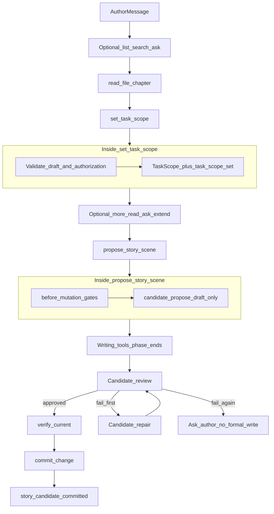

# 评测系统怎么运转（故事版）

更新于 2026-11-17。**先读设计，再对代码。** 交互教学：[how-it-works.html](how-it-works.html)（故事 / 设计地图 / 找代码 / Scope 落地）。目录对照另见 [structure-walkthrough.md](structure-walkthrough.md)；总图见 [design.md](design.md)。

---

## 开场：为什么要有这套东西

线簿会改你的小说正文。模型常常说「已经改好了」。你不能信这句话。

评测要回答的只有两句人话：

1. **这一版好不好用**（至少在我们认得的问题上）
2. **不好的时候，最早坏在哪一环**

暂时没有其他用户。在线评测空着；失败先来自本机使用、规则扫描、离线跑挂。

**设计落点**

| 设计 | 代码大概干什么 |
| --- | --- |
| 评测与产品进程分离 | 评测只 HTTP 打本地模式；`client.py` 的 `HttpEvalClient` 是边界，不 `import` 业务模块 |
| 离线优先、在线空槽 | 能力都在 `evaluation/`；总图策略写在 `design.md` §0，代码里没有在线监控模块 |
| 入口统一 | CLI（`__main__.py`）与工作台（`workbench/jobs.py`）都调 `runner_api.run_batch` |

---

## 第一幕：把一次真实改稿冻成「考题」

现成案例：`revise_ch1_ending_farm_tonight`。

> 把第一章结尾改成舒尔茨答应今晚就带姜戈去农场问那三个名；只改这一章；保留「五个坑 / 三个名」那句对白。

案例拆成五块：作品初态、会话历史、作者输入（模型可见）；期望区域/保留句、检查项（**评测器专用，不进提示**）。允许改的范围用原文锚点，不用行号。

**设计落点**

| 设计 | 代码大概干什么 |
| --- | --- |
| 案例是数据不是程序 | `cases/*.yaml`；`schema.py` 的 `load_case` / `load_cases` 变成 `Case` |
| 锚点必须唯一 | `schema._assert_unique_anchor` / `_validate_expect`：考题坏了直接 `CaseLoadError`，不开考 |
| 基础作品冻结快照 | `works/base/…`；评测说明在同级 `*.meta/`，不进试验复制 |
| 检查项分级 | YAML 里 `level: must \| quality \| human`；对象在 `schema.Check` |

---

## 第二幕：开考——复制一本「可毁掉的书」

工作台「跑测」或 `evaluation run` → 共用 `run_batch`。

每次试验：新开输出目录 → 复制作品 → HTTP 代发作者话 → 收事件 / Trace / 输入 → 落证据包。模型聊天里的自我表扬不作证据。

**设计落点**

| 设计 | 代码大概干什么 |
| --- | --- |
| 批跑与取消 | `runner_api.run_batch`：选题、冒烟/门禁、预算、`cancel_event`、进度回调、增量写报告 |
| 一次试验编排 | `runtime.AttemptRunner.run`：复制、开作品、跑 steps、采证、调判分与过程环 |
| 作品隔离 | `runtime.prepare_work_copy` + `ensure_work_git` |
| 对产品说话 | `client.HttpEvalClient`：打开作品、开 `capture_inputs`、受理轮次、轮询事件、读 Trace/附件 |
| 证据可复评 | `evidence.write_evidence_pack` / `load_attempt_evidence`：before、diff、events、traces、inputs |

工作台触发同一条引擎时：`jobs.create_job` 起后台线程；`server.py` 暴露 `/api/jobs`；前端 `LaunchPage.tsx` 轮询与取消。

---

## 第三幕：三个人怎么判卷

- **must**：区域只动该动的、真的变了、保留句还在、经候选提交——不过即挂  
- **quality**：例如提交前输入含目标章——记报告，门禁策略可单独对待  
- **human**：是否「今晚去农场」——工作台复核进 `reviews.json`，再 `score` 合并  

冒烟 `repeat 1`；门禁 `repeat 3`，可对比基线报告防退化。

**设计落点**

| 设计 | 代码大概干什么 |
| --- | --- |
| 只信证据不信自述 | `checks.grade_attempt` 只吃 `AttemptEvidence` + `Case.expect`，不调模型 |
| 各项检查 | `checks._check_only_region_changed` 等；human 判为 `pending_review` |
| 汇总与门禁 | `report.build_report`、`gate_decision`、`compare_to_baseline` |
| 离线重评 / 合并人工 | `report.regrade_report`、`apply_reviews`；CLI `evaluation score` |
| 人工写回 | 工作台 `data.write_reviews_file`；前端结果页提交复核 |

---

## 第四幕：挂了以后——最早坏在哪一环

六环：范围登记 → 读原文 → 提交候选 → 核对 → 修补 → 提交。`first_failed_stage` 供归因。

CIAO 嵌在离线与归因里，不另起顶层：O 交付、I 过程衔接、C 组件（核对集未做）、A 归因写回（失败转案例未做完）。

**设计落点**

| 设计 | 代码大概干什么 |
| --- | --- |
| 过程环 / 最早失败 | `stages.compute_stages`；`runtime` 写入 `AttemptResult` |
| 报告带归因钩子 | `report` 序列化 `stages` / `first_failed_stage` |
| 工作台归因 UI | 结果页写归因；`data` 读报告与证据给 Trace 跳转 |
| Case 库只读 | `data.list_cases` / `get_case_detail` / `list_runs_for_case`；前端 `CasesPage.tsx` |

---

## 第五幕：工作台是控制室

| 入口 | 设计意图 | 主要代码 |
| --- | --- | --- |
| Case 库 | 读考题与相关历史 | `data.list_cases…` · `CasesPage.tsx` |
| 结果 | 读答卷、证据、复核 | `data.build_attempt_payload` · 结果页 · 共用 Trace 组件 |
| 跑测 | 真触发批跑，可取消 | `jobs.py` · `LaunchPage.tsx` · `api.ts` |
| 壳 | 三入口 + 主题 | `App.tsx` · `theme.ts` · `server.py` 托管 `dist/eval-workbench.html` |

一次只允许一个 active Job（`JobConflictError` → HTTP 409）。

---

## 产品侧：Scope 确认到版本落地（农场案）

评测六环对照的是产品改稿链路。下面用同一条作者话，走完 **登记范围 → 写前 gate → 候选核对 → 版本落地**。重点是产品 Agent 设计，不是检查项清单。

作者话（简化）：「把第一章结尾改成舒尔茨答应今晚就带姜戈去农场……只改这一章。」

**规矩先立住：** 应用能证明「操作没有超出已记录范围」，以及写前材料/版本仍有效；**不能**证明「范围解释一定符合自然语言意图」——后者靠端到端与人工项验收。授权引文匹配 ≠ 意图理解已证明。

源码主线：`src/hastings/workspace/task_scope.py`（登记与校验）→ `agent.py`（`set_task_scope` / `before_mutation` / `propose_story_scene`）→ `service.py`（候选 review/repair → `story_store.commit_change`）。

产品设计全图（含模块/结构分叉、中文注释、落盘事件）：[agent-scope-to-commit.md](../../product-design/v1.0.1/agent-scope-to-commit.md)。

正文改稿调用栈主路径（范围校验与写前 gate 分别嵌在两个工具内部）：

### 1. 开场：默认没有写权限

轮次开始时 `ScopeController` 为空。可以列目录、搜索、读文件、回答；**写工具不能用**，直到 `set_task_scope`。

模型通常先 `read_file` 读 `正文/0001 拔牙人进镇.md`，材料系统记下本轮提供了哪些原文与版本。

### 2. 确认 scope：`set_task_scope`

典型参数（概念上）：`mode: edit`；`authorization` 为作者原话短引文（须 verbatim 出现在本轮可见作者消息）；`grants` 如更新该章路径；`summary` 写清本轮要做什么。

登记时立刻过的 gate（`_validate_draft` / `_validate_authorization`）：

| Gate | 不通过时 |
| --- | --- |
| 有 summary | 没写清本轮要做什么 |
| edit 至少有一个 grant（或模块相关授权） | 空写权限 |
| 路径必须是确切路径 | 不接受目录前缀/通配符 |
| `authorization` 非空且是作者消息子串 | `TASK_SCOPE_EVIDENCE_INVALID` |
| 模块装卸/发布须作者原话含对应动词 | 一般写作授权不能代替「装入/发布」 |
| 重复登记只能收窄 | 扩大必须走 `extend_task_scope` + 已读原文证据 |

通过后：内存中出现带 version 的 `TaskScope`，事件 `task_scope_set` 落盘。这是**记录下来的权限合同**，不是模型口头说「我只改第一章」。

### 3. 提交候选：`propose_story_scene`（正式正文仍未改）

路径 + `base_digest`（当前正文指纹）+ 候选全文。内部走 `before_mutation(..., candidate_proposal=True)`。

写前统一 gate（`before_mutation` 顺序）：

1. 若动正文：结构必须已就绪（`require_structure_for_prose`）
2. 若非候选提议：禁止直接写正文（`STORY_CANDIDATE_REQUIRED`）
3. `require_writable` + **`scope.require`**：有范围、非只读、操作在 grants 内、不在 denied
4. `preflight`：`check_write_intent` 核对目标存在性与 digest 仍匹配
5. 更新正文时：`materials.require_target_read`（须已完整读过该文件）
6. 参考完整性 / 模块必读覆盖
7. `materials.verify_current`（依赖版本未漂）
8. 首次突变：准备 Git session，记 `version_baseline`
9. 再 `verify_current`；`session.guard`（外部改动守卫）

通过后：`candidate.propose(...)` 只把草稿留在候选对象里；正式正文未修改，本轮结束时再核对。

### 4. 核对与版本落地

写作工具轮结束后，服务进入候选 review（必要时 repair，最多两轮核对）：

- 系统提示切换为「候选正文核对阶段」
- 程序 findings + 模型逐项报告；`approved` 才算过
- 通过前再次 `materials.verify_current`
- **`story_store.commit_change`**：带 `revision_source: candidate`、candidate id 等
- 事件 `story_candidate_committed`（change_id / revision / paths）
- 章节修订写入 RevisionStore

至此正式正文与作品 revision 前进。两次核对不过则正式正文不动，向作者提问（`needs_input`）。

### 5. 和评测的对应

| 产品步骤 | 评测侧 |
| --- | --- |
| `task_scope_set` + grants 覆盖 focus | 六环 `scope`；质量项 `scope_matches_auth` |
| 读章进材料 / 进模型输入 | 六环 `read`；`chapter_in_model_input` |
| `propose_story_scene` | 六环 `candidate` |
| review / repair | 六环 `verify` / `repair` |
| `story_candidate_committed` | 六环 `commit`；must `committed_via_candidate` |
| 仅授权区变化、意图是否达成 | must 区域项 + human |

交互逐步展开见 [how-it-works.html](how-it-works.html) 的「Scope 落地」。

---

## 按设计职责看代码（速查）

不按字母表，按「它在闭环里站哪一岗」：

| 岗 | 路径 | 一句话 |
| --- | --- | --- |
| 出题 | `cases/` · `works/` · `schema.py` | 冻现场、校验锚点、检查分级 |
| 开考总控 | `runner_api.py` · `__main__.py` | 批跑参数、探测 base-url、写报告 |
| 单场编排 | `runtime.py` | 复制作品 → 跑 → 采证 → 调判分/过程 |
| 产品边界 | `client.py` | 唯一对外 HTTP 面 |
| 证据 | `evidence.py` | 快照、diff、回执、落盘与重载 |
| 交付判分 | `checks.py` | must/quality；human 待复核 |
| 过程归因 | `stages.py` | 六环 earliest fail |
| 门禁报告 | `report.py` | 汇总、基线、gate、合并 reviews |
| 控制室后端 | `workbench/server.py` · `data.py` · `jobs.py` | API、读产物、单 Job |
| 控制室前端 | `frontend/src/eval-workbench/` | Case / 结果 / 跑测 |

确定性测试在 `tests/evaluation/`（假证据，不调在线模型）。运行产物在 `data/evaluation/runs/`（不入库）。

---

## 收束

**冻一本题 → 复制后对真实产品代发 → 只信文件与 Trace → 程序+人判卷 → 挂了看最早坏环 → 改产品或改考题 → 再跑同一题。**

打开 [how-it-works.html](how-it-works.html)：故事 / 设计地图 / 找代码 / Scope 落地。亲手校准见 [session-handoff-2026-11-16.md](session-handoff-2026-11-16.md) 与 [evaluation/SETUP.md](../../evaluation/SETUP.md)。
