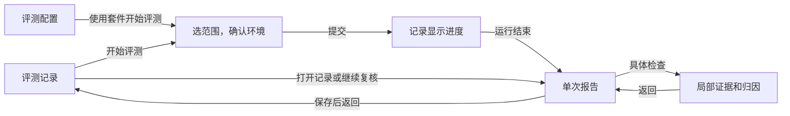

# 离线评测工作台 · 全局交互设计

2026-11-18 · 全局导航、记录筛选、启动与进度、配置、报告和证据页面已实现。

## 用评测记录串起整个工作台

顶部统一为「线簿 / 评测工作台　　评测记录　评测配置　　　　　　　　　主题」。评测记录是默认首页，也是启动评测、查找报告和继续复核的共同入口。开始评测是当前页面的操作，放在标题旁。单次报告、检查证据与归因都归属于评测记录，页面顶部持续标明当前位置。



| 页面 | 默认呈现 | 操作和去向 |
| --- | --- | --- |
| **评测记录** | 按运行时间排列。每行显示任务名、时间、运行方式和当前需要处理的问题。页面内提供「全部」「待我确认」「需排查」筛选 | 「继续复核」直接打开该次运行的待复核题。「查看问题」定位检查，正常记录可以打开完整报告 |
| **开始评测** | 在现有启动页上收为一张表单。常用区只显示跑什么、在哪个环境跑、预计几次 | 提交后回记录页看进度。运行地址、预算、基线和输出名收进高级选项。启动时须能确认实际使用的套件和检查包 |
| **单次报告** | 保留已实现的正文阅读与原地复核。顶部显示这次有什么结果和待办 | 从具体检查打开相关证据。返回记录时保留原筛选和滚动位置 |
| **检查证据** | 保留同一导航与报告上下文。首屏展示该检查的结论、原因和相关输入、文件或执行片段 | 需要更多上下文时展开完整轨迹。归因在检查上下文中保存，返回后继续处理当前报告 |
| **评测配置** | 页内切换「套件」「环境」「检查包」。套件默认显示用途、范围和默认环境 | 可查看案例或用该套件开始评测。文件路径、版本与 ID 在详情中可查 |

### 截图里的记录页

这份运行在列表里应当读成一句话：「第一章结尾改稿，1 项待你确认，1 项质量检查未通过。」旧门禁结果可在该次报告的运行信息中查到。

```text
线簿 / 评测工作台          评测记录    评测配置                    浅色

评测记录                                                   [开始评测]
全部    待我确认 3    需排查
────────────────────────────────────────────────────────────────────
第一章结尾改稿                                             继续复核 →
11 月 17 日 21:20 · 快速检查        1 项待你确认 · 1 项质量检查未通过
────────────────────────────────────────────────────────────────────
```

「待我确认 3」在当前数据中指三条人工检查项。原顶栏的 8 合并了三条人工检查和五条程序问题。一条运行可以同时出现在「待我确认」和「需排查」中。前者定位到人工题，后者定位到失败检查或运行错误。选「证据不足」后显示「待补证」，保留在待复核范围。这个口径在列表、报告和复核后回跳时一致。

### 全局统一规则

- **状态有固定含义。** 运行中、已完成和异常描述执行过程。「待你确认」「待补证」以人工检查项计数。「必须项失败」「质量检查未通过」陈述检查结果。发版结论沿用评测体系的规则，仅在报告具备相应依据时呈现。
- **每页有一个主操作。** 记录页是开始评测，配置页是使用套件，报告页是保存当前需要作者判断的事项。需要排查时从失败检查出发，证据页仍属于原报告。
- **共享顶栏、文字和状态样式。** 延续报告页的暖灰底、低对比细分隔线和青绿色操作。失败使用带文字的红色标记，质量异常使用赭色。记录和配置可用较宽的内容区，正文保持约 760 像素阅读宽度，执行轨迹可用更宽布局。浅色和深色采用同样的信息层级。

### 接口与交付验收

本地列表接口聚合落盘报告与人工记录，给出检查项摘要、首个待复核项与优先排查项。运行中的记录使用现有任务接口。新报告保存开始时间，部分历史记录可从运行名取得时间，剩余历史记录显示文件更新时间。任务名优先用可读案例名称，未提供名称的历史项显示原标识。

导航与共享页面布局在同一版覆盖记录、启动、配置、报告和诊断。旧书签仍能打开原运行。旧「质检」入口承接到记录页相应筛选，原有技术排查和归因从报告里的失败检查进入。全局方案的验收是用本地记录走通「打开记录 → 继续复核 → 保存 → 回到原筛选」，再走通一次「开始评测 → 看进度 → 进入报告」。截图这条记录的待办数和质量异常在列表与详情一致，页面跳转时位置、主题和导航连续。

## 单次报告与正文复核

### 为什么先改报告

11 月 17 日 21:20 的改稿冒烟只跑了一条案例。旧规则记为门禁通过、试验失败。四项程序必须项记录为通过，读取原文的质量检查失败，「是否约定今晚去农场」仍待作者判断。这三个结果回答不同的问题。[本次运行报告](http://127.0.0.1:8765/#/reports/smoke-revise-20261117-212007)

旧报告顶栏显示「验收通过」，摘要显示「待复核 0」，案例行又显示「待复核 1」。摘要数的是以待复核结束的试验，案例行数的是待处理的检查项。作者实际要读的是改后结尾，首屏却给了「进入诊断」和「诊断 #1」两个入口，还要在详情里找正文。

**设计目标是让作者打开链接就能做当前这项判断。** 单例报告首屏同时交代这次改了什么、有什么异常，以及哪一段文字需要作者看。工程排查沿着具体异常往下看。

单案例直接展开。多案例按必须项失败、待作者判断、质量异常、已完成排列，每案只出现一次。报告里的「查看运行证据」进入现有诊断页，返回时保留报告已展开的检查和未提交选择。

### 这次报告应该怎样读

1. 打开即见 **「第一章结尾改稿」**。紧接着说明「结尾已改动。1 项待你确认，1 项质量检查未通过。」报告身份、旧门禁结论和请求数收进「运行信息」。这是一次冒烟，页面不据此给出发版建议。
2. 首个工作区提出具体问题 **「改后的结尾是否明确约定今晚去农场查问？」** 默认展示实际变化的段落，可以展开完整的改后范围和改前段落。证据随答案保存，作者可以检查引用的段落。
3. 判断为「是」或「否」且有对应来源时，更新本题复核结果。选「证据不足」记录已查看，保留待补证状态。保存成功后本题收起，质量异常仍然可见。旧规则的试验结果由既有重评流程计算。
4. 展开 **「读取原文检查未通过」**，看到评测器判定「首次提交候选前，输入未含目标章节全文」及其关联输入。这个判定只说明检查结果。进一步归因时沿着证据查看模型实际收到了什么。四项程序通过结果和运行身份均可按需展开。

### 状态和证据

| 当时的情况 | 正文区的动作 |
| --- | --- |
| 程序记录越权写入等必须项失败 | 优先展示具体越界位置和受影响文件，主操作为「查看变更」。其他人工题仍可查看 |
| 有稿件，有待复核项 | 打开待核问题和改后段落。通过项折叠，质量异常保留可见摘要 |
| 稿件或必要证据缺失 | 显示缺少的证据，允许记录「证据不足」。只有来源可定位时才提交肯定或否定判断 |
| 运行未完成或基础设施异常 | 显示运行状态和错误原文，给出查看记录或返回启动页的入口 |
| 检查已完成 | 显示本场景结果，保留正文、证据与复核记录入口 |

待办数按本次运行的待复核**检查项**计算，并读取已有人工记录。一个有质量失败的试验仍可能包含待复核项。历史报告的原始门禁与试验结论照原值展示，集中放在运行信息。对新规则下须由作者裁决的关键叙事约束，缺裁决时显示「待作者判断」。[发版判定](../design.md#b82-结果分类)

现有后端可读取报告、段落差异、运行记录，也能保存带证据引用的人工判定并重新计分。前端可按检查项整理这些信息，自动附上这次实际展示的文件、改前或改后版本及段落引用。保存与重评是两个步骤：保存失败保留草稿；保存成功而重评失败时显示「复核已保存，报告待更新」，重试仅刷新计分。证据不足沿用待复核判定，并用已有人工记录区分「尚未看过」与「已查看待补证」。

### 视觉和验收

使用单栏阅读布局，正文区控制在约 760 像素，顶栏只保留工作台身份和返回入口。案例名、问题、状态说明使用三个清晰的字号层级。正文摘录使用中文衬线字体，界面使用无衬线字体。青绿色强调当前主操作，赭色加文字标记质量异常，失败必须项使用红色和明确文字。通过项用普通文字，段落之间用留白和细分隔线。

用这一份历史报告走查三件事。第一次打开能直接读到复核原句。作者能在同一处保存判断并看到待办变化。复核完成后，仍能找到原有质量异常及其依据。窄屏保持同样的阅读顺序。

离线部分参考了美团业务实践中从失败检查项查看局部执行证据的做法，以及 CIAO 中用实际交付验收任务、再用过程证据排查原因的思路。[业务实践中的根因分析](../refer/meituan-agent-eval-whitepaper-02.md#32-根因分析) · [CIAO 的标准与证据](../refer/ciao-agent-eval-pexo-gene.md#141-评测标准与证据)
