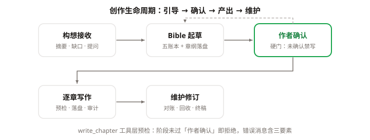

# Phase 8 开发计划：引导式生命周期（intake → 确认 → 产出 → 维护）

> **立项动机**：agent「看不出可用性」——收到完整故事构想后该做什么无人表达：静态 system prompt 不区分工作区阶段，"先 Bible 后正文"只是软约束（write_chapter 无任何预检），outline 章纲账本在 DESIGN §2.2 有规划但未实现，长构想的分解结果（角色小传/线索/时间线）无引导产生。本阶段把「引导 → 确认 → 产出 → 维护」做成系统表达：程序为骨（阶段门/预检/状态注入，70%），提示词为肉（intake 协议，30%）。
> **用户三项已确认决策**：① P7 收尾后新开 P8「引导式生命周期」，RAG 顺延为 P9；② 状态注入采用 B1（每轮 prompt 前刷新 system，非消息前缀）；③ 接受引入 `react-markdown` 前端依赖。
> **编号顺延**：RAG（原 P8）→ P9、审计员（原 P9）→ P10、评测（原 P10）→ P11（沿用 P6/P7 顺延先例）。
> 状态：**已关闭（2026-10-11）**——T1–T7 全部交付，DoD 八条验收通过，构建笔记见 [phase-08-guided-lifecycle.md](phase-08-guided-lifecycle.md)（含四透镜专节与已知留白）。

本阶段骨架一图——生命周期状态机与工具层硬门（虚线为回退边，绿色为关键硬门）：



## 0. 已核实的依赖事实（计划的输入）

| 结论 | 证据 | 对本阶段的影响 |
|---|---|---|
| `config.system` 每轮运行时读取，直接赋值即下一轮生效（P6 D3 手法，无需重建 harness） | [hastings_session.py](../src/hastings/server/hastings_session.py#L182-L199) `apply_writing_language` / `apply_model` 先例 | B1 注入点：`HastingsSession.prompt()` 委托前刷新 `config.system`，reconcile 队列经同一入口自动覆盖 |
| write_chapter 现有守卫仅作者草稿锁 + run_kind，**无任何 Bible 预检** | [chapter_tools.py](../src/hastings/tools/chapter_tools.py#L77-L125) | 阶段门与分级预检（D3/D4）是纯新增，不与现有守卫冲突 |
| 实体注册表模式：新增账本 = models + state_machine + `_REGISTRY` 各加一条 | [bible_tools.py](../src/hastings/tools/bible_tools.py#L196-L218) `_Spec` 注册表 | outline 第六账本按同款扩展，零 if-else（D5） |
| 账本以 name 为主键、状态机迁移表集中登记 | [state_machine.py](../src/hastings/bible/state_machine.py#L13-L46) | outline 状态机（planned→written→revised）加两条即可 |
| `compute_story_stats` 已派生回收率/逾期列表/风险/章节数/总字数；`latest_chapter_number` 等纯函数齐备 | [stats.py](../src/hastings/bible/stats.py#L27-L56) | 状态注入节（D6）与 story 端点（D8）复用，**不引入第二份数据源**（P6 D7 约定延续） |
| StoryWorkspace 是 frozen dataclass，路径解析集中于 `__post_init__` 一带 | [store.py](../src/hastings/bible/store.py#L65-L79) | `story_path` / `outline_path` 两处路径属性照抄同款 |
| ChatStream 对 agent 消息纯文本渲染；前端依赖仅 react/zustand/xyflow/d3-force | [ChatStream.tsx](../frontend/src/components/ChatStream.tsx#L44-L100)、package.json | react-markdown 是 P6 引入 xyflow 以来首个 UI 库新增依赖（决策③已确认） |
| REST 已有 `_session(slug)` 守门惯例与 stats 端点（P6 T7） | [rest.py](../src/hastings/server/rest.py) | story 端点沿用惯例，纯只读派生 |
| `RECONCILE_MARKER` 先例：协议标记写进 prompt、硬约束在工具层 | [prompts.py](../src/hastings/prompts.py#L31-L33) | intake 协议同款哲学：prompt 讲协议，门在工具层 |

## 1. 目标与验收标准

**目标**：把「一个工作区从构想接收到终稿维护」的全生命周期做成系统可表达、工具层可强制的形态——agent 收到完整构想后先引导确认再动工，写作期每章过预检门，作者随时可感知作品进度。

可检查的八条：

1. **阶段门**：`story.yaml` 生命周期（intake → bible_drafting → bible_confirmed → writing → revising → complete，含回退边）；stage 未到 writing/revising 时 write_chapter 被拒，错误消息三要素；
2. **story_stage 工具**：advance/rollback 均须 reason，前置条件校验（bible_confirmed 要求角色 ≥2、method ≥1 且 locked、outline ≥1），迁移留痕进 story.yaml；
3. **outline 第六账本**：`OutlineEntry`（章号唯一性工具层校验）经 bible_upsert/bible_query 泛化读写；write_chapter 落盘自动推进该章 outline 状态（planned→written，force 覆盖→revised）；
4. **分级预检**：write_chapter 前置检查——error（阻断）：阶段门 / 目标章不在 outline / 工作区无角色档案；warning（不阻断，进 details 供前端工具卡展示）：method 未 locked / plant_plans 引用的伏笔不存在或状态不对；
5. **状态注入（B1）**：每轮 prompt 前刷新 system，新增「当前工作区状态」节（阶段 + 五账本计数 + 章节进度 + method 锁定态 + 逾期伏笔数）；story.yaml/stats 读取失败降级跳过该节 + stderr 三要素告警，不阻断写作流（沿用 P5 OSError 教训）；
6. **intake 协议**：WORKFLOW_SECTION 重写为阶段感知协议——intake 阶段收到完整构想时输出五维理解摘要 + 缺口清单 + ≤5 个分组问题，禁止未确认先建账/写正文；bible_drafting 建账顺序固定，建完输出总览请求确认；
7. **前端**：agent 消息 react-markdown + remark-gfm 渲染（流式增量安全）；用户/agent 消息区块区分（对齐 + 色条 + 标签）；顶栏阶段徽章 + 章节进度（n/m）+ 账本完备度，数据来自新端点 `GET /api/{slug}/story`；
8. **红线**：tau 内核 diff 为空、零 import tau_coding、REST 写入口唯一（story.yaml 的写路径只有 story_stage 工具）、七道质量门全绿；DESIGN.md §8 路线表顺延 + 构建笔记含四透镜专节。

**非目标**：

- 不做作者确认的结构化交互卡（v1 用对话确认 + story_stage 工具，UI 卡片移交后续阶段）；
- 不做 outline 幕级汇总视图（账本页 Tab 展示即可）；
- 不做向量索引与语义检索（P9 RAG）、不做 LLM 语义审计（P10）；
- 不改事件契约（story_stage 是普通工具调用，复用既有 ToolExecution 帧）；
- 不做多用户/移动端适配。

## 2. 设计决策

### D1 story.yaml：工作区级生命周期（非账本）

- 位置 `<workspace>/story.yaml`（与 bible/、chapters/ 平级），内容：`{slug, stage, stage_history: [{from, to, reason, at}]}`；
- `StoryStage = Literal["intake", "bible_drafting", "bible_confirmed", "writing", "revising", "complete"]`；
- 迁移表（集中在 story_state 模块，同 state_machine 哲学）：
  - 正向：intake→bible_drafting→bible_confirmed→writing；writing↔revising；writing/revising→complete；
  - 回退：complete→revising（终稿后作者驱动维护）、bible_confirmed→bible_drafting（作者要求推翻设定）；
- **门是硬约束（write_chapter 工具层），推进是协议（模型在作者明确确认后调 story_stage）**——就算模型违规抢跑，工具层拦得住；
- story.yaml 缺失（旧工作区）按 intake 兜底读取，首次任何写路径触发落盘——不强制迁移旧数据。

### D2 story_stage 工具（唯一写入口）

- 参数：`action: "advance" | "rollback"`，`reason`（非空必填）；
- advance 前置条件（不满足即三要素报错，指明缺什么）：
  - →bible_confirmed：角色 ≥2、method ≥1 且全部 locked、outline ≥1；
  - →writing：当前 stage 已是 bible_confirmed（无额外语义）；
- rollback 目标 = 迁移表允许的回退邻接点，逐一校验；
- 迁移成功后 stage_history 追加记录并整表覆盖写。

### D3 outline：第六账本（章纲 = 长篇的分页记忆）

```yaml
- name: "案发之夜"          # 主键（同款约定）
  chapter: 7                 # 章号，工具层校验唯一（重复章号 upsert 拒绝）
  act: "第二幕"
  beats: ["暴风雪封路", "发现尸体", "数据异常被隐瞒"]
  plant_plans: ["保温瓶的位置"]   # 计划埋设的伏笔名（预检 D4 warning 用）
  end_hook: "雪地上的第二行脚印"
  status: planned            # planned → written → revised
```

- 写每章前模型 read 章纲与相关实体卡——60 章的连贯性靠「章纲+账本摘要」而不是无限上下文；
- **write_chapter 落盘后自动推进**该章 outline 状态（planned→written；force 覆盖已有 written→revised）：正文与章纲状态由工具层自动对账，模型不必记这回事。

### D4 write_chapter 分级预检

| 级别 | 检查 | 行为 |
|---|---|---|
| error | stage 不在 {writing, revising} | 拒绝，三要素指明当前阶段与推进方式 |
| error | 目标章号不在 outline | 拒绝，提示先 bible_upsert 章纲 |
| error | 工作区无任何角色档案 | 拒绝（五账本语义下的「角色未建档不开写」硬化） |
| warning | method 未 locked | 不阻断，details 注明 |
| warning | plant_plans 引用的伏笔名不存在 / 状态仍 planned | 不阻断，details 注明 |

预检在草稿锁 / run_kind 守卫之后、落盘之前执行；warning 全部进 `AgentToolResult.details["precheck_warnings"]`，前端工具卡既有 details 摘要行直接展示（零事件契约变更）。

### D5 状态注入（B1）：prompt 前刷新 system

- `HastingsSession.prompt()` 委托 harness 前调用 `self._refresh_system()`（`config.system = build_system_prompt(tools, language=..., workspace=workspace)`）——复用 P6 D3 赋值手法，零内核改动；reconcile 队列经 session.prompt 同入口自动覆盖；运行中不刷新（prompt 入口本就有 busy 防护）；
- `build_system_prompt` 新增第五节「当前工作区状态」（语言节之后、工作流程之前）：

  ```text
  ## 当前工作区状态
  阶段：bible_drafting ｜ 角色 12 · 线索 6 · 伏笔 8（逾期 1）· 手法 1（未锁定）· 章纲 3 条
  已写章节：0 ｜ 章纲未覆盖：ch8 起未建
  ```

- 数据来自 stats + story.yaml + outline 汇总纯函数（新 `bible/story_state.py`），泄压阀：任一读取失败 → 跳过该节 + stderr 三要素告警，不阻断写作流；
- 注入节只陈述事实（阶段/计数/缺口），**不解释该怎么做事**——协议归 prompt（D6），职责分离。

### D6 Intake 协议（本阶段唯一纯 prompt 交付）

WORKFLOW_SECTION 重写为阶段感知协议（配合 D5 注入，prompt 不描述"现在是什么阶段"，只讲"该阶段怎么做人"）：

1. **intake 协议**：收到完整故事构想时，禁止建账/写正文。输出三段——①五维理解摘要（核心诡计/人物群像/结构/结局/文风）；②缺口清单（必须但缺失的信息，如凶手人选、被害人罪行、命名、线索清单、章纲）；③按影响分组的关键问题，一次 ≤5 个，等作者答复（对应 tau_coding guideline「Ask before materially ambiguous design choices」）；
2. **bible_drafting 协议**：建账顺序固定（人物→手法→线索伏笔→时间线→章纲），建完输出 Bible 总览，请作者确认三类点（可改的设定 / 待补的缺口 / 已按默认处理的项），作者确认后 story_stage 推进；
3. **writing 协议**：每章动笔前 read 该章章纲与相关设定；写完报告文件落盘与状态迁移（保留现有第 6 条）；
4. 现有第 7 条（reconcile 协议）原样保留。

### D7 前端：MD 渲染 + 区分度 + 阶段进度

- **AgentMessage MD 渲染**：`react-markdown` + `remark-gfm`（GFM 表格是缺口清单/对比表的刚需）；流式增量渲染安全（组件纯函数、无副作用）；用户消息保持纯文本——只有 agent 产出是结构化的；
- **消息区分度**：agent 消息左色条 + "Hastings" 标签，用户消息右对齐异色底；工具卡色点体系对齐不动；
- **阶段进度徽章**：顶栏状态徽章区扩展——stage 徽章（六态配色）+ 章节进度 n/m + 账本完备度速览；数据源 `GET /api/{slug}/story`（连接时 + 每次 run 结束 refetch）；
- vitest 用纯函数用例（MD 组件的渲染输入映射、stage → 徽章文案/配色映射），延续「前端测试轻基建」约定。

### D8 REST：单一只读端点

- `GET /api/{slug}/story` → `{stage, stage_history, counts: {...}, chapters: {written, planned}}`——`_session(slug)` 守门 + stats 复用，纯派生零新存储；
- story.yaml 的写路径**只有 story_stage 工具**（REST 不暴露写口，守住「写入口唯一」红线）。

## 3. 任务分解

| # | 任务 | 涉及文件 | 测试 |
|---|---|---|---|
| T1 | story.yaml + StoryStage 迁移表 + story_state 纯函数 | 新 `bible/story_state.py`；`store.py` 加 `story_path`；`server/hastings_session.py` 接线 | 迁移边/前置条件/旧工作区兜底单测 |
| T2 | story_stage 工具（advance/rollback + reason + 留痕） | `tools/story_tools.py` 新 | FakeProvider 走查 + 工具单测（拒绝路径三要素） |
| T3 | outline 第六账本（models/state_machine/_REGISTRY 三处注册 + 章号唯一校验） | `models.py`、`state_machine.py`、`bible_tools.py`、`store.py` | 状态机/章号冲突/泛化读写单测 |
| T4 | write_chapter 阶段门 + 分级预检 + outline 自动推进 | `chapter_tools.py` | 预检 error/warning 两级、force→revised、阶段门拒绝 |
| T5 | 状态注入（B1） | `prompts.py`、`hastings_session.py` | 空工作区/写作中两快照 + 降级泄压阀测试 |
| T6 | Intake 协议提示词重写 | `prompts.py` | 既有 prompt 测试更新 + 真模型冒烟（测试构想走查） |
| T7 | 前端 MD 渲染 + 消息区分 + story 端点 + 阶段徽章 | `ChatStream.tsx`、`api/rest.ts`、`App.tsx`、`package.json` | vitest 纯函数 + 视觉验证 |

顺序依据：T1–T4 账本与工具层（硬约束先行，可独立验收）→ T5–T6 prompt 层（协议建立在门之上）→ T7 前端。T1–T4 完成即可在 CLI 冒烟。

## 4. 移交清单（本阶段不做，后续接手）

| 事项 | 移交至 |
|---|---|
| 作者确认结构化交互卡（UI 上的「确认/要求修改」按钮，替代对话确认） | 后续 UI 打磨阶段 |
| outline 幕级汇总视图（三幕结构可视化） | P10 评测与打磨（章节阅读器增强同批） |
| intake 多轮问卷的 UI 化（分组问题渲染为表单） | 同上 |
| story.yaml 的人工编辑入口（REST/前端） | 有真实诉求再立项 |

## 5. 风险与对策

| 风险 | 对策 |
|---|---|
| 阶段门误伤合法流程（如作者想直接续写旧工作区） | 旧工作区兜底 intake + advance 前置条件明确报错指路；CLI 冒烟覆盖三条主路径 |
| 注入节与模型实际感知脱节（刷新时机错位） | 注入只在 prompt 入口刷新，运行中 system 不变（与 busy 防护同语义）；快照测试钉死两形态 |
| react-markdown 流式渲染性能（长回复频繁重渲） | 组件 memo + 段落级渲染；vitest 长文本用例兜底 |
| intake 协议被强模型「热心」突破（不等确认就建账） | 门在工具层：未确认阶段 bible_upsert 不拦（建账合法）但 write_chapter 拦——intake 协议违规的代价被限制在「多建了账」而非「写飞了正文」；构建笔记四透镜复盘此边界 |
| outline 自动推进与作者手改冲突 | 正文是 SSOT（P5 既定）：作者手改经 reconcile 流，outline 状态由下次 write/对账校正 |

## 6. 验收记录（2026-10-11）

- **任务交付**：T1–T7 原子提交 `4a1d0f9` / `245f3cb` / `6585b6a` / `7887066` / `8115457` / `c106ba3` / `612a19b`，逐任务测试先行、七道门全绿后提交；
- **DoD 八条**：全部通过（逐条证据见 [phase-08-guided-lifecycle.md §6](phase-08-guided-lifecycle.md)）；
- **质量门复跑**（T7 后）：pytest 573 passed、ruff check/format 0 errors、mypy 77 files clean、tsc 0 errors、vitest 201 passed、build 12.4s、tau 内核 diff 空、零 import tau_coding；
- **决策落地**：D1–D8 全部按计划落地；唯一偏离——状态汇总函数从计划的 `story_state.py` 改落 `stats.py`（循环导入，见构建笔记 §4）；
- **已知留白**：真 LLM intake 冒烟走查（P9 前补）、确认交互卡 UI 化、outline 幕级视图、story.yaml 人工编辑入口（构建笔记 §7）。
