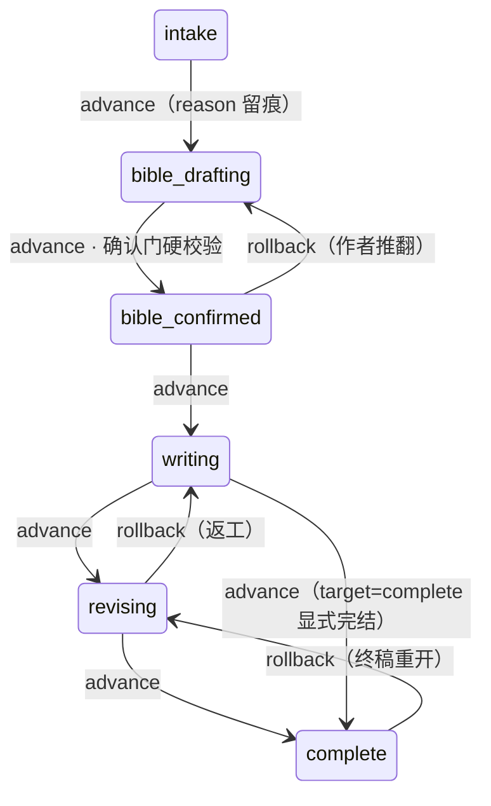
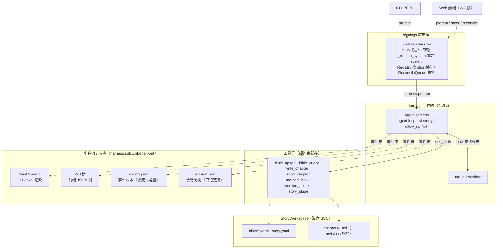

# Hastings 0.1：基于 Tau 的悬疑小说写作 Agent — 设计说明文档

> **已被 V2 取代（导航提示，Phase 17 T17.7）**：本文件描述 V1 的**历史设计与 as-built**，仅用于理解现状与迁移原因。后续目标架构见 [V2 DESIGN](../v0.2/DESIGN.md)，当前实施计划见 [Phase 17](../v0.2/plans/phase-17-migration-cleanup-plan.md)。V1 代码在迁移完成前仍在运行，但不再承载新设计。
>
> 项目名 **Hastings**（黑斯廷斯上尉，阿加莎·克里斯蒂笔下波洛的叙事者——"替侦探写下故事的人"）。一句话定位：**把"编码 Agent 对代码仓库做的事"迁移到"写作 Agent 对小说工作区做的事"**——角色设定是数据模型，线索/伏笔是带状态的账本，章节正文是文件，文风模仿是 RAG 检索。
>
> 双重目标：① 深度学习 Agent 开发（loop、tool use、事件流、RAG、评测）；② 产出一个可讲、可演示、可量化的简历项目。
>
> **阅读说明（AI/协作者必读）**：未显式标注的章节为**设计态**——立项时的设计意图，与实现存在演进差异（保留对比价值，不改写）；标注 **as-built** 的块为**实际交付现状**（截至 P9 + 前端组件库改造，P10 工具层加固已立项待执行）。查当前实现优先看 as-built 块与 [README](README.md) 路由表。

***

## 1. 现状分析：Tau 给了我们什么

Tau 的三层架构（`C:\Projects\Agent\tau`，已复制到本项目 `src/`）：

```text
tau_ai      provider/model 流式层（OpenAI 兼容、Anthropic、fake 测试 provider 等）
tau_agent   可移植的"大脑"：AgentHarness、agent loop、事件、工具抽象、JSONL 会话
tau_coding  coding 应用层：read/write/edit/bash 工具、CLI/TUI、skills、RPC
```

关键接口事实（决定二次开发方式）：

| 事实                                                                                      | 位置                                                           | 对本项目的意义                                                     |
| --------------------------------------------------------------------------------------- | ------------------------------------------------------------ | ----------------------------------------------------------- |
| `AgentHarnessConfig(provider, model, system, tools, max_turns, before/after_tool_call)` | [tau\_agent/harness.py](../../src/tau_agent/harness.py#L39-L48) | 换工具集、换 system prompt 即得到全新 Agent，核心零改动                      |
| `AgentTool = name + description + JSON Schema + async execute_fn`                       | [tau\_agent/tools.py](../../src/tau_agent/tools.py#L76-L105)    | 小说工具与 read/write 完全同构，照 `create_read_tool_definition` 模板写即可 |
| 事件流：`MessageStart/Update/End`、`ToolExecutionStart/Update/End` 等                         | [tau\_agent/events.py](../../src/tau_agent/events.py)           | Web 前端消费的事件契约已就绪，TUI 只是"众多前端之一"                             |
| `FakeProvider` 回放预定义事件流                                                                 | [tau\_ai/fake.py](../../src/tau_ai/fake.py)                     | Agent 行为可以确定性地测试——评测体系的地基                                   |
| `rpc.py` 已有 prompt/steer/follow\_up 命令边界                                                | [tau\_coding/rpc.py](../../src/tau_coding/rpc.py)               | FastAPI WebSocket 桥直接照抄这个模式                                 |
| JSONL append-only 会话 + 分支/恢复                                                            | [tau\_agent/session/](../../src/tau_agent/session/)             | 长篇小说多轮创作的会话持久化免费获得                                          |

**复用/修改/替换判定：**

```text
tau_ai      → 原样复用（0 改动，FakeProvider 兼做测试基建）
tau_agent   → 原样复用为主（预计 <5% 改动；见 §5.4）
tau_coding  → 废弃不用（CLI/OAuth/TUI 全是 coding 特化，改造成本 > 新写）
hastings（新建）→ 替代 tau_coding 的地位：小说工具集 + Story Bible + RAG + FastAPI 服务
frontend    → 新建 React SPA，经 WebSocket 消费事件流，替代 TUI
```

核心洞察：Tau 的架构边界（`AgentHarness = 大脑 / Session = 环境 / TUI = 前端之一`）本来就把"coding"隔离在最外层，所以这次二次开发**不是魔改内核，而是写一个新的应用层**。这正是它作为教学项目的价值。

***

## 2. 产品定义

### 2.1 用户与场景

- **用户**：悬疑/推理小说爱好者、网文作者、想体验"AI 协作写作"的人。
- **核心场景**：
  1. 用户描述一个故事构想（"1930 年代东方快车式的封闭列车谋杀案"）；
  2. Agent 引导建立**故事工作区**：角色卡、受害人、凶手、作案手法、线索清单、伏笔计划、时间线；
  3. Agent 逐章写作，每章结束自动**审计**：伏笔是否按计划埋设、线索是否公平呈现给读者、角色言行是否与人设矛盾、时间线是否自洽；
  4. 用户上传喜欢的作者作品集（如阿加莎·克里斯蒂全集），Agent 检索其段落作为文风示例，统计其文体特征，在正文中模仿。
- **公平性原则（fair play）** 作为产品差异点：解谜所需的全部线索必须在揭晓前呈现给读者——这条原则可被结构化验证（见 §7），是本项目最有"简历含金量"的功能。

### 2.2 核心域概念（Story Bible 的五张"账本"）

| 概念            | 数据要点                                  | 关键状态机                                                     |
| ------------- | ------------------------------------- | --------------------------------------------------------- |
| 角色 Character  | 姓名、身份、动机、秘密、与他人关系、外表/口头禅、视角           | 弧光阶段：扁平 → 发展 → 转变                                         |
| 线索 Clue       | 内容、发现章节、指向性、误导性（red herring 标记）、真实/伪造 | `planned → planted → discovered → interpreted → resolved` |
| 作案手法 Method   | 手法描述、时间窗、所需条件、凶手的不在场证明及其破绽            | `drafted → locked → revealed`（locked 后修改需显式解锁，防烂尾）        |
| 伏笔 Foreshadow | 内容、埋设章节/方式（明示/暗示/象征）、预计回收章节           | `planned → planted → echoed → resolved`（终稿前必须全部 resolved） |
| 时间线 Timeline  | 事件、绝对/相对时间、参与者、与正文段落的双向引用             | 冲突检测（同一人物同时在两地等）                                          |

**as-built 注**：实际交付**六账本**——上表五概念外，章纲 outline 于 P8 独立成第六账本（「长篇分页记忆」，与六阶段状态机同期交付）；当前存储契约见 [modules/bible-store.md](modules/bible-store.md)。

**存储形态：文件制工作区**（与 coding agent 操作代码库同构，天然可 inspect、可 git、可工具化）：

```text
stories/the-orient-express-case/
├── bible/
│   ├── characters/*.yaml        # 角色卡，一人一文件
│   ├── clues.yaml               # 线索账本
│   ├── method.yaml              # 作案手法（对模型"部分加密"：正文工具读不到凶手字段？见 §5.3）
│   ├── foreshadows.yaml         # 伏笔账本
│   ├── timeline.yaml            # 时间线
│   └── outline.yaml             # 章节大纲
├── chapters/
│   ├── ch01.md ... ch12.md      # 正文
└── audits/
    └── ch01.json                # 每章审计报告（含伏笔/线索状态快照）
```

### 2.3 工作区生命周期（六阶段状态机，P8 交付）

工作区阶段记录在 `story.yaml`，`story_stage` 工具是**唯一写入口**（模型无法绕开工具直改 YAML）：

- **advance / rollback 均须** **`reason`**，每次迁移连同模型自述写入 `stage_history`（可审计）；
- 推进到 `bible_confirmed` 前过**确认门硬校验**（角色≥2、手法全锁定、章纲≥1）——工具层强制，不靠 prompt 自觉；
- `write_chapter` 仅在 `writing` / `revising` 阶段放行（阶段预检）。



确认门计数口径：`角色≥2` 指非草稿角色数；`手法全锁` 指方法账本每条均处于 `locked` 及之后状态；`章纲≥1` 指 outline 账本至少一条有效章纲。

***

## 3. Agent 设计

**As-built 架构总览**（截至 P9 + 前端组件库改造；P10 工具层加固已立项待执行。与下文设计态描述互补）：hastings 是 tau 内核之上的**薄应用层**——装配（工具注册、system prompt、事件订阅）与落盘（Bible/正文/审计）全部在 `src/hastings` 完成，`tau_agent` / `tau_ai` 零改动。**事件流是内核与所有下游的唯一契约**：`harness.subscribe` 将 `AgentEvent` 流 fan-out 给四类差异化消费者——PlainRenderer（CLI/eval 渲染，未识别事件显式记录不静默吞）、WS 桥（前端 JSON 帧）、`events.jsonl` 帧级审计账本（滤 `message_update` 流式增量）、`session.jsonl` 会话持久化（挂 `message_end` 只记定稿消息）。



上下文管理依托「靠架构省 token」而非压缩：状态全量外置磁盘（SSOT），每轮 system prompt 注入 `build_workspace_status` 生成的**工作区状态快照**（阶段、账本计数、锁定态、逾期伏笔、章纲缺口，只陈述事实）；`read_chapter` 按需精准 refetch；对账消息 hunk 预览上限 20 条×40 字符；文风档案（P7 确定性统计版）供风格参照，向量检索（`style_search`）顺延未交付。注意：截至 P9 **未接线内核的 CompactionEntry 压缩原语**（`tau_coding/context_window.py` 有完整参考实现）——短篇够用，长篇（50+ 章）存在窗口溢出风险，是后续改进项。

### 3.1 总体形态：单 Agent + 工具 → 编排式双 Agent（演进路线）

**阶段一（Phase 1–10）：单 Agent + 丰富工具。**
完全贴合 Tau 架构：一个 `AgentHarness`，system prompt 定义"悬疑小说主编"角色，工具集承担全部结构化操作。理由：先吃透一个 loop 里工具调用、上下文管理、事件流的全部细节，再谈编排——这是学习路径的最优排序，也是 Tau 哲学（small layers beat magic）的要求。（P6 基础设施、P7 界面重塑、P8 引导式生命周期、P9 体验修补与桌面化均在此形态内完成；后续 P10 工具层加固亦在此形态内，RAG 顺延。）

**阶段二（Phase 11）：引入"审计员"作为第二个 harness。**
写作 Agent 与审计 Agent 分离，原因：

1. **利益冲突**：让写作者自查伏笔回收等于让被告当法官；
2. **上下文隔离**：审计员只需 Bible + 当章正文，不需要写作过程的长上下文；
3. **可独立评测**：审计员是纯输入→报告的管道，容易做 golden test。

编排方式：主 harness 的 `write_chapter` 工具执行完落盘后，服务层异步触发审计 harness（独立 session），报告经事件流推给前端，并作为 `ToolResultMessage` 注回主对话。不引入 LangGraph 之类的编排框架——用 Tau 原生的 harness 组合完成，代码量小且每一行都可解释（学习目的优先）。

### 3.2 System Prompt 设计（hastings 包内数据文件，参考 tau\_coding/system\_prompt.py 的组装方式）

分节组装（可测试、可 diff）：

1. **角色**：资深悬疑小说主编 + 侦探小说 fair-play 守则（参考阿加莎/埃勒里·奎因的"推理小说二十条"精神）；
2. **工作流程**：先 Bible 后正文；每章必须过审计；伏笔状态变更必须调用工具；
3. **工具使用规范**：由各 `AgentTool.prompt_guidelines` 自动拼接（Tau 已支持）；
4. **文风注入**：当前激活的风格档案摘要（§4.4）+ 3\~5 条检索到的范文片段作为 few-shot。

### 3.3 工具清单（Phase 2 交付核心）

照 `create_read_tool_definition` 的模板实现，全部是无副作用输入校验 + YAML/Markdown 文件操作：

| 工具                            | 输入要点          | 说明                                          |
| ----------------------------- | ------------- | ------------------------------------------- |
| `bible_query`                 | 实体类型、过滤条件     | 只读检索五张账本；结果含状态标注（如"伏笔 #3 逾期未回收"）            |
| `bible_upsert`                | 实体类型、字段       | 唯一写入口；强制状态机合法迁移（`planted` 不能直接跳 `resolved`） |
| `method_lock / method_unlock` | 章节号、理由        | 手法锁定后 `write_chapter` 拒绝包含矛盾描述；解锁自动记录审计日志   |
| `timeline_check`              | 可选章节范围        | 纯规则检测：时间冲突、人物分身、手法时间窗矛盾                     |
| `foreshadow_audit`            | 章节号           | 对账：本章计划埋设/回收的伏笔 vs 正文实际出现（正文扫描 + 可选 LLM 复核） |
| `write_chapter`               | 章节号、大纲要点      | 生成→落盘→触发审计；正文写入前做 Bible 一致性预检               |
| `revise_chapter`              | 章节号、修订指令、片段定位 | 带原文 diff 的修订                                |
| `style_search`                | 情绪/场景/叙事意图标签  | RAG 检索范文片段（§4.3），返回原文 + 出处                  |
| `style_profile`               | 无             | 当前风格档案：统计特征 + 高频手法清单，供 agent 自查             |

**as-built 注**：上表为设计态。实际交付工具集：`bible_upsert` / `bible_query` / `write_chapter` / `read_chapter` / `method_lock` / `method_unlock` / `timeline_check` / `story_stage`（与 §3 as-built 架构图一致，契约见 [modules/writing-tools.md](modules/writing-tools.md)）。主要差异：`revise_chapter` 并入 `write_chapter`（覆盖写入 + `.revisions` 归档）；`foreshadow_audit` / `style_search` 未独立交付（对账由 reconcile 管线与审计中心确定性检查承担，向量检索顺延）；`read_chapter`（P4）与 `story_stage`（P8）为实施中新增。

设计原则（学习要点）：**工具是"账本的守门人"而不是"函数合集"**——状态机校验、锁定机制、对账逻辑都在工具层强制执行，LLM 只能通过工具触碰数据，这正是"用工程约束补 LLM 可靠性"的典型手法。

### 3.4 tau\_agent 预计的小幅修改（<5%）

1. `AgentToolResult.details` 已支持任意 JSON——审计报告等结构化数据直接放行，预计无需改；
2. 若需要"每章结束自动注入审计摘要"，用现有 `after_tool_call` 钩子即可，无需改内核；
3. 唯一可能的改动：为审计员的独立 session 复用 `session/tree.py` 的分支能力时，如遇 session id 语义耦合再做小调整。
   **原则：能不改就不改，每次改动必须在 dev-notes 里记录动机**（沿用 Tau 的 ADR 习惯）。

***

## 4. RAG 文风模仿设计

### 4.1 语料入库（Ingestion Pipeline）

```text
用户上传 txt/epub → 解析（ebooklib +BeautifulSoup）→ 结构化切分 → 增强元数据 → embedding → Chroma
```

- **切分**：两级——① *场景级*（300–600 token，按场景转换/空行切），用于写作时检索"同类场景怎么写"；② *段落级*（100–200 token），用于文风统计；
- **元数据**：书名、章节、叙事视角（第一/第三人称）、内容类型（对话/描写/心理/行动）、情绪标签（由一次离线 LLM 批量标注，成本极低且一次性）；
- **合法提示**：语料仅用于个人学习/风格分析，界面上注明版权提示。

### 4.2 技术选型（RAG 部分）

| 组件        | 选择                                   | 理由                                                       | 备选                                     |
| --------- | ------------------------------------ | -------------------------------------------------------- | -------------------------------------- |
| 向量库       | **Chroma（嵌入式模式）**                    | 零运维、纯 Python、数据即文件，符合"可 inspect"哲学；单机语料量（百级场景 chunk）绰绰有余 | Qdrant（想练 Docker 时）、FAISS（更底层，不必要）     |
| Embedding | **BGE-M3（本地 sentence-transformers）** | 中英双语（阿婆原著+译本都覆盖）、免费、离线；1024 维                            | API embedding（OpenAI/BGE-API）：省显存但依赖网络 |
| Rerank    | bge-reranker-base（可选，P10 后期）         | 学习完整 RAG 链路的进阶练习                                         | 无                                      |
| 框架        | **不使用 LangChain/LlamaIndex**         | 组件总共 200 行以内：chunk→embed→upsert→query。手写才能学会，简历上也更能讲清楚   | LlamaIndex（想对比时可做实验）                   |

### 4.3 检索策略（工具 `style_search` 的内部）

1. Query 构造：写作上下文（当前场景意图、情绪、视角）而非正在写的正文本身（避免自我模仿）；
2. 元数据过滤（类型/视角）+ 向量召回 top 20 →（可选 rerank）→ 取 3–5 段；
3. 返回格式：`{原文, 出处, 一句话风格要点}`，由 agent 决定如何化用（提示词明确：**学结构和节奏，不抄内容**）。

### 4.4 风格档案（Style Profile）——RAG 之外的第二条腿

只靠检索模仿是"形似"。离线对整个语料库统计生成一份档案，注入 system prompt：

- 句长分布（均值/方差）、对话占比、段落长度节奏；
- 高频叙事手法清单（一次 LLM 离线归纳：如"物证的重复出现""群像戏中人人说谎""仆人视角的旁白"）；
- 标点/语气词习惯。

**文风 = 检索范文（few-shot 示范） + 统计档案（宏观约束）**，这个组合本身就是可写进简历的设计点。

***

## 5. 前端与服务端设计

### 5.1 形态

```text
React SPA (Vite + TS)  ←WebSocket(SSE 降级)→  FastAPI  →  AgentHarness  →  tau_ai providers
```

- **FastAPI 只做三件事**：① 会话/工作区的 REST CRUD；② WebSocket 事件桥（把 `harness.subscribe()` 的事件逐条 JSON 化推送，收 prompt/steer/cancel 命令——协议照抄 `tau_coding/rpc.py` 的命令语义）；③ 文件上传触发 ingestion。
- **前端不跑任何 Agent 逻辑**，与 TUI 完全同构：都是事件的消费者。这是 Tau 架构红利的直接兑现。
- 事件→UI 状态的映射参考 `tau_coding/tui/adapter.py` 的写法，在 TS 侧写一个等价的 reducer。
- **交付形态（P9 起）**：桌面应用优先——Electron 壳拉起 PyInstaller 打包的后端 sidecar（动态端口、数据落 `%APPDATA%/Hastings`），生产态后端经 `--static-dir` 直供前端静态产物（同源无 CORS）；Web dev 形态（Vite dev server + `uv run` 后端）保留为开发期形态。

### 5.2 页面结构

1. **对话流**（左侧，可折叠可调宽）：消息 + 工具调用卡片（折叠式，渲染 `render_call` 文本）——对标 TUI 主区；
2. **Story Bible 面板**（右侧 Tab，可调宽）：角色/线索/伏笔/时间线的表格视图，伏笔条目按状态着色（未回收=红点）；P6 起增强——伏笔账本表格化（埋设/预计回收/风险列 + 筛选）、角色小传展开、关系图（React Flow + d3-force，懒加载）、数据概览统计卡；
3. **章节阅读器/编辑器**（中央，P5 起正文居中）：正文渲染 + 编辑 + 对账同步；
4. **事件流页**（P5 T6 起为一级导航入口；P6 升级）：原始事件帧 + 历史查询（events.jsonl 持久化）+ 分类过滤 + 运行概览 + 导出；
5. **设置页**：写作语言（已交付）+ 模型接入（P6：服务级 config.yaml 多 provider 档案、热切模型、模型列表发现）；
6. **语料管理页**（P7 落地文风档案先行版本）：上传 .txt/.md、文件列表、确定性 style\_profile 统计（句长分布/对话占比/平均句长）；向量入库进度区待 RAG 阶段转正。
7. **文章管理页**（P7 T14）：文章列表/新建/切换/导出/删除——独立一级页面承载，不放顶栏下拉（用户约定）。

技术选型：React 18 + Vite + TypeScript + Tailwind；状态管理 Zustand（事件 reducer 场景极合适）。不引入 Next.js（无 SSR 需求）、不引入 UI 大库。

**as-built 注**：「不引入 UI 大库」被后续显式决策推翻——前端组件库改造阶段引入 Radix UI + lucide 图标（见 [frontend-ui-foundation.md](frontend-ui-foundation.md)）；一级导航页现为：文章管理（ArticlesPage）/ 账本（LedgerPage）/ 审计（AuditPage）/ 语料（CorpusPage）。

***

## 6. 技术选型汇总

| 层        | 选择                                                  | 一句话理由                                                  |
| -------- | --------------------------------------------------- | ------------------------------------------------------ |
| 语言/运行时   | Python 3.12 + uv                                    | 沿用 Tau；uv 管理 lockfile                                  |
| Agent 内核 | **tau\_agent 原样**                                   | 本次二开的核心价值：验证"内核不动、应用层重写"的架构假设                          |
| Provider | tau\_ai（OpenAI 兼容端点优先）                              | 国内可用任意兼容端点（DeepSeek/GLM/Qwen）；本地小模型用已有的 llama.cpp 扩展路径 |
| Web 框架   | FastAPI + uvicorn                                   | 原生 async（harness 是 async 迭代器）、WebSocket 一等公民           |
| 前端       | React + Vite + TS + Zustand + Tailwind              | 主流、轻、简历通用度最高                                           |
| 桌面壳      | Electron + electron-builder（后端 PyInstaller sidecar） | P9 引入：桌面分发形态，后端单 exe 随包、动态端口拉起                         |
| RAG      | Chroma + BGE-M3 + 手写 pipeline                       | 见 §4.2                                                 |
| 数据格式     | YAML（Bible）+ Markdown（正文）+ JSON（审计/事件）              | 人类可读可 git，与"文件制工作区"匹配                                  |
| 测试/评测    | pytest + tau FakeProvider + 自研 eval harness         | 见 §7                                                   |
| 质量门      | ruff + mypy + pytest（沿用 Tau 工具链）                    | 保持与上游可比                                                |

***

## 7. Agent 验证方案（分层，本项目学习价值最高的部分）

### Level 1 — 确定性单元/集成测试（pytest，CI 跑）

- **工具单测**：Bible 状态机非法迁移必须报错；`timeline_check` 对构造的时间冲突必须命中；`method_lock` 后 `write_chapter` 必须拒绝——纯逻辑，毫秒级；
- **Loop 集成测试**：用 `FakeProvider` 回放"模型请求工具→工具返回→模型继续"的脚本，断言事件序列、消息历史、工具调用参数——**这是从 Tau 学到的最重要测试范式：Agent 行为可以像纯函数一样测**；
- **WebSocket 桥测试**：FastAPI TestClient 断言事件 JSON 化的保真性。

### Level 2 — 结构化对账指标（每章自动，无需 LLM 评判）

正文落盘后审计员直接从 Bible 计算，写进 `audits/chXX.json`：

| 指标    | 计算                        | 目标                |
| ----- | ------------------------- | ----------------- |
| 伏笔回收率 | `resolved / planted`      | 终稿 = 100%         |
| 逾期伏笔数 | 预计回收章节 < 当前章节且未 resolved  | 0                 |
| 线索利用率 | 已呈现给读者的线索 / 解谜所需线索        | = 100%（fair play） |
| 手法一致性 | 正文描述 vs method.yaml 的规则比对 | 0 冲突              |

### Level 3 — LLM-as-Judge 评测（离线 eval harness，`scripts/evals/`）

固定 10\~20 个 golden 任务（不同题材/时代/叙事视角的种子设定），跑完整流程后由独立 judge 模型按 rubric 打分（1–5）：

1. 角色一致性（言行 vs 角色卡，抽 N 段询问）；
2. 线索公平性（只给 judge 正文 + 解谜，问"读者理论上能否推出凶手"）；
3. 手法合理性（诡计在物理/逻辑上是否成立）；
4. 文风相似度（生成文 vs 原著随机抽样段的盲评对比）。

工程要点：rubric 固化在提示词模板里、judge 输出强制 JSON、同任务跑 3 次取中位数（控方差）、结果存 JSONL 供回归对比。**不引入 ragas 等框架**，自研 \~300 行，简历上"自研 LLM 评测 harness"比"用了 ragas"值钱。

### Level 4 — 文风统计评估（不依赖 LLM）

生成文本 vs 目标作者的分布距离：句长分布（KL 散度/Wasserstein）、对话占比差、TTR（词汇丰富度）、特色词频（如"小小的灰色细胞"式的口头禅）。LLM judge 会拍马屁，统计指标不会——两条腿互为校验。

### Level 5 — 端到端冒烟

`uv run python -m hastings.eval smoke`：固定 seed 任务"生成 3 章短篇"→ 全指标输出一份 Markdown 报告。演示和简历附件两用。

***

## 8. 开发路线图（每阶段有可运行交付物）

| 阶段                      | 内容                                                                                                                                                                                                                                                                                                                                                                                                                                                      | 交付物/验收                                                                 |
| ----------------------- | ------------------------------------------------------------------------------------------------------------------------------------------------------------------------------------------------------------------------------------------------------------------------------------------------------------------------------------------------------------------------------------------------------------------------------------------------------- | ---------------------------------------------------------------------- |
| **P0 骨架**               | pyproject（uv）、CI（ruff+mypy+pytest）、包结构：`src/hastings/` 新建，tau\_ai/tau\_agent 保留，tau\_coding 移出构建。已完成，见 [phase-00-skeleton.md](phase-00-skeleton.md)                                                                                                                                                                                                                                                                                                     | `uv run pytest` 绿；hello-world harness 用 FakeProvider 跑通                |
| **P1 最小闭环**             | 命令行版：openai\_compatible provider + 3 个工具（`bible_upsert/bible_query/write_chapter`）+ 打印渲染（复用 tau rendering/plain.py 思路）。已完成，见 [phase-01-minimal-loop.md](phase-01-minimal-loop.md)                                                                                                                                                                                                                                                                       | 终端里完成"设定 2 个角色 → 写 1 章"                                                |
| **P2 Bible 完整化**        | 五张账本 + 状态机 + `timeline_check` + `method_lock` + 全套单测。已完成，见 [phase-02-five-ledgers.md](phase-02-five-ledgers.md)                                                                                                                                                                                                                                                                                                                                         | 状态机/时间线测试全绿                                                            |
| **P3 Web 化**            | FastAPI WebSocket 桥 + React 前端（对话流 + Bible 面板）。已完成，见 [phase-03-web.md](phase-03-web.md)                                                                                                                                                                                                                                                                                                                                                                 | 浏览器完成 P1 同样流程；事件流逐条渲染                                                  |
| **P4 实用化**              | 会话持久化（session.jsonl）+ 正文读回（`read_chapter`/`list_chapters`）+ 多工作区（WorkspaceRegistry + slug 路由）。2026-10-09 完成，见 [phase-04-usability.md](phase-04-usability.md)                                                                                                                                                                                                                                                                                            | 杀进程重启会话恢复；CLI 重进续聊；双工作区隔离                                              |
| **P5 正文中心创作台**          | 布局反转（三栏创作台，正文居中）+ 作者受管写端点（PUT + `.revisions` 归档 + 乐观并发）+ write\_guard 人机互斥 + 对账同步管线（一处修订补齐账本与会话记忆两级上下文）。2026-10-09 完成，见 [phase-05-manuscript-center.md](phase-05-manuscript-center.md)                                                                                                                                                                                                                                                                  | 手改正文 → 保存 → 自动对账；agent 写作中正文只读；人机互斥                                    |
| **P6 基础设施**             | 模型接入设置（服务级 config.yaml 多 provider 档案 + 同档案热切模型/跨档案重建会话 + 模型列表发现）+ 前端可用性（可调侧栏/伏笔账本表格化/角色小传/关系图/数据概览统计卡/全局搜索）+ 事件流持久化与历史查询（events.jsonl）+ 工作区导出 + ErrorBoundary。2026-10-09 完成，见 [phase-06-infra.md](phase-06-infra.md)；计划见 [phase-06-infra-plan.md](phase-06-infra-plan.md)；写作语言设置为本阶段先行完成的前置项                                                                                                                                                            | 设置页换模型下轮生效；重启后事件流可回溯；侧栏可调且无重叠                                          |
| **P7 界面重塑与功能页面**        | 原型对齐（`submission/product-prototype/` 五图）：顶栏三段式重组 + 语料库（文风档案先行：上传/存储/确定性 style\_profile 统计，向量检索留 P10）+ 审计中心（确定性检查 v1：timeline\_check/伏笔逾期/线索前置/手法状态四规则 + 三指标环，零 LLM 零落盘）+ 账本全页 + 事件流/设置页 polish。2026-10-09 完成，见 [phase-07-ui-pages.md](phase-07-ui-pages.md)；计划见 [phase-07-ui-pages-plan.md](phase-07-ui-pages-plan.md)                                                                                                                                  | 五导航页齐备；顶栏 1440 无溢出；语料上传出文风档案；审计选章出报告且「定位/生成修订建议」可用                     |
| **P8 引导式生命周期**          | 工作区生命周期状态机（story.yaml：intake → bible\_drafting → bible\_confirmed → writing → revising → complete，story\_stage 工具 + write\_chapter 阶段门）+ outline 第六账本与分级预检（章纲 = 长篇分页记忆，正文落盘自动推进章纲状态）+ 状态注入（每轮 prompt 前刷新 system 的工作区状态节）+ intake 协议（理解摘要/缺口清单/≤5 问，未确认禁写）+ 前端 MD 渲染与消息区分 + 阶段进度徽章。2026-10-10 立项、2026-10-11 完成，见 [phase-08-guided-lifecycle.md](phase-08-guided-lifecycle.md)；计划见 [phase-08-guided-lifecycle-plan.md](phase-08-guided-lifecycle-plan.md) | 万字构想粘贴 → 首轮只引导不产出；未过确认 write\_chapter 被拒（三要素）；agent 消息 MD 渲染；顶栏可见阶段与进度 |
| **P9 体验修补与桌面化**         | 走查驱动的可用性修补（思考内容默认折叠、对话详略协议 + intake 提问收紧、`【选项】`候选按钮承接、新会话归档重建、等待占位与空态快捷操作）+ 响应式抽屉化（<1024px 对话栏抽屉、横向溢出修复、羊皮纸窄屏降级）+ Electron 桌面化（PyInstaller sidecar + 动态端口 + %APPDATA% 数据目录 + electron-builder 安装包；后端 `--static-dir` 直供静态产物，前端零改动接入）。2026-10-11 完成（安装包冒烟通过），构建笔记见 [phase-09-ux-desktop.md](phase-09-ux-desktop.md)；计划见 [phase-09-ux-desktop-plan.md](phase-09-ux-desktop-plan.md)                                                                        | 安装包启动自动拉起后端、退出无残留；480px 无横向滚动可用；思考内容默认折叠；同一文章可开新会话（旧会话归档可找回）           |
| **— 前端组件库改造**（P9 收口后插入） | 基础组件迁移 Radix UI + lucide、清除 headless 自绘样式。2026-10-11 完成，见 [frontend-ui-foundation.md](frontend-ui-foundation.md)                                                                                                                                                                                                                                                                                                                                        | 七道 CI 门全绿；gzip 增量守住 <80KB 预算                                           |
| **P10 工具层加固**           | 弱模型压测驱动的硬门收口：L1 正文交付硬门（prose\_guard steering）/ L2 intake 阶段门 / L7 状态注入刷新点共享 / L3 错误消息最小示例 / L8 driver 空产物可观测 / L5 选项块协议收敛 / L9 长篇上下文两档压缩；并入作者补充要素 A1–A5（确认交互卡 / 多维度选项块 / token 分层计数 / 压缩手动触发 / 多会话并存切换）。2026-10-11 完成，见 [phase-10-hardening.md](phase-10-hardening.md)；计划见 [phase-10-hardening-plan.md](phase-10-hardening-plan.md)                                                                                                                     | 压测双臂复跑 harness 臂成稿 >0 章；弱模型下软协议成立；七道质量门全绿                              |
| **P。。待定**               | ingestion pipeline + `style_search`/`style_profile` 向量化（Chroma + BGE-M3）+ 语料库页向量索引区转正（上传/文风统计已在 P7 落地）                                                                                                                                                                                                                                                                                                                                                  | 上传阿婆作品集 → 写作时可检索、文风示例注入生效                                              |
| **P。。待定**               | 独立审计 harness + `foreshadow_audit` 工具 + LLM 语义审计（嫌疑人知情范围一致性、关键信息提前展示检测——P7 交付的四条确定性规则之外的语义层）+ 语义指标（核心文风标签/线索密度/叙事节奏）+ 审计报告落盘 audits/\*.json（P7 审计中心视图为确定性 v1，本阶段扩为「确定性 + 语义」两段）                                                                                                                                                                                                                                                                          | 每章自动生成审计 JSON；语义检查清单上线                                                 |

每阶段完成后在 `dev-notes/` 留一篇构建笔记（沿用 Tau 的习惯，也是学习沉淀的直接证据）。

***

## 9. 对优秀 Agent/系统设计的借鉴

| 借鉴对象                               | 借什么                                              |
| ---------------------------------- | ------------------------------------------------ |
| **Dramatron**（DeepMind，层次化剧本生成）    | "大纲→场景→正文"的层次化提示链；我们映射为 outline.yaml → 章节要点 → 正文 |
| **推理小说二十条**（范·达因/奎因）               | fair-play 守则直接写进 system prompt 与审计 rubric        |
| **Manus / Deep Research 类规划-执行模式** | 主 harness 编排 + 子 harness 隔离上下文的组合方式              |
| **Tau 本身**                         | 事件契约、FakeProvider 测试范式、dev-notes/ADR 习惯          |

***

