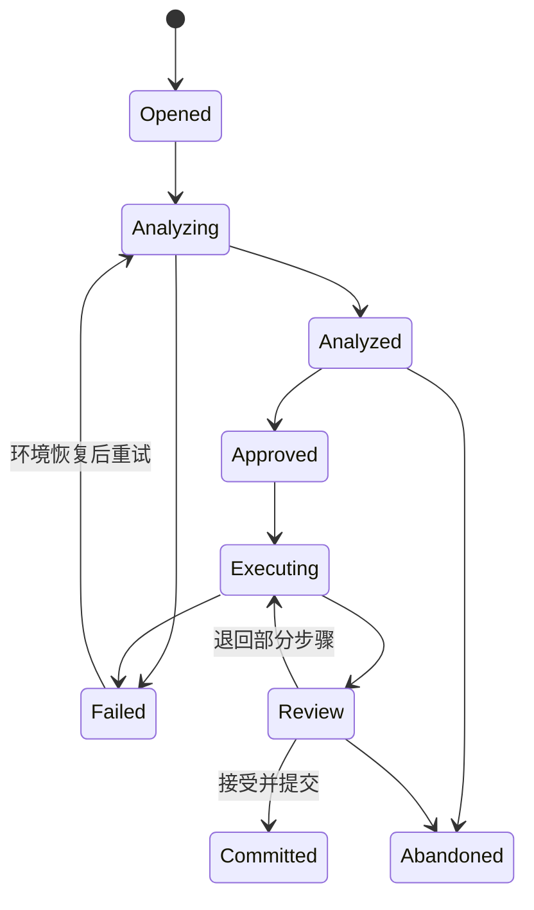
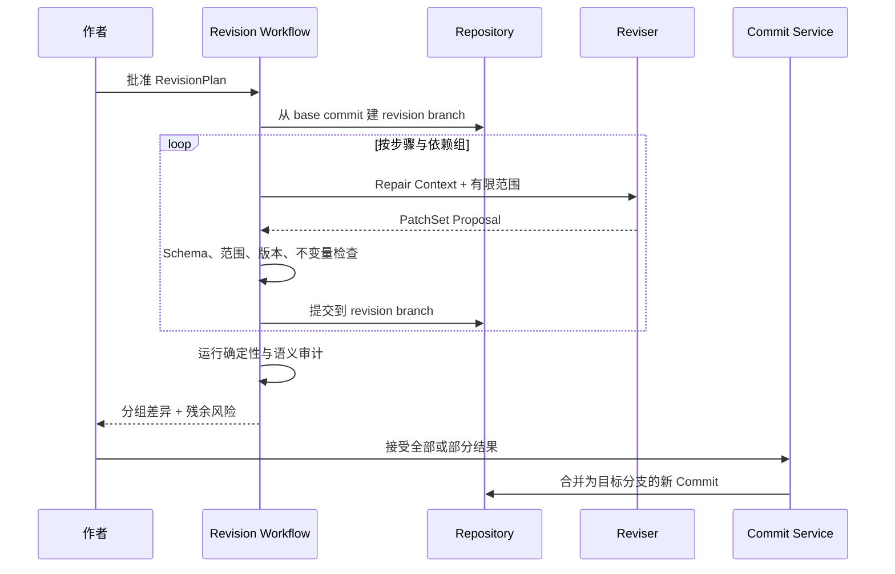

# Change & Impact：影响分析与系统修复

> 状态：as-built / Phase 15（2026-10-15）。§0 为实际交付；后续章节保留总体契约。
> 目标包：`hastings.domain.changes`、`hastings.application.workflows.revision`。

## 0. Phase 15 实际交付

已交付 ChangeSet/ImpactReport/RevisionPlan/ApprovalReceipt/ExecutionRecord/PatchSet/Finding、依赖与正文引用分析、修订分支、逐字段/正文行块审阅、选中内容原子合并、残余影响重算、四类确定性审计，以及可中止/恢复/比较/放弃的章节分组重写。证据与取舍见 [Phase 15 构建笔记](../phase-15-change-impact.md)。

- 应用入口：`AnalyzeChangeImpact`、`PlanRevision`、`ExecuteRevisionPlan`、`ReviewRevision`、`AuditWorkflow`、`RewriteWorkflow`。
- `SeedChange.proposed_content` 携带期望新内容，种子本身进入 Canon 修订步骤；仅有变化意图时也可只分析下游影响。
- 普通 roots 为对象白名单；章节/Arc/Book roots 展开为所含结构、认知及 TextUnit，Canon 作为共享事实保留。截断信息进入报告。
- 语义补充为可注入 Callable 端口，默认只运行确定性与字面 mentions。低置信项仅 review；失败通过 coverage/warnings 表达。
- 凭证一小时内可批准并启动，绑定种子、base、scope、报告、计划；批准消费一次，已启动任务仍可恢复。故事内容变化阻止签发/批准，执行或审阅时计划漂移也会拒绝。
- 执行步骤和命令结果可从仓库恢复，客户端换请求键不重跑已提交步骤。main 可以记录工作流元数据，接受时才写入修订正文。
- PatchSet 冻结分支头和旧内容，支持行块/字段选择。人工改过同一字段即冲突；选择、状态、风险及重算报告同 Commit。committed 不表示全部影响已解决。
- 内容 Patch 禁止改变身份、归属和依赖字段；此类变化继续走领域命令。完整接受某对象的补丁表示该影响已处理，独立审计仍能报告实际冲突。
- Finding 引用检查版本；只有可验证的相关内容修复 Commit 才能标 fixed，元数据提交和重复审计不能关闭问题。
- 重写按章在独立分支执行，锁定单元不进入 Worker；当前控制面为应用用例和 HTTP，正式采用重写稿的产品交互后续再做。
- `/api/v2/projects/{id}/changes` 及 analyze/plan/approve/execute/review/merge 子路由、audit、rewrites 提供最小出口；前端「变更中心」已接通。当前服务器默认启用 V2，`--v2-db` 仅覆盖仓库路径（见 [默认启动修复](../phase-19-default-startup.md)）。

本阶段用 FakeWorker/人工候选验收管线；真实模型、持久后台调度和任务上下文属 Phase 16。V1 数据与写链不迁移，不修改 Tau 上游。

## 1. 职责

本模块把“我改了一个早期设定，后面怎么办”变成可保存、可分析、可审阅、可恢复的工作流。它负责：

- 表达一次变化的原因和目标；
- 从显式依赖和语义引用中计算影响范围；
- 把影响分级并保留因果路径；
- 制定按依赖顺序执行的修订计划；
- 在独立分支上生成 Patch Set；
- 支持逐组接受、拒绝、重算和提交；
- 在修改后触发审计并保留未解决项。

它不负责定义具体故事不变量，也不直接运行模型。

## 2. 核心对象

### `ChangeSet`

| 字段 | 说明 |
|---|---|
| id / project_id | 身份与项目边界 |
| base_commit_id | 变化分析所依据的版本 |
| intent | 作者用自然语言或结构化命令表达的目的 |
| source | manual / agent_proposal / import / migration |
| seed_changes | 已确认要改变的 Artifact/字段 |
| scope | 允许分析和修改的范围 |
| status | opened → analyzed → approved → executing → review → committed 等 |
| created_by / timestamps | 审计信息 |

### `ImpactItem`

- `target_artifact_id` / 可选 `text_unit_id`；
- `severity`：must_fix / should_fix / review / unaffected；
- `impact_kind`：contradiction / motivation / knowledge / timeline / setup_payoff / wording / style 等；
- `dependency_path`：从变化种子到目标的完整边路径；
- `reason` 和证据；
- `confidence`；
- `status`：open / planned / resolved / accepted_risk / dismissed。

### `RevisionPlan`

将 ImpactItem 分成有顺序的 `RevisionStep`：

1. Canon 真相和规则；
2. Narrative Plan 与角色认知；
3. Manuscript；
4. 审计与残余风险。

每一步记录输入版本、目标范围、前置步骤、执行方式、预期输出和完成条件。

### `PatchSet`

一个或多个 Artifact Patch 的集合，带基础 Revision、生成者、Context Package 摘要、影响项关联和 hunk。PatchSet 不表示已经提交。

## 3. 状态机



只有作者或受作者明确授权的界面操作能使 `Analyzed → Approved`。Agent 不能为自己的计划签发 Approval Receipt。

## 4. 影响分析算法

### 4.1 两阶段分析

1. **确定性传播**：沿显式 dependency edge 遍历，得到结构上必然受影响的对象；
2. **语义补充**：对正文 mentions、隐含动机和表达相关性进行模型分析，产生带置信度的 review/should_fix 项。

确定性结果不能被语义分析删除。语义分析失败时仍返回确定性报告，并标明覆盖范围有限。

### 4.2 遍历规则

- 边类型决定传播方向与默认严重度；
- 遇到 Artifact scope 边界时停止并记录被截断项；
- 相同目标的多条路径全部保留，展示时可折叠；
- 环路以 `(artifact_id, relation_revision)` 去重，不无限遍历；
- 分析结果绑定 `base_commit_id`，仓库 head 变化后标记 stale；
- `unaffected` 只在有明确规则证明无需修改时使用，不能表示“没有检查”。

### 4.3 示例

```text
Change: 林岚 role = helper → manipulator

Path A
Character:林岚
  --motivates--> Beat:ch03-sc02-b04
  --changes_state--> Relationship:主角信任林岚
  --requires--> Beat:ch07-sc01-b02
  --renders--> TextUnit:ch07-p18

Result: ch07-p18 / must_fix / 当前内心判断依赖旧信任关系
```

## 5. 修订执行



每个步骤只得到当前步骤所需的 Repair Context。正文修订不得隐式修改 Canon；如果修订发现 Canon 仍不完整，应产生新的 Finding 或 Change Set 建议。

## 6. 全局重写

“从头全面修改”不是覆盖主分支，而是：

1. 从作者选择的 Commit 创建 rewrite branch；
2. 提交新的 Canon/Plan 基线；
3. 运行全范围影响分析；
4. 按 Arc/Chapter 分批生成正文；
5. 每批可以与原分支比较、接受或回退；
6. 最终通过合并 Commit 切换正式版本。

重写分支允许保留旧稿中用户明确锁定的 TextUnit。锁定表示“计划不得自动修改”，作者仍可手动编辑或显式解锁。

## 7. 不变量

1. Impact Report、Revision Plan 和 Patch Set 都绑定基础 Commit；
2. 过期报告不能直接执行；
3. Patch 不得修改 Scope 之外的 Artifact/TextUnit；
4. 每个 must_fix 必须被 resolved、accepted_risk 或显式保留为 open，不能静默消失；
5. Revision Step 只能在其依赖步骤完成后执行；
6. 执行失败不移动目标主分支；
7. 部分接受只提交选中 Patch，并重新计算剩余影响；
8. 审计 Finding 不能在没有对应 Commit 的情况下标为 fixed；
9. 无下游影响是合法空结果，应保存分析摘要但不建立空修订分支；
10. 自动修订不得修改人工锁定范围。

## 8. 测试重点

- 单条 Canon 变化沿多跳边找到正文；
- 环形关系不会无限遍历；
- scope 截断被报告；
- 基础 Commit 变化使报告和 Patch stale；
- 必须修改、建议修改和待复核分类稳定；
- 语义分析失败仍返回确定性结果；
- 分支执行失败不改变主分支；
- 部分接受后重新分析剩余项；
- 人工锁定文本不进入自动 Patch；
- 全局重写能随时比较和放弃，不破坏旧稿。

