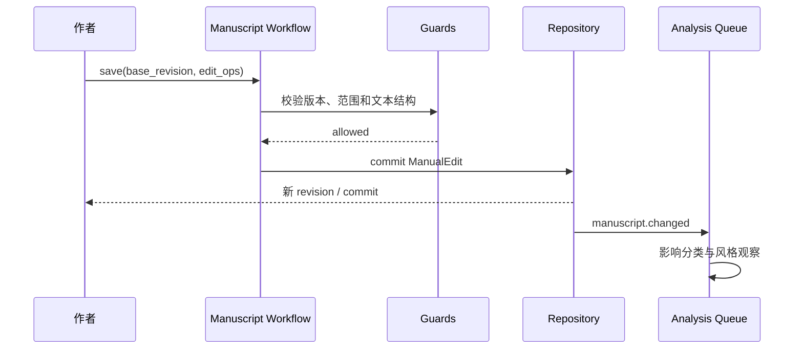

# Manuscript 与 Author Model

> 状态：**as-built**（Phase 14 已交付，2026-10-15）。构建笔记见 [../phase-14-manuscript-author-model.md](../phase-14-manuscript-author-model.md)。
> 实际包：`hastings.domain.manuscript`、`hastings.domain.author_model`、`hastings.application.workflows`（manual_edit / analysis_dispatch / author_learning / restore_version）、`hastings.server.v2`（REST 面）。
> 关键词：TextUnit、Edit Operation、Patch Proposal、逐 hunk 接受、章基础（内容哈希）、保存与分析解耦、Outbox 补偿、Author Observation、Preference Hypothesis、Author Example、V2 REST。
> 下文 §2–§9 为立项时的 target 设计，保留演进对比价值；与 as-built 的命名差异以本块为准。

## 0. as-built 摘要（Phase 14 交付）

- **正文**：`Manuscript → Chapter → TextUnit`（段落级，顺序由章的 `text_unit_ids` 显式持有）。章基础 = 活动段落有序 `(unit_id, 文本)` 的内容哈希（`catalog.content_base`），读投影与命令应用后状态同源；乐观冲突返回 `MANUSCRIPT_BASE_CONFLICT` + 期望/实际基础。
- **Edit Operation**：`insert / replace / delete / split / merge / move`（`operations.py`）；导入整章按确定性段落切分；完整文本保存由服务器 diff 规范化为操作。
- **Agent Patch**：`ManuscriptPatchProposal`（hunk 状态 pending/accepted/rejected）经 `propose_patch` 登记、`accept_patch_hunks` 逐块接受（`applied_base` 记回提案）、`reject_patch` 拒绝；提案无法直接提交正文。
- **人工保存**：`CommitManualEdit.save` 只提交即返回；分析调度由持久化 Outbox 消费者（`AnalysisDispatcher`）承担，按 event_id 去重、失败重投补偿。
- **作者模型对象**（命名与 target 的差异）：`PreferenceHypothesis`（字段 `category`/`statement`/`scope_kind`+`scope_target`/`status` ∈ candidate/active/revoked/`origin` ∈ explicit/induced/`evidence` 为 Commit ID 元组）；`AuthorObservation`（内嵌 `EditSample` + `Classification`）；`AuthorExample`（引用-only + 软删除，极性 positive/negative）。全部是普通 Artifact，随 Commit 持久化。
- **激活规则**（`rules.py`）：规则优先分类管线；置信度门槛为可注入策略参数，低置信保持 candidate；风格方向聚合区分相反证据；scope 具体度优先（global < project < arc < chapter）；revoke 封锁自动复活。
- **历史恢复**：`RestoreChapterVersion` 读源 Commit 章文本 → 当前 head 上一次 `save_full_text` 提交（恢复 = 新 Commit，不重写历史）。
- **REST 面**（`/api/v2`，仅后端）：`POST /projects`、`POST /projects/{pid}/chapters/import`、`GET .../manuscript`、`GET .../chapters/{cid}`、`POST .../chapters/{cid}/save`、`POST .../chapters/{cid}/restore`、`GET .../author-model/{preferences,observations}`、`GET .../author-model/preferences/{pid}/evidence`。错误信封 `{error: {code, category, where, why, fix, details}}`，状态码按 code 分类（`*_CONFLICT`→409、`*_NOT_FOUND`/`UNKNOWN*`→404、环境→503、其余违规→400）。
- **留白**：JobStore 进程内、发布循环未接 lifespan、消费者只建任务不执行、版本历史列表端点与作者模型写端点未做（等 UI 阶段）、正文与 Story 关联（Phase 15）。

## 1. 职责

本模块解决两件相连但边界清楚的事：

1. 保存用户和 Agent 对正文的每次修改，使人工编辑始终安全、可追踪、可撤销；
2. 从人工编辑、接受/拒绝和交互选择中生成有证据的作者偏好，而不是把正文版本和偏好混在一起。

作者模型读取正文变化作为证据，但不能参与正文 Commit 的成败。

## 2. 正文模型

```text
Manuscript
└── Chapter
    └── Scene Text
        └── Text Unit
```

`TextUnit` 是稳定定位的最小正文单元，初始可采用段落级。必要字段：

- `unit_id`：稳定 ID；
- `scene_id` / `beat_ids`：结构关联；
- `text`；
- `order_key`；
- `origin`：human / agent / import；
- `last_actor`；
- `content_hash`。

段落拆分、合并和移动通过 Edit Operation 表达：`insert`、`replace`、`delete`、`split`、`merge`、`move`。操作结果写入新 Revision，旧 TextUnit 的谱系通过 `derived_from` 保存。

## 3. 统一编辑命令

| 命令 | 来源 | 说明 |
|---|---|---|
| `CommitManualEdit` | 编辑器 | 用户保存，版本检查通过后立即提交 |
| `ProposeManuscriptPatch` | Writer/Reviser | 只创建 Patch，不直接修改正文 |
| `AcceptPatchHunks` | 作者 | 可接受全部或指定 hunk |
| `RejectPatch` | 作者 | 保留拒绝原因供评测和协作偏好使用 |
| `RestoreManuscriptVersion` | 作者 | 从历史版本生成新的恢复 Commit |
| `ReanchorTextUnits` | 应用服务 | 段落大改后重新建立稳定引用和谱系 |

Manual Edit 和 Agent Patch 最终都转换为 Repository CommitRequest。两者共享乐观并发、版本历史、事件和审计，不共享授权要求：用户在编辑器中的直接保存本身就是该范围的授权；Agent Patch 仍需审批。

## 4. 人工保存流程



若 base revision 过期，返回带当前差异的冲突，不覆盖他人或后台已经提交的内容。若后台分析不可用，保存仍成功并把任务留在待重试状态。

## 5. 作者模型

### 5.1 三类偏好

| 类型 | 示例 | 默认作用范围 |
|---|---|---|
| 明确偏好 | “不要替人物解释情绪” | 用户指定的项目或全局 |
| 推断习惯 | 多次把抽象情绪改成动作 | 当前项目，达到证据阈值后启用 |
| 协作偏好 | 喜欢先看 3 个结构方案再决定 | 用户或项目级 |

### 5.2 对象

`AuthorObservation`：一次可追溯事实，例如“在 commit X 中删除了段末解释句”。

`PreferenceHypothesis`：对多个 Observation 的归纳，字段至少包括：

- `dimension`：句法、词汇、叙事距离、对话、节奏、结构决策、协作方式等；
- `statement`：可读结论；
- `scope`：global / project / genre / character / pov；
- `evidence_ids` 和反例；
- `confidence`；
- `status`：candidate / active / rejected / revoked / superseded；
- `source`：explicit / inferred；
- `created_at`、`last_confirmed_at`。

`AuthorExample`：作者明确认可的自有文本片段，保存用途、范围、来源 Revision 和许可状态。

### 5.3 观察分类

人工 diff 先分类，再决定能否成为风格证据：

| 类别 | 是否默认用于风格学习 |
|---|---|
| 错别字、标点、排版 | 否 |
| 因 Canon 改变而修改事实 | 否 |
| 情节或场景作用改变 | 进入结构偏好候选，不进入文风 |
| 句式、措辞、叙事距离调整 | 是 |
| 删除模型套话、重复解释 | 是 |
| 接受 Agent 原文未改 | 弱正证据 |
| 拒绝 Patch 并给出原因 | 强负证据 |

分类器可以使用确定性特征和模型，但输出只是 Observation Proposal；低置信结果保持 candidate。

## 6. 激活与应用规则

1. 用户明确陈述可直接成为 active，但仍保存原始证据；
2. 推断偏好必须有多个独立编辑证据或作者确认；阈值为产品策略；
3. 当前任务的明确要求优先于项目偏好，项目偏好优先于全局偏好；
4. rejected/revoked 偏好不能进入 Context Package；
5. 相互冲突的 active 偏好必须按范围和时间排序，无法判定时向作者展示冲突；
6. 系统向模型注入偏好时携带简短理由和正反例，不注入全部编辑历史；
7. 用户可以查看、编辑、停用和删除自有样例；
8. 第一版不训练或微调基础模型。

## 7. 关键不变量

- 用户成功保存的正文不能因观察失败而回滚；
- Agent Patch 不得覆盖 Patch 范围外的 TextUnit；
- 部分接受只提交选中的 hunk；
- 每个 hunk 必须能追溯到 Proposal、基础版本和生成上下文；
- 作者推断必须有 evidence；
- 一个项目中的风格偏好不得自动提升为全局偏好；
- 事实性修改不能未经分类进入文风模型；
- 撤销偏好后，新的 Context Package 不得再包含它；
- 学习任务无结果属于合法空结果，不产生空偏好。

## 8. 查询与 UI 投影

- 章节版本时间线和逐 hunk diff；
- 当前正文中人工/Agent 内容的来源追踪；
- “系统最近学到了什么”列表；
- 每条偏好的证据、反例、范围和使用记录；
- 某次生成实际采用了哪些偏好；
- 过期或冲突的偏好候选。

## 9. 测试重点

- 人工保存成功、分析任务失败，正文仍保持新版本；
- 两个编辑基于同一 revision 时第二个返回冲突；
- 部分接受 Patch 不改未选 hunk；
- 大幅改写后 TextUnit 谱系仍可定位；
- 事实修改不被分类为文风；
- 多次相似修改形成候选偏好，一次修改不会；
- 偏好作用域和优先级正确；
- revoked 偏好不会进入后续 Draft Context；
- 每条活跃偏好都能反查 evidence。

