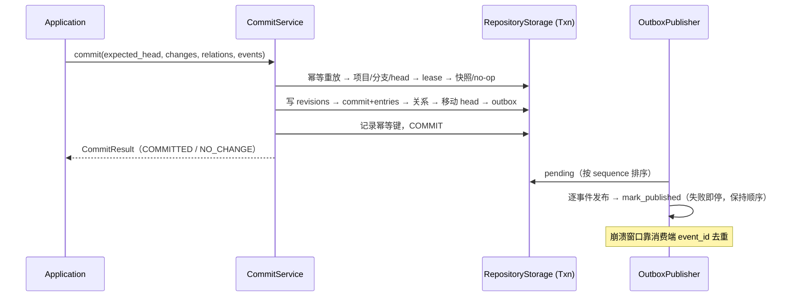

# Repository Kernel：版本化小说仓库

> 状态：**as-built（Phase 12 交付，2026-10-14）**。
> 目标包：`hastings.domain.repository`、`hastings.application.ports.repository`、`hastings.infrastructure.repository`。
> 提交引擎：`hastings.application.services.commit_service.py`（单一算法，驱动内存与 SQLite 双后端）。
> 构建过程与设计复盘见 [phase-12-repository-kernel.md](../phase-12-repository-kernel.md)。

Phase 15 补充只读端口 `find_commit_result(project_id, key)` 与 `commit_history(project_id, at_commit_id)`：前者从原子幂等结果恢复已提交步骤，后者返回验证项目归属后的 first-parent 历史，用于定位真实修复 Commit。Changes handler 将命令指纹/领域结果作为 `changes.command_result` 与业务变化同 Commit 保存，支持跨实例和重启重放，不修改仓库表结构。

## 1. 职责

Repository Kernel 为所有小说资产提供统一的版本语义。它回答：

- 当前分支指向哪个 Commit；
- 某个 Artifact 的当前 Revision 是什么；
- 一次操作改变了哪些对象和关系；
- Patch 的基础版本是否仍然有效；
- 如何建立修订分支、比较版本、撤销和重放；
- 如何保证数据提交和业务事件一致。

它不理解“角色”“线索”或“章节”的具体业务规则；这些规则由上层领域模块提供。

## 2. 核心对象

| 对象 | 必要字段 | 说明 |
|---|---|---|
| `Project` | id、name、created_at | 小说项目边界 |
| `Artifact` | id、project_id、kind、created_at | 可版本化对象身份，kind 创建后不可变 |
| `Revision` | id、artifact_id、parent_id、content、content_hash、author、created_at | 不可变内容版本 |
| `Commit` | id、project_id、parent_ids、message、actor、created_at、sequence | 一组原子生效的变化 |
| `CommitEntry` | commit_id、artifact_id、old_revision_id、new_revision_id | Commit 中的对象变化 |
| `Branch` | id、project_id、name、head_commit_id、version | 可移动引用 |
| `RelationRevision` | source、type、target、metadata、position、valid_from/to | 版本化关系或依赖边（position 记录同一 Commit 内的操作顺序） |
| `OutboxEvent` | id、commit_id、sequence、type、payload、published_at | 与 Commit 同事务写入的业务事件 |
| `Lease` | resource_key、owner_job_id、expires_at、version | 跨会话的短期执行互斥 |

`Revision.content` 与 `RelationRevision.metadata`、`OutboxEvent.payload` 一律保存
`normalize_json` 产出的**规范值树**：与调用者传入对象零共享引用、dict 键全为
字符串且按序、tuple 归一为 list、datetime 归一为 UTC ISO 字符串。非字符串
dict 键在提交入口直接拒绝（`str(k)` 强转会让 `{1: "first", "1": "second"}` 与
`{"1": "second"}` 产生相同哈希——内容丢失且哈希碰撞）。因此两个后端保存同一
种领域值，且历史不可被调用者事后修改。较大正文可由 `content_ref` 指向内容
寻址 Blob，但哈希仍记录在 Revision 中。

## 3. 公开端口（as-built）

签名已按 Phase 12 计划收窄为领域值对象（只变具体，不改名，版本条件全保留）；
端口定义在 `src/hastings/application/ports/repository.py`。

```python
class RepositoryReader(Protocol):
    def get_project(self, project_id: ProjectId) -> Project | None: ...
    def get_branch(self, project_id: ProjectId, name: str) -> Branch | None: ...
    def get_snapshot(self, project_id: ProjectId, commit_id: CommitId) -> Snapshot: ...
    def get_artifact(
        self, artifact_id: ArtifactId, at_commit_id: CommitId
    ) -> ArtifactView | None: ...
    def list_artifacts(
        self, query: ArtifactQuery, at_commit_id: CommitId
    ) -> list[ArtifactView]: ...
    def diff(
        self, before: CommitId, after: CommitId, scope: Scope = DEFAULT_SCOPE
    ) -> RepositoryDiff: ...


class CommitRepository(Protocol):
    def create_project(self, name: str) -> Project: ...
    def commit(self, request: CommitRequest) -> CommitResult: ...
    def create_branch(self, request: CreateBranchRequest) -> Branch: ...
    def move_branch(self, request: MoveBranchRequest) -> Branch: ...


class LeaseRepository(Protocol):
    def acquire(self, resource_key: str, owner_job_id: JobId, ttl_seconds: float) -> Lease: ...
    def renew(self, lease: Lease, ttl_seconds: float) -> Lease: ...
    def release(self, lease: Lease) -> None: ...
```

`CommitRequest` 字段（as-built）：`project_id`、`branch_id`、`expected_head`、`changes`、
`relations`、`actor`、`idempotency_key`（非空强制）、`summary`（非空强制）、`events`、
`required_leases`。

作为-built 补充的低层接缝：`RepositoryStorage.transaction()` 返回
`RepositoryTxn`（读/写原语 Protocol）——提交算法只有一份
（`CommitService`），内存与 SQLite 各实现同一套事务原语，故障注入因此
对双后端同构。`agents` 层依旧禁止 import `CommitRepository`（ADR-003）。

## 4. 提交算法（as-built：11 步固定顺序，单份实现）

`CommitService.commit` 的固定顺序（写点编号，故障注入测试逐一验证）：

1. 规范化输入：`normalize_json` 将 changes 的 content、relations 的 metadata、
   events 的 payload 冻结为与调用者零共享引用的规范值树，并计算稳定哈希；
2. 幂等重放检查：计算请求指纹（「写什么」——changes/relations/events/summary/
   actor 等操作内容；并发执行凭据 expected_head/old_revision_id/required_leases
   **不参与**，否则合法重放会被误判冲突）。同键同指纹返回原结果；同键不同
   指纹抛 `REPO_IDEMPOTENCY_CONFLICT`，指引用户换新键；
3. 开事务；
4. head / branch version 检查（乐观并发，不变量 3）；
5. lease 验证（owner + version + 未过期）；
6. 基础快照有效 revision 检查（不变量 5）与 no-op 检测（合法空结果）；
7. 写不可变 Revision 与 RelationRevision（含同一 Commit 内的 position 序号）；
8. 写 Commit 与 CommitEntries（先 commit 后 relation，FK 顺序约束）；
9. 移动 Branch head（存储层复查 version）；
10. 写 Outbox 事件（与 Commit 同事务，ADR-007；sequence 由批内基数递增）；
11. 记录幂等键（连同请求指纹）；事务提交。

任何写点抛出异常都由存储事务整体回滚（内存靠快照还原、SQLite 靠
ROLLBACK）。no-op 检测放在事务内 head 检查之后而非之前：把读也纳入同一
快照，消除「检测通过但 head 已被并发提交移动」的 TOCTOU 窗口。



## 5. 不变量

1. Revision 创建后不可修改或删除；
2. 一个 Branch 在任意版本只指向一个 head；
3. `expected_head` 不匹配时整个提交失败，不写部分数据；
4. 同一幂等键 + 同一请求指纹重放返回原 Commit，不产生重复 Revision 或事件；
   同键不同指纹抛 `REPO_IDEMPOTENCY_CONFLICT`（指纹只含操作内容，不含并发凭据）；
5. CommitEntry 的 old revision 必须等于基础快照中的有效 revision；
6. 每个 Commit 的 sequence 在项目内严格递增且唯一；
7. Outbox 与 Commit 同事务写入；
8. 导出文件不允许绕过 Repository 形成当前状态；
9. Lease 到期后可被其他 Job 获取，旧 owner 续租或提交时必须失败；
10. 回退通过新 Commit 实现，历史 Commit 和 Revision 永不改写；
11. 关系边的两端必须是本提交内创建或已存在的 Artifact（FK 背书，Phase 12 新增）。

补充语义（as-built）：Lease 版本号跨 release 单调递增防 ABA——release 不删行，
owner 标记为 `released`；不变量 8 的导出路径由 Snapshot 单向生成，Phase 12 未交付导出器。

## 6. 存储方案（as-built）

第一实现使用 SQLite（`infrastructure/repository/sqlite.py`）：

- 单文件便于桌面应用备份；
- 事务覆盖 Commit、Branch、关系和 Outbox；
- 外键、唯一索引和 CHECK 约束支撑核心不变量；
- 后续如需更换数据库，应用层只依赖端口与契约测试。

已交付 11 张表：`projects`、`artifacts`、`revisions`、`commits`、
`commit_parents`、`commit_entries`、`branches`、`relation_revisions`、
`leases`、`outbox_events`、`idempotency_records`（见 `schema.py`）。schema
版本存 `PRAGMA user_version`（当前 `SCHEMA_VERSION = 3`：v2 给
`idempotency_records` 加 `request_fingerprint` 列，v3 给 `relation_revisions`
加 `position` 列）；迁移器按 `_MIGRATION_STEPS` 分步升级（键 N 表示把版本
N 升到 N+1，每步单独 commit 并推进 user_version），v1/v2 旧库可沿链直升，
v2 前的旧行指纹为空串、重放时按冲突拒绝（防御性语义）；基础三行为：空库
建到当前版本、较新版本拒绝并给备份恢复建议、有表无版本拒绝。
`UNIQUE(project_id, sequence)` 支撑不变量 6。

**备份说明**：一律使用 `SqliteRepository.backup_to(dest)`（SQLite backup
API，持锁执行，产物为一致性快照），不要直接复制运行中的数据库文件——
WAL 模式下裸复制会拿到缺 `-wal` 的半状态。**inspection**：`inspection.py`
提供受限只读检查（`mode=ro` 打开、白名单查询、不提供任意 SQL）：SQLite
自检（integrity_check / foreign_key_check）+ 应用层不变量扫描（head 可达、
sequence 连续、entry/revision 链一致、outbox 指向存在的 commit、
content_hash 规范化重算比对），输出结构化报告 `RepositoryInspection`。

禁止在 Phase 12 同时维护 SQLite 和旧 YAML 的双向实时同步。旧 YAML 先通过 Import Adapter 只读进入 V2，Markdown/YAML 导出由 Snapshot 单向生成。

## 7. 结果与错误

| 类别 | 示例 | 行为 |
|---|---|---|
| 成功 | 提交产生新 Commit | 返回 commit_id、new_head、sequence 和变更摘要 |
| 合法空结果 | Patch 归一化后没有实际差异 | 不创建 Commit，返回 `no_change` 和原因 |
| 违规 | expected_head 过期、old revision 不匹配 | 返回稳定冲突码和重新读取/合并指引 |
| 环境故障 | 数据库不可写、磁盘满 | 回滚事务，返回可重试错误，不发布完成事件 |

稳定错误码已全部落地于 `domain/repository/error_codes.py`：`REPO_HEAD_CONFLICT`、
`REPO_REVISION_CONFLICT`、`REPO_NO_CHANGE`、`REPO_LEASE_CONFLICT`、
`REPO_IDEMPOTENCY_CONFLICT`、`REPO_INTEGRITY_ERROR`、`REPO_UNAVAILABLE`、`REPO_PROJECT_NOT_FOUND`、
`REPO_BRANCH_NOT_FOUND`、`REPO_COMMIT_NOT_FOUND`、`REPO_BRANCH_EXISTS`、
`REPO_ARTIFACT_NOT_FOUND`、`REPO_INVALID_CHANGE`、`REPO_DUPLICATE_CHANGE`、
`REPO_BRANCH_MOVE_BACKWARD`，以及迁移器专属的 `REPO_SCHEMA_TOO_NEW` /
`REPO_SCHEMA_UNKNOWN`。所有错误携带三要素（where/why/fix）与结构化
details；SQLite 原始异常不外泄，以 `REPO_INTEGRITY_ERROR` /
`REPO_UNAVAILABLE` 信封转发。

## 8. 契约测试（as-built：tests/v2/repository/）

`contract.py` 的 18 项检查同时运行于内存实现（`test_memory.py`）和 SQLite
实现（`test_sqlite.py`）：initial_commit_and_snapshot、head_conflict、
multi_artifact_atomic、multi_artifact_failure_rolls_back_all、no_op、
idempotent_retry、branch_fork_and_diff、restore_as_new_commit、
relation_revision、lease_basic、commit_and_outbox、reopen_preserves_state、
concurrent_commit_single_winner、history_immutable_to_caller（调用者提交后
修改原对象不改写历史）、normalized_value_roundtrip（datetime/tuple 双后端
同值）、non_string_dict_keys_rejected、idempotency_fingerprint（同键同指纹
重放 / 同键不同指纹冲突 / 换键后成功）、relation_order_within_commit（同一
Commit 先 add 后 remove 的顺序跨后端一致）。

专项测试：`test_commit_service.py`（7 写点故障注入 + 固定顺序断言）、
`test_lease.py`（过期接管/过期提交拒绝/错误凭据）、`test_outbox.py`
（保序发布/崩溃重投去重/handler 失败后重试不被吞）、`test_inspection.py`
（损坏检出 + 只读保证）、`test_acceptance.py`（计划 §8 八步场景双后端复跑）、
`test_sqlite.py`（迁移专项：v1→v2→v3 升级链）。

