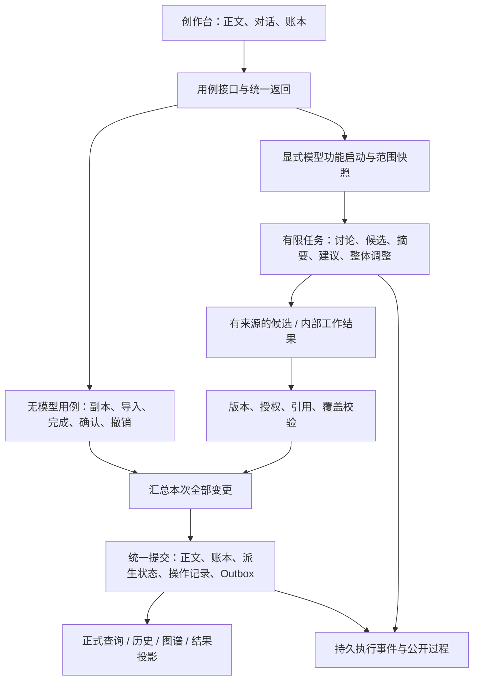

# Hastings 0.3 完整开发计划：作家的桌面与持续创作闭环

> 定位：0.3 实施目标与验收基线，编写于 2026-10-17。当前已进入实现与补验；本文不记录实时进度，现状见 [模块说明](modules/README.md)，剩余缺口见 [运行与验收状态](release.md)。
> 产品版本：0.3；包版本：`0.3.0`；沿用 `/api/v2`，不创建 `/api/v3`。
> 本文为实施方案，新增类型、路径、接口及参数均是目标契约，不表示当前已经存在。
> 不延续分配 Phase 20 等全局编号；本文任务使用 `V03-*`，与 Phase 11–19 的历史交付记录分开。

## 阅读导航

- [1. 交付目标与范围](#1-交付目标与范围)
- [2. 当前基线与改造差距](#2-当前基线与改造差距)
- [3. 总体设计与共同不变量](#3-总体设计与共同不变量)
- [4. 数据身份、存储与状态](#4-数据身份存储与状态)
- [5. 模块实施方案与代码示例](#5-模块实施方案与代码示例)
- [6. 前后端接口与事件契约](#6-前后端接口与事件契约)
- [7. 实施批次与任务清单](#7-实施批次与任务清单)
- [8. 数据升级、旧能力去向与切换](#8-数据升级旧能力去向与切换)
- [9. 验证策略与完整验收](#9-验证策略与完整验收)
- [10. 风险、工作量与实施纪律](#10-风险工作量与实施纪律)

## 1. 交付目标与范围

### 1.1 为什么做这次调整

现有系统已经具备版本仓库、故事领域、人工正文保存、创作任务和对话能力，但作者仍需要在多个业务页面之间搬运意图和结果。
0.3 要解决的是从想法到正文、从修改到继续创作的连续性：作者只需理解正在写什么、哪些已确认、这次操作影响哪里。
内部仍保留严格的版本、范围与提交规则，界面不要求作者理解工作流角色、分支、节拍或逐层审批。

核心交付是一条完整链路：

```text
连接模型或先记录想法 / 导入正文
  → 讨论人物、线索与故事方向 → 确认必要设定
  → 明确请求试写 → 查看完整候选 → 采用为正文
  → 阅读 / 随时开启手工修改 → 跨章保存副本 → 修改完成
  → 记录正式版本、摘要失效、正文证据状态、固定归属结果
  → 作者分别选择更新摘要 / 整理账本更新建议 / 继续创作
  → 必要时在对话中整体调整 → 统一发布 → 回看或关联撤销
```

### 1.2 设计依据与优先级

| 依据 | 本计划负责落实的内容 |
|---|---|
| [产品范围与版本决定](../../product-design/README.md) | 0.3 必须交付与后续保留的边界；模型任务必须显式启动 |
| [主工作区与故事账本](../../product-design/agent-first-workbench-product-design.md) | 用户旅程、首次引导、四类图谱、日志、三批交付及33项验收 |
| [作家的桌面](../../product-design/writers-desk-design.md) | 文章中心、模块化空间、老 iOS 控件、字号和位置保护 |
| [正文修改与版本流程](../../product-design/manuscript-editing-design.md) | 工作副本、统一完成、建议归属、整体调整、关联撤销 |
| [模型上下文与正文摘要](../../product-design/context-and-summary-design.md) | 常驻资料、来源版本、过期处理、本书约定、信息披露边界 |
| [0.2 总设计](../v0.2/DESIGN.md)与[模块契约](../v0.2/modules/README.md) | 可复用的仓库与任务机制；其中节拍、自动作者学习及审计规则按0.3决定调整 |

当前产品决定优先于历史计划与原型功能。原型只提供视觉参考，不将七页导航、占位按钮或示例数据当作需求。
本文新增的工程选择是建议实施基线；若实现证明需要调整，应记录取舍并同步契约，不能降低产品要求。

### 1.3 范围清单

| 本版交付 | 完成标准 |
|---|---|
| 单一创作工作区 | 无正文时接住讨论；有正文时默认文章；唯一协作输入框持续可用 |
| 个人 API 与本地模型引导 | 保存、测试、选择与实际任务使用同一连接；本地下载、加载、测试是真实阶段 |
| 无模型记录 | 未命名作品、多条作者消息、独立输入草稿、连接后自主继续，无自动重放 |
| 已有正文导入 | 新增为默认、替换显式选择、完整预览、去重、副本保护、整批提交 |
| 账本与设定确认 | 正式/候选/真相/证词/认知/读者披露/计划与实现分开 |
| 无节拍的生成与采用 | 人物、线索、作者要求和正文范围足以起草；无隐藏替代规划对象 |
| 手工修改支线 | 一个活动副本，跨章暂存，重启恢复，修改完成一次正式版本，无模型可用 |
| 摘要与常驻上下文 | 每轮携带有版本的账本与摘要；作者显式更新；精确任务读原文 |
| 正文证据状态 | 正式正文生效时确定性核对，失效依据立即标为需核对 |
| 账本更新建议 | 作者启动、原对话成组处理、来源校验、部分采用、关联原始操作 |
| 整体调整与撤销 | 单次范围授权、有限执行、覆盖记录、统一发布、保护后续独立修改 |
| 四类图谱 | 人物、线索、手法、时间线；真实来源、文字等价操作及两种时间顺序 |
| 过程与执行日志 | 公开模型过程、应用事件、最终回复分开；历史、实时、补齐、去重 |
| 本书约定、历史、导出备份 | 可直接维护作品要求，任务用快照；旧历史可达，新增数据进入备份恢复 |

### 1.4 本版排除项

作者模型、自动学习或推断偏好、独立章节/全文模型一致性审计、参考材料导入与材料库、风格语料、RAG、收费平台、多人协作、无人值守整书创作均不进入本版。
旧实现与资料保留，禁止默认触发、作为写作前置条件或显示为可用占位入口。
正文导入与粘贴讨论继续保留；正文与本书约定不能借“材料”名义恢复被排除的流程。
本次任务内的版本、引用、授权、已发现冲突与要求落实检查必须保留，不据此宣称做过独立模型审计。

## 2. 当前基线与改造差距

### 2.1 已核对的代码事实

以下来自本次文件阅读，不代表完成运行验证；实施开始时需再次核对。

| 已有位置 | 当前能力/约束 | 0.3 处理 |
|---|---|---|
| `application/services/commit_service.py` | 统一提交、乐观并发、幂等、不可变版本及同事务 Outbox | 复用；新增正文后置状态必须参加同一次提交 |
| `domain/manuscript/`、`application/workflows/manual_edit.py` | 稳定正文单元、diff、单章正式保存、恢复与 Patch | 复用文本变更；新增工作副本和多章提交协调，自动保存不再调用正式保存 |
| `application/workflows/analysis_dispatch.py`、`server/v2.py` | 正文提交事件可创建分析 Job，并进一步派发风格观察 | 优先移除0.3装配中的自动模型调度；保留历史事件、旧资料及确定性投影 |
| `domain/conversation/`、`infrastructure/conversations/{store,drafts}.py` | 多讨论、消息/事件、任务建议、内存与 SQLite 存储 | 复用；补无模型消息、结果引用、稳定归属与入口去重 |
| `domain/conversation/task_drafts.py` | 起草缺失项包含节拍与已接受计划检查 | 改成正文目标/作者要求/范围检查；空仓库可以创建首章候选 |
| `domain/story/narrative/`、`domain/story/mystery/models.py` | 存在 Beat 和 `at_beat_id`，状态折叠依赖节拍 | 拆除活动契约，迁移有效信息到已有故事对象、事件和正文位置 |
| `application/contexts/__init__.py` | 依赖关系选择与预算裁剪，写作者上下文读取节拍状态，并引用作者档案查询 | 补账本与摘要常驻、原文覆盖和披露边界；去除节拍与旧偏好注入 |
| `application/workflows/{rewrite,revision,review}.py` | 内部修订、范围审阅与版本发布基础 | 复用底层能力；新增对话范围授权、整体覆盖和关联撤销，避免逐章审批 |
| `infrastructure/jobs.py`、`server/v2.py` | 持久 Job、恢复、执行与重试调度 | 补启动凭据；恢复不自动发起新的模型尝试，旧自动队列隔离 |
| `server/model_access.py`、`server/provider_config.py` | 用户连接与选择；支持环境变量回退，当前凭据持久化涉及配置文件 | 普通产品流禁止借用环境 Key；桌面凭据存储单独收口，任务只留非敏感连接快照 |
| `server/v2.py`、`interfaces/api/conversations.py` | 正文导入/保存/恢复、导出、讨论 REST/SSE | 路径兼容；新增预览、修改副本、摘要、结果、图谱、日志用例 |
| `frontend/src/App.tsx`、`pages/*` | 七页导航+右侧对话，默认概览；切项目仍刷新作者偏好等旧数据 | 改为正文中心；旧入口按替代能力退出，禁用被排除功能的主动刷新和启动 |
| `frontend/src/state/{v2,chat,v2socket}.ts` | 项目隔离、正文缓冲、讨论草稿、事件补齐 | 拆清正式稿/副本/候选；保持单一数据缓存，不另建图谱或建议事实源 |
| `interfaces/exporters/v2_package_exporter.py` | 既有版本包导出基础 | 扩展0.3元数据与恢复验证；不将旧V1迁移恢复为产品能力 |

### 2.2 本次不直接更改的基线

2026-10-17 开始编写时，产品方案、`dev-notes/README.md`、`dev-notes/v0.2/{README,DESIGN}.md` 等已有未提交改动，另有后续设计文件移动。
它们作为当前有效输入保留；实施时重新运行 `git status --short`，不得回退或覆盖作者改动。
Phase 19 的真模型 A13 仍有历史待验项；0.3须建立自己的证据，不能把旧计划状态当作通过证明。

## 3. 总体设计与共同不变量

### 3.1 让界面简单，让写入边界集中



保留已有 `domain → application → interfaces/infrastructure` 的依赖约束。
模型只产出提案，正式写入由应用用例汇总到现有提交服务；不为图谱、摘要或导入创建另一套正文存储。
内部实现可以有多个工作者，但作者面对一个协作入口；本计划不要求增加新的通用 Agent 框架。

### 3.2 必须贯穿所有模块的不变量

| 编号 | 不变量 | 证明方式 |
|---|---|---|
| I01 | 正式稿、修改副本、候选、任务快照身份不同 | API引用带类型；查询/写入拒绝混用 |
| I02 | 一个作品至多一个未结束的手工修改副本 | 持久唯一约束；并发创建与重启测试 |
| I03 | 正文变化、摘要失效、证据状态及操作关联原子生效 | 仓库双后端故障注入，不以事件消费者补做关键状态 |
| I04 | 正式写入通过同一提交管线；无差异不创建空版本 | 全入口追踪与 Commit 计数断言 |
| I05 | 每项模型功能有可追溯的作者启动依据 | 启动凭据、功能类型、来源消息/按钮、范围与次数记录 |
| I06 | 打开作品、保存、恢复、模型连接成功不自行创建模型任务 | 零模型调用断言，包括重启旧队列 |
| I07 | 任务固定作品、会话、结果、输入及模型连接快照 | 切作品/讨论/模型与迟到返回测试 |
| I08 | 使用正文证据前检查其对当前来源的有效性 | 图谱和上下文共用证据查询，不沿用旧依据 |
| I09 | 真相、证词/角色认知、读者披露、作者安排分别保存 | 领域类型与候选采用测试 |
| I10 | 所有采用与发布再次校验相关依赖，不能只在任务启动时校验 | 来源变化、部分采用及无关变化测试 |
| I11 | 停止、失败和重试不丢已有结果，不自动重复模型调用 | attempt隔离、停止代际、恢复状态与人工重试证明 |
| I12 | 撤销产生新记录，保留后续独立编辑与历史 | 三方比较、关联账本恢复与冲突阻断测试 |
| I13 | 结果与日志来自真实状态，模型文字不充当提交或工具执行证明 | 回读版本、结构化事件、模拟/真模型证据分开 |
| I14 | 不以隐藏节拍或替代规划对象满足旧任务 | 活动Schema/工具/上下文扫描及无节拍故事夹具 |

### 3.3 统一正文发布路径

导入、候选采用、修改完成、历史恢复、整体调整及关联撤销均复用 `PublishManuscriptChange` 用例（拟新增）：

1. 按 `operation_id` 找到已有结果；同键不同内容明确冲突。
2. 读取同一基础快照，核对目标正文、账本与副本条件；先对相关依赖做三方比较。
3. 在内存准备所有正文/账本变更，基于实际差异计算受影响章节。
4. 准备摘要失效、全书概览失效、正文证据状态及结果记录的变更；过程不用模型。
5. 一次 `CommitRequest` 提交上述全部内容及 Outbox；最终 head 再校验，不在提交间隙重读可变内容。
6. 返回持久操作回执及实际正式版本；会话投影暂未完成时仍可通过操作查询找回结果。

自动保存工作副本不走此路径，不更改正式账本、摘要与证据状态。
无差异返回 `no_change` 与操作回执，不创建正文空版本，也不创建建议/摘要任务。
账本单独保存复用同一仓库，但不能附带未授权正文重写；若账本变化影响概览/任务背景，应更新相应版本索引和分歧提示。

## 4. 数据身份、存储与状态

### 4.1 核心记录

| 记录 | 最小必需内容 | 事实归属 |
|---|---|---|
| `EditSession` | 作品、副本ID、正式基础、状态、保存序号、涉及章节、开始/结束时间 | 独立持久工作数据；不移动正式分支 |
| `DraftChapter` | 章节ID、基础正文单元版本、实际文本、内容哈希、保存序号、段落来源 | 归属一个副本；模型引用冻结具体序号 |
| `OperationRecord` | 操作ID/请求指纹、类型、作品、固定会话ID、来源、前后版本、结果与待处理状态 | 正文发布时的权威业务记录；版本化仓库保存 |
| `OperationReceipt` | 无差异/失败重试/创建入口的幂等结果及请求指纹 | 仓库持久辅助表；正文发布成功回执与提交同事务 |
| `ContextSnapshot` | 正式基础、账本/摘要/约定版本、引用快照、目标位置、读取覆盖、裁剪 | 不可变任务输入；与Job绑定 |
| `ExecutionGrant` | 来源消息/按钮、功能、分析/写范围、候选或执行、调用预算、授权版本 | 应用持久数据；界面不能伪造为后端已授权 |
| `ChapterSummary` | 章节、来源正文清单/哈希、内容、状态、生成任务/模型、纠正来源 | 版本化派生资料，不是正文或账本事实 |
| `BookOverview` | 采用的逐章摘要版本有序集合、目录顺序版本、内容和状态 | 来源集合有变则失效 |
| `EvidenceLink` | 对应设定/披露/认知、来源单元/版本/选区、依赖、有效状态、旧依据 | 版本化关联，图谱/上下文共享 |
| `LedgerSuggestionGroup` | 原始操作、来源正文/账本版本、分组依赖、每项状态、采用结果 | 持久建议；对话与侧栏引用同一ID |
| `BookAgreement` | 作品、明确要求、适用范围、来源消息/手动编辑、替换关系、状态/版本 | 正式作品资料；非作者模型 |
| `CoverageEntry` | 章节/范围、来源版本、读取区间、检查/修改状态、未覆盖原因 | 整体任务内部工作记录 |
| `ExecutionEvent` | 事件ID、作品游标、任务/尝试/Agent/调用、时间、类型、顺序和摘要 | 持久执行日志；链接业务版本，不替代版本 |

副本、任务建议、摘要、账本更新建议分别使用不同类型和ID前缀；禁止一个 `draft` 字段同时指代四种内容。
正文单元沿用 `TextUnit` 稳定ID与谱系，分段/合段/删除不能只凭章节全文哈希冒充精确来源。

### 4.2 存储与原子性方案

当前对话与仓库共用物理 SQLite 文件，但各自使用独立连接/事务；“同一个文件”不等于“同一个事务”。
因此关键状态直接进入仓库提交，不能在 `CommitService.commit()` 后再调用对话或任务存储假装原子。

- 正式正文、证据关联、摘要状态、本书约定、操作记录按 Artifact/Revision 建模，继承现有历史、并发与导出能力。
- 副本及副本章节使用持久辅助表，项目级唯一约束与序号CAS；内存后端实现相同端口，用于契约测试。
- `operation_receipts` 与仓库提交使用同一事务端口扩展，覆盖无变化与操作成功回执；不另建可写正文副本表。
- `OperationRecord` 保存固定会话ID；Outbox携带投影事件。对话仅保存 `operation_id` 的展示引用，正文旁/历史可以直接查询权威记录。
- 没有会话时确定性分配本作品“创作记录”的ID；默认讨论唯一。投影消费者按操作ID幂等创建/补齐讨论与消息引用，不能投递到当时正在打开的会话。
- 投影失败不回滚已经原子生效的正文，结果仍能从操作查询读出，并显示同步中；恢复后只补展示，不再次运行模型或创建版本。
- 人工修改完成后副本关闭属于可补偿的收尾：通过已提交操作识别已完成副本，重启时幂等收口，不能再次完成并发布第二个版本。

无作品入口采用持久 `entry_id + request_id` 预约作品/会话/消息ID并记录步骤。
首次“保存想法”或确认导入重复提交复用预约，不重复建作品；创建后任一写入失败保留“待完成”回执和输入，重试只补缺失步骤。
只有作者消息及归属均已可读取才返回保存成功；普通“发送”须先完成这一步再按同一启动凭据调用模型，重启不自动重放。
辅助入口记录不是正式故事内容，不因新建空作品强造正文 Commit。

### 4.3 状态转换

| 对象 | 状态及转换 | 特别约束 |
|---|---|---|
| 修改副本 | `active ↔ suspended → completed / abandoned` | active/suspended共用作品唯一未结束约束；`finishing`作为可恢复命令状态，不让副本失联 |
| 副本保存 | `dirty → saving → saved / save_failed` | 界面只有服务端确认后显示已保存；迟到响应不得覆盖更新文本 |
| 操作 | `preparing → committed / no_change / blocked / failed` | committed只能有一个正式结果；blocked保留具体冲突，failed保留同键重试 |
| 摘要 | `missing / stale → queued → running → fresh / failed / stopped / superseded` | 可用性与任务状态分开存；失败仍保留上次内容和过期标识，不能误作fresh |
| 建议整理 | `not_started → queued → running → completed / failed / stopped / superseded` | completed可为零建议；零建议不创建空卡片 |
| 单条建议 | `pending → accepted / deferred / rejected / needs_recheck / source_reverted` | 部分采用后重新核对同目标的剩余建议；状态不是回复文本推断 |
| 正文证据 | `valid / needs_check / retracted` | 来源变化标needs_check；不得据此撤销作者设定或等同“不曾发生” |
| 模型任务 | `queued → running → waiting_author / succeeded / failed / stopped / interrupted / superseded` | 与既有Job内部状态建立适配表，不直接按名称覆盖旧枚举 |

失败后的显式重试创建新 `attempt_id` 并复用逻辑任务归属；重复点击同一次重试只创建一个attempt。
进程重启时回读完成结果、继续无模型投影；执行中模型调用若无法确认完成，标为interrupted等待作者继续，不自动重新调用。

与现有Job状态的初始适配：`queued/running`原义保留，`waiting`携带等待原因（作者选择/预算/中断），`completed`携带结果类型（候选/已发布/摘要/建议/无结果），`cancelled`映射已停止，`retryable_failed/terminal_failed`区分可由作者重试与必须修正条件。
`superseded`保留为结果可用性字段，不能把过期候选当模型调用失败；`interrupted`可先用waiting+reason表达，确需新枚举时同步Job存储、API和前端，不只改显示文案。
`completed`只说明该次计算结束；只有操作记录有正式commit才能显示已修改正文。

### 4.4 共同错误与合法空结果

沿用 `HastingsError` 的 `code/category/where/why/fix/details`。冲突返回409、参数错误422、模型未就绪返回可识别的条件错误、存储或模型服务不可用返回环境故障；前端按code分支，不解析中文消息。

| 目标错误码 | 应保留内容及作者下一步 |
|---|---|
| `EDIT_SAVE_CONFLICT` | 保留本地文本和服务端副本序号；展示两份内容并重新保存 |
| `MANUSCRIPT_BASE_CONFLICT` | 保留工作副本/候选；展示重叠范围，提供具体选择 |
| `EDIT_SESSION_BLOCKS_PUBLISH` | 保留整体候选；完成手改并重核基础，或暂缓任务 |
| `SOURCE_NEEDS_RECHECK` | 保留旧正文与账本依据；核对来源或重新整理 |
| `IMPORT_PREVIEW_STALE` | 正式内容不变；更新预览并重新确认目标 |
| `IMPORT_DUPLICATE_CONTENT` | 返回已有导入结果；取消、明确新增副本或指定替换 |
| `EXECUTION_NOT_AUTHORIZED` | 不运行模型/不发布；说明缺少哪个功能和范围授权 |
| `TASK_BUDGET_EXHAUSTED` | 保留内部进度与次数；作者选择继续或缩小范围 |
| `UNDO_DEPENDENCY_CONFLICT` | 保留全部现状；在原结果呈现后续编辑/引用的具体选择 |
| `OPERATION_KEY_REUSED` | 返回原操作标识及冲突原因；新意图使用新键 |

`no_change`、零建议、图谱尚未记录、某章已读取且无需修改都是正常结果；与模型未配置、未覆盖、来源过期或存储失败分别展示。

## 5. 模块实施方案与代码示例

以下示例展示职责与边界，不是现有可直接导入的实现。新增接口以第6节为准；示例中的类型/端口需在所属任务中定义和测试。

### M01 主工作区与阅读位置

**设计目的**：文章、协作和相关账本各自有稳定空间，任务执行不会夺走作者的阅读位置。
**改动入口**：`frontend/src/App.tsx`、`pages/StudioPage.tsx`、`components/chat/*`、`state/{v2,chat}.ts`；拟新增 `components/desk/` 与 `state/desk.ts`。

实施内容：

1. 壳层根据“存在正式正文”选择初始焦点；有正文恢复上次章节，无记录取目录第一章；只有未采用候选仍按构思状态处理。
2. 左边章节/讨论，正文下方唯一输入框，右边相关账本；历史、候选、差异、图谱和完整讨论一次只展开一个主区内容。
3. 用 `project_id + chapter_id + source_kind + edit_session_id` 保存阅读位置、选区与光标；讨论另存滚动位置，禁止使用全局单个scrollTop。
4. 自动当前章引用与手动添加引用分别维护：换章只替换自动引用；从临时视图返回恢复原上下文。
5. 收到流式文本和异步结果只更新协作区域/数据；不修改主区选择、不触发聚焦、不改变正文滚动。
6. 接入引导在无正文时突出，有正文时放在协作区；模型就绪后收起表单。专注写作收起两侧，保留正文与输入。

```ts
// 目标示例：数据事件与作者导航分开，防止任务完成抢占视图。
type MainView =
  | { kind: "manuscript"; chapterId: string }
  | { kind: "discussion"; conversationId: string }
  | { kind: "detail"; detailKind: "candidate" | "diff" | "graph" | "history"; id: string };

function applyOperationResult(state: DeskState, result: OperationResult): DeskState {
  if (result.projectId !== state.projectId) return state;
  return {
    ...state,
    operations: { ...state.operations, [result.operationId]: result },
    // 主区和光标只在作者明确导航或采用首章时变更。
  };
}
```

**验收**：发送、候选到达、摘要完成、切图谱返回均不丢位置；切作品后旧响应不能写入新作品状态。

### M02 模型接入与无模型想法

**设计目的**：先帮助作者连接自己的服务，同时让尚未配置模型的想法和已有稿件可靠留下。
**改动入口**：`server/{model_access,provider_config}.py`、`server/v2_agents.py`、`interfaces/api/conversations.py`、`components/ModelSettings.tsx`、`state/models.ts`。

实施内容：

- 状态区分未配置、连接失败、下载中、加载中、测试中、可用；配置存在不等于已通过实际测试。
- 普通接入移除“使用服务端环境变量”；个人Key保存、测试和任务绑定走同一用户连接。开发自部署入口可保留，但不能作为普通产品流的隐式回退。
- 桌面凭据使用操作系统凭据存储适配端口；连接元数据只保存 `credential_ref`。开发环境继续允许 `.env`，不得将其转换成平台额度或打包默认凭据。
- 旧明文连接资料升级采用“新存储写入并验证→元数据切换→清理该旧Key字段”的顺序，失败保持旧连接可恢复并明确提示；不宣称已有配置文件具备加密保护。
- 本地能力复用既有检测/下载接口，增加真实阶段、取消、恢复和实际调用测试；环境缺失给安装引导，无可靠硬件信息不保证适配。
- 不在计划固定具体模型名/硬件门槛；交付走查时记录目录版本、实际大小、设备和选择理由。
- 记录想法只保存 `author` 消息与 `not_requested` 状态；输入草稿按入口或作品/讨论单独持久化。存储失败显示失败，不以本地乐观状态冒充已保存。
- 连接成功返回原位置；“接着讨论”引用已保存消息，不重复新增原消息；读取范围明确，草稿和历史均不自动发送。

```python
# 目标示例：保存消息与启动模型是两个用例；依赖通过构造注入。
class SaveIdea:
    def __init__(self, entries: EntryStore, messages: AuthorMessageStore) -> None:
        self.entries = entries
        self.messages = messages

    async def execute(self, command: SaveIdeaCommand) -> SavedIdea:
        target = await self.entries.reserve_once(command.entry_id, command.request_id)
        message = await self.messages.save_author_once(
            target=target,
            text=command.text,
            request_id=command.request_id,
            agent_status="not_requested",
        )
        return SavedIdea(target=target, message=message)  # 没有模型运行端口。
```

**验收**：无模型连续保存三条想法，刷新/重启/切作品后归属正确；连接模型后调用计数仍为零，直到作者主动发送或选择接着讨论。

### M03 去除节拍与直接创作

**设计目的**：作者凭人物、线索与表达要求开始写作，不为满足旧架构先建立计划层级。
**改动入口**：`domain/story/{narrative,mystery}/`、`domain/conversation/task_drafts.py`、`application/contexts/`、`application/story_proposals.py`、`application/workflows/agent_workflows.py`、`agents/{roles,schemas}.py`、前端任务卡与账本表单。

实施内容：

1. 起草输入改为相关账本引用、作者要求、视角、目标新章或既有正文范围、大致长度、叙事位置/披露约束；相关线索可空。
2. 删除 `has_accepted_beats`、`TASK_NO_BEAT_TARGET`、Beat类型工具输入、上下文折叠及隐藏创建；章节与场景仍是组织/定位，不强制先建场景。
3. 空仓库/head为空是合法首章来源；任务绑定作品和空基础，候选采用时核对仍为空或处理新增冲突，不要求先保存空章来制造基础。
4. 将故事事件与正文叙述位置分别表示；人物知情关联获知事件，读者披露关联正文顺序，替换活动契约中的 `at_beat_id`。
5. 旧Beat中的有效信息按第8节显式转换，不能将整个对象换名后继续作为任务最小单位。
6. 首版候选采用只读完整预览，继续调整生成有新版本的候选；采用携带预览版本及哈希，不能只按Job ID接受已经被替换的旧输出。

```python
from dataclasses import dataclass

@dataclass(frozen=True, slots=True)
class DraftRequest:
    project_id: str
    base_commit_id: str | None
    instruction: str
    ledger_refs: tuple[VersionedRef, ...]
    target: NewChapterTarget | ExistingRangeTarget
    narrative_boundary: NarrativeBoundary

def validate_draft(request: DraftRequest) -> None:
    if not request.instruction.strip():
        raise invalid_request("task.instruction", "说明这次希望写什么")
    validate_target(request.target)
    # 不检查节拍、完整大纲或凶手是否已经确定。
```

**验收**：仅有姐妹关系与旅馆背景、不确定凶手、没有节拍和完整大纲也能生成候选并采用首章。

### M04 手工修改工作副本

**设计目的**：作者随时修改多章；自动保存负责防丢字，“修改完成”负责正式发布一次变化。
**改动入口**：复用 `domain/manuscript/{models,operations,diff,commands}.py`；拟新增 `application/services/edit_session_service.py`、副本端口/存储和前端修改状态。

实施内容：

- 开始/恢复一个作品唯一的未结束副本，固定正式基础；按访问章节惰性建立副本，不复制全书所有正文。
- 每次自动保存携带 `expected_save_seq`、`request_id`、文本哈希与来源片段；CAS拒绝旧请求覆盖新文本。
- 前端发出新保存时合并等待队列，每章按顺序确认；跨标签页发生序号冲突保留双方内容，不能后到覆盖先到。
- 暂存返回、切视图、切作品不隐式完成；有尚未落盘内容先完成持久化或明确显示恢复风险，不仅保存在React内存。
- “修改完成”先flush全部脏章节，固定本轮保存序号集合，核对基础与三方差异；不重叠合并展示摘要，重叠提供具体选择。
- 完成调用统一正文发布用例；首批至少单章闭环，第二批开放跨章统一完成；底层契约从第一批支持章节集合。
- 未完成副本显式引用冻结具体保存序号；默认正式上下文不读副本。Agent候选采用进副本需要作者动作，并保留段落的生成来源。
- 无实际变化不创建新正式版本；明确放弃只结束副本，不删除历史。成功前输入持续可恢复。

```python
# 目标示例：完成一轮，不在循环内逐章commit。
async def finish_edit(command: FinishEdit, drafts: EditSessionStore,
                      publisher: ManuscriptPublisher) -> OperationResult:
    frozen = await drafts.freeze_saved_revision(
        command.session_id, command.expected_save_sequences
    )
    change = prepare_manual_change(frozen, command.conflict_resolutions)
    result = await publisher.publish(change, operation_id=command.operation_id)
    if result.status in {"committed", "no_change"}:
        await drafts.close_once(frozen.session_id, result.operation_id)
    return result
```

**验收**：改第1、2章、第三章不动；完成只有一个正式正文版本；保存失败、完成失败、重启和多标签冲突均不丢字。

### M05 统一发布与正文证据状态

**设计目的**：新正文生效的瞬间，依赖旧文字的“已出现、已披露、已知”不能继续被当作当前证据。
**改动入口**：`application/services/commit_service.py`及仓库事务端口，拟新增 `publish_manuscript_change.py`、`domain/manuscript/evidence.py`。

实施内容：

- 创建正文变化的统一准备器，调用已有领域命令得到正文变化集合，再准备证据与摘要状态；领域命令不得自行提前提交。
- 正文证据记录稳定单元ID、版本、选区/引用哈希、关系依赖；原文和依赖可确定不变则保留有效。
- 来源单元被改动、删除、拆分或合并后，只有确定性映射且相关语义依据未变才能保留；无法证明时保守标记 `needs_check`，不调用模型猜测。
- 无关章或无关来源变化不全量失效；章节重排更新阅读顺序依赖，故事时间不随章序移动。
- 人工重新关联当前正文可恢复有效状态；保留前次依据和确认来源。模型提出事实变化仍走建议确认。
- 正式稿、摘要失效、证据变化和操作关联同次提交；注入任一写失败，整体回滚。

```python
def evidence_after_change(link: EvidenceLink, diff: SourceDiff) -> EvidenceLink:
    if not diff.touches_dependencies(link.dependencies):
        return link
    mapping = diff.prove_unchanged_source(link.source)
    if mapping is not None:
        return link.reanchor(mapping, status="valid")
    return link.require_check(reason="来源已改变或无法可靠定位")

def prepare_publish(change: PreparedTextChange, snapshot: StorySnapshot) -> CommitPlan:
    return CommitPlan.combine(
        change.changes,
        invalidate_summaries(snapshot, change.changed_chapter_ids),
        reconcile_evidence(snapshot, change.source_diff),
        operation_changes(change),
    )  # 一个计划传给现有CommitService；此处不运行模型。
```

**验收**：删除线索段落后即使无模型，相应依据立刻需核对，作者设定保留；任一状态写失败不发布正文，重试不重复版本。

### M06 正文导入、预览与备份

**设计目的**：已有稿件可靠进入同一版本体系；预览就是作者授权的实际文本与目标，重试不会重复导入。
**改动入口**：现有 `server/v2.py` 的导入/导出路由、`interfaces/exporters/v2_package_exporter.py`；拟新增 `interfaces/importers/manuscript_text.py` 与导入应用用例。

首版工程契约建议如下，属于实施选择，不扩展产品功能：

| 项目 | 0.3 实施基线 |
|---|---|
| 正文格式 | `.txt`、`.md`，UTF-8/UTF-8 BOM；其他编码先提示转换，不静默乱码导入 |
| 文件上限 | 单文件10 MiB，单批总计20 MiB、最多1000章；统一由后端能力接口公布，前端不另写一套常量 |
| 章节解析 | Markdown标题或可识别的章节行给出分章建议；无可靠分隔时作为一章；目录与正文须在预览中可核对 |
| 支持操作 | 新增章节、明确替换指定章；本版不做隐含段落合并/向旧章追加，不导入参考材料 |
| 默认位置 | 已有作品末尾按导入顺序新增；标题同名不当作相同身份 |
| 预览时效 | 持久预览24小时；过期不丢正式内容，作者重新解析确认；保存采用预览ID/版本/哈希 |
| 备份格式 | 沿用现有版本包，增加独立格式版本及0.3扩展清单；正文阅读导出提供UTF-8 Markdown/TXT |

这些上限是初始防护值，不是模型上下文大小或容量承诺；V03-0以实际样本测量后写入统一配置，并记录变更依据。
正文导入与备份恢复是不同用例：前者生成新正文版本，后者恢复指定包及数据身份，不能把备份文件解析为普通章节。

实施步骤：

1. 上传后只解析和生成预览，返回实际文本、章序、哈希与目标；取消不产生正式章节。
2. 替换逐章明确目标和基础版本，展示差异；同一批不得指向重复目标。
3. 确认前检查目标版本与活动副本：与副本涉及章重叠则要求先完成本轮或取消；不自动放弃副本。
4. 替换目标变化则重新预览并确认；纯新增遇目录变化需核对插入点，不能无提示调整既定顺序。无关变化可重核后继续。
5. 全批文本与统一发布所需状态一次提交；首次作品创建沿用入口回执，失败可能保留可恢复的空作品，但不能留下半份正文。
6. 内容指纹按规范化文本与章节边界计算，文件名不作为去重依据；同一次重试与再次主动导入严格区分。
7. 同内容再次主动导入必须明确选择取消、新增副本或替换，不能因新请求ID绕过重复内容提示。
8. 备份包含正式历史、摘要与来源、证据关联、约定、操作及关联采用、未完成副本、建议、讨论和可恢复任务/日志；凭据、模型临时连接与机器私有路径排除。
9. 恢复后的运行中模型任务一律中断待作者继续；凭据重新绑定后也不自动调用。为同ID碰撞定义拒绝/显式恢复到新作品的映射，不静默合并。

```python
def validate_import(preview: ImportPreview, selection: ImportSelection,
                    current: StorySnapshot, draft: EditSession | None) -> None:
    preview.require_content_hash(selection.preview_hash)
    selection.require_unique_replacement_targets()
    preview.check_target_revisions(current, selection)
    if draft and draft.overlaps(selection.replacement_chapter_ids):
        raise edit_session_blocks_import(draft.session_id)
    preview.require_explicit_duplicate_decision(selection.duplicate_decision)
```

**验收**：同名章默认新增、替换需要目标、确认后实际文本等于预览；失败无半份导入；网络重放不重复作品/章节/结果，副本始终受保护。

### M07 本书约定、常驻上下文与信息边界

**设计目的**：模型持续知道作品资料来自哪里，同时不能把后文真相提前写入前章人物的认知。
**改动入口**：`application/contexts/__init__.py`、`domain/worker.py`、`infrastructure/conversations/runner.py`、作品设置；拟新增作品约定命令与查询。

实施内容：

- 普通对话与各类创作任务共用“作品约定→正式账本→可用摘要→当前任务/引用”的背景装配器，不只给写作工作者加背景。
- 本次明确要求优先；本书约定来自作者显式要求或作品设置保存，不从一次采用、人工修改或旧偏好推断。
- 约定相互冲突时新项待选择，作者明确替换后旧项停用；已启动任务保留实际快照，改约定不追改正文或偷偷换任务输入。
- 小作品携带完整账本/逐章摘要；超过预算时保留故事核心、概览、人物/线索目录、版本索引，再按目标展开。
- 工具返回固定版本原文与覆盖区间；预算不足明确遗漏，不把未读章节标为已检查。缺失/过期摘要读原文构建本次临时背景，不写回正式摘要。
- 当前章/段固定叙述位置、视角、截至此处的角色获知事件、读者已披露与揭示安排；全局真相仍可读，但标识为全局作者资料。
- 默认润色不扩大披露范围；明确要求改变揭示安排才按授权执行。故事时间、获知事件、叙述顺序三者分别比较。
- 来源需核对且任务依赖时先读取当前原文；无法确认则提出必要选择，不沿用旧证据或将未知强定为不知道。
- 删除旧作者模型档案的常驻注入，保留原始数据。任务预算包括输出预留、模型能力和已用调用数，不用无限压缩掩盖未覆盖。

```python
@dataclass(frozen=True, slots=True)
class NarrativeBoundary:
    target: VersionedTextPosition
    viewpoint_character_id: str | None
    knowledge_sources: tuple[VerifiedKnowledgeSource, ...]
    reader_disclosures: tuple[VerifiedDisclosure, ...]
    planned_reveals: tuple[VersionedRef, ...]
    disclosure_change_allowed: bool = False

async def context_for_task(task: TaskSnapshot, sources: ContextSources) -> ContextPackage:
    background = await sources.confirmed_background(task.project_id, task.base_commit_id)
    summaries = await sources.usable_summaries(task.summary_versions)
    missing = summaries.missing_or_stale_for(task.analysis_scope)
    temporary = await sources.read_current_text(missing, budget=task.remaining_read_budget)
    return assemble_context(background, summaries.fresh, temporary, task.narrative_boundary)
    # 不调用摘要更新服务；返回包需包含已读/未读区间与裁剪说明。
```

**验收**：第5章揭示的怀表真相可用于维护伏笔，但润色第1章不让侦探提前断言；倒叙按实际获知与阅读顺序判断。

### M08 显式摘要更新

**设计目的**：摘要是可追溯的派生背景，失败不影响正文，旧结果不能覆盖新稿件的摘要。
**改动入口**：拟新增 `domain/manuscript/summaries.py`、`application/workflows/update_summaries.py`、摘要查询/启动接口；复用现有Job和模型运行端口。

实施内容：

1. 保存仅标记相关逐章摘要和概览失效；目录重排只重核概览顺序，不无理由重新生成未改章摘要。
2. 作者点击“更新摘要·使用模型”或明确自然语言请求时，冻结章节来源清单与预算，按来源去重活动任务。
3. 逐章输出覆盖事件、行动/知情变化、线索/解释、疑问、视角/时间与正文位置；未知保持未知。
4. 更新章摘要后基于当前有效的摘要版本集合生成概览，属于同一明确摘要功能内的子步骤，预先显示范围和调用上限；不夹带账本建议。
5. 返回与发布前核对各章节源及概览集合。部分源过期仅对应结果标superseded，不覆盖更新章；概览不完整则明确待更新/覆盖不足。
6. 摘要任务结果写回原始操作/会话；停止和失败保留已有可用摘要，状态如实显示。用户纠正保留来源与版本，不借纠正改账本真相。
7. 当前同来源任务重复点击复用；失败后作者重试新attempt，恢复服务不自动重试调用。

```python
def publish_summary(result: SummaryProposal, current: SummarySources) -> SummaryDecision:
    if not current.matches(result.source_manifest):
        return SummaryDecision.superseded(result, reason="来源正文已经变化")
    return SummaryDecision.accept(
        content=result.content,
        source_manifest=result.source_manifest,
        model_binding=result.model_binding,
        task_id=result.task_id,
    )
```

**验收**：无模型可保存并看到摘要待更新；更新过程中再改正文，迟到摘要不能标fresh；新任务不会偷偷重建正式摘要。

### M09 账本候选与账本更新建议

**设计目的**：把正文中的值得记录的信息有依据地带到账本，但不将证词、猜测或未确认内容变为客观真相。
**改动入口**：`domain/story/`、`application/story_proposals.py`与故事命令处理器、对话候选组件；拟新增 `application/workflows/ledger_suggestions.py`。

实施内容：

- 构思产生设定候选，正文变化产生账本更新建议，二者共享条目确认规则，分别保留来源和原始操作。
- 正文建议仅由作者明确启动；根据本次实际差异+相关账本+必要原文整理，不依赖RAG，不默认读全书模型审计。
- 每项建议带来源正文版本/位置/原句、目标账本基础版本、认知/证词类型、关联依赖和建议前后值。
- 在原结果记录展示总数与简短结论，展开后“更新选中条目 / 调整建议 / 暂不更新”；右侧只用同一查询显示待处理数量和定位入口。
- 生成返回及采用前校验依赖。无关作品变化不全部作废；依赖变化旧项needs_recheck，新整理保留前后关系。
- 部分采用须验证依赖闭合：引用实体已存在，或同时采用其创建建议；整组选择一次提交，不产生悬空正式关系。
- 单独采用只更新选中账本，不改正文；已明确授权的同范围整体联动沿用授权，回报实际更新，不再加一次形式审批。
- 每次采用记录真实commit和因果关联，关联原始正文操作；未采用项继续保存，已采用项不能重复入账。
- 正文与账本分歧只在新任务确实依赖时澄清；“暂不更新”不阻止继续创作，未入账正文仍可读。

```python
def prepare_accept(group: SuggestionGroup, selected_ids: frozenset[str],
                   snapshot: StorySnapshot) -> LedgerCommitPlan:
    selected = group.select_pending(selected_ids)
    assert_sources_current(selected, snapshot)
    require_dependency_closure(selected, existing_ids=snapshot.artifact_ids)
    return LedgerCommitPlan(
        changes=to_typed_story_commands(selected),
        origin_operation_id=group.origin_operation_id,
        accepted_suggestion_ids=tuple(item.id for item in selected),
    )
```

**验收**：姐姐“声称九点到达”采用后仍是证词；部分采用不悬空，重复点击不重复账本版本，源变后旧建议无法原样采用。

### M10 对话授权、整体调整与有限执行

**设计目的**：作者表达一次整体意图，系统连续完成授权范围内的修改，而不是让作者逐章操作后台流程。
**改动入口**：`application/services/{conversation_service,task_prep_service,task_projection}.py`、`application/workflows/{rewrite,revision,review,agent_workflows}.py`、`server/v2.py`。

实施内容：

1. 以结构化意图区分讨论、候选、执行：“假如”无写权限，“替代写法”为候选，“按这个改”为范围明确的执行授权。
2. 普通对话运行器仍无正式写端口；应用协调器解析模型提出的意图后，根据作者原消息/按钮、范围和基础生成启动凭据。不能仅凭模型说“已获授权”放行。
3. 显式自然语言足以启动对应功能，不再强制重复点击“开始”。歧义仅询问影响执行的关键选择，最多1—2个。
4. 固定分析范围与可写范围，作品约定和模型连接快照；“先看看方案”只读分析，不得隐式进入发布。
5. 覆盖台账逐章记录 `unread/read/checked_unchanged/changed/blocked` 及读取区间；未读、只读摘要均不能记为checked_unchanged。
6. 内部工作版本持续生成并合并正文与账本变化；提交前检查版本、范围、引用、内容完整与本次明确要求。表达建议不阻塞发布。
7. 发现有依据的故事冲突在同一授权内修正，最多两轮；默认一次整体任务最多12次模型调用（工程初值，启动前显示并允许作者缩小）。子工作者与修正均计入总预算。
8. 达上限、未覆盖要求、关键选择未定则等待作者，保留内部成果，不标整体完成。不能通过新子Job绕过预算或偷偷追加摘要/建议功能。
9. 发布时只允许一次正式正文/账本统一提交。存在未完成副本则可先分析/生成，发布前完成副本并重核基础，或暂缓；任务期间新建副本同样保护。
10. 同范围已明确授权不再逐章确认。正式版有无关变化可重核重建提交计划，重叠或授权范围改变须作者选择，不能复用旧检查结果。
11. 停止/失败保留正式稳定版本与内部进度；继续由作者明确触发，记录新增预算与attempt，发布前重验。

```python
async def run_revision(task: RevisionTask, runtime: RevisionRuntime) -> RevisionOutcome:
    work = await runtime.load_work(task.work_id)
    while not work.coverage.complete:
        if task.budget.exhausted or task.stop_requested:
            return await runtime.pause_with_progress(work)
        proposal = await runtime.generate_next(work, grant=task.grant)
        work = await runtime.check_and_stage(proposal, work)
    checked = await runtime.validate_for_publication(work, max_repair_rounds=2)
    if checked.blockers:
        return await runtime.wait_for_author(checked)
    return await runtime.publish_atomically(checked, operation_id=task.operation_id)
```

**验收**：更换凶手并保留指定背景/视角，相关正文和账本一次发布；未覆盖、不足预算、停止和活动副本都不形成半套新故事。

### M11 关联撤销与历史恢复

**设计目的**：撤销一次正文修改，要考虑由它引起的账本变化，并保护作者后来独立写下的内容。
**改动入口**：`application/workflows/restore_version.py`与正文恢复查询；拟新增 `undo_operation.py`、因果关联查询及冲突选择组件。

实施内容：

- 按原始 `operation_id` 汇总正文变化、整体任务中账本变化、后来采用建议产生的关联账本变化；每次历史的真实时间与commit保持不变。
- 先生成无模型撤销预览：列出章/正文范围、账本条目、后续独立变化、新引用、计划恢复值与保留值。
- 使用三方逆向应用：原操作前、原操作后、当前版本。当前仍等于原操作后时可直接恢复；后续不重叠变化保留；重叠或新依赖必须选择。
- 冲突选择绑定预览版本和具体字段/正文范围；确认前再核对依赖，无关更新可重核，相关变化重新预览。
- 默认一起恢复正文和关联账本；作者可明确保留部分账本，界面准确显示差异，不宣称已同步。
- 原操作、关联采用记录、未采用建议状态与新恢复操作形成可追溯关系；旧建议来源撤回，迟到任务不得恢复旧事实。
- 撤销和指定历史恢复均复用统一发布路径，重新处理摘要/正文证据；不能通过移动head删除后续历史。
- 原结果记录增加撤销结果引用，新恢复本身有独立操作ID/版本；重复同次撤销复用回执，新的修改后再撤销是新操作意图。

```python
def inverse_field(before: JsonValue, after: JsonValue,
                  current: JsonValue) -> RestoreValue | RestoreConflict:
    if current == after:
        return RestoreValue(before)
    if before == after:
        return RestoreValue(current)
    return RestoreConflict(before=before, introduced=after, current=current)
    # 正文使用相同思想的三方文本合并；不能把整章current直接替换为before。
```

**验收**：九点→正文八点→账本八点后撤销默认恢复两者；账本后来独立改八点半时必须保护该修改，不能直接写回九点。

### M12 账本查询与四类图谱

**设计目的**：把同一组作品依据变得可看、可定位；图谱不建立第二份事实，也不自动补全缺失关系。
**改动入口**：`application/queries/story_queries.py`、`domain/story/views.py`、现有账本组件；拟新增图谱投影与 `components/desk/graphs/`。

| 图谱 | 正式来源与交互 | 不能做的事 |
|---|---|---|
| 人物关系 | 人物/正式关系/认知/目标，作者全知或某角色视角；点人物关联线索与场景 | 将怀疑边当作客观作案关系，未知默认“不知道” |
| 线索关联 | 支持/反驳/解释/首次出现/回收关系及其正文依据，区分计划与实现 | 根据模型措辞画正式推理链、失效来源继续显示已实现 |
| 手法结构 | 已有正式手法文字及既有人物/地点/事件/线索关系；缺项显示尚未记录 | 新增步骤/条件/证据结构化领域对象、模型自动拆图或补边 |
| 时间线 | 现有事件按人物/地点分轨，真实事件/证词分开，不确定时间保留区间 | 以章节顺序代替故事时间，猜测精确时间 |

实施内容：

- 图谱API与目录查询固定同一commit，返回节点/边的对象ID、版本、语义、来源和证据状态；候选若展示须单独类型，不混入正式集合。
- “截至某章/场景”采用叙述位置筛选，角色知情按实际获知事件过滤；两种条件不能混用一个chapter_index。
- 右侧只给相关摘要/局部图，主区展开；图中拖动只保存布局偏好，不能写故事关系。
- 节点、边均能打开文字详情、定位来源和加入讨论；键盘与目录具备相同操作能力。
- 缺少正式连接只代表未记录；影响高亮来自版本差异/实际关系，不代表已修订、质量分数或嫌疑概率。
- 图谱使用当前已有图形依赖，性能不足再优化，首版不增加另一套通用图数据库。

```ts
type GraphEdge = {
  id: string;
  source: string;
  target: string;
  label: string;
  semanticLayer: "truth" | "knowledge" | "disclosure" | "plan";
  evidenceStatus: "valid" | "needs_check" | "not_recorded";
  sourceRefs: VersionedRef[];
};

function onNodeDrag(nodeId: string, position: XYPosition) {
  layoutPreferences.save(nodeId, position); // 不调用账本写入接口。
}
```

**验收**：四类图均有真实数据、空态、来源与返回路径；手法图资料不完整时仍忠实展示缺口，无需新结构对象或模型调用。

### M13 过程、执行日志与恢复

**设计目的**：作者能看见任务实际做了什么，也能学习编排过程；界面收起不影响记录。
**改动入口**：`infrastructure/jobs.py`、`server/v2_ws.py`、`interfaces/api/conversations.py`、现有模型流适配与前端过程组件；拟新增执行日志存储/查询端口。

实施内容：

- 分离三条内容：模型公开过程/推理摘要、应用执行事件、正式回复/候选。服务不返回过程时如实提示，不从最终文本标签猜测。
- 公共日志聚合应用可观察事件，至少有任务开始/结束、Agent调度/交接、模型/工具调用及结果、读取覆盖、等待作者、失败/停止/重试、正式内容提交。
- 每条日志带全局唯一ID、作品单调序号、task/attempt/agent/call/parent_call、时间和关联对象/版本。源事件ID唯一约束用于重放去重。
- 业务Outbox、Job事件、对话SSE各保留自己的序列；日志投影为作品游标，不能比较两个不同流的sequence来排序。
- 同一源内保持因果序，跨源顺序用持久入日志序号及因果引用，不以墙钟时间假定严格先后。
- 模型增量按批次短间隔持久化后向前端确认；崩溃可恢复已保存部分并标中断，不能凭缓存宣称完整输出。
- 历史分页、实时SSE、断线补齐共用事件ID；实时先建立游标或缓冲，完成历史补齐后合并，避免查询与订阅之间漏事件。
- 前端向上阅读停止自动滚动，有新事件提供回到最新；日志和过程独立滚动，未展开仍持续记日志。
- 日志采用白名单序列化与字段脱敏，工具输出截断但保留可定位正文/对象引用；排除Key、认证头、配置原文和私有凭据路径。
- 阶段重启只恢复查询、无模型投影和状态对账；无法确认的模型请求不自动重发，作者重试创建新attempt，旧输出不混入新结果。

```python
@dataclass(frozen=True, slots=True)
class ExecutionEvent:
    event_id: str
    project_id: str
    sequence: int
    task_id: str
    attempt_id: str
    agent_id: str | None
    call_id: str | None
    parent_call_id: str | None
    event_type: str
    occurred_at: str
    summary: str
    source_event_id: str
    version_refs: tuple[VersionedRef, ...]

async def project_event(source: SourceEvent, log: ExecutionLog) -> None:
    await log.append_once(source.id, public_event_payload(source))
```

**验收**：收起日志执行任务，重进仍完整回看；断线期间事件可补齐无重复，停止与重试尝试分开，无公开过程时执行事件仍真实存在。

### M14 视觉系统、可读性与可访问操作

**设计目的**：沿用老 iOS 的控件质感，同时用模块化布局承载长文创作，不让视觉风格牺牲阅读和明确反馈。
**改动入口**：`frontend/src/index.css`、`theme.ts`、已有UI组件与新工作区组件。

- 顶栏紧凑，正文主区使用可用宽高；纸白/暖灰背景、深墨文字、低饱和蓝主动作，克制的圆角/渐变/高光/阴影。
- 初始建议正文18–20px、对话/账本16–18px、正文行高1.7–1.9、正文最大行宽约38–44个汉字；这是视觉起点，由真实内容验收调整，不将正文无限拉长。
- 宽屏三部分，中屏折叠导航、必要时账本抽屉，小屏主区优先；断点以可读性确定，不为了保留列数缩字。
- 语义区域有稳定标题、边界与间距，同模块内用排版/分隔组织，不每条说明一张卡片。
- 一个步骤突出一个主要动作，入口有文字；空候选/空待办不占卡片；未实现工具不显示可点击占位。
- 通过操作与反馈体现作者决定权，落实[桌面交互原则](../../product-design/writers-desk-design.md#通过交互让作者感知设计理念)：建议不自动触发创作，作者明确要求后才执行，试写候选经采用才进入正文；移除宣告理念的常驻黄色提示框，保留必要操作与状态说明，不增加重复确认。
- 键盘能进入编辑、完成、停止、历史、来源与图谱目录；保留可见焦点、表单标签、200%缩放和中文输入法组合保护。
- 状态用文字+辅助颜色，按可访问对比度标准验收；不以低对比小字或悬停隐藏重要操作。
- 长讨论/日志各自滚动，不因流式文本推移正文；动画仅用于展开/定位，尊重减少动态效果设置。

```css
/* 目标示例：外围模块占满空间，正文内部限制行宽。 */
.writers-desk {
  display: grid;
  grid-template-columns: minmax(180px, 220px) minmax(0, 1fr) minmax(300px, 340px);
  height: 100dvh;
  gap: 1rem;
}
.manuscript-region { min-width: 0; min-height: 0; overflow: auto; }
.manuscript-text { max-width: 42em; margin-inline: auto; font-size: 1.25rem; line-height: 1.8; }
.collaboration-detail { max-height: 35dvh; overflow: auto; overflow-anchor: none; }
/* 断点切换抽屉；不能只把三列按比例缩小。 */
```

**验收**：1440×900、1280×800、1024×768、390×844及200%缩放下可完成主要操作；截图必须来自真实内容与状态，不能只验原型空壳。

## 6. 前后端接口与事件契约

### 6.1 共同规则

以下业务路径均相对 `/api/v2/projects/{project_id}`；服务级和无作品入口单独写全路径。它们是目标合同，V03-0冻结OpenAPI与前端类型，实施时更新实际差异。
现有同能力接口优先演进或适配，不长期并存两个写入口。外部命令带稳定 `operation_id/request_id`，同键同指纹返回原结果，同键不同内容409。
读请求明确 `at_commit_id` 或返回实际读取的版本；写请求携带目标revision与必要的 `expected_head`。不能为容忍无关变化而删掉底层head保护，应重核后生成新提交计划。

共同成功响应：

```json
{
  "operation_id": "op_example",
  "status": "committed",
  "project_id": "prj_example",
  "conversation_id": "conv_example",
  "commit_id": "commit_example",
  "changed_chapter_ids": ["chapter_1", "chapter_2"],
  "summary_state": "stale",
  "ledger_suggestions_state": "not_started",
  "result_url": "/api/v2/projects/prj_example/operations/op_example"
}
```

`no_change`不伪造commit；draft保存返回保存序号而非正式commit。异步启动202返回task/attempt/固定结果归属；启动本身不表示发布成功。
历史版本和任务快照接口验证作品归属，跨作品引用拒绝；前端回读正式版本后才展示“已保存/已采用”。

### 6.2 用例与接口对齐矩阵

| UI操作 | 目标方法/路径 | 请求与返回关键点 | 后端责任/实施任务 |
|---|---|---|---|
| 新作品首次保存/发送 | `POST /api/v2/entries` | entry_id、request_id、text、mode=save_idea/send；返回实际作品/讨论/消息 | 入口预约与消息幂等；发送模式明确授权后才启动；V03-1 |
| 保存后续想法 | `POST /conversations/{id}/author-messages` | request_id、text；返回not_requested消息 | 复用消息库，无模型端口；V03-1 |
| 已保存想法接着讨论 | `POST /conversations/{id}/turns`（演进） | source_message_ids、实际引用范围、grant；不复制作者消息 | 讨论服务；V03-1/4 |
| 多讨论历史、普通发送/停止/重试 | 复用现有conversations/turns接口 | 版本引用、连接快照、attempt与错误分类 | 对话/启动服务；V03-1/4 |
| 导入格式/上限 | `GET /api/v2/capabilities` | 统一格式、字节/章数限制及已实现功能 | 能力查询；V03-0/2 |
| 上传并预览正文 | `POST /imports/previews`；首次使用`POST /api/v2/entries/{entry_id}/import-previews` | 文件、解析结果、preview_id/revision/hash、重复内容提示 | 只解析不正式写；V03-2 |
| 调整预览目标 | `PATCH /imports/previews/{id}` | 新增/替换、目标revision、顺序、预期预览revision | 验证唯一目标/副本/文本；V03-2 |
| 确认整批导入 | `POST /imports/previews/{id}/confirm`；首次用对应entries路径 | operation_id、preview_hash、明确重复处理决定 | 原子发布、入口去重；V03-2 |
| 开始/找回手工修改 | `POST /edit-sessions`；`GET /edit-sessions/current` | request_id/当前副本、基础和章节序号 | 唯一未结束副本；V03-2 |
| 自动保存修改稿 | `PUT /edit-sessions/{id}/chapters/{chapter_id}` | expected_save_seq、request_id、text/hash、来源；返回save_seq | CAS及输入保存；V03-2/5 |
| 回读修改稿/冻结引用 | `GET /edit-sessions/{id}`；`POST /edit-sessions/{id}/snapshots` | 指定save_seq、选区、文本哈希；返回不可变引用 | 不能以未保存缓冲冒充快照；V03-2/4 |
| 暂存返回/放弃 | `POST /edit-sessions/{id}/suspend`、`/abandon` | 预期序号；仅副本状态变化 | 不创建正式版本/模型任务；V03-2 |
| 修改完成 | `POST /edit-sessions/{id}/finish` | operation_id、全部章节save_seq、必要冲突选择 | 一次发布全部变更；V03-2/5 |
| 准备/明确启动试写或修改 | 演进`/task-drafts`、`/{id}/start`及对话意图入口 | 功能、范围、来源消息/按钮、上下文和连接快照 | 删除节拍要求；自然语言明确授权可直启；V03-3/4 |
| 查看/采用正文候选 | 复用候选查询/accept路径并演进payload | candidate_id/revision/hash、基础、目标、operation_id | 采用真实预览、统一发布；V03-3 |
| 结果与后续状态 | `GET /operations/{id}`；`GET /operations?chapter_id=...` | 固定归属、正文/账本实际版本、后续任务和撤销引用 | 权威操作查询，不依赖对话投影完成；V03-2 |
| 查询正文摘要 | `GET /summaries` | 逐章/概览版本、来源集合、可用性与任务状态 | 不调用模型；V03-4 |
| 明确更新摘要 | `POST /operations/{id}/summary-tasks` | request_id、chapters、预算/启动依据；返回task | 同来源活动任务去重；V03-4 |
| 明确整理账本更新建议 | `POST /operations/{id}/ledger-suggestion-tasks` | request_id、来源变更/范围/预算 | 只启动此功能；V03-4 |
| 读取/成组采用建议 | `GET /operations/{id}/ledger-suggestions`；`POST /ledger-suggestions/{group_id}/accept` | 组版本、选中ID、相关源revision、operation_id | 一组一次提交、依赖闭合；V03-4 |
| 调整/暂不处理建议 | `PATCH /ledger-suggestions/{group_id}` | 预期组版本、条目/状态；模型重写另行显式启动 | 人工修改无隐含模型任务；V03-4 |
| 查看/保存本书约定 | `GET /agreements`；`POST /agreements`；`PATCH /agreements/{id}` | 要求、来源、预期版本、替换/移除决定 | 版本化、无模型；V03-4 |
| 查看/人工重新关联证据 | `GET /evidence-links`；`POST /evidence-links/{id}/reanchor` | 旧关联版本、当前原文位置、确认来源 | 更新关联不改真相；V03-2/5 |
| 整体调整进度/继续 | 复用Job查询；新增`POST /revision-tasks/{id}/continue`、`/publish` | 新授权预算/基础、冲突选择、operation_id | 仅需要作者选择时展示；范围已清楚不强制逐阶段按钮；V03-7 |
| 撤销预览/确认 | `POST /operations/{id}/undo-previews`；`POST /undo-previews/{preview_id}/confirm` | 恢复范围、冲突/保留项、预览源、operation_id | 关联账本、三方逆向与原子恢复；V03-4/5 |
| 指定历史恢复 | 复用chapters/{id}/restore并接统一发布 | 目标历史、当前基础、operation_id | 副本保护、摘要/证据核对；V03-2/5 |
| 图谱目录/详情 | `GET /graphs/{characters|clues|method|timeline}` | at_commit_id、视角/位置/时段、来源与缺口 | 只读投影；V03-6/7 |
| 执行日志历史/实时 | `GET /execution-events`、`GET /execution-events/stream` | after_sequence、task/type筛选、next_cursor；SSE重连 | 同一事件流分页/补齐；V03-1/8 |
| 当前连接/模型接入 | 复用`/api/model-selection`及`/api/providers/*` | credential_ref/掩码、真实测试、版本化连接绑定 | 服务级；本地检测/下载/取消/状态列入同次OpenAPI盘点；V03-1 |
| 阅读导出/备份/恢复 | 复用export，新增备份预览/恢复用例 | 格式版本、清单/哈希、ID冲突选择；排除凭据 | 所有新增记录覆盖导出恢复；V03-8 |

表中接口较多但不对应新增导航页：副本/结果/建议/摘要属于原工作区动作，图谱/日志按需展开，约定与导出在作品设置。
旧`chapters/import`、`chapters/{id}/save`必须适配到统一管线或明确退役；不得保留可绕开证据核对和操作记录的写捷径。
对话SSE用于消息与操作投影，业务WS用于版本变化，执行日志SSE用于运行事件；每个状态只有一个权威存储，不让三种通知各自决定任务是否成功。

### 6.3 事件类型与消费边界

| 事件族 | 主要字段/来源 | 消费行为 |
|---|---|---|
| `manuscript.operation.committed` | operation_id、commit、变更章、固定conversation_id；同事务Outbox | 刷新正式正文/历史，补对话引用，不启动模型 |
| `summary.invalidated`、`evidence.status.changed` | 受影响对象及版本；同事务Outbox | 刷新状态，不异步补做关键一致性 |
| `edit_session.saved` | session、chapter、save_seq、hash | 更新副本状态；不是正式业务提交 |
| `model_task.started/progress/stopped/failed/completed` | task、attempt、grant、模型绑定、真实阶段 | 更新原结果记录和日志；completed不等于已发布 |
| `model.process.delta` | attempt、channel=public_reasoning/reasoning_summary、片段序号 | 仅展示服务公开过程，不能变账本事实 |
| `ledger.suggestions.updated/accepted` | 组/项版本、采用commit、origin_operation_id | 刷新同一建议事实与关联撤销索引 |
| `operation.reverted` | 原操作、新恢复操作、实际恢复范围 | 原记录挂恢复引用，迟到旧结果失效 |
| `execution.event` | 独立事件ID/作品sequence/源ID/因果关联 | 日志与对话过程共用，过滤敏感字段 |

事件先落盘再通知；Outbox和日志投影重放幂等。连接中断只更新连接状态，不标任务完成或自动停止已授权的运行。

### 6.4 契约交付规则

每项UI动作必须同时具备：请求类型、后端用例、真实查询回读、错误码、恢复/幂等策略、前端状态及契约测试。
在 `frontend/src/api/chat.ts` 与既有V2接口层整理共同DTO；新增desk API模块按职责拆分，不再向全局状态塞任意payload。
V03-0产出机器可核对的API清单，列明已有/新增/演进/只读保留/拒绝启动；最终对照OpenAPI和前端实际调用查缺补漏。
不能以Mock按钮可点击、类型文件存在或隐藏旧入口作为完成标准。

### 6.5 模型接入与备份的补充合同

现有本地模型路由位于 `server/rest.py`，包括 `/api/ollama/{status,catalog,models}`；不能因主方案使用V2作品接口而漏掉这些服务级能力。
原 `/api/ollama/pull` 转发进度流已在 V03-1.4 删除收敛（as-built）：下载进度统一走应用管理的下载任务记录 `/api/local-model-tasks`，底层真实进度映射到任务阶段，离开后可恢复。

| 用例 | 目标合同 | 必须区分的情况 |
|---|---|---|
| 检测本地环境/已有模型/目录 | 复用`GET /api/ollama/status`、`/models`、`/catalog`；响应补充可确认的资源信息与检测时间 | 未安装、未运行、服务不可达、没有模型不是同一状态 |
| 下载/加载/测试协调 | `POST /api/local-model-tasks`，指定model、connection_id、request_id及动作；`GET /api/local-model-tasks/{id}`回读 | 下载完成≠加载完成≠测试通过；阶段无进度数时只显示阶段 |
| 取消下载/加载 | `POST /api/local-model-tasks/{id}/cancel` | 如底层只能停止本次传输，明确回报取消范围；不声称删除共享文件或取消别的进程任务 |
| 本地任务恢复 | `GET /api/local-model-tasks?active=true`并重检实际模型/服务状态 | 不凭旧百分比宣称仍运行；需要重新请求时由作者明确重试 |
| 测试已保存连接 | 演进`POST /api/providers/test`，优先接收connection_id/revision和model，实际使用该保存连接；保留未保存配置测试的独立输入类型 | 模型目录可获取不等于推理测试通过；同一连接才允许更新其verified状态 |
| 连接/模型快照 | 启动返回connection_id、connection_revision、provider、model、非敏感能力信息 | 不在任务包保存Key；已运行调用不随全局切换变化；删除所需凭据后新attempt明确要求重连 |
| 指定版本阅读导出 | 保留`GET /api/v2/projects/{id}/export`语义与旧包兼容；增加明确format参数 | snapshot导出不能标成含全部运行数据的完整备份 |
| 完整作品备份 | `POST /api/v2/projects/{id}/backups`生成一致快照；`GET /api/v2/projects/{id}/backups/{backup_id}`回读状态/清单与下载位置 | 数据写入期间必须冻结一致边界；任务/讨论附属表不能来自不同时间的散拷贝 |
| 验证/预览备份恢复 | `POST /api/v2/backup-restores/previews`接收包；只读验证格式/哈希/清单与ID冲突 | 损坏、缺字段、不支持新格式分别错误；预览不创建作品 |
| 确认恢复 | `POST /api/v2/backup-restores/{preview_id}/confirm`，指定request_id、恢复为原作品或新作品的明确策略 | 覆盖现有作品需列出范围并明确选择；模型任务恢复为中断，凭据不导入 |

下载任务只协调作者启动的本地操作；模型推理测试同样要有可见启动说明与范围，不借测试启动写作任务。
新的完整备份必须覆盖多个存储连接的统一快照：优先在同一数据库只读快照中读取所有相关表，必要时短暂冻结写入并显示状态；不能用逐模块“当前查询”拼出不一致备份。
备份包格式字段分别记录产品/仓库/领域/附属模块版本及文件哈希；恢复到新作品需生成全量ID映射并重写内部引用，恢复到原作品则先验证互斥写入与可回退快照。
最终实际路由若通过既有接口演进实现，应同步收敛本表和前端调用，不为匹配文档额外保留重复端点。

## 7. 实施批次与任务清单

### 7.1 依赖与里程碑

本计划采用三个产品批次、一个准备阶段。一个批次必须交付端到端切片，不能先交布局壳，再长期等待后端。
编号表示实施依赖，不是独立产品版本；完成第一批也不能称为完整0.3交付。


日志基础、视觉与证据保护从第一批开始持续交付，不能留到V03-8才补。
V03-8负责统一压测、恢复、生产构建与旧入口最终退役，不是功能欠账容器。

### V03-0 契约基线与数据升级准备

**开始条件**：读取根AGENTS、当前产品四份方案、本计划、相关0.2模块；保存工作树状态和既有质量门基线。
**目标**：确保后续切片共用同一身份、写入与模型启动规则，先封住旧自动模型调用。

| 任务 | 可执行工作 | 预期产物/退出证据 |
|---|---|---|
| V03-0.1 | 盘点所有UI动作、REST/WS/SSE、任务启动与旧模型功能调用点 | 当前→目标API/能力清单、入口退出条件，不凭模块名推断调用链 |
| V03-0.2 | 冻结第4节记录与revision规则、请求指纹、源清单、错误码 | DTO、内存端口合同、前后端样例payload与往返序列化测试 |
| V03-0.3 | 实现显式启动凭据检查；调整worker恢复/重试策略 | 未授权Job拒绝派发；打开作品、手改保存及重启零模型调用 |
| V03-0.4 | 切断AnalysisDispatcher→风格观察及作者档案注入；隔离旧自动队列 | 数据保留；旧任务分类报告，默认运行不触发学习/审计/静默重试 |
| V03-0.5 | 准备仓库辅助表迁移、事务扩展及向前兼容读策略 | 现有DB副本升级/重复升级/故障/拒绝旧程序写入证明 |
| V03-0.6 | 定义正文源位置、故事事件与披露位置，盘点Beat所有引用 | 活动契约替换表、存量转换报告规则；暂不删除历史 |
| V03-0.7 | 盘点凭据、导入限制、模型调用预算、日志源与性能样本 | 初值配置与测量方案；不把建议参数包装成既有能力 |

**质量门**：仓库内存/SQLite契约、幂等与故障注入、任务启动/恢复测试；前后端DTO与OpenAPI对照。
**文档收口**：记录实施决定及与本文偏差；未完成事务方案不能进入V03-2正式发布。

### 第一批：作品上下文与最小创作闭环

#### V03-1 主工作区、模型引导与无模型记录

**开始条件**：V03-0通过；旧自动模型链路已经隔离。

| 任务 | 可执行工作 | 验证与退出条件 |
|---|---|---|
| V03-1.1 | 搭建三部分工作区；有正文默认章，无正文默认讨论；唯一输入框 | 默认启动使用真实API，正文/协作/账本职责明确 |
| V03-1.2 | 实现入口预约、未命名作品、无模型作者消息和独立草稿 | 首次/连续保存、失败重试、刷新/重启不重复作品或丢文本 |
| V03-1.3 | 个人Key与连接测试/选择同源，普通流移除环境Key回退 | 测试与任务绑定同连接；查询/日志/导出不含Key |
| V03-1.4 | 接入本地检测、使用已有模型、下载、加载与调用测试 | 真服务或明确环境失败证据；不伪造百分比/可用状态 |
| V03-1.5 | 接着讨论引用旧消息，模型配置后恢复原输入位置 | 连接成功零自动重放；明确继续后只创建新回复尝试 |
| V03-1.6 | 执行日志基础历史/实时、公开过程独立通道与停止 | 真实普通对话调用有task/attempt标识；无过程支持如实显示 |
| V03-1.7 | 阅读位置、主区临时视图、滚动隔离与键盘基础 | 流式输出不跳正文，200%缩放仍可发送/停止/配置 |

**首个可演示切片**：首次打开→未配置模型→保存两条想法→刷新→连接已有服务/本地模型→从某条消息继续讨论。
**不提前退出旧入口**：导出、历史、进行中任务仍通过兼容入口可达，尚未替代时不能删除。

#### V03-2 统一发布、正文导入与单章修改

**开始条件**：结果归属与入口身份稳定，仓库事务扩展通过故障注入。

| 任务 | 可执行工作 | 验证与退出条件 |
|---|---|---|
| V03-2.1 | 实现OperationRecord/回执与固定讨论投影，默认创作记录复用 | 无作者消息也能保存/定位结果；投影失败能由操作查询找回 |
| V03-2.2 | 实现统一正文准备/发布、摘要失效与证据核对 | 导入/修改/恢复入口同管线，任一状态失败无半提交 |
| V03-2.3 | 实现导入解析/完整预览/新增或显式替换/确认去重 | 同名不覆盖；批次失败无半份正文，首次作品不重复创建 |
| V03-2.4 | 单章手改开始/自动保存/暂存/恢复/完成/放弃 | 无模型可用；草稿序号冲突保护；正式完成一次版本 |
| V03-2.5 | 接入历史回看/恢复到统一发布，正文来源详情和证据手动核对 | 旧依据可见；恢复后摘要和证据正确，不绕过活动副本保护 |
| V03-2.6 | 首章操作结果展示待更新摘要/尚未整理建议的独立启动入口 | 尚未点击时Job与模型调用数都不增加；无变化不造空版本 |

**阶段退出**：无模型导入一章→修改→暂存返回→重启→修改完成→回看历史，真实服务完整走通。
**限制必须显式**：第一批单章入口不得暗示已支持跨章完成；底层Session/发布模型仍按章节集合设计，第二批扩展不重建事实源。

#### V03-3 去除节拍、设定候选与首章采用

**开始条件**：导入及发布可用；模型启动有来源凭据和连接快照。

| 任务 | 可执行工作 | 验证与退出条件 |
|---|---|---|
| V03-3.1 | 实施Beat有效信息转换及活动Schema/工具/上下文清理 | 运行路径无Beat前置与隐藏对象；历史快照可读取 |
| V03-3.2 | 账本直接保存、候选成组/部分确认、真实版本回读 | 假设不正式入账；证词/认知保留原类型 |
| V03-3.3 | 首章生成从人物/线索/作者要求出发；支持空基础和未定凶手 | 无完整大纲/节拍故事夹具能生成候选 |
| V03-3.4 | 只读完整候选预览、继续调整、按预览hash采用 | 采用文本=所见文本；迟到旧候选不能覆盖新稿/副本 |
| V03-3.5 | 采用后定位正式正文、创建唯一结果和待处理状态 | 回读正式版本；候选到达前不抢占作者正文，首章采用后转写作状态 |

**阶段退出**：模糊构想→确认姐妹/旅馆→不确定凶手仍试写→采用首章→手改完成，全程不进入节拍或旧主编表单。

#### V03-4 常驻上下文、摘要、建议与基础撤销

**开始条件**：正文操作有固定结果/来源；旧Beat活动路径已退出。

| 任务 | 可执行工作 | 验证与退出条件 |
|---|---|---|
| V03-4.1 | 本书约定查看/新增/修改/移除/冲突选择与任务快照 | 无模型可维护；临时要求不自动长期化，旧任务快照不变 |
| V03-4.2 | 普通对话与创作常驻账本/摘要；预算分层、原文按需与读取覆盖 | 不同讨论同作品背景一致；无跨作品泄漏，旧偏好未注入 |
| V03-4.3 | 显式摘要任务、逐章来源、概览集合、停止/失败/过期结果 | 只更新受影响章；其他任务不夹带正式摘要重建 |
| V03-4.4 | 显式建议整理、依赖闭合、成组部分采用、来源再核对 | 两个模型功能分别启动；零建议为空结果，原记录原位更新 |
| V03-4.5 | 对话来源保存、结果投影恢复及侧栏共享状态 | 换讨论/作品/重启任务不改归属，不重复建议列表事实源 |
| V03-4.6 | 基础关联撤销：无后续冲突时正文与关联账本一次恢复 | 九点/八点案例通过；遇冲突只展示事实与阻断，不覆盖新内容 |
| V03-4.7 | 前章润色的知情/披露边界与证据需核对处理 | 第5章信息不提前泄露；未知不强断，读取范围有证据 |

**第一批统一退出条件**：

1. 模糊构想到首章采用、正文导入与单章手改均通过真实应用闭环。
2. 无模型可创建作品、连续保存想法、导入与修改已有正文；所有输入和结果可恢复。
3. 保存后无隐含模型任务；摘要与建议分别显式启动，状态、来源和结果正确。
4. 默认正文中心、有真实过程与日志；节拍不再是活动任务依赖。
5. 无后续冲突关联撤销可用，有冲突保护现状；前后端调用无空接口、无伪结果。

### 第二批：跨章修改支线与人物/线索图谱

#### V03-5 跨章副本、后续编辑保护与完整撤销

**开始条件**：第一批业务验收通过，副本/正式版身份与统一发布稳定。

| 任务 | 可执行工作 | 验证与退出条件 |
|---|---|---|
| V03-5.1 | 开放跨章修改和本轮章节清单，完成前flush全部脏章 | 改1、2章一次commit，第3章正文与摘要不变 |
| V03-5.2 | 正式稿前进时三方合并、无关变化重核、重叠具体选择 | 不自动丢副本；只因无关章变化不阻塞完成 |
| V03-5.3 | 副本快照引用与Agent候选采用进副本，段落混合来源 | 固定save_seq，生成来源不能算作人工编辑 |
| V03-5.4 | 关联撤销预览、后续独立文本/账本/新增引用冲突选择 | 保留新内容；解决前无半套恢复，选择仅正文说明保留差异 |
| V03-5.5 | 多标签页、断网请求重排、完成成功但副本关闭失败恢复 | 序号CAS、幂等收口；重启不再次正式完成 |

**阶段退出**：三章夹具跨章修改→换作品→重启→完成→采用账本建议→独立再改→撤销，全部保留正确版本与来源。

#### V03-6 人物关系与线索关联图

**开始条件**：账本、正文来源和证据状态查询共用稳定契约。

| 任务 | 可执行工作 | 验证与退出条件 |
|---|---|---|
| V03-6.1 | 图谱节点/边/来源/语义层统一只读投影 | 与同commit账本目录对象/关系一致，无第二份可写事实 |
| V03-6.2 | 人物图、全知/角色视角、选中对象局部关联 | 真关系/误信/猜测区分，未记录不变成不知道 |
| V03-6.3 | 线索支持/反驳/误读/解释及计划/正文实现 | 原文变化后立即显示需核对，后文线索不提前出现 |
| V03-6.4 | 右侧局部图与主区展开、加入讨论、来源定位、布局持久化 | 拖动零领域写入；返回原正文位置与副本 |
| V03-6.5 | 图谱文字等价操作、键盘、真实大数据布局与缩放 | 不用画布也能查看条目/来源并继续写作 |

**第二批统一退出条件**：跨章修改/重启/无模型/冲突/关联撤销全部保护内容；人物与线索图谱具有真实来源与可操作的文字路径。

### 第三批：整体调整、长期继续与完整交付

#### V03-7 对话整体调整、手法结构与时间线

**开始条件**：跨章发布、后续冲突处理、叙述位置/故事时间与图谱基础均已通过。

| 任务 | 可执行工作 | 验证与退出条件 |
|---|---|---|
| V03-7.1 | 讨论/候选/执行意图区分，原消息/按钮授权与分析/修改范围 | 假如/先看方案不改正式内容，明确同范围执行不重复审批 |
| V03-7.2 | 全局上下文与原文覆盖台账、内部工作版本连续修订 | 逐章实际读取与未覆盖可查，不将摘要读取当全文检查 |
| V03-7.3 | 调用预算、两轮修正上限、等待作者/停止/失败/继续 | 到上限保留内部进度、不新建隐含任务绕预算 |
| V03-7.4 | 统一发布账本与正文、活动副本门禁、基础重验 | 执行期间新建副本也阻止冲突发布，稳定版不半套更新 |
| V03-7.5 | 手法图忠实投影已有正式文字与关系、缺口/来源 | 无新步骤领域对象、无模型补图、完整度不冒充逻辑证明 |
| V03-7.6 | 时间线真实/证词分轨、未知时间、获知事件和叙述位置 | 倒叙/插叙/不可靠叙述夹具正确；筛选不改变事实 |
| V03-7.7 | 实际版本影响高亮与继续创作、整体操作关联撤销 | 高亮有差异依据，实际范围回读，保护后续独立修改 |

**阶段退出**：三章以上更换凶手/手法/背景，无逐章审批，约定保留要求落实，四类图谱和真实执行日志可回看。

#### V03-8 数据恢复、默认切换与交付验收

**开始条件**：所有范围内用例均有真实接口与局部验收；不得带未替代的旧入口直接切默认壳。

| 任务 | 可执行工作 | 验证与退出条件 |
|---|---|---|
| V03-8.1 | 新旧数据副本升级、重试、迁移中断与过期模型任务恢复演练 | 原历史不变，旧自动任务不复活；新任务仅作者继续才调用 |
| V03-8.2 | 0.3完整备份/恢复、ID冲突、正文阅读导出 | 核对正文/账本/副本/操作/建议/来源/日志，凭据排除 |
| V03-8.3 | 生产构建与默认后端启动完整闭环 | 不传特殊测试开关也可创建作品、生成采用、跨章修改/撤销 |
| V03-8.4 | 日志断线/游标补齐、任务迟到、多窗口/作品/讨论压力 | 去重、顺序、归属、稳定稿与光标不受干扰 |
| V03-8.5 | 四种窗口与缩放/键盘/中文输入法视觉走查 | 老 iOS控件、充实模块化空间、文字可读、无伪入口 |
| V03-8.6 | API调用矩阵和旧入口不可绕过证明，切默认工作区 | 旧写入只能适配统一管线；未来模型功能不能从旧UI/API被意外启动 |
| V03-8.7 | 真模型及本地接入实测、预算/覆盖/失败证据 | 模拟与真模型分开；失败留记录，不宣称通过 |
| V03-8.8 | 更新所有模块as-built、导航、运行说明与发布记录 | 目标与现状可分辨，未验项显式列出，完整验收未过不标0.3交付 |

### 7.2 每个任务的统一执行协议

1. 读取当前任务相关模块和产品段落；确认未提交改动与前置验收证据。
2. 为关键业务行为先写失败测试，记录失败原因；低风险文字/样式微调不机械添加镜像实现的测试。
3. 先完成后端状态/用例与真实回读契约，再接同一动作的UI与恢复；必要的模拟器仅用于独立展示，不作交付证据。
4. 领域写入统一提交；先跑局部测试，涉及持久数据跑内存/SQLite与升级测试。
5. 按第9节运行该范围质量门，记录真服务、真模型与环境失败的不同证据。
6. 更新实际接口、模块文档、导航和构建笔记；记下下一任务可以依赖的已交付能力。
7. 构建笔记只记录目标与结果、实际开发改动、接口与数据影响、必要的实现取舍、验证证据、偏差和未完成项；不添加项目经验、Agent 设计经验、心得或泛化总结。
8. 每次提交只完成一个可解释目标，未满足退出条件保持未完成状态。

## 8. 数据升级、旧能力去向与切换

### 8.1 数据升级与回退顺序

这是0.2当前仓库到0.3契约的升级，不恢复已退役的V1工作区扫描/导入器。
数据库结构版本、领域内容格式版本、备份格式版本与产品版本独立管理；当前仓库schema已见版本3，不能直接将其改成“0.3”。

1. **只读盘点**：获取作品数、未完成副本/Job、Beat及引用、正文单元、偏好/审计历史、导出能力与实际DB路径；不读取/打印Key。
2. **一致备份**：停写或使用SQLite一致快照API，不直接复制运行中的单个db而遗漏WAL；记录文件与逻辑清单哈希，先验证可恢复。
3. **增量建表**：仓库迁移与会话/任务附属表分别记录版本；迁移脚本按可重入步骤记录检查点，失败事务回滚。
4. **内容转换**：由明确迁移操作创建新revision，保留旧commit与原始字段用于历史只读；不原地改不可变revision。
5. **模型任务隔离**：旧自动学习/审计队列标为历史暂停或不再派发，保存原因；旧交互任务无有效新授权则等待作者继续，不能重启服务就消费。
6. **影子查询核对**：同一作品检查正文哈希、账本对象/关系数、来源可达、图谱目录一致、旧历史可读和新启动门禁。
7. **默认切换**：仅在替代闭环与第9节验收通过后切新壳，保留恢复包和迁移记录。
8. **回退**：停止写入，备份0.3新增数据；恢复验证过的升级前快照与匹配程序。旧程序不得直接写新格式DB，也不能通过降级版本号绕过；新增数据需按恢复方案单独保留，不承诺无损自动逆迁移。

迁移失败时旧库不变或留在有检查点的维护状态，不能让新旧程序同时可写。项目未上线不等于允许删除当前作品与学习资料。

### 8.2 Beat有效信息的处置

| 旧信息 | 目标去向 | 无法确定时 |
|---|---|---|
| 人物目标、关系或状态变化 | 对应人物/正式关系与已有故事事件 | 保留原文与来源，标待确认，不猜转换 |
| 伏笔、未解疑问、揭示安排 | 对应人物/线索/事件的叙事安排及正文位置 | 没有可靠对应则留历史待整理；不创建替代Beat对象 |
| 视角、写作目的、长度/范围 | 历史任务快照；作者明确延续时进入新任务要求 | 不自动变成本书约定 |
| 角色知情 `at_beat_id` | 获知事件/故事时间依据及来源 | 标未知/需核对，禁止按旧顺序强推人物已知 |
| 读者披露 `at_beat_id` | 正文位置/章节叙述顺序与来源 | 无正文依据只保留安排，不能视为已经实现 |
| Beat→正文 `renders`等关系 | 有确定映射的正文证据关联 | 保留旧引用，只读回看并标需核对 |
| 未完成节拍生成/审阅任务 | 历史任务与原输出；新流程按作者选择重新准备 | 不自动转换为可发布新任务，不重复调用模型 |

升级报告逐项说明自动转换、仅保留历史、需作者确认与无法映射的数量和ID；新任务、工具Schema、上下文与前端表单不能继续依赖Beat。
历史兼容读取器允许识别旧字段，但不能通过兼容器继续创建新Beat；删除活动类型前先证明新路径无引用，旧快照依赖改到只读legacy模块。

### 8.3 旧入口及后端能力去向

| 0.2能力/入口 | 0.3处置 | 最终切换条件 |
|---|---|---|
| 概览/项目选择/导出 | 进入欢迎/作品选择/作品设置 | 创建、找回、导入、导出/备份全可达 |
| 创作台单章正式保存 | 新工作区手改副本+完成；旧接口适配统一发布或拒绝旧语义 | 保存、冲突、历史与恢复闭环完整 |
| 独立故事账本页 | 右侧摘要、主区详情及图谱 | 对象创建/编辑/确认/来源与版本可操作 |
| 主编/角色选择/变更影响表单 | 对话范围、必要选择、整体任务与结果 | 分析、授权、执行、停止/恢复不依赖旧页 |
| 独立修订审阅与旧Patch待办 | 历史与查看改动承接 | 进行中对象可打开/继续或明确转入历史，不能只丢入口 |
| 作者模型及自动风格观察 | 保留旧代码/数据/历史只读，移除0.3入口、注入与默认调度 | 启动门禁和零调用测试，数据仍可备份回看 |
| 独立模型一致性审计 | 本版不提供启动；旧报告可从历史读取 | 请求完整审计明确说明范围，API不能绕过UI创建此类Job |
| 旧确定性规则/任务检查 | 按具体用例复用版本/范围/引用和有依据冲突检查 | 不误删保存守卫，也不包装成全文模型审计 |
| corpus/rag/材料能力 | 旧资料保留，不展示本版材料入口或作为上下文依赖 | 无隐藏检索/自动风格学习调用；正文导入照常 |
| 执行过程/Job事件 | 同一来源接入持久日志与对话过程 | 实时/历史/attempt隔离/断线补齐一致 |
| 旧工作区迁移功能 | 维持退役 | 不恢复V1扫描、slug映射或旧写路径 |

历史数据保留不等于继续开放未来功能启动。兼容性以保数据、保历史、提供明确拒绝或适配为原则，不以永久保留旧导航为代价。
过渡开关只控制界面/装配切换，不能充当授权；直接调用旧API也必须遵守0.3启动和发布规则。

### 8.4 文档与导航维护

实施过程中更新：根 `dev-notes/README.md` 的当前入口、`dev-notes/v0.3/README.md`、对应模块as-built、`src/hastings/README.md`、`frontend/README.md`、评测导航及实际启动/备份说明。
`dev-notes/v0.2/plans/README.md` 仅引导到新计划，Phase 11–19的历史目标和结果保留，不批量改写成0.3范围。
新增0.3模块文档放在本目录下的 `modules/`，实际交付时再建；每篇标target/as-built与验证日期，避免提前生成大量空文档。
构建笔记按 `v03-<任务号>-<主题>.md` 命名，只保留对应开发内容。最终行为直接整理进模块文档，不在模块中追加阶段流水账或修改历史；导航只提供入口，不复制多份状态表。

## 9. 验证策略与完整验收

### 9.1 四层证据

| 层级 | 主要验证 | 不能替代的证据 |
|---|---|---|
| 领域/端口 | 状态机、依赖、范围、三方合并、原子性、幂等、迁移 | 不证明真实HTTP、SSE和UI可用 |
| 真实接口集成 | SQLite、默认装配、REST/WS/SSE、连接绑定、模型调用记录器 | 确定性模型不证明真实服务质量 |
| 浏览器端到端 | 真实API、默认启动、生产构建、编辑/导入/恢复/图谱/日志 | Mock与截图不证明真实模型调用 |
| 真模型/本地环境 | 用户连接、公开过程支持、实际输出/停止、预算、正文采用与上下文 | 单次成功不宣称全书无冲突；环境失败单列 |

每层保存运行命令、时间、代码版本、使用数据、通过/失败/跳过和证据位置；不把未配置Key导致的跳过写成通过。
真实调用由执行验收的人明确启动并使用其连接，不在普通测试或CI中自动使用作者凭据。

### 9.2 必须优先建立的关键测试

- **零隐含模型调用**：打开作品、连接成功、保存想法、导入、修改完成、历史恢复、撤销、查看图谱及服务重启，模型运行记录器均为零；主动摘要只运行摘要，主动建议只运行建议。
- **原子发布**：逐一注入正文revision、摘要失效、证据状态、操作关联、Outbox与回执写失败，正式head与所有相关状态均不前进；输入/副本仍在，重试单次发布。
- **迟到与并发**：副本序号乱序、多标签保存、任务执行时改正文/账本/约定/模型、切讨论/作品、撤销后旧结果返回；所有归属与版本检查正确。
- **证据精准失效**：删/改线索来源立即需核对；无关章不全失效，拆段/合段无法证明时保守处理，人工重关联有记录。
- **计划与实现分离**：未采用设定、证词、误信、未来揭示不能变正式客观真相或当前已经披露。
- **披露边界**：后文真相、倒叙获知、证词时间、角色误信和阅读顺序的不同组合；默认润色不扩大披露。
- **导入边界**：乱码/超限/解析部分失败、同名新增、重复目标、同内容再导入、目标变化、活动副本及首次创建的崩溃重试。
- **建议采用**：依赖闭合、部分选择、相同对象剩余建议、无关/相关来源变化和网络重放；只更新选中账本。
- **关联撤销**：正文→建议采用→后续独立正文/账本→新增引用；逆向只撤目标变化，冲突未决零正式发布。
- **任务恢复**：旧自动Job不派发，执行中崩溃等待作者；停止代际阻挡旧结果，重试attempt有独立过程和预算。
- **日志补齐**：历史分页与订阅竞态、重复源事件、断线游标、进程重启、缺失思考通道与敏感字段过滤。
- **备份与升级**：旧格式读取、升级重复运行、中断/回退、新增元数据往返、凭据排除、恢复不自动重放模型任务。

测试按领域文件夹进入现有 `tests/v2/`；目录版本用于现有架构兼容，不要求改名。前端新增 `e2e/v03-*.spec.ts` 时同步修改实际测试匹配配置，不能放了文件却未被默认命令运行。
旧0.2用例中节拍/作者模型/审计的单元历史回归可保留，但新UI的端到端旅程必须改成0.3需求；不能让过时e2e强制把未来功能重新放回日常界面。

### 9.3 主方案33项验收追踪

编号对应[主方案第10节](../../product-design/agent-first-workbench-product-design.md#10-03-验收清单)，下表编号本身不代表已通过。

| 产品项 | 场景与必须观察的结果 | 实施任务 / 建议验收ID |
|---|---|---|
| 1 | 不填业务表即可表达想法；个人API/本地引导真实，无模型可记录/导入 | V03-1/2；A01 |
| 2 | Key配置、测试、任务同连接；不回显/借用环境Key | V03-1；A02 |
| 3 | 本地下载、加载、测试分别真实；取消/重进恢复状态 | V03-1；A03 |
| 4 | 有正文默认文章，消息/候选/任务完成不抢主区 | V03-1/3；A04 |
| 5 | 讨论/差异/图谱/日志返回恢复阅读位置、副本与选区 | V03-1/5/6；A05 |
| 6 | 讨论/候选/正式账本/正文分清，来源版本可查 | V03-2/3/4；A06 |
| 7 | 人物/线索/正文直接起草，无节拍或隐藏对象 | V03-3；A07 |
| 8 | 首章候选完整预览，采用实际预览hash；只读限制明确 | V03-3；A08 |
| 9 | 随时手改，多章暂存，导航/重启不结束本轮 | V03-2/5；A09 |
| 10 | 修改完成统一一个版本，重复/no-op正确，无模型成功 | V03-2/5；A10 |
| 11 | 四种稿件身份、实际模型连接快照与混合来源，冲突保新内容 | V03-1/4/5；A11 |
| 12 | 保存只做摘要失效与证据核对，两个模型功能分别启动 | V03-0/2/4；A12 |
| 13 | 采用/导入/手改共路径，正文可引用，建议原对话分组且过期不可采用 | V03-2/3/4；A13 |
| 14 | 每轮账本/摘要背景一致，长篇预算、版本、裁剪、未读可查 | V03-4；A14 |
| 15 | 摘要失败/过期不回滚正文；临时背景不写正式摘要，停止/重试正确 | V03-4；A15 |
| 16 | 精确任务读原文，前章润色不泄漏后文，改变揭示需授权 | V03-4/7；A16 |
| 17 | 单存账本不改正文，整体授权统一更新两者 | V03-3/7；A17 |
| 18 | 分析/写范围与覆盖可见，预算/修正有限，表达建议非强制门槛 | V03-7；A18 |
| 19 | 停止/失败/冲突保稳定版与进度，发布前保护副本，无逐章审批 | V03-5/7；A19 |
| 20 | 撤销新记录覆盖关联账本并保后续编辑/引用，派生状态正确 | V03-4/5/7；A20 |
| 21 | 四类图谱均有真实来源，手法仅投影既有数据与缺口 | V03-6/7；A21 |
| 22 | 文字目录等价操作，拖动只改布局，事实变更走正式命令 | V03-6/7；A22 |
| 23 | 真相/认知/披露/计划实现区分，故事时间与叙述顺序独立 | V03-3/4/6/7；A23 |
| 24 | 公开过程、执行记录、正式回复分流保存，无支持时明确提示 | V03-1/8；A24 |
| 25 | 日志真实task/attempt/agent/call/异常，历史实时补齐去重且无Key | V03-1/8；A25 |
| 26 | 作者模型/审计/材料库/RAG无入口、后台任务或隐藏依赖，正文导入保留 | V03-0/8；A26 |
| 27 | 正文/对话/账本大字与舒适空间、辅助区折叠、重要文字入口 | V03-1/8；A27 |
| 28 | 默认启动/生产构建真闭环，API一致，替代通过才退旧入口 | V03-8；A28 |
| 29 | 无作者消息的导入/手改有唯一持久结果，切讨论/作品不改归属 | V03-2/4/8；A29 |
| 30 | 删除线索/获知事件立即需核对；无关来源与作者设定保留 | V03-2/5；A30 |
| 31 | 导入默认新增，显式替换/差异，目标变更/副本/重复/重试均受控 | V03-2；A31 |
| 32 | 任务要求与本书约定分开，可直接维护、冲突选择、实际快照可追 | V03-4；A32 |
| 33 | 无模型连续想法、归属/草稿/去重正确；连接后自主继续无自动发送 | V03-1；A33 |

另将[桌面14项视觉与交互验收](../../product-design/writers-desk-design.md#7-视觉与交互验收)、[修改流程验收](../../product-design/manuscript-editing-design.md#7-本版验收)、[上下文验收](../../product-design/context-and-summary-design.md#6-验收重点)作为A05/A10/A12/A20/A27/A29—A33的细分用例。
不能因主表一行标通过而省略原方案中的副本保护、原子故障、关联撤销或无模型场景。

### 9.4 连贯业务夹具

使用同一部“雪山旅馆”作品贯穿，另建一部作品验证隔离；夹具包括三章以上正文、姐妹、侦探、三条关键线索、两条误导解释、真实/证词事件、后文揭示和一个旧正文来源。

1. 无模型新入口保存三条想法，另留未发送草稿；配置模型后只从第二条继续，原消息不重复，草稿未发送。
2. 无完整大纲/凶手决定/节拍，确认人物和旅馆，生成并采用首章，继续到三章；每次采用都可找到固定操作结果。
3. 导入第四章默认新增，另用明确目标替换预览；验证重复内容、未完成副本、目标变更与整批失败。
4. 开启手改，改第1章到达时间和第2章描写，暂存、换作品、重启、返回完成；只一个正式版本，第3章不变。
5. 删除一个线索来源，确认无模型也立即需核对；只启动摘要更新，不生成建议；之后单独启动建议并部分采用。
6. 九点→八点案例撤销同时恢复正文/账本；另一次先独立改八点半，撤销出现具体冲突选择并保留该修改。
7. 以第5章才揭示的真相润色第1章，验证人物知情和读者披露；倒叙获知另测，不按章号草率判定。
8. 对话要求更换凶手并保留背景/视角，实际覆盖/调用可见；中途停止、预算耗尽、刷新、新开手改均保稳定稿，继续后统一发布。
9. 四类图谱看同一版本，缺口、证词/真相、计划/实现与两种时间顺序准确；加入讨论和返回正文位置完整。
10. 日志收起执行、断线补齐、重试attempt隔离；备份恢复后核对全部记录，恢复不自行调用模型。

### 9.5 质量门与运行命令

以下为计划中的执行命令，本次编写文档未运行应用质量门。Python命令一律经`uv run`；前端命令在`frontend/`执行。

```powershell
# 仓库根：各任务先运行对应局部测试，完整切换前运行全量。
uv run pytest tests/v2
uv run pytest
uv run ruff check src/hastings tests/v2
uv run ruff format --check src/hastings tests/v2
uv run mypy

# 仓库根：默认服务与实际恢复演练。
uv run python -m hastings.server
```

```powershell
# 工作目录：frontend/
npm test
npm run build
npm run test:e2e
```

所有新增Python代码进入相应检查；若改动其他目录，同次扩展静态检查范围。已有基线失败单独记录，不能修改无关断言把失败“消掉”。
浏览器验证除开发服务器外，还需针对生产构建运行同一旅程；具体生产文件服务方式以现有后端/前端配置核对后写入构建笔记。
真模型评测在既有 `eval/v2/` 新增0.3场景驱动并更新导航，复用用户明确选择的连接，禁止使用旧Hastings写工具或在自动质量门中隐式收费调用。

### 9.6 初始性能与容量目标

以下是实施验收目标，尚未测量；V03-0记录硬件/磁盘/浏览器和基线后确认，不把它们当成跨设备承诺。

| 场景 | 初始目标与证据 |
|---|---|
| 单机常用作品 | 100章、约30万汉字、500个账本对象、1000条关系、1万条日志为基准样本 |
| 本地副本保存 | 输入后约500—1000ms防抖；服务确认延迟P95≤1秒，不阻塞打字；显示真实保存状态 |
| 章节回读与侧栏摘要 | 暖查询P95≤500ms；大正文按章节读取，不默认加载全书到浏览器 |
| 无模型修改完成 | 两章各1万字的保存，P95≤2秒；证据检查按依赖索引，不全书模型扫描 |
| 图谱与日志 | 首屏相关图≤200节点/500边，更多按筛选/展开；日志每页200条，历史虚拟化，避免一次渲染1万条 |
| 运行UI | 流式回复/日志持续追加时正文选区与滚动稳定，输入无明显卡顿；通过浏览器录制和时延测量留证 |
| 模型延迟 | 不设统一响应时限；展示等待/实际过程、已用调用数和停止，不伪造进度/费用 |

任一目标未达先定位数据装载、投影查询与渲染问题，不通过缩小字号、丢日志或省略版本校验换速度。

### 9.7 0.3 完成定义

完整0.3必须同时满足：三批退出条件通过、A01—A33及关联细分场景有证据、默认启动/生产构建通过、数据升级/恢复可执行、未来功能无隐含任务、前后端接口对齐、旧入口替代完成、文档as-built更新。
无真实模型凭据、本地环境缺失、历史升级样本不足等应保留为未验项；可以交付阶段成果，但不能因此标记完整版本已验收。

## 10. 风险、工作量与实施纪律

### 10.1 主要风险与处理顺序

| 风险 | 为什么影响产品 | 应对/最早验证位置 |
|---|---|---|
| 旧保存事件仍触发风格观察 | 作者一次保存被夹带另一项模型功能 | V03-0先断开自动调度与注入，重启旧队列零调用 |
| 同DB独立连接误作原子事务 | 正文成功但证据/结果丢失，模型沿用旧事实 | 关键状态入同Commit，会话只投影；V03-2故障注入 |
| 章节revision没变但正文单元变了 | 摘要/证据错误标为最新 | 源清单使用单元版本/哈希+顺序，不只chapter revision |
| 多章改动逐章提交 | 产生半套修改或撤销不完整 | 一次准备整轮计划，唯一发布；V03-2/5验证Commit计数 |
| 旧Beat状态折叠语义丢失 | 人物知情与披露位置错误 | 显式事件/正文位置迁移，未知需核对，历史可回看 |
| 工作副本与整体任务并发 | 任务发布覆盖手工新文字 | 发布时查持久副本与来源依赖，三方合并；V03-5/7 |
| 结果随当前会话写入 | 作者在别的讨论收到旧任务结果，历史断链 | 启动固定归属+操作权威记录；第一批即验切换/重启 |
| 撤销用整章旧文本覆盖 | 破坏后续独立编辑或保留错误关联账本 | 操作因果+三方逆向+具体冲突选择；V03-4/5 |
| 图谱暗中结构化或推断手法 | 超出本版，生成看似已证实的内容 | 仅正式查询投影，缺口如实显示；V03-7接口审查 |
| 模型过程支持不一致 | 空展开控件或伪造执行过程 | 公开通道能力标识+真实事件，V03-1真实服务走查 |
| 凭据仍是普通配置明文 | 普通用户接入与导出边界不清楚 | 桌面凭据端口、元数据引用、过滤测试；V03-1收口 |
| 改UI后仍靠旧页完成业务 | 新工作区表面可用，核心闭环断裂 | 用例矩阵+默认启动端到端，替代完成才退旧入口 |

### 10.2 工作量参考与取舍

在单名熟悉项目的开发者持续投入、现有仓库与任务基础可复用的假设下，建议按下列区间安排；这是规划参考，不是交付承诺，也不含长期外部环境等待。

| 工作包 | 参考有效工作日 | 主要不确定性 |
|---|---|---|
| V03-0 | 3—5 | 事务扩展、旧任务隔离与Beat引用面 |
| V03-1 | 5—8 | 桌面凭据、本地环境/模型真实状态、工作区状态保护 |
| V03-2 | 6—9 | 原子派生状态、预览导入、持久副本与结果 |
| V03-3 | 4—7 | 去Beat兼容、无前置起草与候选采用 |
| V03-4 | 7—11 | 来源清单、上下文/摘要/建议、基础关联撤销 |
| V03-5 | 5—8 | 跨章三方合并、多窗口与后续独立编辑保护 |
| V03-6 | 4—7 | 图谱投影/来源/角色视角及文字等价操作 |
| V03-7 | 8—12 | 整体覆盖/有限执行、统一发布、手法/时间线语义 |
| V03-8 | 5—8 | 升级恢复、生产环境、真模型与视觉回归 |
| 合计 | 47—75 | 在V03-0基线和第一批完成后重新估算；测试与文档已计入各包 |

进度不足时可减少首版候选的可编辑能力、图谱默认规模和装饰细节；不得削减跨章完成、证据原子状态、关联撤销保护、四类图谱、执行日志或显式启动来宣称完整交付。
任务可由开发者自行安排，但共享契约必须先冻结；本计划不要求并行开发或多Agent执行。

### 10.3 实施前必须落定的工程决定

产品范围无需重新评审；以下由V03-0/V03-1依据代码和测量选择并记录，不阻塞本计划的有效性：

1. 仓库事务辅助表扩展的具体端口与迁移编号，保证回执/关键状态原子性及双后端合同。
2. 桌面打包形态实际可用的凭据存储适配与开发环境隔离方案；失败不能偷偷回退部署Key。
3. 本地服务实际支持的取消/加载/下载状态映射、设备检测能力和交付时的模型目录。
4. 新旧叙事位置、时间与证据关系的格式版本、转换覆盖及legacy只读边界。
5. 导入上限、预览保留期、调用预算和性能目标的测量结果；变更通过统一能力接口对齐前后端。

每项决定记录问题、选择、原因、替代方案与验证证据；若影响产品可观察行为，先在对应方案同步说明，不能只改代码常量。

### 10.4 下一步实施起点

从V03-0.1开始：先生成当前UI/API/任务启动链路清单，再建立“保存与重启均不触发模型”的失败测试，隔离旧自动风格观察与重试。
在V03-0.2—0.5冻结发布和数据契约后，按V03-1交付第一个可演示切片。
本文编写完成只表示计划可用于执行；任务、质量门与验收状态均保持待实施。
