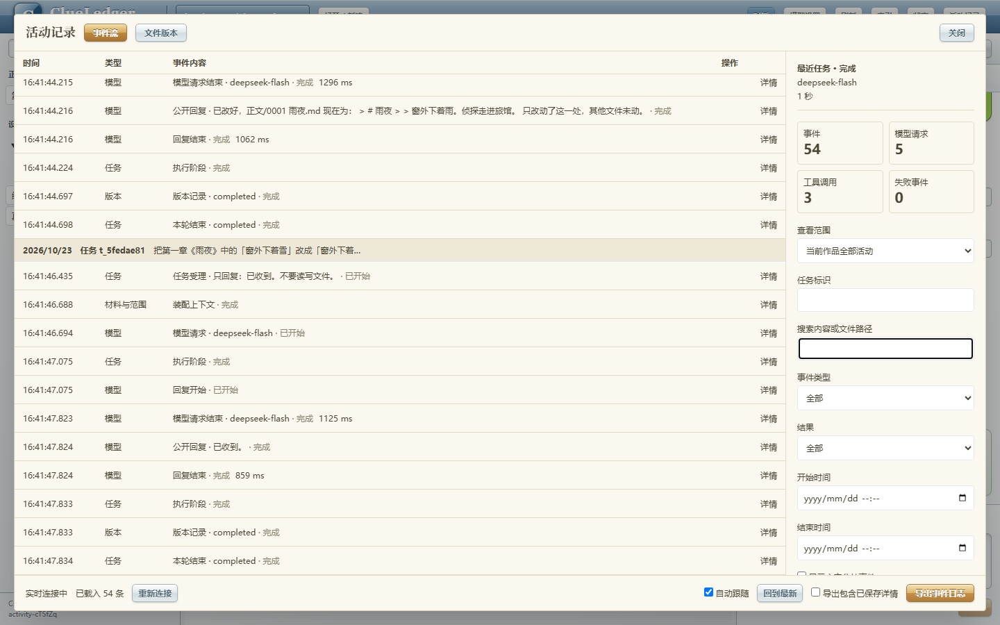

# 活动记录验证产物

日期：2026-10-23。产品行为见[活动记录模块](../../modules/activity-log.md)，改动与修正见
[V06-F 记录](../../notes/V06-F-activity-log.md)。

| 验证 | 结果 | 原始输出 |
|---|---|---|
| Python 全量 | 561 通过，1 项既有弃用提示 | [最终日志](python-final.log) |
| 前端单元测试 | 12 个文件、113 项通过 | [最终日志](frontend-final.log) |
| 浏览器 | 单批 17 通过，含在线 `deepseek-flash` 场景 | [最终日志](browser-final.log) |
| Ruff / Mypy | 检查通过，Mypy 51 个文件 | [检查日志](static-final.log) |

浏览器服务启动前执行前端构建。活动流在线场景覆盖真实修改、模型请求与工具、文件变化、
输入详情、筛选导出、第二轮持续订阅和关联版本页；不验证文学质量或任意作品容量。

首次失败单独保留：[新增诊断事件与旧固定序列断言](python-first.log)、
[输入快照开关异步状态](browser-first.log)、[另一处旧按钮选择器](browser-selector-failure.log)。
修正后验证没有增加模型或浏览器自动重试。

