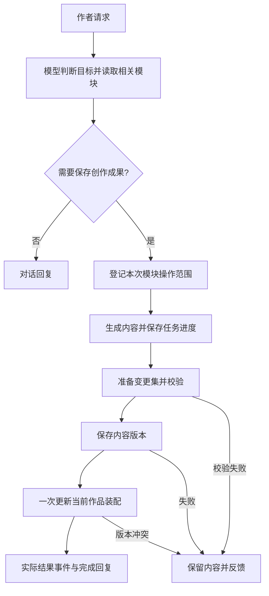

# 模型自主维护模块：提示词、执行与交互方案

日期：2026-10-25。状态：**M0–M3、作者提问恢复、预览、撤销与清理均已完成；2026-10-26 补齐旧文件显式授权的后端校验，后端全量 931 项通过；在线验证创建、局部更新、讨论及提问恢复，并实际观察到旧目录误登记被拒绝后在同轮改用模块保存。创建数量按作者确认的内容完整性标准验收，连接中断的尝试仍保留为失败**。承接[产品设计](../../product-design/v0.8/agent-module-management.md)。实施记录见第 9 节；未列出的能力仍按本文件前文的拟议契约理解，不根据第 9 节推断已交付范围。

## 1. 当前实现与需要调整的地方

| 当前代码 | 已有基础 | 本次需要处理 |
|---|---|---|
| `src/hastings/workspace/context.py` | 按任务用途装配提示词与模块短目录 | 写作主提示词仍限定三类旧设定文件；调整为自由模块优先，旧文件兼容 |
| `src/hastings/workspace/task_scope.py` | 作者原话、确切目标、范围及排除项校验 | 当前发布与装入依赖专用词语；增加当前作品创作成果的资源范围 |
| `src/hastings/workspace/agent.py` | 模块查询、读取、发布、装卸工具 | 增加内容变更工具，支持同次任务多个模块；现有发布不能代替作品内编辑 |
| 同上 `publish_module` | 可新建实例 | 新建请求键使用同一 `turn_id:publish:new`，需要按操作分别标识，避免第二份内容复用请求身份 |
| 同上 `attach_module` | 精确版本挂载，成功后结束本轮 | 多模块生成后一次应用，不逐份装入并提前结束 |
| `src/hastings/library/bindings.py` | 作品内容保存、不可变版本、装配指纹校验 | 扩展成组应用，模型与手工操作共用服务校验 |
| `src/hastings/library/assembly_api.py` | 编辑器保存接口，运行中要求空闲 | 模型内部走本任务授权的执行入口，不能调用要求空闲的 HTTP 接口或关闭互斥检查 |
| `frontend/src/state/workspaceModules.ts` | 草稿隔离、原文编辑与另存 | 接入模型提交后的实际版本更新，保护正在编辑的草稿 |
| `frontend/src/state/chatMessages.ts` | 既有会话事件投影 | 增加模块变更结果，不从回复正文判断成功 |

保持一个写作 Agent。在同一作者任务中完成理解、读取、范围登记、生成与提交，不额外创建分类模型或后台整理任务。

## 2. 一次请求的执行顺序



“准备变更集”是执行阶段，不是要求用户采用的候选流程。校验通过后同一任务直接应用。确需澄清时才等待用户，不能将等待超时解释为批准。

任务内容分段持久化。停止时不挂载不完整成果；重新打开可读到已生成部分。作者要求继续时复用内容和任务身份，重新检查依赖，不重建已成功的对象。

## 3. 提示词与任务范围

### 3.1 提示词接入

将写作主规则按职责分开：创作行为、模块维护、旧文件兼容、写入与读取约束。采用产品设计中的模板，删除仍在运行的相互冲突约束，历史文档不回改。

- 新资料默认走模块工具；用户明确指定旧文件时继续兼容，不自动迁移。
- 主提示词、工具说明和错误建议保持相同规则，避免一处允许创作落盘、另一处仍要求专用发布词。
- 已挂载短目录用于定位，不当作读过全文；相关更新继续遵守实际读取约束。
- 决定真凶等授权创作内容可直接生成，不将它误判为需要作者先给答案的事实缺失。
- 提示词和示例纳入版本管理；任务保存实际使用的模板版本，便于在线评测和回看。

### 3.2 资源范围示意

扩展现有范围登记，增加当前作品内容操作。下面是拟议数据，字段尚未实现：

```json
{
  "mode": "edit",
  "summary": "完成人物小传与聚集、调查前提，并保存为当前作品模块",
  "authorization": "先撰写人物小传，包括人物形象，他们的往事，每个人的作案动机，确定死者与真凶，人们之间的联系，聚集起来的合理原因",
  "module_content_grants": [
    {"action": "create", "slot": "cast", "purpose": "人物小传"},
    {"action": "create", "slot": "premise", "purpose": "聚集与调查前提"}
  ],
  "module_exclusions": ["具体作案手法", "调查过程", "小说正文"],
  "library_publish": false
}
```

新建用本任务稳定的 `slot` 表示尚未分配 ID 的目标；应用分配真实 ID。已有内容更新必须登记绑定、模块和基础版本，不能只给名称。

`library_publish=false` 表示未授权修改已有库原稿。新建并用于本作品的初始库存储由专用内容服务完成，属于新内容操作，不调用通用发布权限旁路已有保护。

作者原话和已有承接消息仍要能定位。模型可以解释语义，但不得登记与创作目标无关的操作；工具只允许执行已登记的确切槽位或目标。后台可以确定性验证目标与范围一致，不能确定性证明自然语言解释正确，这部分纳入在线语义评测。

继承现有不随意扩大范围的规则：先读取、确定本轮组织，再登记槽位；随后如发现本轮目标之外的重组需要，向作者说明，不自动新增库管理权限。

## 4. 内容变更服务与工具

### 4.1 提交结构

建议增加 `prepare_module_changes` 与 `apply_module_changes`。前者持久化内容、检查结构与范围，后者保存并应用；两者由同一个 Agent 在一次任务中连续调用。

新建的工具输入保持简单，示意如下：

```json
{
  "operations": [
    {
      "operation_id": "cast",
      "action": "create",
      "name": "人物小传",
      "body": "# 核心嫌疑人\n\n## ……\n\n完整小传内容"
    },
    {
      "operation_id": "premise",
      "action": "create",
      "name": "聚集与调查前提",
      "body": "# 聚集原因\n\n……"
    }
  ]
}
```

新建正文在服务中适配为现有自由资料记录，不让模型或前端重新选择类型。

更新操作使用精确绑定与记录引用，支持唯一文本替换；整份重写要求目标全文已实际提供。保留旧条目 ID、别名和附加字段。输入缺少旧字段不能被解释为删除，移除条目需要明确操作与相应范围。

准备成功返回：变更集 ID、内容版本、操作摘要、可读取预览的引用及校验结果。大段内容不在工具结果里再次全文回传；模型和界面按引用读取。

每个操作使用稳定且独立的身份。建议基于任务 ID、变更集 ID、operation_id 和保存阶段形成请求键；网络重放返回原结果。同键不同体拒绝，明确编辑后的正文以新变更集修订处理，不能悄悄换体重试。

### 4.2 应用流程

后端统一服务执行：

1. 检查变更集归属、任务范围、已登记操作、基础版本、实际读取覆盖和生成内容完整性。
2. 检查当前作品装配与预期版本；任何已有目标已变化时保留内容并返回冲突。
3. 对新建内容创建初始库实例；对已有模块调用作品内版本保存能力，不推进库 head。
4. 记录每个操作的已保存引用。全部必要版本准备好后，在同一作品锁内一次替换本次涉及的绑定；保留无关绑定及关联。
5. 返回实际应用的绑定和版本，记录可撤销的前后快照，发出确定性结果事件。

作品装配一次提交，避免作者看到半组关系相互不一致的当前作品资料。**不宣称库文件与作品装配存在跨目录原子事务**：内容保存后装配提交失败，可能已经有库实例或不可变版本；状态必须区分，重试仅完成缺失步骤。

不要直接重复调用现有逐项 `save_content`，因为它每次都会修改装配。应复用底层版本保存，再由成组服务统一提交装配。

内部执行接口要求当前活动任务持有对应作品的执行权限；外部手工编辑仍遵守运行中互斥。不能因为模型需要写入就把 HTTP 的 `require_idle` 全局关闭。

服务边界示意，以下代码不是现有实现：

```python
async def apply_module_changes(change_set_id: str, run: RunContext) -> dict:
    change_set = changes.load_owned(change_set_id, run.turn_id)
    run.scope.check_module_changes(change_set.operations)
    # authority 由活动任务生成，模型不能自行传入或伪造。
    result = service.apply(change_set, authority=run.execution_authority)
    event_type = "module_changes_applied" if result.applied else "module_changes_failed"
    run.record(event_type, result.event_view())
    if result.applied:
        run.phase = "finalizing"
    return result.tool_view()
```

成功应用后，本任务进入收尾，只允许读取本次结果并给完成回复，不再继续创作写入。原始装配快照仍保留，不能在同一轮偷偷切换所有检索的版本。下一次作者请求重新冻结装配，就能正常读取本次新模块。

这保留现有冻结设计，同时允许一次创作任务生成并挂载多份模块。现有单独装入、卸下工具的结束本轮规则继续兼容。

### 4.3 撤销

撤销按变更集处理，在确认当前绑定仍与该次结果一致后恢复前快照。若已有后续编辑，返回冲突，保留后续成果，不能整份覆盖回旧装配。

新建模块从当前作品移除，库副本保留；既有模块恢复当前作品原来的精确版本，不修改库原稿和其他作品。新关联随本次变更撤回，无关装配保留。

### 4.4 必要的作者决定

增加结构化的 `ask_author` 工具，仅用于任务目标不明或创作取舍无法确定的情况。输入包括具体问题、关联内容与可选答案；生成 `question_id`，任务进入 `needs_input`，持久化进度后释放运行锁。

前端把问题显示在原对话中，允许点选或自由输入。回复携带 `reply_to_question`，服务端验证作品、会话和问题归属，以这条作者消息显式继续任务。若问题已回答或目标版本已变，不能把旧按钮当作对新内容的授权。

恢复时重新检查依赖与本轮范围，承接原请求并纳入新的作者决定；不根据等待时间选择答案。普通的模块拆分、命名和已授权的人物创作无需调用此工具。

## 5. HTTP、事件与前端对齐

以下为拟新增接口，前缀 `W=/api/file-workspaces/{id}`。HTTP 不启动额外模型，模型工具与 HTTP 共用服务。

| 能力 | 拟议接口 | 前端用途 |
|---|---|---|
| 保存或准备变更集 | `POST W/module-change-sets` | 内容进度、实际变更详情；正常模型执行经内部服务 |
| 读取变更集和结果 | `GET W/module-change-sets/{change_set_id}` | 刷新恢复、预览、冲突内容读取 |
| 应用已生成内容 | `POST W/module-change-sets/{change_set_id}/apply` | 失败后的继续保存，无需重新生成 |
| 撤销本次应用 | `POST W/module-change-sets/{change_set_id}/undo` | 对话结果附近的撤销入口 |
| 回答任务问题 | 既有对话提交接口增加可选 `reply_to_question` | 明确继续对应问题，不另建一套消息接口 |

申请、读取、应用、撤销均核对当前作品归属。写操作带请求键与基础版本；继续保存前检查原授权仍适用，发生新冲突时不自动扩大任务。

继续沿用当前轮次事件序列，不新增第二套订阅。建议事件：

| 事件 | 确定事实 | 前端动作 |
|---|---|---|
| `module_changes_prepared` | 内容已保存到任务进度，尚未用于作品 | 显示预览与简短进度 |
| `module_content_saved` | 某操作得到持久化内容引用 | 保留逐项保存结果，不提前宣布整组应用成功 |
| `module_changes_applied` | 当前作品装配已提交 | 刷新对应作品目录与相关阅读内容，显示撤销 |
| `module_changes_failed` | 明确的失败阶段与可继续范围 | 保留内容，提供继续保存或冲突处理入口 |
| `module_changes_reverted` | 当前作品已经恢复 | 刷新绑定与阅读内容，保留库副本说明 |
| `author_input_requested` | 问题已持久化，任务正在等作者回答 | 原对话显示问题、选项和自由回复入口 |

事件附作品、轮次、变更集、操作与真实引用，长正文按接口读取。前端只投影事实，不根据自然语言“已保存”或 HTTP 200 判断任务成功。

结果读取必须足以在重载后重建状态，不能只依靠内存中的事件。作品切换与迟到响应继续核对作品、资源和请求代次。

前端投影示意，以下字段和函数尚未实现：

```typescript
case "module_changes_applied": {
  storeResult(event.workspace_id, event.change_set_id, event.result);
  invalidateAssembly(event.workspace_id);
  invalidateChangedDocuments(event.workspace_id, event.result.bindings);
  // 不覆盖仍在编辑的本地草稿；版本变化时保留草稿并提示核对。
  return projectAppliedResult(turns, event);
}
```

复用现有对话进度、模块阅读区和侧栏，不增加独立“模块规划中心”。生成时不把空壳正式挂载；成功后显示可点击名称，保持用户当前阅读位置。

模型更新只使相应故事总览派生结果需要更新，不顺带调用“更新总览”。无专门视图时直接读原文。

## 6. 落地阶段

| 阶段 | 工作 | 完成条件 |
|---|---|---|
| M0 规则统一 | 写作提示词、工具说明、旧文件兼容、创作与讨论范围 | 无互相矛盾的运行规则；新契约先以未启用状态接入 |
| M1 内容服务 | 变更集、独立操作身份、读取与版本检查、成组应用、结果持久化与撤销 | 单次多模块和已有模块更新可在服务层完整执行 |
| M2 模型接线 | 范围登记、准备与应用工具、必要提问及恢复、结果反馈、成功收尾 | 同一请求完成生成到挂载；越界操作被拒绝 |
| M3 前端接线 | 对话结果、预览、目录刷新、草稿保护、继续保存与撤销 | 刷新和切作品后仍显示实际结果，无候选采用关卡 |
| M4 验收与文档 | 确定性、浏览器、在线语义，当前行为说明与限制 | 通过后才开启新提示词与工具并更新交付状态 |

各阶段串行接通，不先发布只有提示词、缺少写入工具和反馈的半成品。现有行为在整条能力未验证前继续可用。

## 7. 验收矩阵

### 7.1 确定性与浏览器

- 一次请求新建两份以上内容，操作身份不同；重复提交不重复建模块。
- 同一次任务同时新增与修改，未修改条目和旧元信息保留。
- 修改本作品内容不推进已有库原稿，不影响另一作品的绑定。
- 已保存内容但装配失败，返回分阶段状态；继续保存复用已有结果。
- 最终提交前基础版本变化，不能覆盖新内容；生成稿仍可读取。
- 停止、断流、重载后可回看生成进度，不把未应用内容当正式模块。
- 等待作者回复时不占用运行锁；重复答案、旧问题按钮与版本变化正确处理。
- 模型应用时外部编辑被互斥保护；任务之外的内部写入凭证被拒绝。
- 成功后侧栏可读、保持当前阅读位置；未保存的手工草稿不被刷新覆盖。
- 撤销恢复当前作品，存在后续编辑时不覆盖，其他作品与库原稿不变化。
- 未挂载全局内容不能通过任务工具或结果详情越权读取。
- 新模块立即可读；没有自动发起故事总览、索引或其他模型任务。

### 7.2 在线语义

使用 `.env` 指定的在线模型，不使用本地模型。复用现有评测框架，保存完整工具轨迹和最终持久化结果，并人工核对必要的语义判断。

| 案例 | 关注点 |
|---|---|
| 用户提供的完整雪山小说请求 | 主动组织、填充并保存；嫌疑人数正确，侦探与叙述者不计入；覆盖人物与聚集、调查前提 |
| 同例的排除范围 | 不生成具体手法、调查过程或小说正文；未来要求可保存在约定中 |
| “只是想听听这点子怎么样” | 讨论，不保存，不挂载 |
| “写三个人物方案，暂时别保存” | 完成创作但遵守不保存 |
| 已有同类人物模块 | 读取再判断更新，不机械新建，不按名字自动合并 |
| “把医生改成姐姐，其余不变” | 定位已有内容并局部修改，保留其他人物 |
| 新要求与已定真凶冲突，取舍不明确 | 先澄清，保留成果，不把无回复当批准 |
| 小补充 | 可只更新一段，不强求建立整套模块 |
| 开篇写作 | 可使用作者真相规划，但不提前泄露读者未知身份 |

模块数量和名称允许不同。检查所需内容是否覆盖、是否重复、是否越界、能否在下一轮实际定位使用，不用固定清单匹配代替创作质量判断。

## 8. 文档与交付

实施时同步维护工具说明、前后端事件类型、接口客户端、运行说明和模块导航。旧阶段记录保留，本草案在实际接线后写明最终调整、验证结果及未覆盖范围。

本轮只形成设计。本文示例未编译、接口未接入，不能据此宣称已有自动创建模块的完整体验。

## 9. 实施记录（2026-10-25）

### 9.1 已落地

| 层 | 实际改动 |
|---|---|
| 写作规则 | `context.py` 的写作任务提示词改为「讨论与创作 → 作品结构 → 模块组织 → 创作边界 → 工具规则 → 写作要求 → 修改范围」。自由模块优先；旧设定文件只在作者明确要求时使用；保留「先读再写」与作者排除项 |
| 任务范围 | `task_scope.py` 新增 `ModuleContentGrant`、`ModuleChangeTarget` 与 `ScopeController.check_module_changes`。新建按稳定槽位，更新按绑定、模块与基础版本逐项核对；重新登记仍只能收窄 |
| 内容服务 | 新增 `library/changes.py`：变更集持久化、请求键重放、单次多操作、作品内版本保存、一次装配提交、分阶段失败与按变更集撤销 |
| 模型工具 | `prepare_module_changes` 与 `apply_module_changes` 接入写作用工具集；`set_task_scope` 接受 `module_content_grants`；应用成功后 `RunContext.finalizing` 阻止本轮继续写入，读取仍可用 |
| 库发布键 | 同轮新建多个模块改用按类型与名称散列的请求键，不再共用 `turn_id:publish:new` |
| HTTP | 新增 `POST/GET /module-change-sets`、`POST .../apply`、`POST .../undo`；写操作要求空闲，撤销与继续应用可把实际结果追加回指定会话 |
| 会话事件 | 新增 `module_changes_prepared`、`module_content_saved`、`module_changes_applied`、`module_changes_failed`、`module_changes_reverted` 的类型、归并与前端投影 |
| 前端 | 对话轮次显示实际准备/保存/应用/失败/撤销结果；应用前的名称打开准备内容预览（新建正文、逐条修改），应用后的名称打开已有阅读区；应用后刷新装配与变化模块缓存，草稿不覆盖；已应用结果旁提供撤销；任务卡显示内容授权 |
| 评测 | `eval/cases/v08.yaml` 新增自主新建、下一轮局部更新、讨论不保存三例；新增 `v08-modules` 套件；证据增加模块正文快照与 `module_contains`/`module_excludes` 判定 |

### 9.2 实际验证

- 新增 `tests/library/test_module_changes.py` 8 项：多模块成组新建、幂等重放、作品内更新不推进库 head、唯一定位失败、整份重写读取前提、过期装配、撤销恢复与后续编辑冲突。
- 新增 `tests/workspace/test_module_changes_tools.py` 5 项：范围登记、越界拒绝、实际读取后更新、应用后进入收尾。
- 新增 `tests/workspace/test_author_questions.py` 6 项：提问暂停与回答后继续、重复回答拒绝、跨会话回答拒绝、装配变化拒绝、提问后写入阻断、刷新后问题仍从未回答状态恢复。
- `tests/library/test_assembly_api.py` 新增 HTTP 准备/读取/应用/撤销与过期装配用例。
- 前端 `chatMessages.test.ts` 新增变更集归并、撤销、失败投影与提问投影用例；评测 `test_context_eval.py` 新增暂停终态判定用例。
- 当前结果：后端全量 891 项通过（提示词兼容断言与评测用例数量已按新规则补齐）；前端单元 261 项通过；前端构建通过；ruff 与 mypy 通过。
- 在线语义（2026-10-25，`deepseek-flash`，`v08-modules`）3 例全部通过并完成人工复核：

| 案例 | 实际结果 |
|---|---|
| `v08_module_autocreate` | 同一轮新建并应用「云栖旅馆·人物小传」「云栖旅馆·聚集缘由」；覆盖五名嫌疑人、死者、真凶与聚集原因；未写作案手法、调查过程或正文；文件改动为空 |
| `v08_module_update` | 读取已装「人物设定」，只把医生一条改为死者的姐姐；管家原文保留；库 head 未推进，装配绑定换到作品内版本；无重复模块 |
| `v08_module_discuss` | 只讨论点子与冲突，未准备或应用内容，未建立模块；工具轨迹中没有变更集工具 |

运行证据：`eval/runs/context-20261025-232942-018782/`（报告、逐案证据、人工复核与 `rescored.md`）。

- 在线语义（2026-10-26，`deepseek-flash`，`v08_author_question`）1 例通过并完成人工复核：第一轮识别「旧真相与作者新说法冲突」，用 `ask_author` 记录一个带四个选项的取舍问题并以 `needs_input` 结束、未改任何文件；第二轮带 `reply_to_question` 回复后承接原请求，改写第八章与真相、把管家降为嫌疑人，未重复提问。运行证据：`eval/runs/context-20261026-124715-271862/rescored.md`。
- 在线复测（2026-10-26，`deepseek-flash`，`v08-modules`）3 例：原始报告为 2 例失败、1 例待复核；其中一项是关键词检查触发，另一项是模型选择了不符合任务范围的处理方式：
  - `v08_module_autocreate`：同一轮准备了三份变更集，最后一份应用成功（两份新建模块）。`no_method` 因正文含「不写作案手法，也不写调查过程」触发；该匹配不能证明生成了具体手法。原始报告保留，实际内容仍须语义复核。
  - `v08_module_update`：首轮读完条目后用 `ask_author` 询问「管家还算不算医生」，以 `needs_input` 结束；单独重跑时改用 `edit_file` 修改 `设定集/真相.md`、`正文/0008 揭晓.md` 与管家条目，未走模块更新，触发 `trajectory_scope` 与 `allowed_final_changes`。
  - 同一次运行验证了废弃变更集清理：同一轮三份变更集中，应用最后一份后工作区只保留已应用的那份。
  - 运行证据：`eval/runs/context-20261026-133323-551555/report.md`、`eval/runs/context-20261026-133756-343476/report.md`。

### 9.3 补充：作者提问与跨轮恢复（2026-10-26）

| 层 | 实际改动 |
|---|---|
| 问题记录 | 新增 `workspace/questions.py`：问题原文、选项、关联路径、所属会话与轮次、装配指纹与原请求材料整份持久化在作品状态目录；已回答记录保留，读取损坏按空处理 |
| 提问工具 | 写作用途新增 `ask_author`：核对受管路径与选项数量，记录 `author_input_requested`，本轮随后阻断一切写入；同一轮重复调用只返回已记录的问题 |
| 暂停状态 | `RunStatus` 新增 `needs_input`；收尾事件如实报告「等待作者回答」，运行锁按既有 `finally` 释放，工作区不再占用 |
| 恢复入口 | 对话提交增加可选 `reply_to_question`；受理时核对问题归属会话、是否已回答与装配指纹，通过后写入 `author_replied` 并承接原请求的材料身份 |
| 上下文承接 | 执行事实在下一轮补上「该轮向作者提问」与「作者回答」，模型不需要靠自然语言猜上一轮问过什么；回答只补作者决定，不重选参考 |
| 前端 | 新增 `AuthorQuestionCard`：显示问题、选项与自由输入；回答走同一套对话提交，已回答状态来自事件而非本地标记，刷新与切会话后一致 |
| 评测 | 新增 `v08_author_question` 两轮用例；评测驱动支持 `expect_needs_input` 与 `reply_to_question`，暂停轮以问题事件作为公开输出 |

### 9.4 补充：应用前内容预览（2026-10-26）

| 层 | 实际改动 |
|---|---|
| 读取入口 | 沿用 `GET /module-change-sets/{change_set_id}`：新建返回正文，修改返回逐条原文与替换内容；不需要等装配完成才能读 |
| 前端投影 | 新增 `changePreview.ts`，按操作整理为「新建正文」或「逐条原文/替换/整份正文」；操作不存在时返回空，不让界面猜内容 |
| 前端入口 | `ModuleChangeCard` 中应用前（准备、失败、已撤销）的名称改为预览按钮，弹出内容对话框；读取失败按错误三要素显示（`[错误码] 位置：现象。建议：…`），不把读取失败说成保存成功。应用后的名称仍打开侧栏阅读区 |
| 测试 | 新增 `changePreview.test.ts` 3 项；`test_assembly_api.py` 增加详情返回正文断言。结果：前端单元 264 项通过、`tsc --noEmit` 通过；后端该文件 13 项通过 |

### 9.5 补充：浏览器撤销与草稿保护（2026-10-26）

| 层 | 实际改动 |
|---|---|
| 预置脚本 | 新增 `frontend/e2e/fixtures/module_changes.py`：用真实 `ModuleChangeService` 与 `ConversationStore` 预置一轮会话事件，不调用模型；支持「已应用的新建」与「已准备、等待继续保存的修改」两种状态，输出变更集、会话与作品信息 |
| 撤销用例 | 应用后卡片显示「已用于本作品」；点撤销后显示「已撤销本次修改」与库副本保留说明；刷新后由事件重建为已撤销、目录不再有这两个模块、装配绑定为空，库内仍能搜到新建模块 |
| 草稿用例 | 应用前卡片显示「内容已准备」；点名称打开内容预览并看到原文与新文；打开模块手工编辑但不保存，再点「继续保存」，绑定版本已换新而库 head 未推进；随后「继续编辑」时未保存草稿仍在 |
| 结果 | 两个用例在 `frontend/e2e/module-workspace.spec.ts` 中通过（25.4s）；此前 `vitest` 26 文件 264 项、`tsc --noEmit` 与前端构建均通过 |

### 9.6 补充：废弃变更集清理（2026-10-26）

| 层 | 实际改动 |
|---|---|
| 清理时机 | `ModuleChangeService.apply` 成功提交装配后，删除同一 `turn_id`、同一作品下仍为 `prepared` 的其它变更集；失败与已应用的记录保留 |
| 失败处理 | 删除失败不把已成功的应用改成失败：失败项写入结果 `discard_failed`，同时向 stderr 输出 `[MODULE_CHANGES_DISCARD_FAILED]` 三要素告警 |
| 前端状态 | 变更集状态新增 `superseded`；`module_changes_applied` 投影把同轮更早的 `prepared` 标记为「已由同轮后续修订取代」，保留记录但不再提供预览与继续保存入口，避免清理后出现失效入口 |
| 测试 | 后端新增 1 项：只删除同轮 `prepared`，保留已应用、失败与其他轮；前端新增 1 项投影：更早的准备结果被取代、失败记录不变。结果：该后端文件 9 项通过，`chatMessages.test.ts` 32 项通过 |
| 在线观察 | 2026-10-26 的 `v08_module_autocreate` 在线运行中，模型同一轮依次准备了三份变更集，应用最后一份；运行结束后工作区只剩 `chs_2d664356ff53ead2.json`，两份未应用的进度文件已被删除 |

### 9.7 未完成

- 清理只发生在应用成功时，没有按时间或数量回收长期未使用的变更集；跨会话仍保留 `prepared` 与 `failed` 的任务进度。
- 应用前预览只存在于界面，评测驱动不检查预览对话框；清理已在在线运行中观察到，但没有独立判定项。
- 旧目录误写已补后端校验并完成本轮回归；当前在线证据只覆盖所列模型与小样本，真实长篇和多模型的任务理解仍待验证。第 9.8 节保留校验前的失败，第 9.9 节记录修复与恢复证据。

### 9.8 补充：任务分流与提问门槛（2026-10-26）

此次调整解决两个判断问题：作者已经决定的新值被当成待确认的冲突；模块中的局部修改被转交给旧文件编辑。修改范围限于写作要求与工具说明，接口、持久化格式和运行时权限校验不变。

| 判断 | 当前规则 |
|---|---|
| 目标定位 | 明确指定的目标优先；未指定存储位置的资料修改先查已挂载模块，按实际引用和原文定位，不凭相同称谓合并人物或扩展目标 |
| 局部修改 | 「只改这一处」「其余不变」只授权指定信息的替换，保留其他字段、条目、文件和章节；范围外的潜在影响可在完成后说明 |
| 必要提问 | 明确替换旧值代表作者已决定；读取后仍无法定位目标，或本轮必须满足的要求存在未决冲突时才提问。作者明确要求先提问时仍照办 |
| 工具选择 | 模块局部修改也使用 `prepare_module_changes` 与 `apply_module_changes`；`edit_file` 的局部替换建议限定为获准修改的章节和旧设定文件 |
| 成组保存 | 同轮全部操作放入同一个 `operations`，准备完整后统一应用；遗漏内容时先重新准备完整变更集，应用后本轮只读 |
| 内容与反馈 | 模块正文保存创作成果，执行进度、保存状态与未做事项留在对话；同步章节必须有作者要求并遵守登记范围 |

确定性验证：相关上下文预算、作者提问、模块工具及评测测试共 51 项通过；ruff 检查与格式检查通过，mypy 116 个源文件通过。写作要求正文为 3,274 字符，沿用原 4,000 字符分区预算。本轮没有修改前端，不重复运行浏览器验收。

评测判定修正：`v08_module_autocreate/no_method` 改为检查实际正文是否展开具体作案或调查过程的语义复核，避免将「不含作案手法」误判为实际越界；`v08_module_update` 增加不调用 `ask_author`、`write_file` 与 `edit_file` 的自动断言，局部修改复核明确检查诊室信息、条目 ID 和字段。作者请求和模型可见作品初态不变，评分规则不进入模型输入。旧运行使用已冻结的旧案例契约，不用新判定改写旧结果。

在线验证记录：

- 初次模块套件与提问恢复运行分别为 `context-20261026-145633-527421`、`context-20261026-145729-070386`。两批在 14:58:03 收到 `peer closed connection without sending complete message body (incomplete chunked read)`，报 `[MODEL_CALL_FAILED]` 后停止；原始失败及未运行记录保留，不将中断批次计为通过。
- 局部更新专项 `context-20261026-145943-002513` 连续两次通过证据复核：只将医生与死者的关系改为姐姐，诊室信息和管家原文保留；没有 `ask_author`、文件写入或重复模块，库 head 不变。见该运行的 `reviews.json` 与 `rescored.md`。
- 使用原判定的两轮模块套件 `context-20261026-150147-944287`，复核后为 4 通过、2 失败：两次更新与两次讨论通过；第一次创建因否定说明触发 `no_method`，第二次创建实际只保存人物小传，漏存聚集缘由。后者补充了「全部准备后统一应用」的提示词要求，原始记录与复核保留。
- 最终模块套件 `context-20261026-150809-453038` 使用修正后的判定，各例运行两次，复核后 **5/6 通过**。两次局部更新均走原模块，保留其他信息，新增禁用工具断言通过；两次讨论均未写入；第二次创建一次应用两份内容。第一次创建仍新建六份旧角色小传并修改管家，只应用一份聚集缘由模块，触发 `allowed_final_changes`、`trajectory_scope`、`decision_scope` 与创建语义检查。见[复核报告](../../eval/runs/context-20261026-150809-453038/rescored.md)与同目录 `reviews.json`。
- 提问恢复回归 `context-20261026-151244-082418` 经复核 **1/1 通过**（两轮）：先记录一个带三个选项的问题并等待；回答后只改第八章与真相，保留管家即医生，悬置凶手身份，没有重复提问或改前面章节。见[复核报告](../../eval/runs/context-20261026-151244-082418/rescored.md)。

上述结论仅覆盖当时的提示词调整。后端对「普通模块创作」与「显式沿用旧文件」的范围校验及相同作者请求复测已在第 9.9 节补齐。

### 9.9 补充：旧设定文件的后端授权校验（2026-10-26）

本次将旧目录的选择规则接入后端，解决模型已经收到「模块优先」提示却仍把普通资料任务登记为旧文件写入的问题。校验约束存储位置；原有确切路径、操作类别、读取前提和版本检查继续生效。

| 层 | 实际规则 |
|---|---|
| 适用轮次 | 模块内容工具可用的 Agent 写作轮次；由服务端根据模块库能力启用，模型不能通过工具参数关闭。没有模块库的底层文件兼容调用保持原行为，作者手工编辑文件不经过这项模型工具策略 |
| 明确位置 | 当前作者请求须明确指定旧文件路径、文件名、带「文件」的旧资料名称，或明确沿用旧目录、旧结构；「只改已有文件」与所列目标组合可保留已有文件修改。「撰写人物小传」不授予旧目录写权限 |
| 授权来源 | 只认当前作者请求；参考对象和引号中的操作建议不授予写权限。历史旧文件要求须有当前作者的明确继续表达，并通过 `carried_from_seq` 指向该请求；当前明确禁止优先 |
| 登记与追加 | `set_task_scope`、`extend_task_scope` 在范围生效前逐项检查旧文件；移动同时检查源与目标。读取到的原文证据只能说明关联性，不能补出作者未给的位置授权 |
| 写入前 | `write_file`、`edit_file`、`move_file`、`delete_file` 共用的写前入口再次校验，早于 Git 基线准备与文件写入；内部预置过的范围也不能跳过 |
| 拒绝与恢复 | 返回 `[LEGACY_FILE_AUTHORIZATION_REQUIRED_CONFLICT]`，包含实际路径和改用模块工具的建议；拒绝登记不改变当前范围、不写成功事件、不修改文件，可在同轮改用 `module_content_grants` 保存 |
| 接口对齐 | 不新增 HTTP 字段、事件结构或持久化版本；前端继续消费现有范围事件和通用错误。模块能力开关只在后端调用中传递 |

新增 `workspace/legacy_files.py` 集中维护明确表达的匹配与当前请求承接规则。该校验不证明模型对作者全部自然语言意图的理解正确；复杂或未识别的表述仍需要按实际错误处理，不能把词语匹配宣传为完整的授权证明。

确定性验证：新增 39 项授权用例通过，覆盖默认资料创作拒绝、参考与各种引号中的操作建议、同名文件误匹配、明确旧文件修改、当前禁止优先、历史承接、追加范围、移动两端，以及拒绝后在同轮保存为模块；补齐单引号边界后后端全量 **931 项通过**，ruff 检查与改动文件格式检查通过，mypy 117 个源文件通过。本轮没有改动前端或接口格式，不重复浏览器验收。

2026-10-26 作者确认：**按内容完整性验收，允许合并成一份模块**。据此修正 `v08_module_autocreate/self_organized` 中「至少两份」的旧条件，明确人物与聚集内容必须完整保存并用于作品，模块可合并或拆分。该调整仅修改评分标准，模型可见的作者请求和作品初态不变；已冻结的旧案例及报告不改写。

在线验证（`.env`，`deepseek-flash`）：

| 运行 | 结果与边界 |
|---|---|
| [旧口径两轮模块套件](../../eval/runs/context-20261026-155023-402270/rescored.md) | 5/6 通过；两次局部更新、两次讨论、一次创建通过。另一次完整合并为一个模块，按该运行冻结的旧条件保留失败；两次创建的 `diffs` 均为空，没有旧文件写入 |
| [提问恢复](../../eval/runs/context-20261026-155648-011273/rescored.md) | 1/1 通过，两轮完成。第一轮只提问并等待；回答后正常保存指定的第八章与真相，没有重复提问、改早期章节或新建人物文件，新校验未阻断明确的旧文件修改 |
| [新口径创建两次](../../eval/runs/context-20261026-155922-803099/rescored.md) | 1 次通过；另 1 次在生成完成前发生 `incomplete chunked read`，以 `[MODEL_CALL_FAILED]` 保留失败，不据空结果判通过 |
| [创建单案重试](../../eval/runs/context-20261026-160453-046502/rescored.md) | 1/1 通过；实际复现六个旧文件操作的误登记，后端拒绝后模型在同一轮改用两个模块槽位，完整保存人物与聚集内容，没有文件改动或再次提问 |

重试的关键证据：`set_task_scope` 5094 含六个旧文件操作，工具结果为 `LEGACY_FILE_AUTHORIZATION_REQUIRED_CONFLICT`；`task_scope_set` 8844 才首次生效，且仅有两个 `module_content_grants`；`module_changes_applied` 8935 成功，`run_finished` 9642 为 `completed`，`diffs` 为空。新口径下有效完成的两次创建均通过复核，连接失败的尝试仍计入其原运行的失败统计。重试内容存在导语人数笔误，已在 `reviews.json` 中记录，存储位置回归不代表创作文本的全部质量检查。
