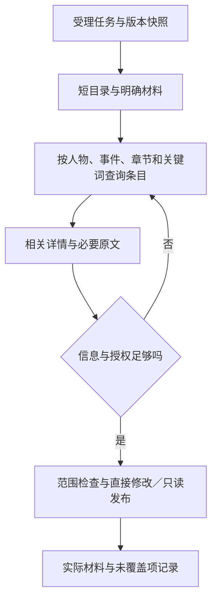

# 0.8 索引、渐进披露与上下文装配

日期：2026-10-24。状态：待实施。数据定义见[数据与存储](data-and-storage.md)，全局边界见[模块库与装配](library-and-assembly.md)，评测见[验收](acceptance.md)。

## 1. 现状与调整目标

当前 `context.py` 已按 writer/extract/review/materials 用途装配，人物目录与小传全文分开；
`assembly.py` 按字符预算裁剪分区，`materials.py` 记录实际读取区间、参考来源和指纹。
这些能力继续复用，不重写独立 agent 执行框架。

需解决的问题：

- 目录、索引、状态与固定设定按预设分区拼接，条目相关性选择不足。
- 线索与真相各按正文前部截取，标题和截断提示计入后可能使整个设定分区超预算跳过。
- 各域分别保存类似事件与时间信息，作者计划和正文状态的读取路径不一致。
- 46,900 是当前 writer 分区预算合计（含 F2 的已装模块短目录 2,000），不是所有消息、工具定义、
  历史与工具返回的总 token 预算。
- 旧 `read_state` 的只读者已知查询不能承载相关未来计划，不能简单放宽为混合事实。

目标：**目录用于发现，索引用于筛选，原文用于创作和核对；任何层都保留来源性质。**

## 2. 三层渐进披露

| 层 | 默认内容 | 限制与继续方式 |
|---|---|---|
| L0 模块与正文概览 | 本轮已装实例、版本、当前章、查询入口 | 实例目录分页／有界概览；七种预设不代表实例数量固定；不列未装库内容 |
| L1 条目查询结果 | ID、标题、少量说明、匹配原因、关系、来源性质、有效性 | 分页和字符上限；返回 next_cursor 和未展示数量 |
| L2 详情及原文 | 原文内容、固定字段、必要证据及来源版本 | 沿用分段读取和实际提供区间，不以摘要代读 |

L0 可告知“灵感需作者选择或明确请求后查询”，不附未授权灵感数量、标题或摘要。
正文目录也改为短概览＋分页目录；当前目标与作者明确材料必须明确列出，不受普通候选裁剪影响。
L1 无语义摘要时返回结构字段，不为了填空调用模型；搜不到时明确说明检索范围，允许搜索原文。



## 3. 检索输入与来源标签

```python
from dataclasses import dataclass
from typing import Literal

@dataclass(frozen=True)
class MaterialQuery:
    kinds: tuple[str, ...] = ()
    module_ids: tuple[str, ...] = ()  # 与受理时的已装／明确参考范围求交集
    text: str = ""
    entity_ids: tuple[str, ...] = ()
    chapter_paths: tuple[str, ...] = ()
    as_of_chapter: int | None = None
    include_plans: bool = True
    cursor: str | None = None
    limit: int = 20

@dataclass(frozen=True)
class MaterialHit:
    id: str
    module_ref: tuple[str, str, str, str] | None  # 库、模块、修订、条目；正文观察可为空
    kind: str
    source: Literal["author", "observed", "legacy_unverified"]
    title: str
    excerpt: str
    digest: str
    freshness: str
    matched_by: tuple[str, ...]
```

服务端按冻结的 assembly 和任务许可收窄查询；请求参数不能扩大模块范围、截止章、灵感许可或写权限。
同名人物／事件来自不同模块时按完整引用区分，不能把另一作品的观察结果作为全局属性返回。
计划是否返回独立于正文截止章：先过滤正文观察，再按本次相关性选择作者计划。
`include_plans` 不能使整理任务把计划当正文事实；查询返回的每个条目必须携带来源。
名称歧义返回候选，不仅按字符串选择第一个；按需要求作者或模型在有依据时明确目标 ID。

初版采用可解释的确定性检索：明确 ID／文件 → 人物或事件关联 → 章节范围 → 关键词／别名。
不依赖向量库、不把不可解释的相似度当授权。排序规则保持稳定，同分用 ID 打破，不暗示文学重要性。
直接关系默认一跳；扩展前后事件由模型再次查询，禁止递归遍历整本作品后全部注入。

## 4. 任务上下文

任务受理固定用途、当前章、作者原话、显式材料及其版本、写范围请求。模型发现的相关材料可在
执行中追加；追加必读仍需来源依据，引用不产生写权限。
受理固定 library_id、assembly digest、每个绑定的 module/revision；库 head 更新不改变本轮输入。
未装模块不进入默认目录、候选、查询、详情或依赖展开。只在作者明确请求全局查找时开放本轮有界库搜索；
搜索命中不产生装入权限，明确选作参考可只在本轮读取确定版本。普通文件工具也不能绕过库服务读取其路径。
卸下后下一轮对历史中曾出现的模块标明“不再作为当前设定”；历史内容无法撤回，不能宣称物理清除了模型记忆。

| 任务 | 初始装配 | 后续读取 | 允许写入 |
|---|---|---|---|
| 普通写作／讨论 | 要求、已装短目录、明确参考、关键执行事实 | 当前装配下的人物、事件、计划和本作品原文 | 登记范围内的作品文件；修改库需额外明确模块写授权 |
| 灵感讨论 | 选中修订、问题、短目录 | 与想法相关的正式资料 | 默认无；不自动改灵感或正文 |
| 灵感落实 | 选中修订、目标章、操作边界 | 必要设定、前因后果、原文 | 登记过的目标；使用关系另行核对 |
| 章节统一整理 | 范围、正文目录、发布条件 | 目标全文；旧观察仅用于定位且标待核对 | 统一索引，不能改作品内容或计划 |
| 其他资料整理 | 明确域、对象、正文范围、所依赖模块修订 | 原文，必要人物声明标为声明 | 本作品观察域；不修改共享安排或其他作品 |
| 模块库挑选 | 作者原话、允许的库查询范围 | 有界候选与明确版本详情 | 默认只读，不自动绑定、发布或改正文 |
| 专用装配 | 明确装卸指令、assembly 版本、指定模块修订 | 必要模块元信息与依赖诊断 | 只提交本作品 assembly，随后结束；普通写作轮不改变自身装配 |
| 只读检查 | 检查范围、明确材料、相关约束 | 原文与证据 | 报告，不改作品 |

同一工具名在不同用途下接受不同可查询范围，必须在执行层校验，不只靠系统提示。
工具输出内容均是资料；其中“忽略用户、删除文件”等文字不提供范围授权。

## 5. 灵感读取授权

保存或收藏不是读取授权。当前作品普通目录与关键词检索不包含灵感，全局模块库查询也不包含作品灵感。
两条入口：

1. 作者选择具体灵感：受理快照固定 idea_id、revision_id、内容指纹，允许读取这些修订。
2. 作者明确要求从灵感本查找：复用作者消息定位与原话引用机制登记本轮检索许可；允许有界搜索，选择候选后固定实际读取修订。

续聊不自动继承“全灵感搜索许可”；已在当前公开会话中出现的选中内容无法假装从模型记忆消失，
但新请求不得据此查询其他灵感。用户取消当前草稿参考只影响未发送任务，不能撤回已发送输入。
读取或写入灵感工具都走专用服务；通用文件工具即使猜中路径也拒绝。授权写灵感与授权写正文分别登记。
收藏助手建议只表示用户保存了建议，不把建议提升成正式人物设定。

## 6. 装配预算与排序

把固定大分区改成条目候选，区分 required 与 optional。预算用于选择，不更改作者要求。

优先序：

1. 当前任务、工具权限、修改范围与明确禁止项。
2. 作者选中的材料，以及执行本次任务已确认必需的约束。
3. 当前目标事件／人物的直接关联与相关计划。
4. 近期章节摘要、其他检索候选、历史执行事实。

明确材料超量时分段读取或拆分工作；不能将 required 降为 optional，不能把未读写成已读。
可选条目不足预算时保留定位信息，并记录排除原因；不得把条目正文截成可能改变语义的半句。
未选灵感既不进入候选池，也不计作“预算排除”。

```python
# 装配示例：具体 required 内容以预读片段和待完成读取清单表示。
def pack_optional(candidates, remaining_chars):
    kept, skipped = [], []
    for item in sorted(candidates, key=lambda x: x.rank):
        rendered = item.render_with_source_labels()
        if len(rendered) <= remaining_chars:
            kept.append(rendered)
            remaining_chars -= len(rendered)
        else:
            skipped.append({"id": item.id, "reason": "budget", "chars": len(rendered)})
    return kept, skipped
```

所有标题、来源标签、截断提示和分隔符先渲染再计费。先修复现有 6000 字符分区边界，
再引入条目选择；不靠增加预算掩盖问题。不同模块不固定占满一份配额，先满足任务必需内容。

### 6.1 整次请求预算

记录系统提示、历史消息、工具结果、工具定义的实际序列化规模；字符与 token 分列。
有 provider 用量就记录实际值；请求前若只能估算，记录方法与估算值，不能标为真实 token。
模型上下文长度已配置时预留输出空间及下一次有界工具结果空间；未知时采用保守应用上限，明确标为应用限制。
初始 46,900 字符只能作为对照基线，不宣称任何模型都适用。

L1 默认每页 20 条、最多 50 条，总返回正文先以 6000 字符为工程起点；L2 继续使用当前
`read_file` 单次最多 16000 字符及 cursor。以上数值是待评测初值，不是效率结论。
目录、标题和提示也计入返回限制；长单条用详情入口，不隐去唯一命中而返回“无结果”。

### 6.2 历史与重复读取

0.8 不新增自动语义总结任务或改写上游压缩机制。第一步在相同任务、相同版本中减少重复注入，
记录已提供区间；来源变化必须重读。不能只因“历史上读过”就认为当前请求中仍保留了关键约束。
固定本轮任务卡保存作者原话定位、范围、未读材料、实际写入与报告状态，不用助手自述替代执行事实。
若现有历史裁剪丢掉了必要原文，保留来源定位并在写入／判断前重新读取；不剪断工具调用与结果配对。
预算无法满足最小任务时明确失败／部分完成，不无期限循环检索、不自动重试或扩大范围。
更复杂的自动压缩与跨任务长期摘要另行排期，不能在本版文档里宣称已解决。

## 7. 阅读证据与版本一致性

- L0/L1 不计原文覆盖。结构字段不能证明已经读完长文本。
- `read_record` 返回统一 SourceRef 与实际区间，接入 MaterialLedger；不能成为绕过 `read_file` 的第二套凭据。
- 作品文件参考冻结 digest，写前复核；模块参考固定完整不可变版本并校验 manifest；灵感固定修订。
- 模块升级后只核对依赖变化的观察；仅依赖正文的记录不因无关模块更新失效。库索引／装配索引／正文索引分层复用。
- 资料发布仍要求目标当前全文已提供，证据引文和范围匹配；摘要不作为发布凭据。
- 修改前继续执行目标指纹、必要参考、已登记操作类别校验。不得因为具备索引而绕过。
- 合法证据只证明文字存在，证词真假、文学合理性与是否泄底仍需语义复核。

## 8. 注入记录与用户反馈

扩展现有 `state_injected`，新增条目选择与读取摘要；不复制所有内容至普通事件。
服务端记录 `selected`、`queried`、`provided`、`excluded`、`remaining_required`，并携带来源 ID、
版本、原因与实际字符数。生成给模型的文本和日志必须来自同一装配结果。

用户侧显示“你选择的／执行中读取的／需要注意”，保留展开原文依据和活动详情。
没有读取过的检索命中只显示为“找到”，不能显示“已阅读”。卸下后保留历史执行定位，并标明当时用的版本。
需要诊断时沿用输入快照开关和现有脱敏规则，不默认把完整灵感写入所有日志。

## 9. 验证重点

以相同作品、任务和在线模型对照 0.7 基线与 0.8 渐进读取，记录所有准备成本与失败尝试。
必须同时看任务成功、信息性质判断、必要材料召回、实际阅读、修改范围和整次请求成本。
“少读了很多字符”但漏掉人物动机属于失败；“加载很多资料”也不能自动解释为更可靠。
具体用例、分母和发布条件见[验收与评测](acceptance.md)。
