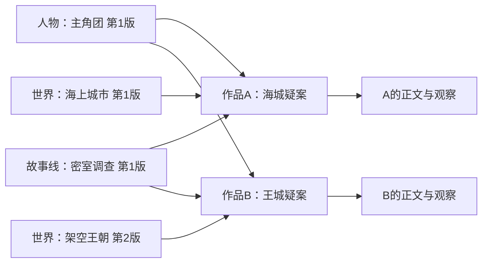

# 0.8 全局模块库与作品装配

日期：2026-10-24。状态：**待实施**。本契约落实同类型多实例、跨作品复用、版本固定与卸下后的上下文隔离。
产品入口见[产品方案](../../product-design/v0.8/README.md)，其他数据见[数据与存储](data-and-storage.md)。

## 1. 三种对象

| 对象 | 身份 | 示例 | 作用域 |
|---|---|---|---|
| 预设类型 | kind | world、characters、plot | 应用支持的固定能力 |
| 模块实例 | module_id | 海上城市、架空王朝、主角团、密室调查 | 全局库；同类型可创建多个独立实例 |
| 作品绑定 | binding_id、module_id、revision_id | 海城疑案使用主角团第1版 | 具体作品；固定版本及显式关联 |

同一作品可绑定多个同类型不同实例；同一 module_id 不可同时绑定两个版本。
0.8 不做“隐藏入口”或与装卸独立的 enabled 开关。模块未装入即不在本作品默认资料范围内。
列表分页与服务端数量／大小上限仍有必要，但不得把“同类型只能一份”写成结构约束。

## 2. 全局库的持久化

模块库是作者内容，不是 `.hastings` 下可清理的缓存。位置通过应用级 library 配置选择，
默认建议位于系统文档目录 `ClueLedger/ModuleLibrary`，可换位置；配置只保存定位，不能复制第二份权威原文。
第一版仅一个活动本地库，不做账户云同步、多库联邦、多人合并或远程共享。
实际建库发生于实现后的作者操作，本次只写计划，不创建用户模块库。

```text
全局模块库/
├─ library.json                         # library_id 与格式版本
├─ modules/<module_id>/
│  ├─ module.json                       # kind、名称、head、删除状态、幂等结果
│  └─ revisions/<revision_id>/
│     ├─ manifest.json                 # 父版本、条目清单、每份文件 digest
│     └─ entries/<entry_id>.md          # 固定字段＋自由文本，不可变已发布内容
└─ drafts/                              # 未发布编辑稿；不是写作默认可读版本

作品/
├─ 正文/*.md
├─ .clueledger/assembly.json            # 精确绑定、顺序、简单引用和配置版本
└─ 灵感本/<id>.json                     # 沿用独立修订；本轮不改变其作品归属

应用缓存/
├─ library-catalog.json                 # 按模块版本的基础索引，可重建
└─ workspaces/<id>/                     # 正文索引、观察、覆盖、执行事实
```

发布目录不可直接改写，编辑另建草稿再发布新修订。程序校验 manifest 中的内容指纹；外部改写
已发布文件时返回损坏／不匹配，不能原 revision_id 下静默接受新内容。
导出为普通 Markdown 后外部编辑，可显式导入为新版本；不再允许普通 file 工具跨出作品根修改全局库。
模块版本由库服务管理，不由任何单个作品的 Git 控制；作品 Git 只记录正文和 assembly 等本地受管源。

## 3. 绑定数据

```python
from dataclasses import dataclass

@dataclass(frozen=True)
class ModuleRef:
    library_id: str
    module_id: str
    revision_id: str

@dataclass(frozen=True)
class RecordRef:
    module_id: str
    entry_id: str

@dataclass(frozen=True)
class ModuleBinding:
    id: str
    module: ModuleRef
    label: str

@dataclass(frozen=True)
class Assembly:
    schema_version: int
    bindings: tuple[ModuleBinding, ...]
    # 只表达作者明确选择的引用，不做自动角色替换或正文改写。
    links: tuple[tuple[RecordRef, RecordRef], ...]
```

持久化还需配置 digest 与 request_key 结果。entry_id 在模块内稳定；完整来源身份为
`library_id/module_id/revision_id/entry_id`，不能单凭人名或路径跨模块合并。
模块内引用同版本 entry_id；跨模块引用用 module_id/entry_id，在本作品受理快照中解析到确定 revision_id。
未绑定、目标已删或冲突时标为 unresolved，禁止递归去全局库找最新版本补齐。
变体模块有新 module_id，forked_from 保存原模块版本；内部引用重映射，外部依赖保留并提示核对。

## 4. 发布、用于当前作品与另存变体

编辑器显示正在修改的模块、基础版本、当前作品固定版本。两种保存动作：

- 保存到模块库：发布新修订，任何作品绑定都不自动前进。
- 保存并用于本作品：作者一次操作授权发布和本作品更新；其他作品保持原版本。

两者都不需要随后再点“采用”。库版本发布与作品绑定是两个独立持久化步骤，不宣称跨目录事务。
库发布成功、作品绑定因冲突或忙失败时返回 `published=true, binding_updated=false`，界面保留结果并允许只重试绑定，
不能重新运行模型或重复发布版本。幂等请求和阶段结果都要持久化。

```python
# 结构示例；库服务与作品服务各自实现锁、指纹和请求键核对。
def publish_and_bind(library, workspace, command):
    published = library.publish(
        draft=command.draft,
        expected_head=command.expected_head,
        request_key=command.request_key + ":publish",
    )
    binding = workspace.try_bind(
        module_ref=published.ref,
        expected_digest=command.expected_assembly_digest,
        request_key=command.request_key + ":bind",
    )
    return {"published": True, "module": published.ref, "binding_result": binding}
```

发布时先在 staging 写完整版本并核验，再原子移入 revisions，最后在模块锁内 CAS 更新 module.json。
崩溃后已完成但未设 head 的版本按请求键恢复，不允许同 revision_id 内容变化。草稿或半写版本不出现在查询中。
同模块并发保存一个成功、另一个明确冲突；不同模块可独立保存。
基于旧固定版本编辑时不能覆盖已推进的 head；作者选择基于最新版重做，或“另存为变体”。不自动三方合并。

修改全局人物资料产生的新版本不改任何作品的人物观察；只有显式更新绑定后，相关依赖索引需重新核对。
正文证据只依赖正文时不因无关世界模块升级失效；依赖小传的身份核对须记录所用完整模块版本。

## 5. 装入、卸下、删除与运行中任务

装入／升级／卸下均 CAS 修改 assembly 并记录 Git；操作不调用模型、不生成正文。
同一作品的普通写作／整理任务运行时，不允许改变该作品绑定，返回 `WORKSPACE_BUSY_CONFLICT`，不隐式排队。
自然语言装卸可进入专用装配用途：不提供正文／观察写工具，核对明确授权后提交一次 assembly，
提交即结束该用途的模型执行；后续写作以新的受理快照进入另一轮。不能在普通写作轮中改变自身冻结的装配。
用户仍可在库里编辑其他模块／发布新版本，因为已受理任务固定旧 revision；“保存并用于本作品”可只完成发布。
另一作品升级绑定不影响本作品；本作品卸下也不影响另一作品。

卸下后，新的普通任务排除该模块的目录、摘要、查询结果和详情读取权限，已装模块的跨模块引用不可旁路。
当前会话历史曾展示过的旧内容无法撤回；下一轮明确标为已卸下、不再作为当前设定约束，必要时建议开启新会话获得干净输入。
这不是删除正文事实：已写死亡事件、人物出现、伏笔回收仍可从本作品索引查询。

模块库删除为 tombstone：退出新装入候选，已绑定的不可变版本仍可读取并标“库中已删除”；恢复后可再次装入。
0.8 不物理清除版本，以免破坏未打开或离线作品。已知使用作品列表仅供提示，不能冒充全部依赖清单。
删除模块内条目通过新版本表达；旧版本保留条目，升级绑定时列出失效引用。

## 6. 一套人物、两个世界或不同故事线



作者从当前组合创建新作品时，复制绑定和可解析的简单关系，可在创建前指定替换模块；新正文为空，
不复制原作品观察、缓存、会话或灵感，不自动适配已有内容。正文复制／跨世界整书改编另行发起。
保留原组合后将另一个世界用于新作品，比同一正文反复切换互斥设定更可追溯。
同作品可装多份互补世界或故事线；冲突以提示呈现，不能仅因同 kind 就拒绝，也不能暗中让后装者覆盖前者。
初版允许显式关联相同人物和事件；复杂调查者／隐瞒者角色槽位、自动职业转换留待后续。

## 7. 三层索引与访问范围

1. 库索引：每个已发布模块版本的名称、类型、条目、字段、依赖与可选语义摘要，不含任何作品的生死／回收状态。
2. 装配索引：按作品 assembly digest 解析绑定、引用与依赖缺口，不重新总结共享模块原文。
3. 正文索引：按作品和章版本保存摘要、事件、证据与观察，不回写全局模块。

基础索引程序提取；语义摘要按需显式生成并以模块 revision 或正文 digest 为依赖。
短条目本身即可作为查询结果，不强制模型生成同义摘要。未装模块的库索引不能出现在普通写作候选中。
明确“从模块库选世界观”才授权本轮全局搜索；选中未装模块作参考只限本轮，不自动绑定，也不授权发布新版本。

写作上下文冻结 library_id、assembly digest、每个 module revision 和显式参考。模块读取仍计实际区间，
revision manifest 校验不能替代全文阅读。装配记录和日志不得用“已读模块”掩盖只读其中一个条目。

## 8. 导入、备份和缺失依赖

0.7 作品打开时保留只读旧资料适配，不自动创建或移动全局模块。显式“导入模块库”按类型建立实例、
保存来源映射并让本作品绑定确定版本；完成绑定后旧源不再双读，旧文件保留导入标记，未经明确删除不移除。
重试按源指纹／请求键复用导入结果，不能每次生成另一套人物。无法解释的旧计划标待确认，不自动提升来源级别。

仅复制作品目录只带正文、灵感和绑定清单，**不保证包含全局模块原文**；缺少的精确模块版本由依赖诊断提示，
不能冒充完整作品，也不能自动改用最新版。
作品包导出与导出于 2026-10-24 取消：不再提供 zip 打包、解包校验或导入映射，相关服务端路由、
前端入口与用例一并移除。

库路径失联、模块版本缺失或内容被改时，正文仍可读；必要资料缺失的任务明确失败或要求缩小范围，
不能用最新版、同名模块或其他作品状态替代。恢复库后重新解析绑定，不自动运行模型。

## 9. 本版交付边界

必须包含：同类型多实例、全局抽屉、不可变模块版本、作品绑定、装卸、变体、跨作品状态隔离、
空正文组合新建、三个层次的索引与访问边界。作品包导出导入已取消。
不包含：隐藏操作、默认跟随最新、库版本物理清理、多库云同步、无提示批量升级、自动语义合并、
完整角色槽位系统、任意两个世界观的一键正文转换。
