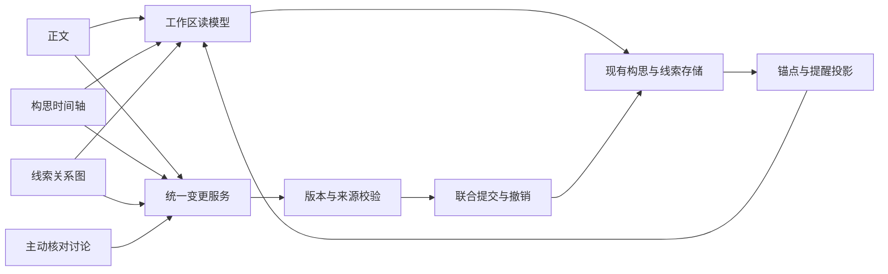

# v1.0.7 详细开发计划：构思与线索简化

日期：2026-11-01。目标版本：**v1.0.7**。状态：**待实施**。产品范围见[产品方案](../../product-design/v1.0.7/README.md)，字段与接口以[契约文档](data-and-api.md)为准。

## 1. 目标与取舍

本版让作者通过「正文 / 构思 / 线索」三个入口完成日常工作，减少要理解的状态和重复维护的关联。作者从一个正文片段就能登记线索，从一个构思节点就能找到正文，出现差异后可以选择进入讨论。

减少的是默认操作和重复表达。段落锚点、来源证据、版本检查、修改范围和联合提交继续提供可靠性。讨论中“直接绑定”的目标落实为统一的关联服务与简单的读模型，不通过删除所有修订信息来实现。

完成本版后，以下流程必须使用真实服务成立：

1. 无构思的已有正文 → 选段 → 选择真相或误导 → 刷新后标记仍在。
2. 构思时间轴 → 选中节点 → 查看多个正文出处 → 定位原文 → 返回节点。
3. 正文标记 → 线索详情 → 相关线索 → 对应出处，分类始终一致。
4. 修改构思 → 保存成功并提醒 → 稍后处理，仍可继续创作。
5. 主动讨论 → 建议包含依据 → 作者选择 → 实际提交 → 回读结果与状态。

本轮评审进一步明确：线索用途枚举为 `truth / mislead`；支撑有方向，矛盾与共同误导无方向，具体语义见[产品方案](../../product-design/v1.0.7/README.md)。时间轴以相对故事零点为唯一数值基准；暂缓按相关内容指纹判断。关系建议纳入主动讨论，多选批量操作、按类型整体移动线索及读者视角新开关暂缓，不增加本版主流程。

## 2. 已核对的代码基线

基线提交：`d1f8238 feat(v1.0.6): 段落级正文锚点与正文出处标注`。`pyproject.toml`、`src/hastings/__init__.py`、`frontend/package.json` 当前均为 `1.0.6`。

| 部位 | 当前事实 | v1.0.7 改动方向 |
|---|---|---|
| 主入口 | `AppHeader.tsx` 为正文 / 构思 / 模块库 | 线索进入主导航，模块库移至全局工具区 |
| 工作区 | `WritingLayout.tsx` 左栏目录/全书线索，右侧对话 | 目录按需展开，详情和对话共享辅助区 |
| 构思页 | `StorySurface.tsx` 使用 `StoryMysteryView`，包含状态筛选和多层信息 | 改为披露章节分组的只读故事时间轴 |
| 构思关系 | `StoryVariant` 已有节点、线索计划、相对时间、绑定和核对记录 | 扩充精确时间与独立线索关系，不重建另一套构思存储 |
| 线索身份 | `ClueLedger` 保存稳定身份、按章观察与覆盖 | 沿用身份与正文证据；类型放在方案计划，明确唯一编辑位置 |
| 正文标注 | `clue_marks.py` 从账本证据生成；缺少证据时使用锚点内词项匹配 | 改为精确来源投影，撤除词项猜测回退 |
| 正文关联 | `ProseBinding` 有段落引文、区间摘要、节点契约摘要；`node_id` 必填 | 允许仅关联线索，统一 UI 与工具入口的解析和校验 |
| 状态 | 节点八类，章节另有 `partial/unbound` 等 | 公共状态仅三类，内部原因独立表达 |
| 同步提交 | `require_sync_decision` 可返回 `STORY_SYNC_CONFIRM_REQUIRED` 阻止修改 | 创作差异改为提交后提醒，技术冲突继续阻止写入 |
| 提交与恢复 | `StoryStore` 与 `prepare_clue_joint` 已支持结构、正文、账本联合提交 | 扩展既有协调器，保持幂等、重启恢复与撤销 |
| 讨论受理 | 有 `purpose: review`、构思引用、精确线索引用和在线模型配置 | 增加核对目标引用，复用真实会话和回合服务 |

当前未跟踪的 `temp-design-preview.html`、`temp-simplified-architecture.md`、根目录包文件、`release/` 和既有 `anchor-model.html` 不纳入本版清理任务。实施前再次核对工作树，避免覆盖作者已有内容。

## 3. 统一架构

三页共享选中节点、线索、正文定位和数据修订。作者表单与模型工具共用同一套变更规范化服务。读接口只投影，不创建会话、不调用模型、不修改持久化对象。

## 4. 模块任务与代码落点

### M1 工作区导航与共享详情

目的：作者能在稳定位置查看当前内容，不必到多个线索面板寻找同一条信息。

- 扩展 `frontend/src/state/navigation.ts`，正文/构思/线索状态进入 URL；灵感的 `ideas` 路由仍表示灵感，不能复用为构思。
- 修改 `AppHeader.tsx`、`WritingLayout.tsx`，统一入口，保留作品选择和模块库返回位置。
- 新增 `WorkspaceDetail.tsx` 和 `workspaceSelection.ts`，使用判别联合表达节点详情、线索详情和对话目标，避免多个布尔值同时打开。
- 窄屏详情置于内容下方。切换页面保留阅读位置、对话草稿和选中项；不同作品之间清空不适用的引用。
- 所有读取携带作品、方案、对象和修订组成的请求键；晚返回的结果不能覆盖新的选择。

完成条件：直接 URL、浏览器前进后退、刷新、模块库返回及快速切换都指向正确对象；同一时刻没有重复线索详情。

### M2 分类、来源与联合变更

目的：作者只登记一次线索用途，正文与关系图获得一致结果。

- 修改 `story_models.py`：线索计划增加两类用途，节点增加可选的计划章节与结构化时间，方案增加线索关系及提醒确认记录。
- 扩展 `ProseBinding`：节点和线索至少存在一个目标，支持“仅线索”关联；保留路径、摘要和区间证据。
- 新增 `story_binding_service.py`（拟新增），统一 UI、模型工具和候选提交的选段解析，不让调用方自行伪造摘要。
- `story_clue_commit.py` 的临时线索 ID 替换必须覆盖绑定与关系两端，不能只替换计划和节点用途。
- 新增操作接入 `story_changes.py`、`story_store.py` 的校验、逆操作、依赖和回执。
- 空作品首次标记沿用 `main/empty` 提交方式建立空主方案，不要求先生成构思节点。

完成条件：一次“创建线索并标记正文”只有一个可恢复提交；重试不会重复创建，任何目标失败不会留下半条关系。

### M3 正文选段与双向定位

目的：正文与构思、线索都有可验证的直接出处。

- 在 `SelectionToChat.tsx` 的选段能力上增加两个标记动作，保持原有引用到对话能力。
- 复用 `SourceHighlight.tsx` 的码点与 UTF-16 转换；正文显示文本不得代替规范化 Markdown 源坐标。
- 修改 `Paper.tsx`、`ClueMarks.ts`、`clue_marks.py`、`story_prose_marks.py`。
- 作者新标记写入带 `clue_id` 的精确绑定；已有账本证据只在能验证当前原文时显示。合并视图去重，不把界面标记另存为第二份账本事实。
- 模型核对或候选发布发现同一线索多次出现时，也逐处登记精确绑定；复用相同规范化服务，不通过新增重复账本贡献保存位置。
- 点击构思出处定位正文；点击正文标记选择线索；返回构思时恢复节点。
- 失效或多处匹配时保留原引用并说明原因，不定位到猜测的位置。
- 允许同章多次出现与重叠范围；重叠标记以可展开列表呈现，不能互相覆盖。

完成条件：中文、emoji、重复句、Markdown 格式、CRLF、章节前插入文本、片段删除、外部编辑均有明确结果。

### M4 只读故事时间轴

目的：保留时间维度，同时减少阶段、角色和知识泳道的常驻信息。

- 新增后端 `story_timeline.py` 和前端 `StoryTimeline.tsx`（均拟新增），替代默认的多泳道视图。
- 同一横轴只接收具有共同时间基准的数值；精确时刻显示点，区间显示条，未知时间显示可选择的未定位行。
- 行按披露章节分组，组内节点各自成行。未绑定节点显示计划章节；未安排章节另列。
- 点击节点刷新共享详情，时间轴本身不提供拖拽、缩放编辑、重排或调整持续时间。
- 编辑时间、标题和意图在详情进行；时间输入不强制精确到分钟。
- 相对天数和已明确的时刻统一换算为相对分钟；模糊描述保留未定位状态。绝对日期可写进基准标签，但本版不解析标签或新增日期自动换算。
- 针对长篇做可见行窗口或分段加载，选中节点仍可通过明确的定位动作进入视野。

完成条件：倒叙、跨午夜、相对时间、同章多节点和跨章节点表达正确；图上的时长不由标题长度或像素最小值决定。

### M5 统一线索页与关系图

目的：在同一位置理解线索的用途、出处和与其他线索的关系。

- 将 `StoryClues.tsx` 中适用的列表能力收敛到 `ClueSurface.tsx`，新增共享 `ClueDetail.tsx`、`ClueRelations.tsx`（拟新增位置为 `components/clues/`）。
- 扩展 `story_clue_views.py`、`clue_views.py`、`clue_api.py` 和对应前端 API；无构思节点时仍可列出已登记线索。
- 默认详情只展示标题、类型、作者事实、读者理解、正文出处和相关线索；角色知情、覆盖统计、生命周期不再逐项常驻。
- 关系支持支撑、矛盾、共同误导，有端点、说明和可选证据；图与列表来自同一投影。
- 节点与连线的点击共用辅助区；关系表单明确端点方向，列表提供同等可达的详情和操作。预览的支撑示例须补足方向依据，不能照搬含义不完整的连线。
- 关系由作者登记或通过明确采用的对话变更写入；GET 不产生模型推断。
- 主动讨论可以建议可能矛盾，列明原文与成立前提；不增加后台扫描、独立候选关系池或自动采纳行为。
- 无关系时使用列表；较大规模展示完整列表与选中项的一跳图，显示真实的未展示数量。

完成条件：类型修改同步刷新正文与图；孤立线索、同名线索、无正文线索、关系撤销和删除端点都有正确行为。

### M6 三状态与非阻断提醒

目的：作者理解当前是否需要核对，并能决定何时处理。

- 重构 `story_sync.py` 的公共读模型；状态与原因分离，只返回 `ready/draft/attention` 作为作者状态。
- 用节点语义契约和关联片段摘要判断变化；标题、展示排序和其他段落的修改不导致无关提醒。
- 取消“存在某个未关联章节，就使所有未绑定节点需核对”的跨节点推断。缺少关联的具体节点为草稿。
- 删除 `StorySyncStrip.tsx` 的多状态筛选入口，状态点保留在节点或目录必要位置。
- 创作差异不再通过 `STORY_SYNC_CONFIRM_REQUIRED` 阻止普通保存；提交回执带提醒，前端展示保存结果与受影响对象。
- 提醒的稍后处理写入当前指纹，仍保持需核对。再次变化后指纹失配，恢复提醒。
- 指纹只纳入相关语义、片段、目标与核对依据，精确定位和唯一重定位视为同一有效结果；标题、偏移平移、其他段落与暂缓记录自身不触发重复提醒。
- 不把前端警告消失当作完成；状态由后端重新投影。

完成条件：修改意图可保存；并发改稿仍被阻止；稍后处理不会变成就绪；完整状态矩阵通过定向测试。

### M7 主动讨论与模型执行

目的：把差异处理放进作者熟悉的对话，且每次修改都有明确对象和依据。

- 复用 `conversations.ts`、`api/workspace.ts`、`story_context.py` 和现有会话接口，新增 `context.story_reconcile` 引用契约。
- 点击前只读当前提醒，不预建对话、不请求模型。点击后服务端解析引用、验证版本，首次请求为 `review`。
- 同一提醒使用稳定请求键和会话记录避免重复创建；关闭详情、切换页面和重试不重新发起模型请求。
- 作者选择修改后按当前授权范围进入已有正文或结构变更流程；正式提交前重读依赖。
- 更新 `prompts/authoring.py`、`prompts/story.py`、`prompts/tools.py`，撤除“发现同步差异必须先阻止提交”的旧指令。
- 首次讨论只给所选节点、相关片段和必要线索；“展开核对全书”由作者另行明确。
- 维护 `reader_preview` 隔离，不把作者分类或未来关系泄露给实际试读上下文。

完成条件：真实在线调用能生成有原文依据的建议，作者选择后发生真实写入；超时、停止、过期和恢复都有可解释结果。

### M8 清理、验证与版本交付

目的：删掉被新工作流替代的入口和无消费者接口，避免旧规则继续影响新界面。

- 撤除 `StoryMysteryView` 的默认界面、旧知识泳道和状态筛选；检查 `mysteryLayout` 与 `/mystery` 的真实消费者后移除纯 UI 专用部分。
- `story_mystery.py`、`story_knowledge.py` 等仍被写作核对使用的领域函数继续保留；不得按文件名整块删除。
- 清理左栏“全书线索”重复入口、旧同步选择提示、孤立样式和专用测试。保留正文定位、章界读取和候选发布的真实消费者。
- 新格式直接开发，不做旧数据迁移、不补旧枚举兼容层。程序不自动清空作者正文目录。
- 按验收文档进行逐模块验证，再做一次发布范围回归，统一版本号和交付说明。

## 5. 分阶段实施与退出条件

| 阶段 | 关键工作与依赖 | 作者可体验的结果 | 退出条件 |
|---|---|---|---|
| P0 | 核对 HEAD、工作树、已知失败；冻结关系语义、相对时间、指纹和功能范围；准备新格式夹具 | 可用统一样本讨论全部流程 | 页面动作—接口—存储—验收编号一一对应，已有改动有记录 |
| P1 | M2 公共类型、来源规范化、状态投影与读写回执；依赖 P0 | 可读取三态和两类用途的真实数据 | 类型、合法空结果、版本冲突、临时 ID 解析和联合回滚定向通过 |
| P2 | M3 与类型编辑的垂直链路；依赖 P1 | 选段标记、刷新保留、类型同步、定位出处 | A01—A08、A19 的有关断言通过 |
| P3 | M4 与节点详情；依赖 P1、P2 | 时间轴查看和正文双向定位 | A09—A12 通过，三类时间信息不被混算 |
| P4 | M5 的列表、图、关系编辑；依赖 P2、P3 | 全书线索及其关系在同一页可用 | A13—A16 通过，无关系和大规模退化可用 |
| P5 | M6 与 M7 联调；依赖 P1—P4 | 差异提醒、稍后处理、讨论及实际调整 | A17—A24 通过，在线用例 O01—O04 有原始证据 |
| P6 | M1 完整工作区及 M8 撤除清单；依赖 P2—P5 | 三入口与统一详情成为正式界面 | 路由、模块库返回、草稿保留、旧入口退出均通过 |
| P7 | 完整受影响回归、浏览器规模样本和全部在线用例 | 可交付候选版 | 验收矩阵所有必需项通过，未执行项不得记为通过 |
| P8 | 版本、锁文件、状态说明与交付记录；依赖 P7 | v1.0.7 可追溯交付 | 各处版本一致，文档区分已实现和剩余边界 |

阶段记录建议以 `P0-baseline.md`、`P2-prose-marks.md` 等命名。遇到失败先保留原因与实际输出，修复后只复验受影响范围；不要用多次重跑掩盖在线语义问题。

## 6. 接口收口原则

- 三页复用 `/story/changes` 作为变更入口，不分别建设一套线索修改、关系修改和同步修改后门。
- 保留现有线索列表、详情、来源定位和正文标记 GET，通过扩充响应接入新 UI。
- 新增时间轴和线索关系两个有明确消费者的读投影。
- 讨论使用已有会话创建和回合接口，不新增一套独立聊天系统。
- `/mystery` 的撤除与前端消费者在同阶段完成；已有内部核对代码使用独立领域函数。
- HTTP DTO、工具 JSON Schema、前端类型、提示词中的枚举和字段同步修改，不能只让预览或单一入口可用。

完整表格与 JSON 见[数据与接口契约](data-and-api.md)。

## 7. 主要风险与处理

| 风险 | 处理方式 | 对应验收 |
|---|---|---|
| 只改界面文案，后台仍强制同步 | 清查所有 `require_sync_decision` 调用和提示词；同一变更分别从 UI、工具、候选验证 | A17、A20、O01—O04 |
| 线索类型、出现过程与事实真假混为一谈 | 类型独立存储，证词与作者事实分别装配 | A03、A22、O05 |
| 把旧范围套到已改正文 | 服务端核对摘要与引文；唯一重定位与歧义失败分开 | A05—A08 |
| 一章一节点的预览假设进入数据模型 | 多章、多节点、同章多次出现夹具作为第一批样本 | A04、A10 |
| 改类型只刷新一处 | 使用修订回执统一失效正文标记、详情、图和核对状态 | A02、A21 |
| 并发读请求使旧内容覆盖新选择 | 请求键、序号与卸载取消共同防护 | A21 |
| 初次讨论意外写作 | 请求用途明确为 review，后端工具权限和写入日志验证 | A20、O01 |
| 节点标为就绪但实际没有应用改动 | 以提交回执和回读为准，不采纳模型口头声明 | A18、O02—O04 |
| 新界面使模块库或灵感不可达 | 入口位置明确，返回位置与既有能力纳入回归 | A25 |

## 8. 版本与文档

P8 统一更新：

- `pyproject.toml` 与 `src/hastings/__init__.py`。
- `uv.lock` 的项目版本记录，通过现有依赖管理流程同步。
- `frontend/package.json` 与 `frontend/package-lock.json` 中的根项目版本。
- 已有版本断言、健康检查及打包元数据中实际使用的版本来源，先搜索消费者再修改。
- 本目录入口、产品入口与 `dev-notes/README.md` 中的真实交付状态。

版本号更新本身不触发重复后端全量；若 P7 后没有业务改动，只检查版本一致性和受影响的断言。根目录 README 仅在作者另外要求时修改，`mynotes/` 始终只读。

## 9. 本次计划编制验证

本次验证范围是文档链接、引用路径、阶段一致性、接口覆盖与示例语法；不执行后端全量、不调用在线模型、不将预览交互测试计为正式业务验收。未来实施验证按[验收计划](acceptance.md)逐项记录。
