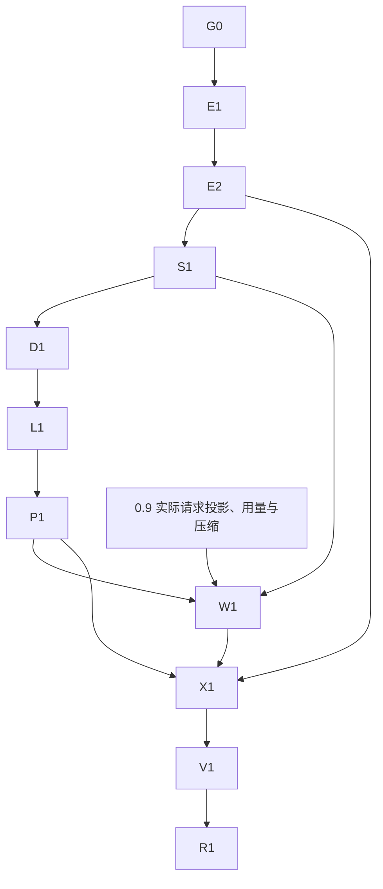

# 1.1 详细开发计划

> 2026-10-27 版本调整：原 1.0 修订学习计划顺延为 1.1 预留；优先完成 [1.0 悬疑线索设计与写作联动](../../product-design/v1.0/README.md)。本计划尚未实施，实施前按 1.0 实际交付重新核对基线。

初稿：2026-10-26；顺延：2026-10-27。状态：**1.1预留，待重新核对1.0交付基线**。目标：**1.1.0**。
更新：2026-10-27，加入作品级 `STYLE.md` 直接维护与修订学习共用流程。

范围见[产品方案](../../product-design/v1.1/README.md)；契约见[数据与恢复](data-and-recovery.md)、
[接口与前端](api-and-frontend.md)、[实现示例](implementation-examples.md)和[验收](acceptance.md)。

## 1. 目标与取舍

本版减少反复纠正同类表达的负担，前提是正文可靠、理解有来源、范围受控。
先保证编辑与版本及写作约定维护，再归纳候选，最后用于写作。保存、版本、分析和启用分别报告，
任何后续失败不能抹去已保存正文。

作者已确认自动分析、确认后使用、默认作品内和目标版本 1.1。
本轮补充确认作品根目录真实 `STYLE.md`，支持应用内和外部编辑器；作者直接声明无需改稿证据。
文件是当前约定内容的权威来源，面板与候选确认更新同一文件；记录库负责证据、决策与派生索引。
完整边界见[写作约定文档契约](style-document.md)，不把文件作为记录库的单向导出副本。
本计划选择作品内轻量记录库处理新增操作、证据与决策，支持幂等、版本核对、调度和失效；
正文仍以 Markdown 和真实 Git 为准，会话仍以现有事件为准，不迁移为新内容数据库。

采用共用写入占用、不可变快照、可恢复阶段记录、只读分析和请求级投影。
不同时加入参数训练、向量检索、全量历史扫描或自动跨作品学习。

## 2. 2026-10-26 代码基线

| 位置 | 事实 | 本版处理 |
|---|---|---|
| `components/workspace/Paper.tsx` | 只读阅读器 | 编辑与对照入口，保持阅读 |
| `workspace/files.py` | 指纹、UTF-8/LF、原子替换、路径与元信息校验 | 复用，保存核对实际字节指纹 |
| `workspace/api.py` | 有文件 GET、导入和 Git，无人工正文保存 | 新编辑/学习路由，复用错误信封 |
| `workspace/git.py` | 按路径提交、HEAD 核对、最新提交 revert | 操作关联、内容核对、补记协调 |
| `workspace/service.py` | 前台受理、材料/模型快照、范围与提交 | 受理和真实请求边界接偏好 |
| `workspace/run_registry.py` | 占用登记，检查和登记不构成原子受理 | 原子 claim，写入口共用 |
| `server/file_app.py` | 共享 RunRegistry，装配主要用 busy 回调 | 注入协调器、新服务和后台生命周期 |
| `workspace/model_activity.py` | 请求、Usage、耗时；输入附件可关闭/过期 | 学习独立归属、持久数值记录 |
| `workspace/state.py` | 作品 ID 随路径变化，改名迁移状态 | 新增稳定 UID，关系不依赖旧路径 ID |
| `workspace/deletion.py` | 删除作品和应用状态，保护共享目录 | 先停学习、关连接，禁止写回 |
| `state/moduleEditor.ts`、`useUnsavedChanges.ts` | 原文草稿主要在前端会话 | 正文新增持久草稿，不泛化改造全部草稿 |
| `WritingLayout.tsx`、`state/layout.ts` | 目录/正文/对话，按宽度和字号切换 | 对话与偏好共用辅助区域 |
| `desktop/main.ts` | 每次动态本地端口 | 草稿不能仅依赖浏览器 origin 存储 |
| `playwright.config.ts` | 显式测试文件名单 | 新文件同时登记 |
| `eval/harness` | 主要驱动聊天，无偏好消融 | 新增编辑/决策步骤和对照变体 |
| 版本 | 当前主包/前端/桌面均为0.9.0发布候选；实施前核对1.0实际交付 | R1统一为1.1.0，计划不升级 |

工作树有其他改动。G0 固定源码、契约、测试和既有失败，不能把其他任务状态覆盖为本版状态。

## 3. 职责和文件

文件可按复杂度合并，职责和校验边界不能省略；下列均为拟议位置。

| 职责 | 位置 | 交付 |
|---|---|---|
| 写入互斥 | 调整 `workspace/run_registry.py`、服务与路由 | claim、owner、失败释放、生命周期屏障 |
| 领域类型 | 新 `workspace/revision_models.py` | 编辑、保存、片段、偏好与状态 |
| 新记录 | 新 `workspace/revision_store.py` | 事务、格式校验、快照、幂等、租约、outbox；不迁移旧学习记录 |
| 写作约定 | 新 `workspace/style_document.py` | 固定文件定位、块解析、范围、指纹、保存、外部核对、索引重建 |
| 人工编辑 | 新 `workspace/manuscript_edits.py` | 基线、草稿、保存、补记、恢复 |
| 中文差异 | 新 `workspace/revision_diff.py` | 段落/句内、移动/拆并、预算、坐标 |
| 证据 | 新 `workspace/revision_evidence.py` | 来源、独立组、沿革、失效、排除 |
| 学习 | 新 `workspace/revision_learning.py`、`revision_prompts.py` | 调度、冻结、只读调用、输出校验 |
| 作者决策 | 新 `workspace/writing_preferences.py` | 候选确认和详情编辑写回 STYLE.md；停用、恢复、忘记、冲突 |
| 请求使用 | 新 `workspace/preference_context.py`，接 context/assembly | 受理快照、每请求选择、撤销过滤、回执 |
| 接口 | 新 `workspace/revision_api.py` | 完整契约，不继续扩张主路由文件 |
| 应用装配 | 调整 `server/file_app.py` | 启停、恢复、取消、服务工厂 |
| 前端请求 | 新 `frontend/src/api/revisions.ts` | 同名状态、错误、请求键、游标 |
| 文档请求 | 新 `frontend/src/api/styleDocument.ts` | 文档读取、保存、草稿、操作恢复与错误 |
| 前端状态 | 新 `state/manuscriptEditor.ts`、`state/writingPreferences.ts` | 归属、序号、旧响应保护、恢复 |
| 编辑界面 | 新 `components/revisions/ManuscriptEditor.tsx`、`RevisionDiff.tsx`、`ManuscriptConflict.tsx` | 编辑、差异、冲突 |
| 偏好界面 | 新 `components/preferences/PreferencePanel.tsx`、`PreferenceDetail.tsx`、`PreferenceUsage.tsx` | 候选、管理、来源、使用 |
| 约定界面 | 新 `components/preferences/StyleDocumentEditor.tsx`、`state/styleDocument.ts` | 整份编辑、独立草稿、指纹冲突、与详情同源 |
| 原组件 | 调整 Paper、WritingLayout、ChangesDrawer、useUnsavedChanges、作品生命周期 | 不丢内容、统一辅助栏、归属 |

## 4. 阶段任务

### G0：基线与契约

- 固定工作树、版本、已实施能力与既有失败，不覆盖其他改动。
- 核对 0.9 的实际用量、压缩和请求投影接点；记录与其计划的差异。
- 冻结状态、错误、幂等作用域、证据坐标、回执和初始负例。
- 冻结 `STYLE.md` 分块、稳定 ID/范围注释、无注释文本、外部修改及丢失范围的解析规则；禁止双份生效来源。
- 固定风险样本：事实/剧情、临时缩写、人物特例、反复保存、撤销、后文和节奏不足。
- 保留真实写作台对话布局，预览仅作交互参考。

完成条件：契约单一、检查可执行、依赖可判断；不产生业务交付结论。

### E1：互斥、存储与编辑身份

- 将「检查忙碌 → 登记」改为原子 claim，带 owner 和 kind。
- 接模型受理、人工保存、导入、Git、作品装配和改名/删除；只释放自身 owner。
- 学习不持正文写锁，但受作品关闭/删除屏障和自身租约约束。
- 显式编辑或设置写入时建新格式 1；GET 不初始化、不调用模型。
- 稳定作品/文档 UID、编辑会话、服务端基线和实际字节指纹。
- 草稿按会话持久化，带版本与序号，不生成 Git 或模型请求。

完成条件：竞争确定，草稿跨刷新和桌面端口恢复；新记录失败不改正文。

### E2：正文保存与恢复

- 先查重，再核对会话、指纹、路径和占用。
- 固定前后快照与 HEAD，持久化意图 → 替换文件 → 按路径记录 Git。
- 未知未记录改动单独处理，不并入人工证据。
- 保存、版本、学习分轴；补记不重写正文、不调用模型。
- 请求发送后继续编辑，响应仅推进已提交基线，保留更高本地序号。
- 重启核对快照与匹配提交，不盲目重写或再次提交。

完成条件：响应丢失、各崩溃点、外部修改和 Git 冲突可恢复，旧请求不覆盖正文。

### S1：写作约定维护

- 读取作品根目录真实 `STYLE.md`，缺失返回空视图；首次保存或候选确认才创建。
- 直接声明保存不需要改稿证据和模型调用；纯文档修改不进入正文修订学习。
- 整份编辑和规则详情通过同一服务更新文件，保留未修改文本；支持无注释普通 Markdown。
- 文档草稿独立持久化，复用序号和旧响应保护；不扩大 chapter 编辑接口范围。
- 共用 claim、原始指纹、请求键和阶段意图，协调文件、Git、索引和决策恢复；Git 失败独立补记。
- 打开、任务受理和每次发送前核对磁盘，解析结果绑定文件 digest；外部删除、非法文件和索引过期不回退旧规则。
- 范围丢失或身份无法核对时排除相关规则，整份冲突保留三份内容，不自动覆盖或扩大范围。
- 记录库索引只能从当前文件重建，停用和忘记排除不能被文件历史回退绕过。

完成条件：离线、关闭自动学习也能维护约定；文档与详情同源，外部改动与各崩溃点可判断、可恢复。

### D1：差异与证据

- 完整快照审计，显示层段落对齐后做句内差异。
- 区分插入、删除、修改、移动和拆并；不确定时展示较大原文范围。
- 来源由实际保存路径决定，整章替换和来源不明粘贴不默认当强偏好证据。
- 片段沿革归并同处修改，独立证据按组计算，不按提交数。
- 纯格式不分析；事实与剧情交分类，不硬编码成风格。
- 相关修改、撤销和外部变化重核关联，无关段落变化不使所有历史证据失效。

完成条件：中文定位准确、长文有界、重复与恢复不增加虚假证据。

### L1：自动分析

- 保存完成后登记待处理操作，短等待合并，上下文和日调用均限额。
- 固定片段、上下文、资料、候选快照、模型、提示版本。
- 无写工具，输出分类、规则、条件、例外和引用，允许空候选。
- 核验来源、引用、范围、取消令牌和证据 epoch，再事务发布候选。
- 前台优先，迟到结果不发布；已发出请求的中断不自动重发。
- 新结果不自动覆盖已确认规则，不写人物事实或正文。

完成条件：正常改稿到达候选，失败/暂停/预算/重启不阻塞保存。

### P1：作者决策

- 决策带精确版本、请求键和作者看到的规则，旧版本确认返回冲突。
- 会改文件的决策同时核对 expected_style_digest；候选确认预览完整规则块，文件与索引核对完成才报告生效。
- 确认、编辑并确认、修改已启用规则、仅本次、停用、恢复和忘记。
- 作品/人物/场景范围，条件和章界可改；人物身份不能仅靠同名。
- 扩大范围重新确认，相近和冲突理解保留关系。
- 忘记先排除并失效投影，再清理内容、示例与受控历史；旧摘要不能恢复。

完成条件：有效规则权威来源唯一，忘记与证据撤销完整。

### W1：用于真实写作

- 受理冻结允许版本、证据状态和上下文基线，不读界面当前列表替代。
- 同时冻结 `style_digest`，每次发送前核对当前文件；变化只排除旧规则，不在本轮加入新规则。
- 本次要求、具体明确约定、作品一般明确约定、已确认推断依次适用；同层冲突需要区分条件或由作者决定。
- 每请求按已知目标、人物、场景和章界选择；目标未知不使用局部偏好。
- 工具确定目标后可在允许快照内重选，不加入受理后新确认规则。
- 每请求过滤停用/忘记旧版本，只收窄；选中与排除绑定真实请求回执。
- 规则和示例独立章界、预算，后文不带入前章或事实提取。
- 复用 0.9 完整请求估算/压缩/投影，不从旧摘要恢复失效偏好。

完成条件：回执与真实输入一致，当前要求优先，未来信息不重新引入。

### X1：页面与生命周期

- 真实接口接通编辑、草稿、冲突、保存、补记和差异。
- 写作偏好区接通整份约定与待确认入口，外部变化、文档草稿和详情编辑共用文件，不新增主导航。
- 偏好入口不抢焦点，右侧切换不卸载对话或清空草稿。
- 窄屏、100%/150% 字号、键盘、触屏、焦点恢复。
- 改名暂停学习并关闭连接，迁移状态后按稳定 UID 恢复；删除后禁止写回。
- 卸下人物模块或身份变化使对应偏好需复核，不按同名重绑。
- 回归导入、版本撤销、活动记录和模型设置。

完成条件：每个前端动作都有后端，后端能力都有使用与恢复入口。

### V1：效果与性能

- 用 `.env` 在线模型，固定样本、独立留出场景、三个对照。
- 分别验证直接声明与候选确认两条入口，保存文件指纹和实际请求回执；评分标准不写入约定。
- 驱动真实编辑/分析/决策/写作，脚本确认不冒充自然作者偏好。
- 作者盲读忠实度、适用性、生成；模型评分辅助。
- 失败、未知、成本与修正负担留证，不反复重跑挑成功。
- 验证调度、取消、长文与草稿性能，后台压力不影响保存。

完成条件：[验收门槛](acceptance.md)有证据，未执行与不确定不计通过。

### R1：1.1 发布

- 主包、前端、桌面、锁文件、产物统一 `1.1.0`，数据格式独立。
- 用户可见名称统一「线簿 / ClueLedger」，内部包名、状态路径、appId 兼容保留。
- 不直接改 `app.setName` 导致用户目录迁走；变更必须显式兼容原 userData。
- 桌面验证新记录库、动态端口、草稿、Git、在线模型、停止和异常退出。
- 用真实旧版本副本验证安装升级和作品 Markdown 文件保留，旧学习记录不迁移；同时验证新项目。
- 发布实际模块说明、运行/升级说明与证据，不自动改根 README。

完成条件：版本、产物、行为、文档一致，未验证范围明确。

## 5. 依赖与阶段体验

E2 可体验改稿，S1 可维护写作约定，P1 可体验可审查学习；W1 接真实使用，尚不能称为 1.1。
实施优先级在1.0之后；G0先核对其实际交付，复用稳定作品身份、来源定位和线索辅助区，W1继续核对0.9请求投影与压缩。
按阶段交付和门槛估算，不在缺少测量时承诺总工期。

## 6. 风险与处理

| 风险 | 处理 |
|---|---|
| 重复保存/提交 | 请求键、不可变意图、提交核对、显式恢复 |
| 文件与偏好面板分别生效 | STYLE.md 为内容权威，详情写回同文件，索引绑定实际 digest |
| 外部改动、范围丢失或回退旧文件 | 发送前核对、保留冲突、排除无效规则，停用/忘记不因回退失效 |
| 外部绕过应用锁 | 指纹和 HEAD 多点核对，保留冲突结果，不承诺跨工具原子事务 |
| 反复修改虚增证据 | 片段沿革与独立组，中间尝试不累加 |
| 情节误学为文风 | 分类、负例、来源、作者确认、允许无候选 |
| 后台挤占或重复付费 | 有界调度、前台优先、取消、已发送中断不自动重发 |
| 忘记后从旧历史恢复 | 排除标识、清理、来源投影和在线回归 |
| 动态端口丢草稿 | 服务端持久化、最近持久化序号 |
| 数据连接阻止改名/删除 | 短连接、生命周期屏障、关闭、备份验证 |
| 文风改善却损伤故事 | 独立任务、硬约束和作者盲读分别验收 |

## 7. 计划检查范围

本轮只检查文档链接、命名、契约及示例语法和独立逻辑，结果见示例文末。
未运行正式生产、浏览器或在线验收，不改变发布状态。
