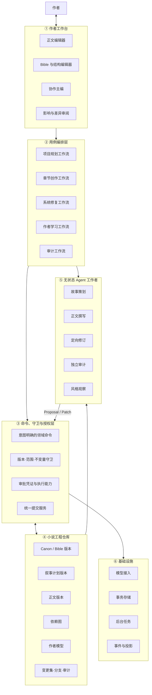
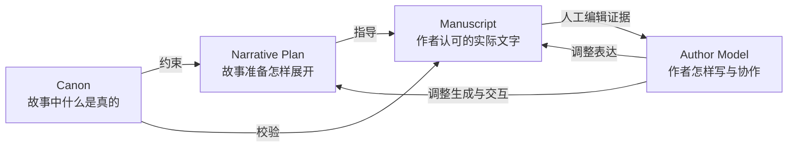
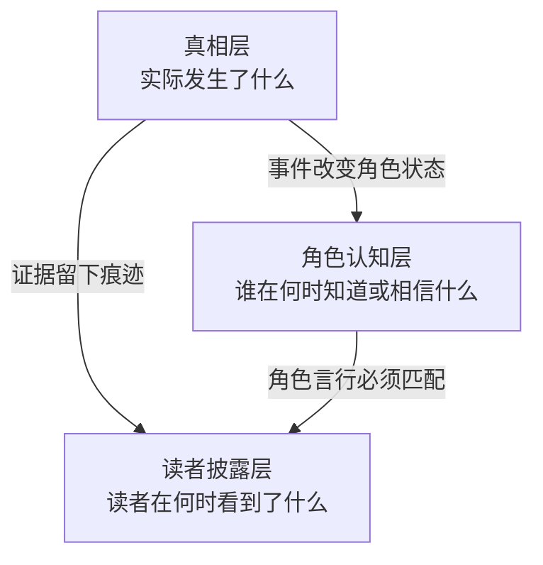
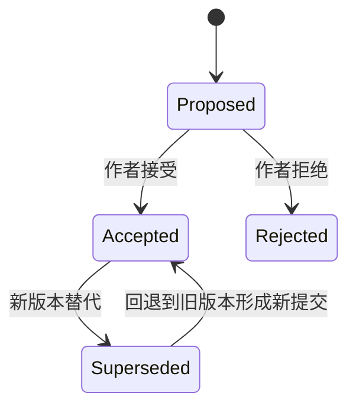
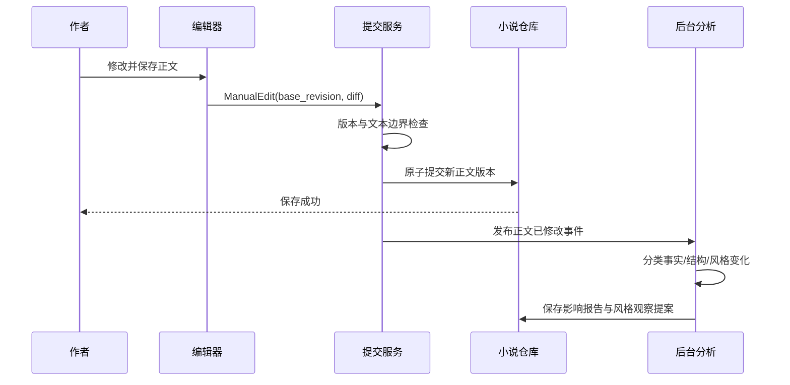
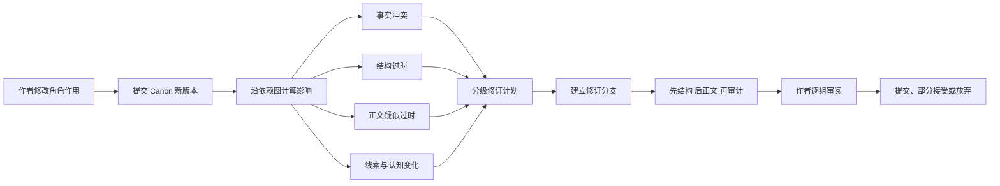
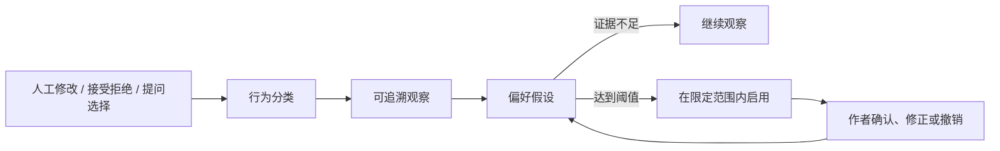

# Hastings V2：可演化的小说工程工作台

> 文档性质：**目标架构**。
> 立项日期：2026-10-14。
> 旧系统仍在运行；本设计通过 Phase 11–17 分阶段替换，不描述当前代码已经具备这些能力。

## 1. 产品定义

Hastings V2 是一个面向长期小说项目的协作写作环境：作者制定和修改故事事实、结构与正文，系统保存每次决策的版本和依赖，并在变化发生时帮助作者分析影响、制定修订计划、生成可审阅补丁和验证一致性。

一句话定位：

> **以作者为最终决策者，以版本化小说仓库为事实源，以变更集驱动创作和修复，并从作者真实修改中持续学习。**

### 1.1 解决的问题

1. 长期聊天使设定散落，模型无法区分已经决定的事实和讨论中的候选方案；
2. 早期设定变化后，后续结构与正文的影响范围不可见，只能依靠人工通读或整书重写；
3. 人工正文修改与 Agent 写入走不同路径，容易丢失版本、覆盖编辑或造成账本和正文分叉；
4. 所谓“学习文风”通常只是选择预设风格或注入样例，无法解释系统从用户修改中学到了什么；
5. 单个长期 Agent 同时负责规划、写作、修订和审计，任务冲突、上下文混杂，失败后难以恢复。

### 1.2 产品承诺

- 用户保存的正文立即成为当前有效版本，不被后台对账静默覆盖；
- 每个 Agent 写入先成为 Proposal，经过版本、范围、不变量和授权检查后才能提交；
- 修改 Bible、结构或正文时能生成可解释的影响报告；
- 支持局部修复、分支试写和从任意版本开始的全局重写；
- 作者模型的每条推断都有证据、适用范围、置信度和撤销路径；
- 项目事实存在仓库中，会话和模型均可替换或丢失；
- 悬疑项目能分别追踪真实情况、角色认知和读者披露，审计公平性与泄密。

### 1.3 当前范围

V2 优先完成单机、本地优先的创作和修复闭环。发布平台、读者社区、付费、多人实时协作、模型微调和第三方作品风格模仿不属于本轮重建范围。

## 2. 参考输入与产品取舍

NovelMint 的公开流程采用“构想 → 节拍时间线 → 按声音画像生成正文 → 编辑 → 发布”，其悬疑指南强调先确定真相，再反向布置线索、误导项、嫌疑人和时间线：

- [How to write a mystery novel](https://novelmint.ai/guides/how-to-write-a-mystery-novel)
- [AI novel-writing software](https://novelmint.ai/ai-novel-writing)
- [AI 如何保持故事连贯性](https://novelmint.ai/zh-CN/guides/how-ai-keeps-story-continuity)

Hastings V2 借用“结构先于正文”和“事实必须外置”的思想，但把产品中心放在两个更深的能力上：

1. 修改可以跨越 Canon、叙事结构和正文，并以影响链、修订计划和差异审阅呈现；
2. 系统从用户真实编辑与选择中积累作者模型，而不是只使用一次性风格说明。

用户补充想法见 [`ideas.md`](../ideas.md)：作者模型同时观察写作习惯、提问方式和选择偏好；不同任务使用不同上下文构建与压缩策略。

## 3. 核心设计原则

### P1 作者拥有决定权

Agent 负责分析、提出候选方案和执行已授权的修改。事实是否成立、正文是否接受、一次修订覆盖多大范围，最终由作者决定。授权必须绑定到具体变更集和基础版本，不能用模糊的“之前确认过”替代。

### P2 仓库是唯一事实源

项目状态来自版本化仓库。聊天记录只保存沟通过程；system prompt、模型记忆、前端缓存和导出的 Markdown/YAML 都不是第二事实源。

### P3 变化是一等领域对象

Bible 修改、章节重写、人工润色和结构调整都先进入 Change Set。系统围绕变化保存原因、基础版本、影响、补丁、审阅和提交结果。

### P4 Agent 只提交提案

Agent 不直接写数据库或文件。它返回有基础版本和目标范围的 Proposal/Patch，由应用层验证并提交。确定性规则不放进 prompt 期待模型自觉遵守。

### P5 用户正文优先

人工保存走统一提交入口并立即生效；风格观察和影响分析在提交后执行。后台分析失败不能使人工保存失败，也不能把正文恢复成旧稿。

### P6 上下文按任务构建

规划、写作、修订、审计和风格观察使用不同 Context Package。每个包声明仓库版本、选择依据、token 预算和允许的工具，避免把整段会话压缩成万能记忆。

### P7 可观测性属于提交契约

一次成功提交必须同时产生可查询的 Commit、变更摘要和事件；不能出现数据已写入但事件丢失，或事件宣称完成而数据未生效。

### P8 失败必须可分类

系统明确区分：

- **违规**：命令违反版本、授权或领域不变量，应纠正输入；
- **合法空结果**：例如改动没有下游影响，应正常结束并解释；
- **环境故障**：例如模型或存储不可用，应保留任务状态并允许恢复。

## 4. 六层总体架构



依赖方向：界面调用应用用例；应用用例调用领域命令与端口；基础设施实现端口。领域层不得依赖 Web、数据库、模型 SDK 或 `tau_agent`。

## 5. 小说领域模型

### 5.1 四类核心资产



#### Canon

保存角色、关系、地点、世界规则、主题约束、悬疑真相、线索、伏笔和时间线。事实可以被新版本替代，历史版本不可修改。

#### Narrative Plan

采用“系列 → 单本 → 故事弧 → 章节 → 场景 → 节拍”的层级。每个节拍记录目的、视角、前置状态、状态变化、读者披露、建立/回收项及依赖的 Canon。

#### Manuscript

正文按章节、场景和稳定文本单元组织。每个版本保留来源、基础版本、差异、修改意图和相关结构对象。稳定标识用于在段落增删后继续定位引用。

#### Author Model

包含明确偏好、推断习惯和协作偏好。每条推断都有证据、适用范围、置信度、状态和用户反馈，不把一次偶然修改永久固化。

### 5.2 悬疑项目的三层事实



- 真相层：凶手、动机、手法、真实时间线和客观证据；
- 角色认知层：角色在某个节拍前后的知识、误解和秘密；
- 读者披露层：正文实际向读者公开的事实、线索和误导项。

由此可以确定性或半确定性地检查：角色提前知情、关键线索缺失、揭晓前泄密、时间冲突、没有人物依据的误导项，以及建立后未回收的承诺。

## 6. 版本与生命周期

V2 不再用一个全局阶段决定哪些对象可编辑。项目里程碑只用于导航；每类对象拥有自己的状态。



章节可以处于 `planned / drafting / review / accepted / stale`；变更集可以处于 `opened / analyzed / approved / executing / review / committed / abandoned / failed`。Bible 在任何创作时期都能产生新版本；其下游对象依据依赖图被标记为 stale，而不是要求整个项目回退阶段。

仓库中的基本关系：

```text
Artifact --拥有--> Revision --被纳入--> Commit --形成--> Branch history
Change Set --生成--> Impact Report --生成--> Revision Plan --生成--> Patch Set
Approval Receipt --允许--> 某个 Change Set 在某个基础版本和范围内提交
```

## 7. 核心业务流程

### 7.1 新项目

1. 作者提供构想或导入已有材料；
2. 协作主编区分“已决定事实、候选方案、未决问题”；
3. 故事策划生成 Canon 与 Narrative Plan 提案；
4. 作者逐组接受、修改或拒绝；
5. 提交首个 Canon 基线；
6. 章节创作从指定基线构建 Draft Context，生成正文补丁；
7. 作者审阅后提交，审计和作者观察在提交后运行。

### 7.2 人工修改正文



保存正文不等待模型。事实影响分析或风格观察失败时，正文提交仍然有效；失败任务可重跑。

### 7.3 修改 Bible 后系统修复



影响分为：

- `must_fix`：已经违反明确事实或不变量；
- `should_fix`：人物动机、场景目的或表达已经过时；
- `review`：存在语义关联但系统不能确定；
- `unaffected`：依赖分析确认无需处理。

系统必须给出影响路径，例如：

```text
角色“林岚”的作用：协助者 → 幕后操纵者
  → 改变 ch03-sc02 中的行为动机
  → 使 ch07-sc01 的信任建立缺少依据
  → 使 ch09-p18 的内心判断与新真相冲突
```

### 7.4 作者模型学习



初始实现通过结构化偏好和用户自有样例影响生成，不训练基础模型。项目级偏好优先于全局偏好；明确指令优先于推断；事实修订、错别字修复和格式化不能直接作为文风证据。

## 8. Agent 与上下文架构

### 8.1 工作者

| 工作者 | 输入 | 输出 | 禁止事项 |
|---|---|---|---|
| 协作主编 | 用户意图、项目快照 | 用例选择、待确认问题、Change Set 草案 | 不直接写仓库 |
| 故事策划 | Canon/Plan 上下文 | 事实或结构 Proposal | 不写正式正文 |
| 正文撰写 | Draft Context | Manuscript Patch | 不自行改变 Canon |
| 定向修订 | Change Set、影响项、旧/新事实 | 指定范围 Patch | 不扩张修改范围 |
| 独立审计 | Audit Context | 带证据的 Finding | 默认只读 |
| 风格观察 | 人工编辑前后差异 | Author Observation | 不修改正文和 Canon |

这些角色是无状态工作者，不要求一直保留自己的会话。`tau_agent` 可以继续作为执行外壳，但不得成为领域状态或授权状态的拥有者。

### 8.2 Context Package

每个上下文包至少包含：

- `repository_version`：构建所依据的 Commit；
- `task_kind` 和 `target_ids`；
- `selected_artifacts` 及选择原因；
- `author_preferences` 及证据范围；
- `constraints` 与允许调用的工具；
- `token_budget`、裁剪记录和可重新读取的引用；
- `expected_output_schema`。

不同任务分别构建：

- Draft Context：当前节拍、相关 Canon、前后局部正文、作者偏好；
- Repair Context：旧事实、新事实、影响路径、待修改对象和保留约束；
- Audit Context：检查范围、真相、角色认知、读者披露和正文；
- Style Learning Context：人工 diff、编辑环境、既有偏好和反例。

上下文压缩只能压缩对话性说明，不能删除审批凭证、失败工具结果、基础版本和影响证据。丢失的正文内容用稳定引用按需读回。

## 9. 守卫与授权模型

所有写命令依次经过：

```text
命令 Schema
  → 身份与执行能力
  → 基础版本检查
  → 目标范围检查
  → 领域不变量
  → 作者审批检查
  → 原子提交
  → Outbox 事件发布
```

Approval Receipt 至少绑定：

- `change_set_id`；
- `base_commit_id`；
- 允许修改的 Artifact 或范围表达式；
- 允许的命令类型；
- 有效期和使用次数；
- 授权来源与作者可见摘要。

“项目已经进入 writing 阶段”“对象数量达标”或“同一会话中曾经确认”都不能代替授权。

并发采用乐观版本检查；耗时任务使用仓库级 Lease 防止同一对象被重复执行。Lease 存储在仓库中并带到期时间，不属于某个 WebSocket 或 Agent 会话。

## 10. 存储、事件和可恢复性

### 10.1 存储决策

V2 第一版建议使用本地事务数据库保存：Artifact、Revision、Commit、Branch、依赖边、Change Set、审批、任务、作者模型和事件 Outbox。正文内容可以作为版本化内容记录或内容寻址 Blob 保存。

Markdown/YAML 用于：

- 导入旧工作区；
- 人类可读导出；
- 调试快照和备份。

导出文件不是第二事实源，修改导出文件必须通过明确的导入操作进入新 Commit。

### 10.2 提交与事件

业务变更和 Outbox 事件在同一事务中写入。独立发布器把 Outbox 转换成 WebSocket、活动流和后台任务输入。事件顺序来自单一提交序列，不由每个消费者各自计算。

### 10.3 恢复

- Agent/Provider 失败：Job 保留为可重试状态，不产生 Commit；
- 进程中止：已提交事务完整存在，未提交事务回滚；
- 事件发布失败：Outbox 保留，恢复后继续发布；
- Patch 基础版本过期：标为 conflict，重新分析或由作者合并；
- 作者撤销：以历史 Commit 为基础生成新的反向 Commit，不修改历史。

## 11. 旧系统迁移边界

2026-10-15 决策：项目尚未上线，不再维护 V1 工作区数据迁移。下表描述代码职责的演进，
不承诺旧目录自动导入；当前作品直接新建为 V2 项目。详见[退役记录](phase-17-workspace-retirement.md)。

| 当前部分 | V2 处理 | 迁移理由 |
|---|---|---|
| `tau_ai` | 保留，放入模型适配器 | Provider 能力可复用 |
| `tau_agent` | 保留为工作者运行时 | Loop 和事件机制可复用，但不拥有领域状态 |
| `hastings.bible` | 拆成 Story Domain 与 Repository | 文件模型、状态机和存储职责混在一起 |
| 六阶段全局状态机 | 退出授权与写入控制 | 长期创作需要随时修改 Bible，并只使依赖对象 stale |
| `bible_upsert` | 由意图明确的命令替代 | 泛化覆盖无法表达业务意图，易擦除字段和绕过状态 |
| `hastings.manuscript` | 迁移为版本化 Manuscript 与统一提交 | 人工和 Agent 写入必须共享历史与守卫 |
| `server.reconcile` | 替换为 Change/Impact/Revision 工作流 | 对账不是消息同步，而是可审阅的领域变化 |
| session 内写锁 | 替换为仓库 Lease + 乐观版本 | 会话重建不能丢失互斥状态 |
| `context_manager` | 替换为任务化 Context Builder | 通用压缩不能正确服务写作、修订和审计 |
| `events_store` 多实例序号 | 统一 Commit Sequence + Outbox | 保证事件顺序和数据提交一致 |
| `rag.style_profile` | 纳入 Author Model 的证据源 | 统计画像只是作者模型的一部分 |
| 前端编辑器与事件渲染 | 分阶段复用 | 先替换后端契约，再迁移交互 |

旧写路径已退役；新写入统一走 V2。旧工作区迁移入口、映射器与专用测试数据已删除。

## 12. 工程质量与验证

### 12.1 测试层级

1. 领域单元测试：版本、不变量、影响传播、状态迁移；
2. Repository 契约测试：同一测试套件验证内存实现和事务实现；
3. 应用集成测试：命令 → 守卫 → 提交 → Outbox；
4. Agent 回放测试：FakeProvider 输出 Proposal，断言越权和过期补丁无法提交；
5. 备份往返与退役验证：V2 导出恢复逐项一致，旧迁移入口不可达；
6. 真模型评测：规划、写作、修订、审计分别评测，不用一个端到端分数掩盖失败来源。

### 12.2 非功能目标

- 任意一次 Commit 可在本地重放出相同项目状态；
- 一次 Bible 修改的影响报告能定位到 Artifact，正文尽量定位到场景或稳定文本单元；
- 任意 Agent Patch 都能说明其基础版本、目标范围和依据；
- 单个 Agent 或模型服务不可用不阻止人工编辑和历史浏览；
- 1 本 100 章、每章 5,000 中文字的项目仍能按目标范围读取和修订，不把全书装入单次上下文；
- 所有用户可见修改都能比较、部分接受、撤销和追溯来源。

## 13. 明确不采用的设计

- 不把长会话当项目记忆；
- 不允许 Agent 直接访问数据库连接或任意文件写入；
- 不以全局创作阶段代替对象版本和作者授权；
- 不用一个通用 upsert 工具承载所有领域变化；
- 不让审计员在同一次调用中直接修复它发现的问题；
- 不让风格观察无证据地写入全局偏好；
- 不让 Markdown/YAML 与数据库同时成为可写事实源；
- 不在 V2 基础闭环完成前引入复杂向量库、模型微调或多机任务系统。

## 14. V2 完成判定

V2 基础架构只有在以下用例同时成立时才算完成：

1. 用户导入或创建小说，确认 Canon 基线并完成至少一章；
2. 用户手改正文，保存立即成功，系统随后产生可解释的影响与风格观察；
3. 用户改变关键角色作用，系统给出跨 Canon、结构和正文的影响链；
4. 用户建立修订分支，部分接受 Agent 补丁，未接受部分保持不变；
5. 审计员指出修改后仍存在的角色认知、时间线或线索公平性问题；
6. 用户撤销作者偏好推断，后续上下文不再使用它；
7. 中途重启应用后，Commit、审批、Job 和事件顺序保持一致；
8. V2 项目能够导出并恢复到新仓库，对象、正文及依赖边逐项一致；
9. 旧的通用写入、全局阶段授权和对账管线退出运行路径。


## 15. 对话侧栏与显式创作周期（Phase 19 as-built）

普通聊天与创作任务是两条独立状态流：聊天始终可用但**没有写端口**；只有显式
任务建议（TaskDraft）经作者「开始」进入既有 planner/writer/auditor 工作流，
候选经作者接受才成为正式内容（Commit 回读为准）。

### 15.1 模块与事实源

| 关注点 | 落点 | 说明 |
|---|---|---|
| 对话契约 | `frontend/src/api/chat.ts` | 消息/轮次/事件/TaskDraft 形状；SSE 信封序号仅在会话内递增 |
| 对话状态 | `frontend/src/state/chat.ts` | 规范化视图 + 纯 reducer；流式文本不进正文编辑缓冲 |
| 常驻侧栏 | `frontend/src/App.tsx`、`components/chat/*` | 桌面可调宽/收起、窄屏覆盖；切页不销毁会话 |
| 对话存储 | `infrastructure/conversations/{store,drafts}.py` | Memory/SQLite；对话是项目辅助数据，不产生 Repository Revision |
| 流式执行 | `infrastructure/conversations/runner.py` | 复用 Tau Provider 文本流；tools 恒空（聊天无工具、无写能力）；失败六分类 |
| 会话服务 | `application/services/conversation_service.py` | 发送/取消/重试；同会话单轮、全局并发有界；重启标中断不自动重发 |
| 任务准备 | `application/services/task_prep_service.py` | 受限 TaskDraft + 缺失项纯函数；启动拦截（缺失项/过期基础版本/幂等键） |
| 候选投影 | `application/services/task_projection.py` | Job 状态 → `candidate.ready`/`result.accepted` 事件；任务卡只投影实际 Job |
| REST/SSE | `interfaces/api/conversations.py` | conversations/messages/turns/task-drafts/accept + 事件流（快照与长连同一端点） |
| 模型绑定 | `server/v2_agents.py` | 启动定格 `{profile, model, api}` 进 Job；来源失效明确失败不换厂商 |

### 15.2 两条状态流的关键边界

- **聊天轮次**：`queued → running → completed/stopped/failed/interrupted`。
  用户消息与轮次原子创建（幂等键指纹）；取消是服务端动作，部分回复保留、
  迟到分片由存储层裁决丢弃；断线只改连接状态，重连按序号补齐。
- **创作周期**：建议本身不创建 Job；「开始」要求缺失项清空且基础版本未过期，
  同键重放返回同一 Job（重启恢复窗口）；取消任务后迟到输出不产出候选；
  候选接受复用既有审阅规则（marker Commit 幂等），聊天文本不能代替审批。
- **模型绑定**：任务启动定格 provider/model/api 进 Job payload；执行与重试
  读取绑定，切当前模型不影响已启动任务。

### 15.3 验收入口

- 自动化：`tests/v2/conversation/`（runner/服务/域/存储）、
  `tests/v2/server/test_chat_api.py`、`test_task_draft_api.py`、
  `test_task_lifecycle.py`、`tests/v2/agents/test_model_binding.py`；
  前端 `frontend/e2e/v2-chat.spec.ts`。
- 真模型走查：`uv run python eval/v2/chat_driver.py --out eval/runs/<日期>-phase19-chat`
  （本地 Ollama；报告见 `eval/runs/2026-10-16-phase19-chat/`）。
