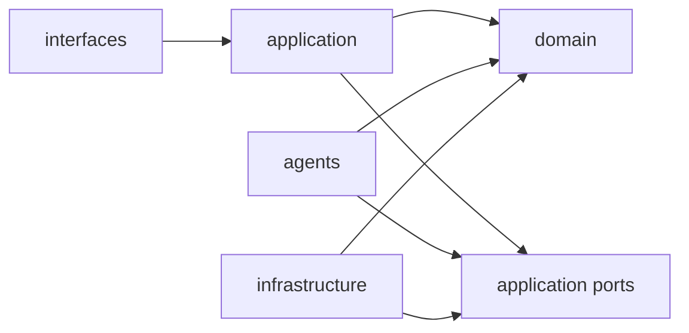

# Hastings V2 模块导航

> 本目录写目标模块契约。模块尚未交付时标记为 `target`；阶段完成后才改为 `as-built`。

## 1. 目标包结构

```text
src/hastings/
├── domain/                 # 纯领域模型和规则，不依赖框架
│   ├── repository/         # 版本、提交、分支的领域类型
│   ├── story/              # Canon、叙事计划与悬疑模型
│   ├── manuscript/         # 正文与稳定文本单元
│   ├── changes/            # 变更集、影响、补丁与修订计划
│   ├── author_model/       # 作者偏好、观察和证据
│   └── audit/              # Finding 与审计规则
├── application/            # 用例、命令网关、工作流、上下文构建
├── agents/                 # 无状态工作者和输出 Schema
├── infrastructure/         # 存储、模型、事件、任务的端口实现
└── interfaces/             # REST、WebSocket、CLI 与导入导出
```

实际迁移允许暂时保留旧目录，但新增 V2 代码必须遵守上述依赖方向。

## 2. 依赖规则



- `domain` 不 import `application`、`agents`、`infrastructure`、Web 框架、数据库 SDK 或 Tau；
- `application` 通过端口访问 Repository、Agent Runner、Clock、ID Generator 和 Event Publisher；
- `agents` 只能返回领域定义的 Proposal/Finding，不持有 Repository 写接口；
- `interfaces` 不直接调用数据库或 Agent；
- `infrastructure` 实现端口，不反向定义业务规则。

## 3. 模块索引

| 文档 | 模块 | 主要问题 | 状态 |
|---|---|---|---|
| [repository-kernel.md](repository-kernel.md) | 版本化仓库内核 | 怎样保存、提交、分支、回滚和发布事件 | as-built / Phase 12 |
| [story-domain.md](story-domain.md) | Canon 与叙事领域 | 怎样表达故事事实、结构和悬疑公平性 | as-built / Phase 13 |
| [manuscript-author-model.md](manuscript-author-model.md) | 正文与作者模型 | 怎样保护人工正文并从修改中学习 | as-built / Phase 14（§0 as-built 摘要，§2–§9 为 target） |
| [change-impact.md](change-impact.md) | 影响分析与系统修复 | 怎样把早期变化传播到结构和正文 | target / Phase 15 |
| [guard-authorization.md](guard-authorization.md) | 命令、守卫与授权 | 哪些工具可见、谁能改什么、何时可提交 | target / Phase 12–15 |
| [orchestration-context.md](orchestration-context.md) | Agent 编排与上下文 | 怎样让不同工作者在有限上下文中协作 | target / Phase 16 |
| [interfaces-observability.md](interfaces-observability.md) | API、事件和可观测性 | 怎样连接 UI、后台任务、导入导出并保持可恢复 | target / Phase 12–17 |

## 4. 跨模块共同约束

1. 所有实体使用稳定、不可复用的 ID；显示名可以修改，不能作为主键；
2. 所有 Patch 带 `base_revision_id` 或 `base_commit_id`；
3. 所有写入由 Commit Service 原子提交；
4. 所有 Agent 写入都是 Proposal，不返回“已完成”作为提交证据；
5. 用户人工编辑与 Agent 修改共用版本历史；
6. 领域错误使用稳定错误码，并提供三要素说明；
7. 事件来自提交 Outbox；无 Commit 的任务进度事件不得伪装成业务完成事件；
8. 每个模块同时定义正常结果、合法空结果和环境失败；
9. 模块公开契约发生变化时，同一提交更新文档与契约测试。

