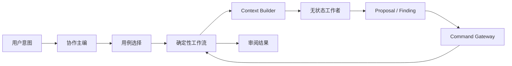

# Orchestration & Context：Agent 编排和任务上下文

> 状态：as-built / Phase 16（2026-10-15）；本页 §0 说明实际入口与取舍，下文保留架构契约。
> 目标包：`hastings.application.workflows`、`hastings.application.contexts`、`hastings.agents`。

## 0. Phase 16 已交付入口

- `agents/{schemas,roles,coordinator}.py`：六角色、严格输出与意图选择；`infrastructure/agents/tau_runner.py`：每次新建 Harness，角色工具白名单与 Capability 取交集，只做查询/提案。共享应用守卫在 `application/guards_worker_output.py`，替换 AgentRunner 也不能绕过范围、Revision 与 quote 检查。
- `application/contexts/__init__.py`：四类绑定角色的 Builder 复用确定性选择；按依赖、结构父级、段落和前一节拍窗口选资料。Draft 携带进入/离开状态及认知/披露，Repair 携带种子、步骤、影响路径和审批；偏好按章节作用域解析，正反例仅保存有效引用。预算采用保守 UTF-8 字节上界，保留版本、授权、错误与作者指令，裁剪留下可读回的 omissions。
- `application/workflows/agent_workflows.py`：规划接受、草稿接受、分支修复、语义审计与真实编辑观察。模型输出都是候选；正文/设定由作者接受形成 Commit，分析结果只写审计或作者模型元数据。
- `application/workflows/worker_job.py` 与 `infrastructure/jobs.py`：SQLite Job/事件、检查点、Lease、取消代际与有界退避。状态实际名称为 `waiting`；澄清与提案都等待作者处理，不保留私有模型会话。
- `server/v2.py` 生命周期恢复过期任务、扫描 Outbox 并补交分析元数据。取消后的迟到结果不能发布；已完成模型输出在恢复时可直接重放，不重复调模型。

实际 Context 头见 `domain/worker.py`：包含 `capability`、`author_examples` 与 `evidence`；输出 Schema 由适配器按角色注入，不把浮动时间写入选择哈希。事件当前通过持久游标查询和 UI 轮询消费。详细取舍、真模型和闭环证据见 [Phase 16 构建笔记](../phase-16-agent-workflows.md)。

## 1. 职责

本模块把用户意图转换成可恢复的应用工作流，选择合适的无状态工作者，并为单个任务构建最小、可解释、可重新读取的 Context Package。

它不拥有项目事实、不直接写数据库、不自行放宽授权，也不把聊天历史当作工作流状态。

## 2. 编排模型



协作主编可以使用模型帮助理解自然语言，但“下一步允许做什么”由工作流状态和 Gateway 决定。

## 3. 工作者契约

所有工作者实现统一概念接口：

```python
class AgentWorker(Protocol):
    kind: WorkerKind
    input_schema: type[ContextPackage]
    output_schema: type[AgentOutput]

    async def run(self, context: ContextPackage, capability: RunCapability) -> AgentOutput: ...
```

输出类型：

- `StoryProposal`；
- `ManuscriptPatchProposal`；
- `ImpactSupplement`；
- `AuditFindingSet`；
- `AuthorObservationSet`；
- `ClarificationRequest`；
- `NoResult`；
- `WorkerFailure`。

模型的自然语言解释放在结构化输出的 `rationale`，不能用一段“已经修改完成”代替 Patch 或 Commit ID。

## 4. Context Package 通用头

```text
context_id
task_kind
project_id
repository_commit_id
target_ids
selected_inputs[] {artifact_id, revision_id, reason, excerpt/ref}
author_preferences[] {id, statement, scope, evidence_summary}
constraints[]
allowed_tools[]
output_schema
token_budget
omissions[] {what, why, refetch_tool}
created_at
```

Builder 的输出必须可记录和重放。相同 Snapshot、任务参数和预算应选择相同的确定性输入；模型输出本身不要求确定。

## 5. 四类上下文

### Draft Context

包含当前 Beat/Scene、相关 Canon、进入和离开状态、读者已知信息、前一场景尾部、必要后续约束、适用作者偏好与正反例。默认不包含整书正文或无关角色全部资料。

### Repair Context

包含 Change Set、旧/新事实、目标 Impact Item、依赖路径、待改对象当前版本、必须保留文本和批准范围。一次只处理一个修订步骤或可独立的一组对象。

### Audit Context

包含规则集、检查范围、Truth/Knowledge/Disclosure 视图、相关正文与已知例外。默认 Capability 只读；审计输出 Finding，不输出正文 Patch。

### Style Learning Context

包含人工 diff、编辑前后的 Canon/Plan 环境、既有偏好、反例和分类规则。剔除仅由事实变化或格式化导致的差异。

## 6. Token 与裁剪策略

1. 先按依赖和目标选择，不先塞满再摘要；
2. 稳定事实以结构化视图提供，正文以局部 excerpt + 可读回引用提供；
3. 明确保留 base commit、target IDs、Approval 摘要、失败工具结果和用户最新指令；
4. 超预算时按可解释优先级裁剪，并在 omissions 中记录；
5. 需要被裁剪内容时用只读工具重新获取；
6. 不同 Context 类型拥有独立预算和选择策略；
7. provider usage 用于观测和预算校准，不作为事实来源；
8. Context 不写回会话摘要充当长期项目记忆。

## 7. 工作流持久化

耗时工作流保存为 Job：

```text
queued → running → waiting_for_user → running → completed
                    ↘ cancelled
running → retryable_failed → queued
running → terminal_failed
```

Job 保存：输入 Commit、Change Set、当前步骤、Lease、尝试次数、Worker 输出引用、错误类别和下一动作。进程重启后从最后一个已提交步骤恢复；不得依赖内存中的 Harness 实例。

## 8. 会话的角色

会话只保存：

- 用户与协作主编的交流；
- 展示过的 Proposal/Impact/Approval 链接；
- 当前界面关注对象；
- 可丢弃的自然语言摘要。

项目事实、任务状态、授权和 Agent 结果均通过稳定 ID 引用仓库。创建新会话不改变项目；删除会话不删除任何 Commit 或 Change Set。

## 9. 失败处理

| 情形 | 输出 | 工作流动作 |
|---|---|---|
| 模型返回 Schema 错误 | violation/worker_output_invalid | 同一 Context 最多纠正一次，仍失败则保留证据 |
| 工作者无可修改内容 | NoResult | 合法结束当前步骤，解释原因 |
| Provider 超时 | environment/retryable | 保存 Job 和 Context，退避重试或切换已配置 Provider |
| Patch 基础版本过期 | conflict | 不自动重试写入，重建 Context 或请求合并 |
| 用户补充新要求 | 新 Change 或更新尚未批准的 Change | 已批准执行中的范围变化需要重新分析和授权 |

## 10. 测试重点

- 每类 Context 只包含与目标有关的数据；
- Context 记录所有裁剪与读回入口；
- Agent 返回 Patch 而不是直接改 Repository；
- Audit Worker 没有写工具；
- Style Worker 不能读取无关项目的偏好证据；
- 进程重启后 Job 从已提交步骤恢复；
- 模型空结果和环境故障走不同状态；
- Context 基础 Commit 变化后输出不能提交；
- 新会话不影响进行中的持久化 Job。

