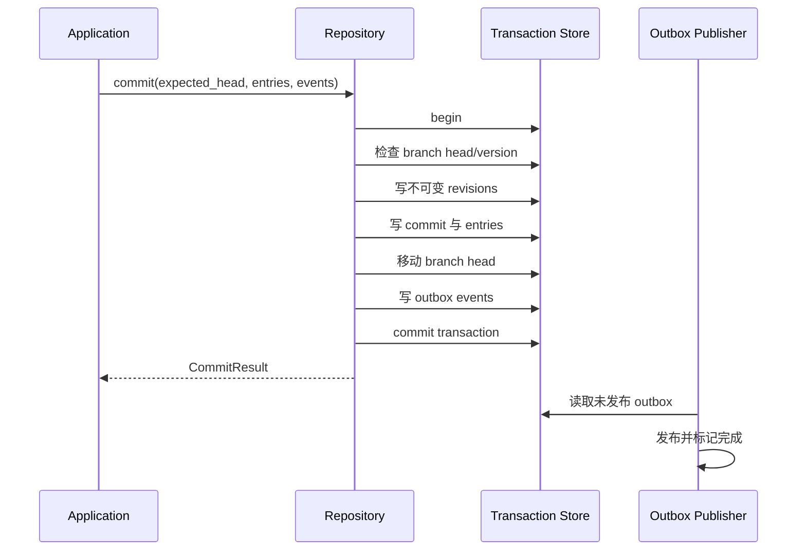

# Repository Kernel：版本化小说仓库

> 状态：target，计划在 Phase 12 交付。
> 目标包：`hastings.domain.repository`、`hastings.application.ports.repository`、`hastings.infrastructure.repository`。

## 1. 职责

Repository Kernel 为所有小说资产提供统一的版本语义。它回答：

- 当前分支指向哪个 Commit；
- 某个 Artifact 的当前 Revision 是什么；
- 一次操作改变了哪些对象和关系；
- Patch 的基础版本是否仍然有效；
- 如何建立修订分支、比较版本、撤销和重放；
- 如何保证数据提交和业务事件一致。

它不理解“角色”“线索”或“章节”的具体业务规则；这些规则由上层领域模块提供。

## 2. 核心对象

| 对象 | 必要字段 | 说明 |
|---|---|---|
| `Project` | id、name、created_at | 小说项目边界 |
| `Artifact` | id、project_id、kind、created_at | 可版本化对象身份，kind 创建后不可变 |
| `Revision` | id、artifact_id、parent_id、content、content_hash、author、created_at | 不可变内容版本 |
| `Commit` | id、project_id、parent_ids、message、actor、created_at、sequence | 一组原子生效的变化 |
| `CommitEntry` | commit_id、artifact_id、old_revision_id、new_revision_id | Commit 中的对象变化 |
| `Branch` | id、project_id、name、head_commit_id、version | 可移动引用 |
| `RelationRevision` | source、type、target、metadata、valid_from/to | 版本化关系或依赖边 |
| `OutboxEvent` | id、commit_id、sequence、type、payload、published_at | 与 Commit 同事务写入的业务事件 |
| `Lease` | resource_key、owner_job_id、expires_at、version | 跨会话的短期执行互斥 |

`Revision.content` 使用经过领域 Schema 验证的 JSON 兼容数据；较大正文可由 `content_ref` 指向内容寻址 Blob，但哈希仍记录在 Revision 中。

## 3. 公开端口

下列接口表达语义，最终命名可在 Phase 12 内微调；不得删除版本条件。

```python
class RepositoryReader(Protocol):
    def get_project(self, project_id: ProjectId) -> Project: ...
    def get_branch(self, project_id: ProjectId, name: str) -> Branch: ...
    def get_snapshot(self, project_id: ProjectId, commit_id: CommitId) -> Snapshot: ...
    def get_artifact(self, artifact_id: ArtifactId, at: CommitId) -> ArtifactView: ...
    def list_artifacts(self, query: ArtifactQuery, at: CommitId) -> list[ArtifactView]: ...
    def diff(self, before: CommitId, after: CommitId, scope: Scope) -> RepositoryDiff: ...

class CommitRepository(Protocol):
    def commit(self, request: CommitRequest) -> CommitResult: ...
    def create_branch(self, request: CreateBranchRequest) -> Branch: ...
    def move_branch(self, request: MoveBranchRequest) -> Branch: ...

class LeaseRepository(Protocol):
    def acquire(self, resource_key: str, job_id: JobId, ttl: timedelta) -> Lease: ...
    def renew(self, lease: Lease, ttl: timedelta) -> Lease: ...
    def release(self, lease: Lease) -> None: ...
```

`CommitRequest` 必须包含：`project_id`、`branch_id`、`expected_head`、变更条目、关系变化、actor、幂等键、用户可读摘要和待发布事件。

## 4. 提交算法



## 5. 不变量

1. Revision 创建后不可修改或删除；
2. 一个 Branch 在任意版本只指向一个 head；
3. `expected_head` 不匹配时整个提交失败，不写部分数据；
4. 同一个幂等键重复请求返回原 Commit，不产生重复 Revision 或事件；
5. CommitEntry 的 old revision 必须等于基础快照中的有效 revision；
6. 每个 Commit 的 sequence 在项目内严格递增且唯一；
7. Outbox 与 Commit 同事务写入；
8. 导出文件不允许绕过 Repository 形成当前状态；
9. Lease 到期后可被其他 Job 获取，旧 owner 续租或提交时必须失败；
10. 回退通过新 Commit 实现，历史 Commit 和 Revision 永不改写。

## 6. 存储方案

第一实现使用 SQLite：

- 单文件便于桌面应用备份；
- 事务覆盖 Commit、Branch、关系和 Outbox；
- 可用外键、唯一索引和 CHECK 约束支撑核心不变量；
- 后续如需更换数据库，应用层只依赖端口与契约测试。

建议表：`projects`、`artifacts`、`revisions`、`commits`、`commit_parents`、`commit_entries`、`branches`、`relation_revisions`、`leases`、`outbox_events`、`idempotency_records`。

禁止在 Phase 12 同时维护 SQLite 和旧 YAML 的双向实时同步。旧 YAML 先通过 Import Adapter 只读进入 V2，Markdown/YAML 导出由 Snapshot 单向生成。

## 7. 结果与错误

| 类别 | 示例 | 行为 |
|---|---|---|
| 成功 | 提交产生新 Commit | 返回 commit_id、new_head、sequence 和变更摘要 |
| 合法空结果 | Patch 归一化后没有实际差异 | 不创建 Commit，返回 `no_change` 和原因 |
| 违规 | expected_head 过期、old revision 不匹配 | 返回稳定冲突码和重新读取/合并指引 |
| 环境故障 | 数据库不可写、磁盘满 | 回滚事务，返回可重试错误，不发布完成事件 |

稳定错误码至少包括：`REPO_HEAD_CONFLICT`、`REPO_REVISION_CONFLICT`、`REPO_NO_CHANGE`、`REPO_LEASE_CONFLICT`、`REPO_INTEGRITY_ERROR`、`REPO_UNAVAILABLE`。

## 8. 契约测试

同一套测试必须运行于内存实现和 SQLite 实现：

- 创建项目、Artifact、Revision 和首个 Commit；
- 两个并发提交只有一个成功；
- 幂等重试不重复写入；
- 多 Artifact 提交遇到一条非法变化时全部回滚；
- Commit 和 Outbox 同时存在；
- Publisher 重试不会重复产生业务效果；
- Branch 分叉、比较与反向 Commit；
- Lease 获取、续租、过期和旧 owner 拒绝；
- 关闭进程并重新打开后 sequence、head 和内容哈希不变。

