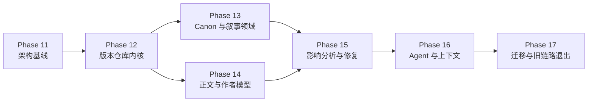

# Hastings V2 重建计划总览

> 计划状态：Phase 11–16 已完成（2026-10-15）；Phase 17 主体交付（2026-10-15：迁移产品流/CLI/WS/前端迁移面/导出/演练与容量测量），余项为人工验收（真实工作区用户核对、桌面安装包升级演练、e2e 走查）。
> 原则：每个阶段产生可运行、可验证、可回退的纵向切片；后续阶段不得通过临时直写绕开前一阶段的契约。

## 1. 阶段依赖

Phase 13 和 Phase 14 在 Phase 12 后可以并行开发，但共享同一 Repository 契约，不能各自添加写入后门。

## 2. 阶段索引

| 阶段 | 目标 | 主要退出证据 | 计划 |
|---|---|---|---|
| P11 | 冻结架构、依赖和迁移基线 | V2 文档评审、现状清单、包依赖测试 | [phase-11-architecture-baseline-plan.md](phase-11-architecture-baseline-plan.md) |
| P12 | 建立版本化 Repository 与统一提交 | 内存/SQLite 契约测试、冲突/幂等/Outbox 证明 | [phase-12-repository-kernel-plan.md](phase-12-repository-kernel-plan.md) |
| P13 | 建立 Canon、Narrative Plan 和悬疑三层事实 | 领域命令、不变量、五个查询投影、V1 dry-run、§7 误解决策闭环 ✅ 已完成 | [phase-13-story-domain-plan.md](phase-13-story-domain-plan.md) |
| P14 | 统一人工正文版本并建立作者模型 | 人工保存闭环、Patch hunk、偏好证据 | [phase-14-manuscript-author-model-plan.md](phase-14-manuscript-author-model-plan.md) |
| P15 | 完成影响分析、修订分支和差异审阅 | 角色作用变化贯穿 Canon→Plan→正文，三章/部分接受/审计/重启 ✅ 已完成 | [phase-15-change-impact-plan.md](phase-15-change-impact-plan.md) |
| P16 | 接入无状态 Agent、任务上下文和持久 Job | 四条工作流、六角色真模型、持久恢复与新项目闭环 ✅ 已完成 | [phase-16-agent-workflows-plan.md](phase-16-agent-workflows-plan.md) |
| P17 | 导入旧工作区、迁移 UI、退出旧写链路 | 迁移报告、端到端验收、旧写入口不可达 → 导入器/校验/不可达证明/迁移产品流（REST+UI）/CLI+WS 切换/导出/演练与容量测量已交付；余项：真实工作区用户核对、桌面升级演练、e2e 走查 ⏳ 主体交付 | [phase-17-migration-cleanup-plan.md](phase-17-migration-cleanup-plan.md) |

## 3. 每阶段统一执行协议

后续模型接手某阶段时，必须按顺序执行：

1. **读取**：根 `AGENTS.md`、V2 README、总设计、相关模块文档、本阶段计划；
2. **盘点**：运行 `git status --short`，列出会触碰的现有文件和用户未提交改动；
3. **验证前提**：执行本阶段“开始条件”；不满足则先修复前提或停止并说明；
4. **建立失败测试**：先让关键行为测试失败，记录失败原因符合预期；
5. **最小实现**：只实现使当前任务通过的契约，不提前实现后续阶段；
6. **局部验证**：运行新增/相关测试；
7. **迁移验证**：如触及旧数据或旧接口，运行兼容和回滚测试；
8. **质量门**：运行项目约定的 Python/前端检查；
9. **文档收口**：更新模块状态、V2 README、阶段构建笔记；
10. **原子提交**：一次提交只完成计划中的一个任务组。

## 4. 每阶段共同红线

- 不修改 `tau_ai` / `tau_agent` 的领域语义；确需上游改动必须单独立项并记录；
- 不引入新的通用 upsert 或任意文件写工具；
- 不把 Feature Flag 当成授权机制；
- 不同时保留同一类数据的两个可写事实源；
- 不让 Agent 测试只断言自然语言输出，必须断言 Proposal、Guard 或 Commit；
- 不以“测试全绿”替代阶段业务验收；
- 不删除旧数据或旧代码，直到 Phase 17 的迁移和不可达证明完成；
- 不把环境故障归类成模型违规；
- 不在构建笔记中省略已知留白和失败证据。

## 5. 统一交付清单

每阶段完成时必须同时存在：

- 通过的失败先行测试；
- 实现代码；
- 数据迁移或“不需要迁移”的明确说明；
- 稳定错误码与三要素消息；
- 事件/可观测性证据；
- 更新后的模块文档；
- `dev-notes/v2/phase-XX-*.md` 构建笔记，其中“Agent 设计经验”位于交付内容、关键决策之后和评审记录之前；
- 下一阶段可以依赖的明确公开接口。

## 6. 总体验收场景

最终回归使用同一个基准故事：

1. 创建包含凶手、协助者、三条关键线索和两条误导项的短篇悬疑项目；
2. 生成并人工修改前三章；
3. 将协助者改为幕后操纵者；
4. 系统输出影响到角色关系、知识状态、两个节拍和三处正文的路径；
5. 在修订分支生成 Patch，作者只接受其中两处；
6. 系统重新分析剩余冲突；
7. 审计指出尚未解决的提前知情问题；
8. 作者模型从人工修改中提出一个有证据的文风候选，作者撤销后不再使用；
9. 重启应用，版本、Job、审批和事件顺序保持一致；
10. 导出指定 Commit，再导入到新项目并核对内容哈希。
