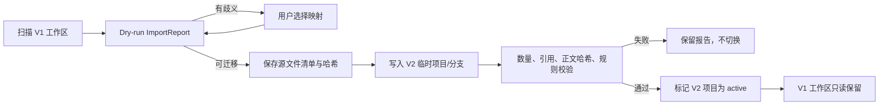

# Phase 17 计划：旧工作区迁移、界面切换与旧链路退出

> 状态：待执行。
> 依赖：Phase 16 完成。
> 目标：让现有项目安全进入 V2，使前端和 CLI 全面使用新用例，并让旧写路径变为不可达后再清理。

## 1. 开始条件

- V2 完整闭环已经通过确定性测试和真模型走查；
- V1 fixture dry-run 无未解释字段丢失；
- 当前用户工作区已有可验证备份/导出方案；
- 迁移、回滚和数据校验 UX 已评审；
- 所有旧写入口均在 Phase 11 清单中有替代方案。

## 2. 阶段交付

1. V1 工作区扫描、dry-run、确认、导入和校验报告；
2. 可重复、幂等的迁移器；
3. 迁移前只读快照与回滚说明；
4. 前端 Project/Canon/Plan/Manuscript/Change/Author/Audit 页面切换；
5. CLI/REST/WS 统一调用 V2 application use cases；
6. V1 项目可选择迁移，迁移完成后禁止再走 V1 写路径；
7. 删除或隔离旧 `bible_upsert`、全局阶段授权、旧 reconcile 和 session-owned lock；
8. 数据完整性、性能、打包和桌面升级验证；
9. DESIGN/README as-built 更新；
10. V2 发布候选验收报告。

## 3. 非目标

- 不强制自动迁移所有用户项目；
- 不删除用户旧工作区目录；
- 不引入云同步或多人协作；
- 不同时维护 V1 与 V2 的双向编辑；
- 不在迁移阶段重新设计领域 Schema，发现缺口应回到对应模块修复。

## 4. 迁移流程

迁移不原地修改旧文件。切换失败时用户继续使用未改变的 V1 项目，V2 临时导入可删除或保留诊断。

## 5. 实施任务

### T17.1 ImportReport

扫描角色、关系、手法、线索、伏笔、时间线、outline、正文、revisions、session 和 events。每个源项只能处于 mapped / legacy / ambiguous / ignored-with-reason / error。任何无理由遗漏使报告失败。

### T17.2 幂等导入

以源 manifest hash + schema version 作为幂等键。相同输入重试返回原迁移结果；源文件变化后要求重新 dry-run。导入使用 V2 Commit Service，不允许直接批量 SQL。

### T17.3 校验

至少比较：

- 文件数、实体数、章节数和字数；
- 每章规范化正文 hash；
- 角色/线索/伏笔/outline 映射；
- 无悬空 ID；
- Story State 和时间线基础规则；
- 旧 revision 是否按策略保留；
- 无法迁移的 session/events 是否进入只读历史附件。

### T17.4 UI 切换

按页面逐个切换到 V2 query/use case，完成一个页面后删除它对旧 REST shape 的依赖。Change Center 与 Diff Review 是新主流程；旧阶段徽章替换成项目里程碑、branch/head 和 stale 提示。

### T17.5 CLI/WS 切换

CLI 只通过 application use case；WS 分开业务 Commit、Job 和对话事件。重连根据 sequence 补齐。旧事件只在 V1 历史查看器读取。

### T17.6 旧写路径不可达证明

新增测试枚举 V2 项目的所有路由、工具和后台任务：

- 无 `bible_upsert`、`write_chapter` 直接落盘；
- 无 `story_stage` 作为授权；
- 无 `reconcile` 丢弃正文编辑；
- 无 session instance lock 作为唯一互斥；
- 无独立 EventStore 分配业务 sequence；
- 无 YAML/Markdown 双向自动写。

先让测试在兼容期失败，再逐入口切换直到通过。

### T17.7 删除与归档

只有当替代路径测试、迁移测试和不可达测试全部通过后，才删除旧代码。删除分成独立 cleanup 提交；历史文档保留，并在旧 DESIGN 顶部增加已被 V2 取代的导航提示（若无用户未提交冲突）。

### T17.8 打包与恢复演练

桌面安装包从旧版本升级：发现 V1 项目、展示 dry-run、迁移一个副本、重启、编辑、回退查看。模拟磁盘满、迁移中断、Provider 不可用；前两者不切换 active，Provider 不可用不阻止纯数据迁移。

## 6. 测试清单

- 所有 V1 fixture dry-run；
- 歧义映射用户选择；
- 相同输入幂等；
- 源变化要求重跑；
- 中途故障无 active V2 半项目；
- 章节 hash/字数一致；
- 未知字段进入 legacy/report；
- UI 各页面契约；
- WS 重连去重；
- V2 旧写入口不可达；
- V1 只读历史仍可导出；
- 桌面升级和全新安装；
- 总览计划中的 10 步端到端验收。

## 7. 性能与容量验证

构造 100 章 × 每章约 5,000 中文字的数据集：

- 打开项目不读取全书正文；
- 读取单章和局部 diff 延迟可接受；
- 依赖图分析按 scope 执行；
- Draft/Repair Context 不超过配置预算；
- Commit、分支比较和导出有测量记录；
- 重启恢复不重放全部对话生成状态。

计划中不先写死毫秒门槛；Phase 17 开始时基于目标硬件记录预算，并在构建笔记解释选择。

## 8. 最终退出条件

- 总览中的 10 步验收全部通过；
- 至少一个复制的真实旧工作区完成 dry-run 和用户核对，正式迁移仍由用户决定；
- V2 新项目和已迁移项目都只使用 V2 写链；
- 旧数据保留可读备份，导出可用；
- 全量 Python/前端/桌面质量门通过；
- V2 总设计与模块文档标记 as-built，并记录与目标设计的差异；
- 旧模块 README 明确为 V1 historical/as-built；
- 构建笔记包含迁移失败演练、清理列表和四透镜复盘。

## 9. 发布后留白

以下能力在 V2 基础闭环稳定后另行立项：

- 向量化作者样例检索；
- 跨书/系列影响分析优化；
- 多模型质量路由；
- 多用户协作和权限；
- 云同步与远程数据库；
- 面向读者的发布与反馈闭环；
- 可选的作者私有微调。

