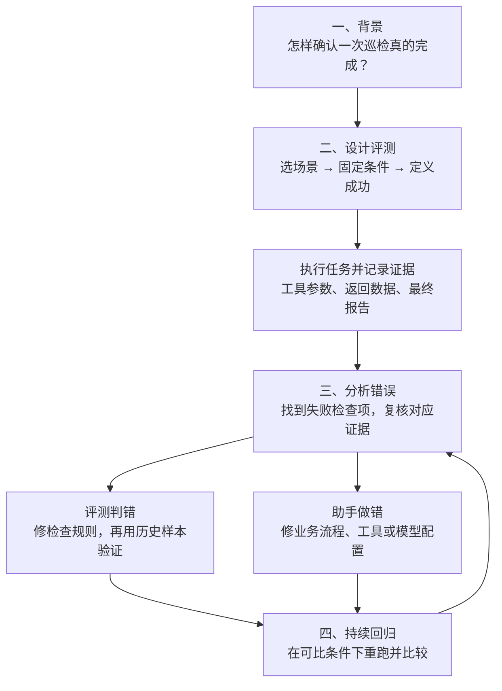

# 线簿 / ClueLedger 评测系统

线簿协助作者修改和续写长篇小说。评测关注 Agent 能否按作者的意图和约束完成真实写作任务，交付作者可以使用的结果。

## 建设目标

- **可测**：把真实业务流程转化为可执行、可判定的场景和成功标准。
- **可信**：稳定、规模化地执行评测，并让过程可观测、结论可复核。
- **可优化**：从评测结果定位根因、验证改动，并逐步连接线上业务效果。

## 要点

业务Agent评测体系不是一次性建设完成的测试平台，而是一套从业务任务出发，逐步形成场景、指标、证据、诊断和迭代闭环的业务基础设施。其他业务不必复制我们的Task和指标，但可以复用这套建设路径。

- 从业务任务出发，而不是从公开数据集出发。公开 Benchmark 提供通用参照，业务 Benchmark 负责定义真实生产要求。
- 从业务风险推导指标，而不是先有指标再寻找解释。每个指标都应对应具体风险和执行阶段。
- 指标既要能够衡量，也要能够诊断。任务失败后，应能够下钻到原子检查项和局部证据。
- 评测器和 Agent 分别迭代。尺子变准和能力变强是两个不同的闭环，不能混为一谈。
- 离线Benchmark、线上过程指标和业务结果共同构成证据链。离线提升是必要条件，但不能自动推导出业务收益。

## 开发流程

下图用美团白皮书中的巡检任务说明评测流程。

### 1. 构建 Benchmark（评测任务集）

当前从一条空作品起步任务开始。见 [Benchmark 任务与 Schema](benchmark/README.md)。

### 2. 设计评测优化和 Agent 迭代

见 [评测器设计：先用 T01 跑通一轮](benchmark/evaluator.md)。

### 3. 评测工程落地和优化

见 [评测工作台开发计划](../dev-notes/evaluation/development-plan.md)：任务库、运行预检、证据归档与复盘的实现范围和验收条件。

## 参考资料

后续评测设计引用这三篇文章时，使用当前工作区的离线存档。正文和配图可离线查看。

- [Agent 评测漫谈](data/references/meituan/Agent-Evaluation.html)
- [评测白皮书 01 · Agent 评测全览](data/references/meituan/Agent-Evaluation-White-Paper-01.html)
- [评测白皮书 02 · 商家 AI 助手的评测与优化闭环实践](data/references/meituan/Agent-Evaluation-White-Paper-02.html) · [直达第三节「评测优化与 Agent 迭代」](data/references/meituan/Agent-Evaluation-White-Paper-02.html#%E4%B8%89%E3%80%81%E8%AF%84%E6%B5%8B%E4%BC%98%E5%8C%96%E4%B8%8Eagent-%E8%BF%AD%E4%BB%A3-error-analysis)
