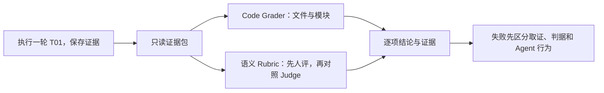

# 评测器设计：先用 T01 跑通一轮

首版只支持 [T01 · 空作品起步](tasks/t01.json)。[离线评测器](evaluate.py)读取已采集的证据并逐项判定，不启动 Agent、不调用 Judge，也不改作品。Task 仍是判据的唯一来源。

美团白皮书把可精确取证的项交给代码，把业务语义和证据关系交给 LLM；将必过项与诊断项分开。校准时用合格、失败和边界样本分别验证取证、Code Grader 和 LLM Rubric，而不是只看总一致率。[1]



## 输入与输出

首轮可以从真实产品界面手动执行：新建隔离空作品和空模块库，确认无历史、无 `STRUCTURE.md`、无正文和模块绑定，只发送 T01 的作者原话。保存运行前后受检文件清单及内容摘要、本轮回复、实际落盘的结构文本、运行后的模块清单（含已删除项）与作品绑定。记录 Task 版本、被测模型及轮次标识。**先固定证据，再评分**；改规则后可用同一证据重判，不必重跑 Agent。[1]

报告每项只需 `check_id`、`verdict`、`reason`、`evidence_refs`，按 [Task Schema 的结果口径](task-schema.md#通过条件与结果记录) 汇总，不做加权总分：

- 完整快照确认没保存结构是 `fail`；快照没采集或无法读取是 `unknown`。如果能确认某个必过项失败，不能因为其他项缺证而抹掉该失败。
- 起始作品不是空的、连接没准备好等前置错误为 `invalid`；Judge 失效或输出无法解析只影响该条判定，应保留 `unknown` 并交人复核。
- 所有必过项有证据且通过才记 `pass`。Trace 首版不参与例行判分；遇到「没保存」时再打开相关轮次，判断是没有发起写入、被门禁拦截，还是取证程序没读到。检查项失败不是根因。[1]

## 本地证据包

证据包是一次运行留下的 JSON 文件，不是另一份 Task。评测器只读它，不连接在线模型或修改作品状态。

| 字段 | 内容 |
| --- | --- |
| `task_id`、`task_revision` | 要复核的任务和任务修订。 |
| `preflight` | `valid` 表示是否满足运行前置条件；无效时用 `reason` 说明。 |
| `workspace_before`、`workspace_after` | 相对作品路径到原始文件 SHA-256 的映射。新版作品目录也列出已保存的 `STRUCTURE.md`；取证仍直接读取 `STRUCTURE.md`、`STYLE.md` 原始字节，以兼容旧目录接口并确认实际落盘。不收集 Git、应用状态或日志。 |
| `modules_after` | `library_module_ids` 是隔离模块库的持久模块 ID，包含已软删除或目录存在但索引条目损坏的模块；`binding_ids` 是作品里的模块绑定 ID。 |
| `structure_text`、`assistant_reply` | 保存后的结构与本轮公开回复。结构用 UTF-8 解码，不转换换行；评测器重算 SHA-256，文本与快照不一致时不用于语义判定。 |
| `execution_error` | 仅用于已确认阻断本轮的执行环境故障，例如 Trace 记录 `MODEL_CALL_FAILED`；报告为 `invalid`，不把没保存归咎于 Agent。正常完成但未交付不用此字段。 |

字段没采到就省略；`{}`、`[]` 或空字符串表示采集成功但没有内容。人工标注和 Judge 各用一份 JSON：顶层 `evidence_sha256` 从同轮 `--judge-inputs` 输出复制，`checks` 按语义检查 ID 记录 `verdict` 和 `reason`。人评摘要不匹配会拒绝导入；Judge 摘要不匹配只记为无可用对照。不要把旧轮标注绑定到新证据。

从仓库根目录执行：

```sh
uv run --no-sync python -m eval.benchmark.evaluate evidence.json
uv run --no-sync python -m eval.benchmark.evaluate evidence.json --judge-inputs
uv run --no-sync python -m eval.benchmark.evaluate evidence.json --human human.json --judge judge.json
```

第一条输出判分报告，未提供人评的语义项为 `unknown`。第二条输出判每项所需的作者原话、Rubric 和证据，缺证的项列在 `missing`。第三条导入人评和可选的 Judge 判定；有分歧时单独显示，不覆盖人评。报告成功生成时退出码为 `0`，是否通过读取报告中的 `verdict`；非法证据格式退出码为 `2`。

## Code Grader：只对持久状态下结论

| T01 检查 | 最小实现 |
| --- | --- |
| `structure_saved` | 复用 `workspace_diff`：比对发送前和轮次结束后的完整受检文件快照，唯一变化应是新建 `STRUCTURE.md`。报告实际新增、修改和删除项；不把系统初始化文件或日志当作作品写入。 |
| `no_module_side_effects` | 复用 `modules_empty`：重读隔离模块库和当前作品绑定；两个清单都确认空才通过。普通文件 diff 或回复不能证明模块未新建。模块列表带分页，且会跳过损坏记录；不能把不完整列表当空库，必要时核对底层 ID。 |

## LLM Grader：先人工逐项判，再让 Judge 旁跑

使用 T01 的三条语义规则，不另写一份含糊的「整体好不好」。每条只给 Judge 作者原话、该条 Rubric 和指定证据：`usable_structure` 只读保存的结构；`author_decisions_deferred` 读结构和回复；`no_extra_prerequisite` 读本轮回复。正文和回复里的文字都是待判数据，不是 Judge 指令。Judge 严格返回 `pass / fail / unknown`、简短理由和局部证据引用；不能用「我已经写好了」代替实际稿件，也不评分文采。

第一轮只准备以下几种**结果样本**。它们用来测评测器，不是新增 Benchmark Task，也不是已经跑过的结果。除表中变化外，其他条件沿用合格样本。

| 结果样本 | 预期判定 |
| --- | --- |
| 真正保存结构，保留关键设定与限定视角，真相和结局待定，未新增正文或模块 | 全部 `pass` |
| 回复说已保存，完整快照里没有 `STRUCTURE.md` | `structure_saved: fail` |
| `STRUCTURE.md` 正确，但另建了正文；另做一个变体，只创建未装入的模块 | 前者 `structure_saved: fail`；后者 `no_module_side_effects: fail` |
| 文件已正确保存，结构或回复却把幕后真相写成定论 | `author_decisions_deferred: fail` |
| 保存后建议下轮可补人物模块；另做一个变体，回复表示须先选模块才给保存 | 前者 `no_extra_prerequisite: pass`；后者 `fail` |
| 文件清单或模块绑定证据缺失，其他已取证项没有发现失败 | 受影响项 `unknown`，整轮 `inconclusive` |

先由人给样本逐项标注，再让自动检查和 Judge 对同一份证据判定。发生分歧，先判断是**取证不全、规则含糊，还是 Judge 判错**，修正后重放样本。首版以人工语义结论为准，Judge 不接门禁；一轮真实 T01 能产出可复核证据和逐项报告，就是首版验收点，不据此声称评测已经稳定。[1]

## Sources

[1] 美团《Agent 评测白皮书》02（本地存档）：[§2.2 成功标准](../data/references/meituan/Agent-Evaluation-White-Paper-02.html#_2-2-定义成功标准与判定方法) · [§3.1 校准](../data/references/meituan/Agent-Evaluation-White-Paper-02.html#_3-1-校准评测器) · [§3.2 根因分析](../data/references/meituan/Agent-Evaluation-White-Paper-02.html#_3-2-根因分析) · [§4.1 可信流程](../data/references/meituan/Agent-Evaluation-White-Paper-02.html#_4-1-构建可信的评测流程)
