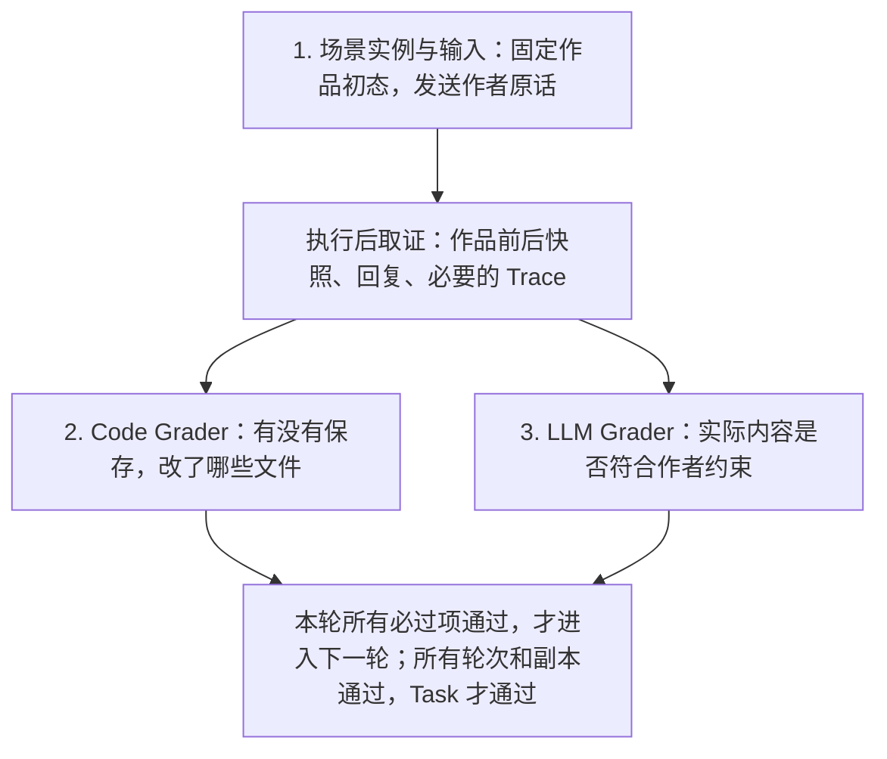

# Benchmark Task Schema v1

Task 按白皮书拆成三个业务块：[场景实例与输入](#1-场景实例与输入)、[确定性 Code Grader](#2-确定性-code-grader)、[LLM Grader](#3-llm-grader)。`schema_version: 1` 是外层格式标记。[T01](tasks/t01.json)是当前唯一的样例。

## 1. 场景实例与输入

| `scenario` 字段 | 约定 |
| --- | --- |
| `id` / `revision` | 任务 ID 保持不变；作者输入、初态、流程或判定口径变化时递增 `revision`。只调整格式或说明文字，不改变任务版本。 |
| `title` / `description` / `risks` | 人读的名称、业务分支和失败风险。场景不规定无关的内部工具路径。 |
| `provenance` | `workflow` 表示来自流程设计，`regression` 表示从真实失败提炼。`references` 是相对 `eval/benchmark/` 的来源引用，可指向本地提示词或历史记录；仅供复核，不影响执行，不发给 Agent。 |
| `environment` | 从作品对话入口 `workspace_chat` 提交，使用可用的在线模型 `online`。声明前置条件，不指定供应商、模型名或密钥。 |
| `messages` | ID 到完整作者原话的映射。发送时不拼接任务标题、评分规则或来源；保留原文和段落。多个副本可以引用同一条原话。 |
| `cases` | 一个或多个必跑的独立副本。各自包含 `title`、`fixture` 和按顺序执行的 `steps`；副本不共享作品或会话。 |

### 作品初态：`case.fixture`

- 每个副本从新建的隔离作品、空会话和隔离的空模块库开始，作品没有模块绑定。`files` 是要预置的作者可见内容，键是相对作品根目录的路径。空作品用 `{}`，不代表应用不能生成空壳；须确保没有引入可供创作参考的内容。不要带入当前用户的会话、作品资料或模块组合。
- 文件可以是内联 UTF-8 `text`，也可以是相对 `eval/benchmark/` 的 `asset` 加 `sha256`，后者按原始字节校验摘要。从隔离副本运行，不把源素材目录当工作区。
- `focus` 设为 `work_home` 或指定 `file.path`。需要模拟引用选段时，指定 `selection`：以原文 Unicode 码点计数，零起点、左闭右开 `[start, end)`。Runner 转为应用选段并核对实际引用；只查看文件时省略 `selection`。
- 开跑前核对文件清单与内容、空会话、空模块库与空装配、焦点和在线模型。配置错误、缺素材或无法模拟指定焦点时记 `invalid`，不发送请求。每次 Trial 重建副本。

### 执行步骤：`case.steps[]`

每项用 `id` 定位本轮，用 `message` 引用作者原话。等待本轮完成或明确进入等待作者输入状态后，从两个 Grader 块中找出 `checkpoint.case` 和 `checkpoint.step` 匹配的检查，采集约定的证据。**下轮消息只在本轮所有必过项通过后发送，且留在同一会话。** 人工判定尚在进行时暂停；必过失败或缺证时，不替作者补救，后续轮次标记为未执行。

需要做对照时，可用不同初态创建独立副本，共用作者原话。对照副本不是同题重跑。

## 2. 确定性 Code Grader

两个 Grader 块以稳定的检查 ID 为键。每项均声明 `checkpoint`（副本与步骤）、`role`（`required` 或 `diagnostic`）、所需 `evidence` 和判定 `rule`。两个块都必须写出；没有适合的检查时可留空，但每轮至少要有一条必过项。诊断项不阻断后续步骤，也不参与任务成败。

| `evidence` | 记录什么 |
| --- | --- |
| `assistant_reply` | 该轮完整的作者可见答复，包括可见的追问；保留消息引用。 |
| `workspace_before` / `workspace_after` | 分别在发消息前和该轮到达检查点后采集。记录受管、作者可见文件清单、内容或可读引用、摘要，以及章号检查需要的正式章节清单。候选稿、会话日志、Trace 和 Git 元数据不算正式稿件。 |
| `modules_after` | 该轮结束后，从隔离模块库重读模块清单（含已删除项），并从当前作品重读模块绑定。不以回复或作品 Markdown 文件差异代替。 |
| `turn_trace` | 对应轮次的可核对事件，如写入回执、工具返回和 Gate 判定；定位到 `turn_id` 与事件 ID。不要求读取内部推理。 |

`code_graders` 只放能直接用证据判定的规则，不推测文本含义。

| `rule.type` | 判定 |
| --- | --- |
| `workspace_unchanged` | 两份完整快照的受管、作者可见文件清单和内容摘要相同。它只证明没有净变化；禁止中途写入或尝试写入时，需要单独定义 Trace 判据。 |
| `workspace_diff` | `required` 指定各文件是 `created`、`modified` 还是 `deleted`；`allow_other_changes: false` 表示除了列出的变化，不能有其他文件新增、修改或删除。修改按内容判断，不按时间戳。 |
| `chapter_saved` | 从作品持久状态重读，指定章号在应用的正式章节清单里，且能读到非空正文。候选、标题、聊天自述或单个工具回执均不能替代。完整清单确认不存在是 `fail`；无法读取或取证是 `unknown`。 |
| `modules_empty` | 从已核对的空模块初态开始。任一清单非空即 `fail`；两个清单均确认空才 `pass`；没有看到模块但证据不全是 `unknown`。不检查未落地的对话建议。 |

## 3. LLM Grader

`llm_graders` 只放需要理解作者意图、叙事含义或证据关系的规则。`rule.criterion` 写清判定条件；`pass_examples` 和 `fail_examples` 给出边界，不要求回答或稿件逐字匹配。语义检查可复用相同规则先做人评、再做 LLM 判定，不另设第三类 Grader。

- Judge 只接收本条规则、相关作者输入与指定证据；回复、稿件和 Trace 内容只作为待判断的数据，不作为指令。返回 `pass`、`fail` 或 `unknown`，附理由和可定位的证据。明确看到越界就是 `fail`；所谓“没找到证据”不能自动记 `pass`。
- 用合格、失败和容易误判的样本先做人评，再校准人机一致性；未校准前由人复核语义检查，不把 LLM 裁决接成必过门禁。Judge 模型、提示词和规则版本记入运行记录，不是被测 Agent 的输入。

例如 [T01](tasks/t01.json) 从空作品开始：Code Grader 检查只新增全书结构、模块状态仍为空；LLM Grader 检查已保存的结构能继续构思、真相和结局仍由作者决定，以及没有把额外确认或建模块当作起步前提。只在聊天里贴大纲、保存时顺手建第一章、在结构里定死真相，分别属于不同的失败。

## 通过条件与结果记录

- **检查结果**：`pass`、`fail`、`unknown`（所需证据不足以判断）或 `not_run`（如前序步骤阻断）。已完整观察到预期动作没发生，不等于缺证。每项至少记录 `case_id / step_id / check_id`、结果、理由和证据引用；缺证时说明缺的是哪份证据。证据引用定位到文件版本与区间、消息 ID 或 Trace 事件，不只给一个结论。
- **副本结果**：`invalid` 表示初态、配置或执行环境不满足约定，不能评 Agent；有效执行中有任一必过项 `fail` 则为 `fail`；没有已知失败、但仍有必过项无法判定则为 `inconclusive`；所有步骤的必过项都通过才记 `pass`。
- **Task 的单次 Trial**：所有副本都 `pass` 才通过。任一有效副本已证实 `fail`，则 Task 失败；否则有无效副本记 `invalid`，其余未能判满的记 `inconclusive`。保留每个副本的独立结果，不将缺证或无效计成通过，也不隐去它们。
- **运行记录**：Task 定义之外，保留任务版本、实际作品基线、Agent / Prompt / 工具配置标识、在线连接的非敏感标识及实际模型、检查执行版本、作品和会话 ID。禁记密钥。重复 Trial、通过率、稳定性、耗时和成本是之后的运行与聚合协议，不写成单题检查。对比 Agent 版本时，固定同一 Task 版本及其余运行条件。

## 结构校验与开跑校验

[JSON Schema](task.schema.json)校验三块结构、字段、证据种类和规则形状。它不核对磁盘、运行环境或跨字段引用。实际执行前，Runner 还需校验：

- JSON 不含重复键；Step ID 在副本内唯一，`message` 引用存在。检查 ID 在两个 Grader 块之间也不能重复，`checkpoint` 必须指向存在的步骤，每步至少有一条必过项。
- 文件焦点在初态可打开，选段满足 `0 <= start < end <= len(原文)`。
- 文件和素材路径实际解析后仍在各自根目录内，不通过链接绕出；拒绝平台保留名和归一化后重名。核对外置素材存在、内容与摘要一致。
- 应用确实就绪，能恢复预设初态、执行所声明的入口操作，并采集各必过项所需的证据。不要把“通过 JSON 校验”当成“已可运行”或“Task 已通过”。

方法参照：[《Agent 评测白皮书》02 §2.1–2.3](../data/references/meituan/Agent-Evaluation-White-Paper-02.html#_2-1-评测场景设计)。
