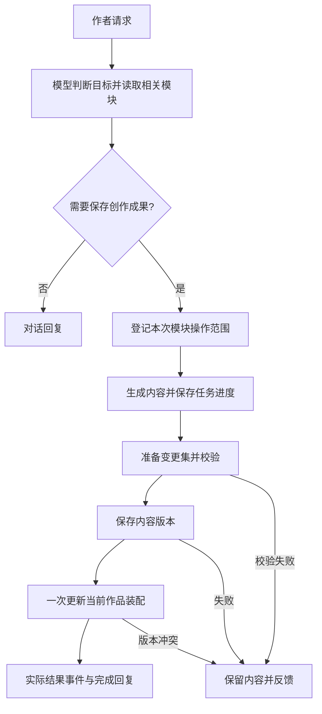

## v0.3

- notice：发现项目模块太多，功能繁杂，难以优化以及实用化开发，连基础的写文章都无法正常完成。故尝试做减法，先做最小化可行方案。
- solution：以后开发过程以功能为单位，每个功能都要从设计到后端到前端开发到实际测试，才算完成。

从用户体验为切入点，核心功能就是对话，首先需要一个功能齐全便利的chatbox，项目对象是文章，也就是文本。先确定文本存在形式。

<br />

目前状态

```
作品
  ├─ 第一章：标题、章节顺序、段落 ID 清单
  │    ├─ 段落 A：正文字符串
  │    └─ 段落 B：正文字符串
  └─ 第二章
       └─ 段落 C：正文字符串
```

## v0.4

- 文章：直接维护一个markdown格式内容的目录，直接用git进行版本管理。

  目前设计：内容总体分为两大块，1.正文，按章划分，一章一个文件。2.设定集，其中有且仅有：角色小传（角色设定，个性，往事），线索（指向所有嫌疑人的作案可能性，读者视角观察），真相（包括真实情况，真实作案手法）。

```
我的小说/
├─ .git/
├─ 正文/
│  ├─ 01 雨夜.md
│  └─ 02 来信.md
└─ 设定集/
   ├─ 角色小传.md
   ├─ 线索.md
   └─ 真相.md
```

<br />

- 用户体验性基础功能：完善模型对话框功能，比如显示思考过程，展示预选项，流式输出和md格式输出，可视化结构化输出， （）
- 模型接入基础功能：仿照tau coding，允许接入第三方模型，也用方便的层级式，先选供应商再添api。允许使用本地模型，添加一键安装功能。  （done）

***

## v0.5 

- 角色变成目录，每个角色一个文件
- 用户体验性基础功能：完善模型对话框功能，比如显示思考过程，展示预选项，流式输出和md格式输出，可视化结构化输出， （done）
  - 似乎应该让角色标签成为角色的一个必须属性，由模型设置，后续再说用户修改。
  - **cite 状态用工具写入，不要靠模型记忆**：人物状态、伏笔状态、章节进度这类，让 agent 通过结构化的"更新状态"输出，由你的代码去改 JSON，而不是让它自己在文本里记住。文本里的记忆会漂。

***

## v0.6

参考：mynotes\refer\jiajia.fun.md

- 先重点设计文件读写功能和上下文装配器：

作者可以仅通过对话提出任务，也可以选择作品文件作为参考。系统需要找到相关材料、识别材料版本、区分参考与修改授权，并在需要时提供带原文依据的检查结果。

***

## v0.7

- 更新了故事资料，算是模型上下文工程的一部分，但是仍不满意，估计要下一个版本，目前想法：正文才是唯一最终输出内容，用文本格式存，其他均为辅助材料，可以用结构化格式存。

* 事件流日志（done）

<br />

？ 也许应该修改项目特色，记录作者的灵光一现并合理的注入作品，且文本结构依然完整，故事依然合理。以时间线为主轴展开。

***

## v0.8

- 完成灵感功能（感谢锤子科技，闪念胶囊）（done）
- 关于故事资料（名称待定），没啥好想法，目前想法就是用时间线来进行串联：\
  主入口改为“故事总览”，默认时间线（done）
- 更好的模块化输入（done）
- tool call：模型自主权（done）
- 完善模型意图识别和自主创建模块：（done）



***

## v0.9

- 接入Ai订阅链接功能（gpt done）
- 暂时撤掉故事总览功能，后续再说（done）

* 该继续上下文工程了：压缩和上下文用量显示

  <br />
* 插入和排队
* 添加类似agents.md的记忆文档，用来调整模型习惯。比如：“少用不是。。。而是。。。的句式”
  ***

## v1.0

- 悬疑线索设计与写作联动：本章线索、原文定位、作者计划、推理核对和讨论改写（2026-10-27确定优先）

## v1.1（预留）

- 用户修订记录和写作习惯总结功能

