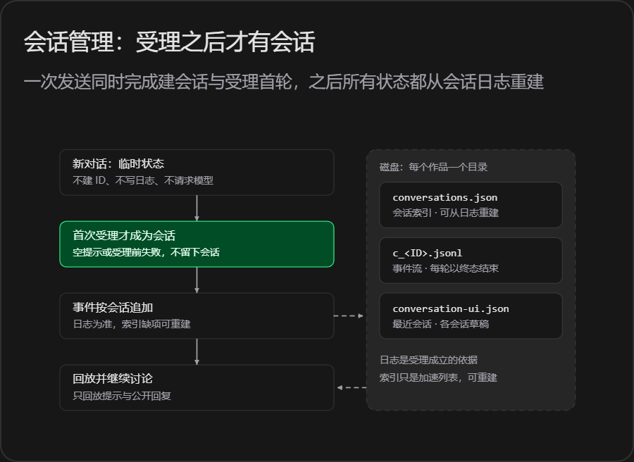

# 产品设计

## 文本管理

作品就是一个本地文件夹：正文与设定都是 Markdown 文本，没有数据库，目录内容本身就是唯一事实来源。用外部编辑器改过的文件不需要导入或同步，下一次读取就是最新内容；版本记录直接交给 Git。

```
我的小说/
├─ .git/
├─ 正文/
│  ├─ 0001 雨夜.md
│  └─ 0002 来信.md
└─ 设定集/
   ├─ 角色小传/
   │  ├─ 佐藤警部.md
   │  └─ 林静.md
   ├─ 线索.md
   └─ 真相.md
```

**路径与命名**

- 正文章节固定放在 `正文/`，一章一个 `.md`；文件名以四位序号开头，序号决定章序，不按列表位置重新编号，缺章时后面的章节仍保留原章序。
- 角色小传固定放在 `设定集/角色小传/`，一名角色一个文件；身份写在文件开头的 `---` 元信息里，例如 `roles: [suspect, culprit]`。
- `设定集/线索.md` 与 `设定集/真相.md` 是固定文件，只能改写，不能移动或删除。
- 只接受这三类受管路径；符号链接、目录联接和解析后越出作品根目录的路径一律拒绝。

**显示名**

章节显示名优先取正文开头明确写出的章名（如 `第三章 书房里的脚印`、`序章 暴雪前的信`），其次取有意义的一级标题，最后回退文件名。章序只认文件名里的四位编号，标题里的「第几章」只用来提取章名；两者不一致时给出诊断，不擅自改章序。人物小传的名字优先取一级标题，缺失时用文件名。

**写入**

每次读取都返回内容指纹（digest，按实际字节计算）。改写已有文件必须带上次读到的 digest；文件在这期间被外部改过就返回冲突，要求重新读取，避免用旧内容覆盖。新建文件不带 digest，因此不能拿它当无条件覆盖。写入用同目录临时文件替换，中途失败不会留下半个文件。文本统一为 UTF-8 + LF，其他编码与二进制内容直接报错，不做自动转码。

**版本管理**

作品目录本身是一个独立的 Git 仓库，只有 `正文/` 与 `设定集/` 参与版本记录。应用按轮次把改动记成提交，提交身份只对单次命令生效，不读写作者的全局 Git 配置；作者已暂存的内容不被消费，作品套在上级仓库里时也不会借用上级仓库。撤销用反向提交完成，不移动分支指针。

导入遵循同一套规则：`.md` 一个文件一章，`.txt` 按分章标记切分后一章一个文件。

<br />

## 工具

工具清单和实现都在 agent.py 的`build_tools()` 里，共 9 个：

| 工具 | 用途 | 写入条件 |
| --- | --- | --- |
| `list_files` | 列出正文章节、角色小传以及线索与真相文件的路径和标题 | 只读 |
| `read_file` | 读取文件内容、总行数与 digest，长文按 offset/limit 分页 | 只读 |
| `search_text` | 在正文与设定中逐行搜索关键词，返回路径、行号与摘录 | 只读 |
| `write_file` | 整体写入或新建受管文件 | 改写已有文件须带 digest |
| `edit_file` | 用唯一匹配的原文做局部替换 | 必须带 digest，原文须唯一 |
| `move_file` | 在同类目录内重命名章节或角色小传 | 必须带 digest |
| `delete_file` | 删除章节或单个角色小传 | 必须带 digest |
| `git_diff` | 查看工作区相对上次提交的差异 | 只读 |
| `git_log` | 查看最近的提交标题与时间 | 只读 |

两处固定边界：`digest` 只能来自 `read_file` 的返回，用来确认改的是刚读过的内容；线索与真相文件不可移动、不可删除。Git 的提交与撤销由应用完成，不暴露给模型。

<br />

## 会话管理



## 上下文工程\*

重点设计
