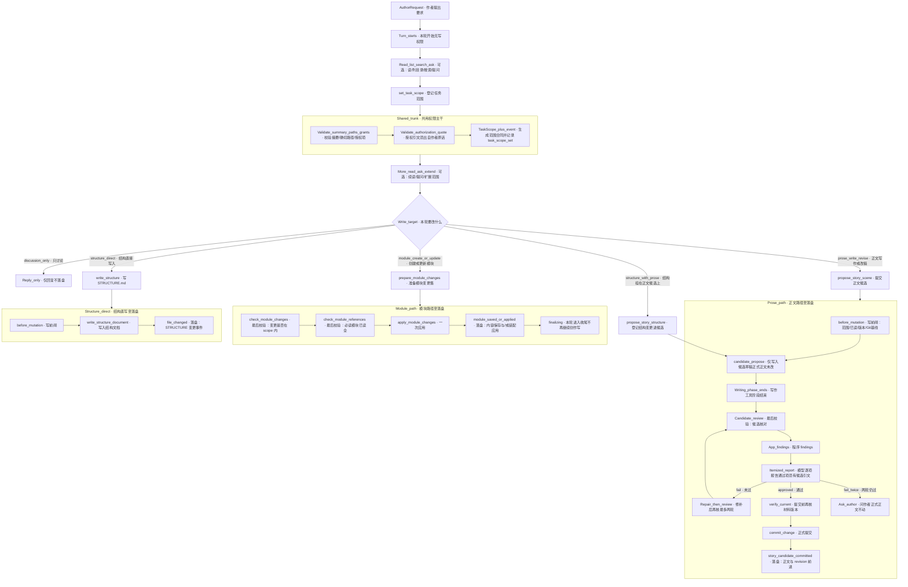

# Agent 写入主线：从 Scope 到落盘

更新于 2026-11-17。承接 [structure-and-agent-lifecycle.md](structure-and-agent-lifecycle.md) 第 5 节「可见任务闭环」，按**现行实现**画出：共用权限主干、各写路径的最后校验、直到落盘事件。

**设计规矩：** 应用能证明「操作未超出已记录范围」且写前材料/版本仍有效；不能证明「范围解释一定符合自然语言意图」。授权引文匹配 ≠ 意图理解已证明。

源码主干：`src/hastings/workspace/task_scope.py`、`agent.py`（`set_task_scope` / `before_mutation`）、`service.py`（正文候选收尾）、模块工具在 `agent.py` 的 `prepare_module_changes` / `apply_module_changes`。

## 全流程图

节点标签为「代码名 · 中文」。虚线旁路未全部展开（见文末）。

## 各路径：最后校验与落盘

| 路径 | 落盘前最后校验 | 落盘标志 |
| --- | --- | --- |
| 正文写作/改稿 | 候选核对（程序 findings + 逐项报告与引文）→ 再 `verify_current` | `story_candidate_committed` |
| 创建/更新模块 | `check_module_changes` + 模块必读完整 → `apply` | `module_content_saved` / `module_changes_applied` |
| 结构直写 | `before_mutation`（范围/已读/版本）→ 写入 | `file_changed`（STRUCTURE） |
| 结构挂在正文候选 | 与正文同一轮候选核对后一起提交 | 随 `commit_change` |
| 只讨论 | 无写盘校验 | 无落盘 |

## 有意未画全的旁路

- **上下文模块建议**：先暂停让作者采纳，再开新轮续原任务  
- **单独装配装卸 / 库发布**：仍先 `set_task_scope`，末端工具不同  
- **`purpose=review`**：偏只读检查，不是「生成后入稿」  
- **试读等受限用途**：材料范围更窄
