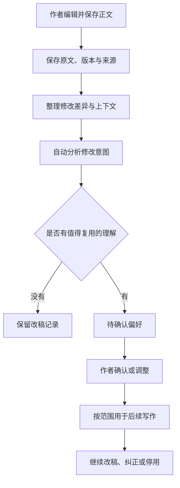

# 修订学习：从人工改稿形成写作偏好

日期：2026-10-26；版本安排更新：2026-10-27。状态：**前置产品草案，已顺延为1.1预留，尚未实施**。

作者优先将悬疑线索确定为1.0，本项顺延为 **1.1.0预留**。正式范围和详细契约见 [1.1 产品方案](../v1.1/README.md)与
[开发入口](../../dev-notes/v1.1/README.md)。本文保留最初推导，差异以1.1明确契约为准。

本文将[作者模型与长期记忆](author-model-design.md)中的方向细化为当前文件工作区可实施的方案。
现有正文阅读、文件与 Git 链路是实施基础；历史原型中的审阅页、作者模型和证据百分比不代表已有能力。

## 1. 目标与已确认决定

让作者正常修改正文，就能积累有依据的写作偏好，减少后续生成中反复发生的同类修改。
作者应能看到系统理解了什么、根据哪些修改理解、会在什么场合使用，并能纠正或停用。

本轮作者已确认两项决定：

1. **自动分析修改，偏好经作者确认后才用于后续写作。**
2. **默认限定当前作品；推广到个人通用偏好由作者主动决定。**

以下交互、数据与阶段安排是建议方案，仍可在评审时调整。编写本方案不更改运行版本，也不并入已确定的 0.9 上下文与会话压缩范围。

建议功能名称为「修订学习」，表达系统从作者修改中归纳偏好；管理入口称「写作偏好」。
「作者模型」可继续用于内部设计讨论，但界面无需让作者判断自己是否在训练模型。

首版通过已确认的偏好和相关改稿示例影响生成，不更新模型参数。这样可以逐条解释、即时纠正，
也便于在切换在线模型后继续使用。生成是否更合意仍需后续对照验证，不能因保存了偏好就宣称效果已改善。

## 2. 当前基础与缺口

2026-10-26 核对的当前工作区代码事实：

| 能力 | 当前情况 | 本功能需要补充 |
|---|---|---|
| 正文阅读 | `Paper.tsx` 是只读 Markdown 阅读器 | 正文编辑、草稿恢复、保存与冲突处理 |
| 文件接口 | `GET /api/file-workspaces/{id}/file` 可读取完整原文、显示正文和指纹；没有对应正文人工保存接口 | 有幂等请求和版本来源的人工保存接口 |
| 文件写入 | `Workspace.write` 已有指纹校验、换行规范化和原子替换 | 复用底层写入，补充人工编辑操作记录 |
| 版本记录 | `GitRepo` 已有真实提交、差异、按路径记录和最新提交撤销；前端已有「改动与历史」 | 标记修改来源，增加适合中文文章的行内差异和完整段落对照 |
| 模型改稿 | 写作轮次有执行记录、基线与收尾；外部未记录改动可以被单独补记 | 不能将外部改动或提交者身份直接认定为人工创作 |
| 上下文 | 已按用途装配、限制预算并记录实际装入内容 | 只选择适用的已确认偏好，记录具体版本与示例 |
| 偏好学习 | 后续设计保留了来源、范围和忘记要求；当前主链路没有可用的自动学习闭环 | 观察、候选、确认、使用、纠正的完整流程 |

因此实施顺序应从可靠的人工编辑开始。只给现有差异界面增加一次模型分析，无法保证学习来源正确。

## 3. 作者实际使用的流程

1. 模型生成正文后，作者在稿纸点击「编辑」，直接修改一章中的对白、描写或段落。
2. 点击「保存」后先落盘并记录版本。保存不等待模型，也不要求填写修改原因。
3. 系统把本次改稿形成可恢复的分析任务，合并同一批修改，自动分析值得学习的变化。
4. 有候选时在写作台给出轻量入口，例如「发现 2 条可能的写作偏好」。作者可以继续写作，稍后处理。
5. 打开后看到一句可编辑的理解、适用范围与修改前后原文，选择「确认偏好」「修改理解」或「仅本次」。
6. 后续生成选取相关的已确认偏好。作者能查看本轮实际使用了哪些偏好，也能停用或纠正。



直接修改的正文保存后立即成为当前正文；确认偏好决定未来如何写作，两者分别处理。
不要求作者再接受一次自己已经保存的文字，也不因拒绝一条偏好而撤销正文。

## 4. 从一个例子理解学习内容

修改前：

> 林岚很紧张，她害怕许砚继续追问。

作者改为：

> 林岚把杯沿转了半圈。「你刚才说到哪儿了？」

差异应像参考图一样显示删除和新增，并能切到完整段落。候选理解可以是：

> **在本书人物回避追问的场景中，优先用小动作和转移话题表现紧张，减少直接解释心理。**

候选同时显示：本作品、回避追问场景、来自本次第七章的一组修改。
「以后不要写心理描写」超出了这个例子的支持范围，不能作为默认归纳。

作者可以将范围收窄为「只适用于林岚」，也可以说明「这次只是调整情节」。
后者只关闭这条候选，不能反向得出作者喜欢直接心理描写。

偏好应同时保留三部分：**怎样写、何时适用、有哪些例外**。例如「重要情绪转折可以直接写心理」。
一句抽象的「文风细腻」不能独立指导后续生成。

## 5. 学习内容及其边界

| 观察方向 | 可以提出的条件化理解 | 分析所需上下文 |
|---|---|---|
| 场景描写 | 调查场景优先描写可观察、与行动有关的细节 | 当前段落、前后段及明确的场景目的 |
| 人物对白 | 某人物受质问时倾向简短回应，避免主动解释 | 对白轮次、说话人和该人物相关材料 |
| 心理与情绪 | 某类场景优先用动作呈现情绪 | 修改前后段落及叙事视角 |
| 叙述表达 | 减少重复修饰，保留具体动词 | 句子及完整段落 |
| 写作节奏 | 揭示新线索前减少铺陈，揭示后保留反应 | 连续段落或场景，不能只看一个句子 |
| 信息呈现 | 某类推理过程偏好让读者先看到动作和证据 | 相关上下文及作者已给定的写作要求 |

下列变化不直接归纳为文风偏好：姓名日期修正、地点与人物事实调整、线索增删、剧情重排、
标题和格式整理、导入或整章替换。它们可以留在版本记录中；需要同步故事资料时沿用独立的资料流程。
例如把「已经知道真相」改成「还不知道」，首先应识别为情节或知情状态修正。

同一处可能兼有事实与表达变化，应分别标注。无法拆清时允许返回「暂无法判断」，不强行生成偏好。
短句比例、对白长度、段落长度可辅助描述修改，但不能单独证明作者的审美或修改动机。

## 6. 证据可靠性

### 6.1 记录修改行为的来源

来源由实际执行链路记录，不让模型根据文字猜测，也不根据 Git 提交作者或提交标题判断：

| 来源 | 默认处理 |
|---|---|
| 应用内直接编辑 | 可分析实际改动；证明发生了人工编辑，不宣称每个新增字都是作者原创 |
| 模型生成或模型改稿 | 保留版本，不计作作者亲自改稿的证据 |
| 作者采用一段模型建议 | 可保留为明确选择，强度和性质与亲手改写区分 |
| 外部编辑器改动 | 标记来源未知；作者确认来源后再分析，不因补记版本就自动认定人工 |
| 导入、粘贴替换、大段重写 | 记录行为；不默认将整段当作高质量偏好对照，必要时请作者补充来源 |
| 撤销或版本恢复 | 处理证据有效性，不把反向差异当作一条新偏好 |

首版只自动分析应用内直接编辑的现有正文。模型建议采用、外部修改与历史批量学习以后独立扩展。

### 6.2 一次修改与多次证据

- 一个编辑批次里连续保存同一处修改，只计作一组独立证据；每次版本仍完整保留。
- 同一片段经历「改写 → 微调 → 再保存」，优先比较批次开始与完成的结果，避免把中间尝试都当成稳定选择。
- 不同章节、不同情境中的相似修改，可以增加支持证据；仍须检查它们的适用条件。
- 未修改的文字没有被明确比较过，不能被当作正面偏好；保留模型原文也不等于作者赞成全部表达。
- 单次修改可以提出范围较窄的候选。反复出现可以支持更广范围的候选，但任何范围扩大都不自动生效。
- 不展示未经校准的「证据支持 82%」。显示具体修改组数、适用条件、来源和冲突证据。

### 6.3 只在有用时询问

保存不附带必填问卷。存在会显著改变归纳结果的歧义时，在候选详情问一次，例如：
「这次缩短对白，是为了这个人物，还是为了本场景的节奏？」
作者未回答就保留窄范围或不提出该偏好；不以等待时间替代回答。

## 7. 编辑、版本与恢复

### 7.1 编辑基线

作者进入编辑时固定完整原文件、原文指纹、路径与编辑批次 ID。差异基于实际编辑前后快照，
不能简单比较当前 HEAD 与最终磁盘内容，否则可能夹入外部或模型修改。

编辑器显示正文时保留文件开头的元信息及其他未显示内容，不能把 `display_text` 直接作为完整文件覆盖。
差异展示可忽略无意义的换行展示差别，证据与版本仍绑定规范化后的完整原文。

首版采用一章一次显式保存。自动保留的草稿用于恢复，不在每次按键时生成 Git 提交或调用模型。
草稿按作品、路径和原始指纹隔离；切换章节保留各自草稿，退出或刷新后可恢复。

### 7.2 保存与并发

人工保存与模型写作共用作品写入互斥。模型任务运行中可以保留人工草稿，但保存前须等任务结束或停止任务。
提交时以原始指纹校验；文件已变化时保留草稿，展示基础版本、磁盘现状与草稿供对照，不自动覆盖。

保存依次完成：请求查重 → 校验与固定基线 → 写入操作意图和前后快照 → 原子写文件 → 记录 Git → 完成操作 → 登记分析。
已有未知未记录改动必须单独处理，不能并入本次人工证据。只记录本次确定涉及的路径，并验证提交中的正文内容与快照一致。
应用内互斥无法阻止外部编辑器或外部 Git 操作；检测到指纹或 HEAD 在关键步骤变化时，保留已落盘结果并报告冲突，不猜测来源。

文件、Git 和学习状态不能组成一个跨系统原子事务，需要可恢复的操作记录。
重启根据操作阶段、快照指纹与已产生提交核对状态，不盲目重复写入或重复提交。
相同请求键与相同载荷返回原结果；相同键不同载荷拒绝。

### 7.3 分别报告结果

| 情况 | 正文与版本处理 | 学习处理 |
|---|---|---|
| 文件与版本记录成功 | 显示已保存及版本记录 | 自动登记或合并分析任务 |
| 文件成功，Git 失败或未启用 | 保留文件，显示历史尚未记录，可独立补记 | 快照保留为待记录，首版在版本核对后再分析 |
| 版本成功，分析登记失败 | 不撤销正文或再次提交 | 标记待补登记，重启按操作记录恢复 |
| 没有文字变化 | 不生成空提交 | 不生成学习证据 |
| 模型不可用、额度不足或分析失败 | 已保存内容保持有效 | 等待、暂停或显式重试，不反复自动请求 |

分析失败不能使保存显示失败；同时不能把「文件已保存」显示成「版本与学习都已完成」。
错误遵循项目格式，例如：

```text
[FILE_STALE_CONFLICT] 正文保存：文件已在其他位置更新。建议：对照最新内容后重新保存，当前草稿已保留。
[REVISION_ANALYSIS_FAILED] 修订学习：本次分析未完成。建议：稍后重试，正文和版本记录已保留。
```

### 7.4 撤销与忘记

撤销某次正文修改时，失效的是该修改贡献的证据，不是删除整个版本历史。
候选失去全部证据时关闭；推断偏好失去全部支持时暂停并提示复核。
作者在确认时已编辑为明确写作要求的，保留其声明性质，不因原例子消失而静默删除该要求。
仍有其他有效支持的偏好保留，并更新来源数量；撤销某个例子也不证明作者偏好相反写法。

「停用」保留记录供恢复；「忘记」排除相应偏好及其旧证据的再次自动归纳。
忘记会清理偏好内容、派生示例和使用索引，另保留最小排除标识，防止从同一批历史重新学回。
Git 中的正文仍是作品历史；忘记偏好不宣称已删除历史正文。重新从被排除证据学习必须由作者主动要求。

## 8. 差异理解与偏好形成

建议采用以下有边界的分析过程：

1. **程序计算差异。** 先对齐段落，再计算句内或字符变化，识别整段移动、拆分与合并。原始差异始终可回看。
2. **整理最小充分上下文。** 包含修改片段、必要前后段及已有的场景条件。节奏修改允许读取更大范围；读取范围和版本有记录。
3. **分析改动性质。** 输出事实修正、剧情调整、表达变化、格式变化或不确定，并给出短的依据说明。
4. **提出条件化理解。** 每条候选只描述一个可执行的倾向，附支持和反向证据；模型不能自行确认或扩大范围。
5. **归并与核验。** 与已有候选和偏好对照；补充证据可以自动完成，修改已确认规则或适用范围必须重新确认。
6. **作者确认。** 保存作者看到并确认的精确版本、范围与例外；不能用后台新分析覆盖作者正在确认的版本。

证据引用由程序校验是否来自给定版本和区间，引用成立不等于推断语义正确。
角色和场景无法唯一定位时不猜：有稳定模块记录则引用其身份；没有稳定身份时先限定当前片段，
确认后再建立明确关联。相同人名不能作为跨作品或跨模块同一身份的依据。

模型只读冻结的证据包，返回结构化候选，不获得正文写入、模块修改或偏好激活工具。
原文引用作为待分析资料处理，不能将正文中的命令式句子提升为系统要求。

## 9. 偏好保存什么

建议将以下职责分开，具体文件或表结构在详细开发计划中确定：

| 记录 | 核心内容 |
|---|---|
| 编辑操作 | 操作 ID、请求键、作品、路径、批次、修改来源、前后指纹与快照、基线与结果提交、保存阶段 |
| 修改片段 | 前后版本区间、原文、上下文引用、对齐方式与版本、是否有效、是否排除 |
| 学习操作 | 证据范围与指纹、模型和提示版本、状态、真实请求关联、重试与取消信息 |
| 偏好 | 可执行规则、适用范围与条件、例外、状态、版本、确认方式、支持及冲突证据 |
| 使用记录 | 本轮使用的偏好精确版本、所选示例、适用理由、排除原因与占用预算 |

示意记录如下，字段只是拟议契约：

```json
{
  "id": "pref_001",
  "revision": 1,
  "status": "active",
  "rule": "人物回避追问时，优先用小动作和转移话题表现紧张，减少直接解释心理",
  "scope": {"workspace_id": "workspace_001", "character_ref": null},
  "conditions": ["回避追问的场景"],
  "exceptions": ["重要情绪转折允许直接心理描写"],
  "confirmation": {"kind": "author_edited", "operation_id": "decision_001"},
  "supporting_evidence": ["edit_fragment_001"],
  "conflicting_evidence": []
}
```

偏好用「待确认、已启用、已停用、已替代、已忘记」区分生命周期。
学习操作另有「待处理、分析中、完成、失败、已取消」，不混成同一状态。

作品偏好与学习记录放在现有作品状态目录下，不进入章节正文，也不建立第二套正文主库。
原文快照用于证据和恢复，索引可以重建。学习恢复数据不依赖会被清理的短期活动附件。
作品重命名和删除须随当前状态迁移、清理机制处理，不能留下仍会被装入其他作品的记录。

## 10. 如何影响后续写作

每次任务开始时，根据当前作品、目标人物、写作范围和场景条件，选择少量相关的已启用偏好，
连同必要的改稿示例放进专门的写作偏好分区。选择结果与真实输入同源，不另造一套展示记录。

写作要求的适用顺序建议为：

1. 当前任务中作者明确提出的要求。
2. 当前人物或场景的具体约定，以及当前作品的明确约定。
3. 当前作品中已确认的推断偏好。
4. 以后由作者主动推广并对当前作品启用的个人通用偏好。

同一层的明确冲突不能靠「最新一条总是优先」静默解决。先检查条件是否不同；仍冲突时保留冲突，
必要时请作者决定。事实与披露范围独立核对，写作偏好不能授权改变事实或提前披露。

偏好示例只取与任务相容的内容。后文的对白或改稿上下文可能包含谜底：回写前章时默认不装入这些示例，
可用不含故事事实的规则文本；无法可靠去除后文信息的规则也暂不装入。
角色未出场或条件不确定时，不能仅因人名相似就装入对应偏好。

首版仅在写作与改稿任务使用；索引、资料事实提取、会话压缩和默认检查不自动套用文风要求。
确认偏好不会重写已有章节，也不会新增原任务之外的写入权限。

为偏好和示例设单独预算，超额时优先保留明确、具体、相关的条目，记录跳过原因。
与 0.9 上下文统计和压缩实现衔接时，偏好分区必须进入完整输入估算；任务受理后固定使用的偏好版本。
偏好失效、停用和忘记作为独立状态参与投影，旧会话或压缩摘要中的偏好引用不能恢复其有效性；
不能只从当前偏好分区删掉一条规则，却继续把旧摘要中的同一规则作为有效要求装入。
停用或忘记立即影响后续请求；若进行中的请求已携带被忘记内容，应标记该请求并允许作者停止，不能宣称已从发出的请求撤回。

## 11. 页面与任务体验

不新增强制的「作者模型」主导航。建议复用稿纸、改动历史和一个按需展开的偏好面板：

| 位置 | 内容与操作 |
|---|---|
| 稿纸 | 编辑、保存、取消；正文已保存与历史记录状态清楚分开 |
| 改动与历史 | 修改来源、段落级红绿差异、完整段落；跳到关联的候选或偏好 |
| 写作偏好面板 | 待确认与已启用记录；查看来源、编辑理解、收窄范围、停用和忘记 |
| 任务详情 | 本轮实际使用的偏好和示例；可由一次不合意生成追查使用依据 |
| 学习设置 | 自动分析开关、调用预算、暂停与失败后重试 |

红绿差异同时使用删除线、插入标识和文本说明，不能只用颜色区分。
窄屏优先显示一份可切换的完整段落，避免强制左右两栏挤压阅读。
候选入口不抢焦点，不在每次保存后弹窗；没有新理解时可以没有候选。
修改原因和证据详情按需展开，不用常驻说明占满写作界面。

本轮已确认自动分析，因此将其作为该功能的目标流程；不会据旧版「不默认运行模型任务」再次要求确认同一决定。
实施时要明确展示自动分析状态、消耗和关闭入口。自动分析只产生候选，不能自动发布偏好或修改正文。

后台操作基于不可变快照，不持有正文写锁。前台模型请求优先，学习任务等待或取消后重新调度；
不修改现有前台任务的作品内互斥契约。连续保存用可调整的短等待合并，开始分析前再次核对证据状态。
重启恢复待处理记录；失败任务不因打开页面或重新连接模型无限重试。
停止自动分析不删除已确认偏好；清空待处理与忘记偏好是分别可理解的操作。

分析时冻结所用在线模型，复用真实请求、用量与活动记录。没有归属会话的人工编辑分析按作品操作统计，
不塞入任意当前会话的累计用量。只发送必要的片段与上下文，作者能查看实际分析范围。

## 12. 前后端应共同交付的契约

以下全部是**拟新增契约**，不是现有接口清单。基础路径沿用 `/api/file-workspaces/{workspace_id}`。

| 操作 | 拟议接口 | 前端对应能力 |
|---|---|---|
| 保存正文编辑 | `POST /file-edits` | 编辑器提交并展示保存、版本及学习状态 |
| 读取编辑记录 | `GET /file-edits`、`GET /file-edits/{edit_id}` | 可恢复的保存结果、历史和来源 |
| 读取结构化差异 | `GET /file-edits/{edit_id}/diff` | 片段差异、完整段落和证据定位 |
| 读取学习状态 | `GET /revision-learning` | 开关、预算、待处理数量和操作状态 |
| 设置分析方式 | `PUT /revision-learning/settings` | 启用、暂停和预算调整 |
| 重试或取消 | `POST /revision-learning/operations/{operation_id}/actions` | 失败重试与停止当前分析 |
| 查询候选及偏好 | `GET /writing-preferences`、`GET /writing-preferences/{preference_id}` | 列表、规则、范围、来源和当前版本 |
| 作者决策 | `POST /writing-preferences/{preference_id}/decisions` | 确认、修改、仅本次、停用、恢复或忘记 |

保存请求至少携带 `path`、完整 `text`、`expected_digest`、`edit_batch_id`、`request_key`。
修改来源由服务端保存链路确定，不能由客户端传一个 `human=true` 就提升证据等级。
保存响应返回编辑 ID、新指纹、文件保存状态、版本记录状态、提交 ID 与学习状态；三类状态独立。

决策请求携带 `expected_revision`、精确规则与范围、动作及请求键。
后台新增证据不会自动替换已确认规则。作者打开旧版本候选后确认，必须核对候选版本，避免确认到未看过的理解。
第一阶段不接收跨作品范围，也不展示无后端能力的推广按钮；推广能力在后续阶段完整交付。

现有 Git 状态、提交与原始差异接口继续保留。结构化差异服务从相同原文版本计算，不维护另一套正文历史。
历史任意位置的局部恢复、分支和多人协作不作为该功能前提，当前最新提交撤销边界继续明确保留。

建议新增职责为：人工编辑服务、段落差异处理、证据存储、学习操作、偏好存储、偏好选择。
模型调用与活动记录复用现有机制；不为本功能重建通用工作流框架。

## 13. 分阶段交付

| 阶段 | 完整交付内容 | 进入下一阶段前的条件 |
|---|---|---|
| A：可靠改稿 | 正文编辑、草稿恢复、指纹冲突、操作幂等、Git 记录、来源与段落差异 | 能准确还原改了什么，失败不覆盖草稿，不混入未知来源 |
| B：可审查理解 | 自动分析、批次归并、候选和证据、失败重试与预算 | 能区分表达、事实和剧情；允许无候选；同处多次保存不重复计证据 |
| C：用于写作 | 确认、修改、停用、忘记、相关选择、示例装配和使用记录 | 未确认不生效，范围与优先级正确，停用和证据失效可验证 |
| D：效果与扩展 | 在线对照、真实作者试用、完善冲突；再交付主动推广到个人偏好 | 新场景中减少同类人工修改，且不损伤故事要求；跨作品使用有明确控制 |

第一版可把 A–C 作为一个功能闭环，D 中的效果验证是正式交付条件；跨作品推广作为后续独立范围。
第一版重点选择对白表达、场景描写和情绪呈现。节奏可以记录候选，但只在上下文充分且经作者确认后应用，
不承诺从少量句子修改建立完整的长篇结构风格。

暂不同时加入全量历史自动扫描、隐式跨作品学习、参数训练、向量检索基础设施或自动批改全书。
这些能力是否必要，应由记录规模、选择效果和真实作者反馈决定。

## 14. 验证方法与交付标准

### 确定性与界面验证

- 保存、响应丢失后的重放、文件冲突、Git 失败、记录补偿、重启与草稿恢复。
- 中文段落、对白、多段移动、拆并段落、换行和元信息保护；证据定位到正确版本。
- 人工、模型、外部与撤销来源的隔离；重复保存、恢复版本和再次分析不重复增加证据。
- 未确认候选绝不进入生成；忘记后旧证据不能重新生成相同偏好；确认旧候选版本发生冲突。
- 作品切换、重命名、删除和人物同名时的隔离；后文例子不能泄露到前章。
- 编辑、历史、候选和偏好管理在窄屏及字号放大后可用；失败提示保留操作结果和恢复入口。

### 在线语义验证

依照项目约定，使用 `.env` 配置的在线模型，不使用本地模型；本轮方案整理不调用评测模型。
保存模型、提示、证据集版本与真实输入的关联，评测报告不保存凭据。

在同一模型与相同故事要求下比较：不使用偏好、只使用已确认规则、使用规则及相关改稿示例。
评估集按独立章节或场景留出，不能把刚用于归纳的段落作为主要效果证据。

分别评估：

| 评估面 | 主要问题 |
|---|---|
| 理解 | 候选是否忠实于修改；是否把情节、纠错和临时决定误泛化 |
| 选择 | 该人物、该场景是否适用；不适用时能否不使用 |
| 生成 | 是否保留事实、视角、披露边界与本轮指令；是否减少相同类型的再修改 |
| 作者体验 | 候选确认和修正负担是否可接受；来源能否解释一次不合意生成 |

以作者不知道分组的成对阅读和实际改稿为主要效果证据，模型评审只作辅助。
不以改动字数变少单独证明效果：它也可能来自作者没时间修改，或模型写得过于简单。
正式开发计划应在固定评测样本后约定语义门槛；本草案不伪造准确率或改善比例。
权限、未确认偏好不注入、来源隔离和忘记等确定性约束必须全部通过。

## 15. 技术取舍的依据

- [Git 差异文档](https://git-scm.com/docs/git-diff)说明其可比较版本、文件和工作区内容，并提供词级差异选项。
  本方案复用它保存和核对文字变化，中文阅读层另外做段落与句内展示；修改意图由独立分析提出，不能由 diff 本身证明。
- [Direct Preference Optimization 原论文](https://arxiv.org/abs/2305.18290)讨论了利用偏好数据进行参数微调的方法。
  它不直接验证本文的写作偏好方案，也不能证明一次改稿就是合格的训练样本。
  本方案先验证可解释的偏好与示例能否改善新场景生成；未来确需参数训练时，再建立原任务、可比回答、
  修改来源、数据授权、留出集与训练后效果的独立流程。

本方案的主要取舍是：先确保理解有依据、范围受控和效果可验证，再逐步增加自动化程度。
作者的修改保留为作品资产；模型对修改的理解始终允许被纠正。
