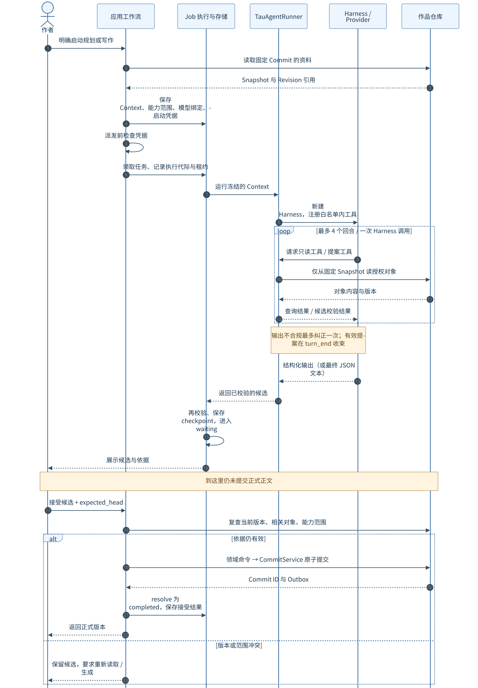

# Harness 架构图解：执行、授权与作品版本

> 核对日期：2026-10-18。定位：0.3 开发期间的架构分析，以本次工作区源码为准（基线提交 `6109e83`），不是新功能方案或整版交付声明。
> 阅读顺序：先看职责图，再看循环与采用流程，最后看上下文、恢复和事件。图中实线表示已有调用或状态流转；虚线表示补充输入。各图的适用链路在正文中明确说明。
> 范围依据：[产品设计导航](README.md)、[0.3 开发进度](../dev-notes/v0.3/README.md)。模型一致性审计、作者模型与 RAG 仍属后续范围；代码中存在相关角色，不代表 0.3 已提供这些产品功能。

项目中的 harness 有两个理解层次。狭义上，`AgentHarness` 是可复用的模型执行器，管理消息、模型回合、工具调用、事件和取消。广义上，让 Agent 可控地完成创作，还需要应用层提供固定版本资料、授权范围、持久任务、结果校验和作品提交。

**最重要的边界是：模型负责生成与提出候选，应用层决定能否运行、能否采用，以及何时形成正式版本。** Harness 的运行结束、Job 的完成、正文的提交，是三个不同的事实。

## 1. 职责图：什么需要 Harness，什么直接调用模型

[查看大图](diagrams/harness/01-execution-boundaries.svg) · [可编辑图源](diagrams/harness/01-execution-boundaries.mmd)

这张图展示调用依赖，模型结果返回与作者采用的先后关系见第 3 节。蓝色是作者操作与应用用例，绿色是模型执行，黄色是正式作品写入；颜色只辅助分组，职责以框内文字为准。

目前有四种值得区分的接入方式：

| 链路 | 执行方式 | 状态与权限 | 当前定位 |
|---|---|---|---|
| 旧 CLI / `HastingsSession` | 复用有消息历史的 `AgentHarness` | 消息可落 JSONL；目前装配的旧工具只读 | 理解内核的历史入口，不能当作当前创作主链路 |
| 工具型工作者 | `WorkerJobRunner` → `TauAgentRunner` → 新 Harness | Job 保存任务状态；工具仅查询或提案，没有正式写端口 | 0.2 已建立、0.3 继续演进的任务链路 |
| 普通对话 | `ConversationService` → `ProviderChatRunner` | `tools=[]`；对话存储保存轮次与消息 | 无需工具循环，作者发送消息即发起本轮讨论 |
| 0.3 试写、摘要、账本建议 | 各业务服务 → `_run_text` → `ProviderChatRunner` | 单次无工具模型调用；结果由业务服务校验与处理 | 并未统一经过 `TauAgentRunner`；摘要另外具备专用持久任务 |

保留两种模型执行方式有实际价值：讨论和明确的单项生成可以直接调用模型；需要按需查资料、多步使用工具的任务才使用循环。共同要求应放在应用边界，例如来源版本、取消后的结果处置、预算和可追溯性，不必为了形式统一，让每个功能都经过工具循环。

所谓“无状态工作者”指跨任务不依赖私有会话，并不是 Harness 内部没有状态。一个 Harness 实例仍有消息列表、运行标记和两个消息队列；`TauAgentRunner` 每次执行新建实例，持久事实由外部的 Context、Job 和仓库保存。

依据：[旧工具装配](../src/hastings/cli.py)（`build_harness` / `create_writing_tools`）、[工作者适配器](../src/hastings/infrastructure/agents/tau_runner.py)、[无工具对话适配器](../src/hastings/infrastructure/conversations/runner.py)、[服务装配](../src/hastings/server/v2.py)（`_run_text` / `_chapter_writer` / `_summary_writer` / `_suggestion_writer`）。

## 2. 循环图：一次请求为什么可能多次调用模型

[查看大图](diagrams/harness/02-agent-loop.svg) · [可编辑图源](diagrams/harness/02-agent-loop.mmd)

一次 `prompt()` 可能包含多个回合：模型先提出工具调用，工具结果进入消息历史，再交给模型继续判断。一个回合包含一次模型响应，以及这次响应提出的全部工具调用。没有工具、没有即时补充、也没有后续消息时，循环才自然结束。

| 控制点 | 实际语义 | 对产品体验的影响 |
|---|---|---|
| `prompt` / `continue_` | 同一个 Harness 不能同时启动两次；后者沿已有消息继续 | 同实例的并发要由上层排队或拆为独立任务 |
| `steer` | 首次模型调用前、每个完整回合结束后取队列 | 可以补充当前要求，但不抢占本轮正在执行的工具 |
| `follow_up` | 工具循环与 steering 都结束后读取 | 适合当前工作完成后接着处理的要求 |
| `queue_mode` | 默认每次取一条，也可一次取全部 | 它控制消息消费，不是多 Agent 调度 |
| `before_tool_call` / `after_tool_call` | 前者可拦截工具；后者可改写结果与错误标记 | 通用扩展点；作品级权限仍需工具实现与应用守卫落实 |
| `cancel` | 设置取消信号，由 Provider / 工具协作响应；收尾修补缺失的工具结果 | 取消不等于撤销已发生的业务写入，后者需要独立的版本操作 |
| `max_turns` | 单次循环的模型回合上限；默认可以不设 | 不是跨任务调用预算，也不是总费用上限 |

读内核时，还需要注意四个实现细节：

1. 当前 `loop.py` 使用 `for call in calls` **串行执行**工具。虽然 `AgentTool` 有 `execution_mode` 字段，这个循环并未据此并行调度。
2. `on_update` 的工具进度先收集，等工具返回后再发出事件；模型文本可流式展示，不代表工具进度也在执行过程中实时推送。
3. `AgentToolResult.terminate` 没有被通用循环用来终止执行。`TauAgentRunner` 在收到有效提案后的 `turn_end` 主动取消并关闭流，避免多余模型调用。
4. 工具异常通常转换成错误结果交给模型；取消异常继续向上传播。事件监听器则逐个执行并等待，普通监听器的未处理异常可能中断运行；内核没有统一保证所有观察者故障都被隔离。

此外，`input_schema` 是模型可见的工具契约，不能代替服务端校验。当前通用 `AgentTool.execute` 直接调用执行函数，范围、对象版本和结构化输出检查由应用代码承担。

依据：[Harness](../src/tau_agent/harness.py)、[Loop](../src/tau_agent/loop.py)、[工具协议](../src/tau_agent/tools.py)、[Provider 协议](../src/tau_agent/provider.py)。图省略了异常传播与 `max_turns < 1` 的参数错误分支；它们同样需要正确释放运行状态。

## 3. 时序图：生成候选之后，谁有权改变作品

[查看大图](diagrams/harness/03-worker-proposal-sequence.svg) · [可编辑图源](diagrams/harness/03-worker-proposal-sequence.mmd)

这张图专指 `AgentWorkflows` 的规划 / 写作候选路径。图中的“持久 Job”包含任务执行器与存储，固定 Snapshot 的读取可发生在适配器启动时，工具随后读取该快照；并不表示每个工具都再次查询浮动的最新版本。

它有三次不同性质的检查：

1. **启动时检查能否执行。** Context 固定资料与版本，Capability 约束角色、可读对象、可提案修改对象和工具集合，ExecutionGrant 记录作者启动依据。资料本身不能授予权限。
2. **产出时检查结果是否合规。** 注册工具取“角色工具白名单”和 Capability 的交集；输出还要验证结构、范围、版本和引用。共享守卫位于应用层，替换模型适配器也不能跳过它。无结果、需要澄清和执行失败分别表达。
3. **采用时检查依据是否仍有效。** 作者确认当前 head 后，应用复查相关对象是否变化，再执行领域命令与原子提交。无关对象的变化不必一律使候选失效；相关依据或正文的变化不能被旧候选覆盖。

`TauAgentRunner` 的单次 Harness 调用上限是 4 回合，结构化输出最多允许一次纠正。纠正沿本任务实例的历史进行，不能把“4 回合”解释成整个 Job 的统一调用预算。

### 0.3 试写采用是另一条实际路径

当前 `DraftingService` 的试写通过无工具调用生成，候选保存在辅助表。作者采用时核对候选修订、预览哈希、正文基础版本、未完成工作副本和披露边界，然后经 `PublishManuscriptChange` 发布。

该发布器把正文差异、证据状态核对、摘要失效、操作记录和回执一起交给提交服务；这些保存动作是确定性的，不顺带创建新的模型任务。导入、手工修改、历史恢复与关联撤销也使用这条发布管线。

**两条路径的采用实现尚未完全合并。** 工具型工作者的 `AgentWorkflows.accept` 仍直接构造 `CommitRequest`，0.3 的试写采用则走统一正文发布器。因此图中的“应用层提交”是共同责任，不代表所有已有正文候选路径已经共享同一个发布用例。

依据：[工作者任务执行](../src/hastings/application/workflows/worker_job.py)、[候选接受](../src/hastings/application/workflows/agent_workflows.py)（`accept`）、[输出守卫](../src/hastings/application/guards_worker_output.py)、[试写服务](../src/hastings/application/services/drafting_service.py)、[统一正文发布](../src/hastings/application/services/publish_manuscript_change.py)、[原子提交](../src/hastings/application/services/commit_service.py)。

## 4. 上下文图：模型看到什么，长期状态在哪里

[查看大图](diagrams/harness/04-context-and-state.svg) · [可编辑图源](diagrams/harness/04-context-and-state.mmd)

两套上下文都从作品版本出发，但用途不同：`ContextPackage` 服务于有角色、有工具范围的工作者任务；`BackgroundPackage` 提供对话与试写共同使用的作品背景。当前不能把六层背景装配器画成所有 Harness 的统一入口。

六层背景按优先级排列。代码中**本书约定和故事核心是必留层**，装不下会报错；其他内容按预算保留或省略，并记录遗漏和覆盖范围。披露边界排在第二层，但当前未被列入 `MANDATORY_TIERS`。摘要缺失或过期时，可以使用按版本读取的原文作为本次临时背景，不自动保存成正式摘要，也不能把未读内容说成已检查。

长期状态应按以下归属理解：

| 状态 | 权威所有者 | Harness 是否拥有 |
|---|---|---|
| 本轮消息、工具结果、steering / follow_up、取消信号 | 当前 Harness 实例 | 是，主要在内存 |
| 工作者输入、模型绑定、启动凭据、检查点、执行代际 | 持久 Job 与应用服务 | 否 |
| 交流记录、结果引用、轮次状态 | 对话存储 | 否；聊天记录不代替作品仓库 |
| 未采用的试写候选与工作副本 | 各业务服务的辅助记录 | 否 |
| 正文、账本、版本关系与正式提交 | 作品仓库 | 否 |

这使新开对话和重建执行器不必重建作品事实。代价是应用层需要显式传递稳定 ID、版本和来源；不能靠一份不断增长的聊天历史同时承担记忆、授权与恢复。

依据：[工作者上下文装配](../src/hastings/application/contexts/__init__.py)、[工作者模型与能力范围](../src/hastings/domain/worker.py)、[六层背景](../src/hastings/application/contexts/background.py)、[背景收集](../src/hastings/application/contexts/collector.py)、[上下文产品方案](context-and-summary-design.md)。

## 5. 状态图：恢复的是持久任务，不是内存中的 Harness

[查看大图](diagrams/harness/05-job-states.svg) · [可编辑图源](diagrams/harness/05-job-states.mmd)

这张图是当前 `WorkerJobRunner` / Job 存储的主要路径，不是普通对话或专用摘要任务的完整状态机。`waiting` 的原因要继续读取 `output`：它可能是候选、澄清，也可能是 `historical_paused`、`not_authorized` 或 `interrupted`；不能统一显示为“候选待采用”。`completed` 也可能只是合法空结果或分析完成。

取消通过提高 `generation` 让旧执行失去提交任务结果的资格。任务执行器轮询取消状态、停止执行，并在保存检查点或结束状态时再次校验代际。租约则用于限定谁正在持有任务，不能代替版本冲突检查。

恢复有两个场景，需要分开理解：服务启动时，仍处于 `running` 的任务被标为 `waiting / interrupted`，等待作者处理；运行中的租约过期处理仍会把任务转回 `queued`。底层执行器支持复用已存的输出检查点，但这不等于每次进程重启都会自动重跑或自动继续模型。

**当前重试策略存在待对齐处。** 0.3 产品明确要求作者启动重试，但 `WorkerJobRunner` 仍会对部分环境错误生成 `retryable_failed` 与退避时间，`worker_loop` 到期后可再次派发；专用摘要任务也保留了部分错误的同类路径。图按源码画出这条边，不能将产品要求写成所有链路已实现的行为。

依据：[Job 存储](../src/hastings/infrastructure/jobs.py)、[工作者执行器](../src/hastings/application/workflows/worker_job.py)、[派发与启动恢复](../src/hastings/server/v2.py)（`worker_loop` / lifespan）、[专用摘要任务](../src/hastings/application/workflows/summary_jobs.py)、[0.3 显式启动决定](README.md)。

## 6. 事件图：看到执行进度，不等于作品已提交

[查看大图](diagrams/harness/06-events-and-truth.svg) · [可编辑图源](diagrams/harness/06-events-and-truth.mmd)

这些通道回答不同问题，不能把一种事件直接解释成另一种事实：

| 通道 | 能说明什么 | 不能单独证明什么 |
|---|---|---|
| Harness `AgentEvent` | 某次模型响应、工具调用或回合发生了什么 | 正式作品已经改变 |
| Job 事件 | 哪个任务在执行、产出、失败或等待 | 作者已经采用候选 |
| 对话 REST / SSE | 消息、轮次与结果引用如何展示 | 对话文字就是权威任务状态 |
| ExecutionLog | 已接入功能的执行生命周期，可按作品游标回看 | 所有 Harness 与模型功能都已接入该日志 |
| 仓库 Outbox / 业务 WebSocket | 随事务落下的正式版本事件，可断线补齐 | 每条执行进度都意味着一次提交 |

旧会话以 `harness.subscribe` 分发事件：即时展示、定稿消息 JSONL、审计日志各取所需。当前工作者适配器只转发部分 Harness 事件（工具开始、工具结束、回合结束），再补充 `agent.started`、输出提案、Schema 纠正等应用事件，存入 Job 事件表，不保存完整逐 token 流。

0.3 的 ExecutionLog 已接入对话轮次生命周期，并有分页与 SSE 接口。但本次核对没有发现 Job 事件表向 ExecutionLog 的统一桥接；试写等 `_run_text` 调用也没有经过 `ConversationService` 的日志投影。因此“有执行日志接口”与“所有模型任务已经统一留痕”应分开验收。

前后端读取时应沿权威对象 ID 获取详情：Job 进度读任务接口，候选预览读候选接口，正式结果读 Commit / 操作回执。界面上的“生成完成”与“已采用”需要分别来自相应事实，而不是解析模型回答中的措辞。

依据：[内核事件](../src/tau_agent/events.py)、[旧会话持久化](../src/hastings/session_persist.py)、[Job 事件](../src/hastings/infrastructure/jobs.py)、[任务 API](../src/hastings/interfaces/api/agents.py)、[对话日志接线](../src/hastings/application/services/conversation_service.py)、[执行日志 API](../src/hastings/interfaces/api/execution_log.py)、[业务事件通道](../src/hastings/server/v2_ws.py)。

## 7. 设计评价与下一步对齐重点

现有架构最清楚的部分，是把通用执行循环和作品业务分开：内核可被复用，角色权限能缩小，候选可以审阅，正式版本有独立提交证据。这也适合学习编排：先理解单个循环，再理解外部应用如何给它输入、权限与持久状态。

目前复杂度主要来自新旧应用路径共存，而不是内核过于复杂。以下是本次源码分析得到的对齐项，不在本文中改动实现或重新扩大 0.3 范围：

| 对齐项 | 当前证据 | 为什么值得优先处理 |
|---|---|---|
| 作者启动与失败重试 | 有派发凭据检查，也仍有到期自动重派发 | 同一功能不能因为走了另一条执行路径而获得不同的启动语义 |
| 跨调用预算 | `ExecutionGrant.consume()` 已定义；本次搜索未见生产调用点，门禁只检查已存计数 | 单次循环上限无法约束跨纠正、跨尝试的实际模型调用总量 |
| 正文采用的统一发布 | `AgentWorkflows.accept` 与 `DraftingService.adopt` 的提交路径不同 | 证据核对、摘要失效与操作回执需要在各入口一致生效 |
| 统一执行日志覆盖 | Job 事件、对话日志、直接生成三条接线尚未合一 | 作者应能找到每项已启动模型功能的过程与最终状态 |

预算判断依据：[ExecutionGrant 与门禁](../src/hastings/application/execution.py)、[模型绑定与工作者装配](../src/hastings/server/v2_agents.py)、[工作者循环边界](../src/hastings/infrastructure/agents/tau_runner.py)。以上是调用链与源码搜索结论，不替代生产环境故障注入或端到端验收。

后续扩展建议继续遵循三个归属：模型策略与工具循环放在执行层；启动、预算、恢复与结果校验放在应用层；作品不变量与版本事实放在领域和仓库。图源、渲染方式与维护入口见[配图说明](diagrams/harness/README.md)。
