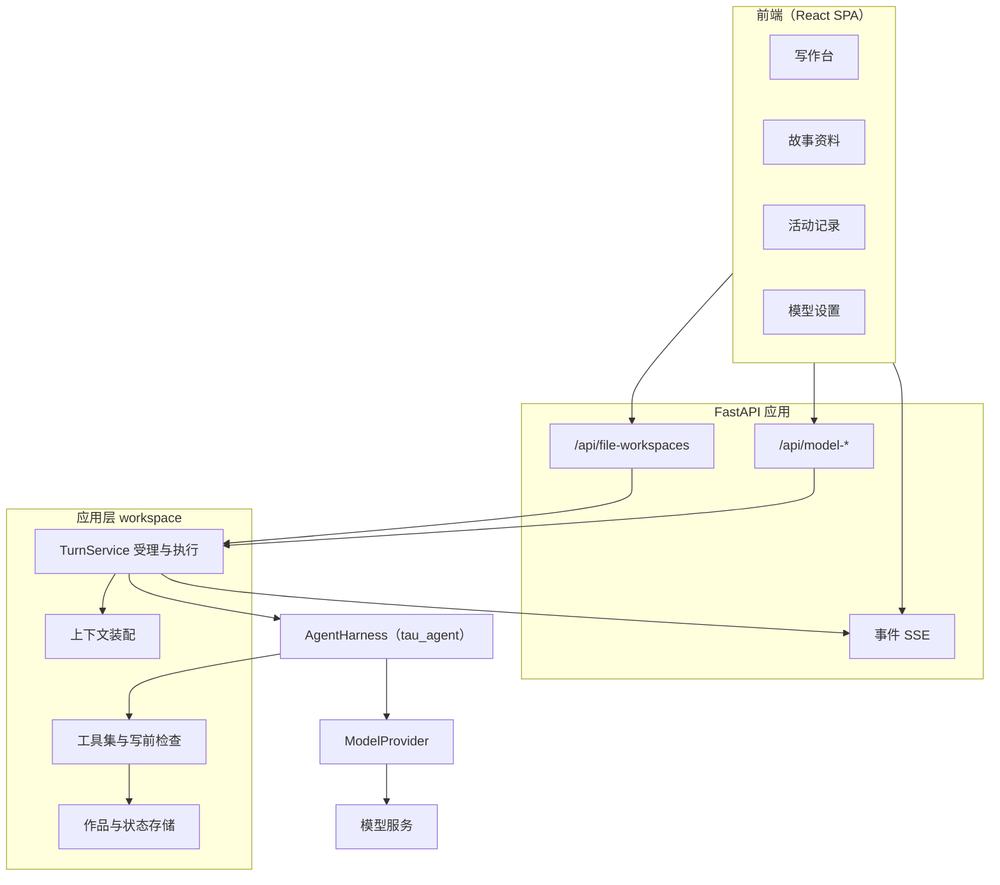
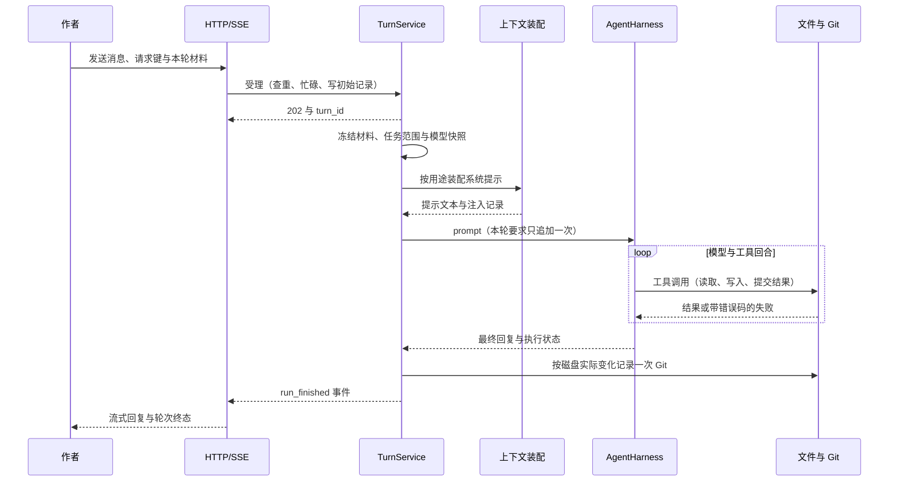
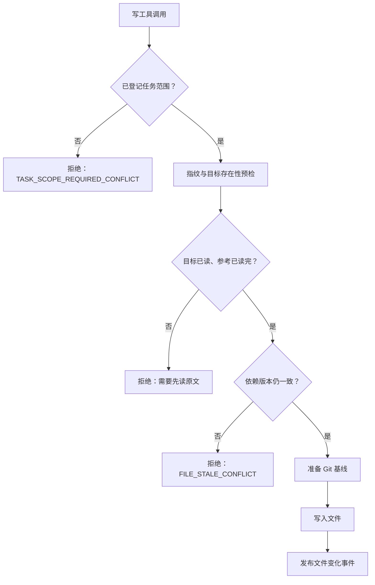
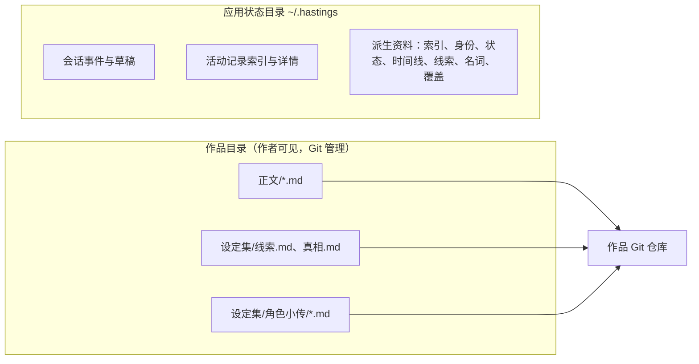

# 线簿架构：作品文件、写作 Agent 与资料任务

> 核对日期：2026-10-24。当前运行实现为 **0.7**（包版本 `0.7.0`），0.8 方案待实施。
> 本文说明当前代码的实际分层与链路；模块细节见 [0.7 模块导航](../dev-notes/v0.7/modules/README.md)，运行与验收见 [0.7 运行说明](../dev-notes/v0.7/release.md)，代码入口见 [后端导航](../src/hastings/README.md)。
> 不描述已删除的 0.2/0.3 编排（候选采用、故事账本、Job 队列）；那些决定的历史背景见 [0.3 产品方案](v0.3/README.md)与 [dev-notes](../dev-notes/README.md)。

## 1. 定位

作品是一个本地 Markdown 目录，历史由目录内的真实 Git 仓库记录。应用负责四件事：阅读与修改文件、接受一轮对话并执行模型、整理派生资料、留下可查询的执行记录。模型内核 `tau_agent` 不针对本产品改动，应用层只通过 `AgentHarness` 使用它的循环、工具协议与事件。

因此当前链路里没有候选采用、没有独立审阅页，也没有默认运行的后台模型任务。作者提出要求后，写作 Agent 直接读写作品文件；索引、检查、身份核对与资料整理都必须由作者明确发起。

## 2. 分层与职责

| 层 | 当前职责 | 主要位置 |
|---|---|---|
| 前端 | 写作台、故事资料、活动记录、模型设置；hash 路由恢复页面位置 | `frontend/src/` |
| 接口 | 文件、Git、对话、事件、资料、模型设置；统一错误信封 | `workspace/api.py`、`server/model_api.py` |
| 轮次服务 | 受理、查重、作品互斥、执行、停止、重启修复 | `workspace/service.py` |
| 上下文 | 按用途装配分区、预算与注入记录 | `workspace/context.py`、`workspace/assembly.py` |
| 工具 | 文件与 Git 只读工具、写作工具、各任务的结果提交工具 | `workspace/agent.py` |
| 存储 | 作品目录、最近作品登记、会话事件、活动索引与派生资料 | `workspace/files.py`、`workspace/state.py`、`workspace/activity.py` |
| 模型连接 | 供应商预设、连接、凭据、模型发现与测试 | `server/model_*.py`、`infrastructure/credentials.py` |
| 内核 | 模型回合、工具循环、事件与取消 | `src/tau_agent/` |

## 3. 一轮请求的生命周期

- **受理先于执行**：`request_key` 相同且文字、材料、用途一致时返回原轮次，不重复调用模型；文字或材料不同按 `REQUEST_KEY_CONFLICT` 拒绝。
- **作品互斥**：同一作品同时只受理一轮，包括已受理但尚未开始执行的轮次；忙时返回 `WORKSPACE_BUSY_CONFLICT`，不排队。
- **停止随时有效**：还没调用模型的轮次直接收尾为「已停止」，不假装轮次不存在。
- **模型快照**：受理时固定连接、显示名称、模型与实例；之后修改连接只影响下一轮。
- **两条独立轴**：执行状态 `completed / partial / failed / stopped / interrupted`，记录状态 `committed / no_change / unrecorded`。文件写成功但 Git 没记上，用 `failed` + `unrecorded` 表达，不显示为全部成功。
- **重启修复**：有 `turn_started` 却没有 `run_finished` 的轮次补一条中断终态；不自动继续，也不猜测完成。

## 4. 上下文装配

系统提示不是一段拼好的字符串，而是按用途分区的装配结果。用途由受理时的 `purpose` 决定，不看作者意图；同一轮既能讨论也能改稿，所以「讨论」不单列类型。

| 用途 | 对应工具模式 | 装入分区 | 典型场景 |
|---|---|---|---|
| `writer` | `write` | 任务要求、目录、本轮材料、章节索引、身份、人物状态、故事时间、未回收线索、专名、设定集、此前轮次 | 普通写作与修改 |
| `extract` | `index`、`state` | 任务要求、目录（目标范围写在任务要求里） | 建索引、身份与状态核对 |
| `review` | `review` | 任务要求、目录、材料、人物状态、故事时间、未回收线索、设定集 | 只读检查 |
| `materials` | `materials` | 任务要求、目录、本次范围 | 故事资料整理 |

- **分区顺序固定**：任务要求 → 目录 → 材料 → 索引 → 身份 → 人物状态 → 故事时间 → 线索 → 专名 → 设定 → 此前轮次。
- **必装分区不截断**：任务要求与目录超出预算时整轮失败（`CONTEXT_ASSEMBLY_FAILED`）；可裁分区超预算时整块跳过，并记下原因与字符数。
- **记录与实际同源**：每轮先写 `state_injected` 事件，列出用途、各分区字符数、跳过项与预算使用量，再把同一份装配结果交给模型。
- **状态时点**：请求可用 `context.state_chapter` 指定截止章；未指定时写作按当前章节、检查按最早目标章，都不能定位时按第 0 章筛选，不自动采用全书末章。
- **索引只注入有效记录**：过期、来源缺失或无法读取的索引不进入写作上下文，避免按旧摘要写作。

已知缺口：2026-10-24 的在线上下文评测发现，`context_prepared.provided` 声称的预读区间没有出现在首个模型输入中；写前完整性检查使用同一份材料账本，因此不能证明这段原文实际交付。模型之后主动 `read_file` 可以取得原文，但不会修正首次交付的缺失。

## 5. 工具与写前检查

工具按用途裁剪，同一个 AgentHarness 不兼任所有权限。

| 工具模式 | 可用工具 | 边界 |
|---|---|---|
| `write` | 目录、读取、搜索、登记参考、登记范围、追加范围、请求检查、写、局部替换、移动、删除、差异、历史、读取状态 | 作品写工具齐全；Git 提交与撤销不暴露给模型 |
| `index` | 目录、读取、搜索、`save_chapter_index` | 只能写索引缓存，不改正文，不准备 Git 基线 |
| `review` | 目录、读取、搜索、`save_review_report` | 只读原文并发布报告，不撤销已落盘修改 |
| `state` | 目录、读取、搜索、`read_state`、对应域保存工具 | 只发布带证据的派生记录，没有作品写工具 |
| `materials` | 目录、读取、搜索、`publish_material_result` | 一次只整理一个资料域，目标必须在本轮范围 |

- **范围先于一切**：没有范围时四个写工具一律拒绝，拒绝不产生文件、目录或 Git 副作用；范围只接受确切路径与操作类别，「修改」不隐含删除。
- **指纹是写入凭据**：`read_file` 返回磁盘字节指纹，改写、局部替换、移动、删除都必须携带；外部编辑或换行变化使旧指纹失效（`FILE_STALE_CONFLICT`）。
- **读取账本**：作者显式选择的参考必须读完才能改作品；引用证据的字符区间必须落在本轮实际提供过的原文里。
- **错误回喂**：失败以 `[错误码] 位置：现象。建议：…` 返回给模型，由它重新读取或调整，不替它猜测。HTTP 状态由错误码尾缀决定（`*_NOT_FOUND` → 404，`*_CONFLICT` → 409，`*_FAILED` → 500，其余 400）。
- **回合上限**：单轮默认最多 24 个模型回合；写后检查是同一轮的第二阶段，写作阶段已用的回合要从检查阶段扣除。

## 6. 数据与状态

| 位置 | 内容 | 是否进作品 Git |
|---|---|---|
| `正文/` | 一章一个 Markdown 文件，章序来自文件名四位编号 | 是 |
| `设定集/` | 线索、真相两份固定设定；角色小传一人一文件 | 是 |
| `~/.hastings/` | 最近作品登记、会话事件、界面草稿、活动索引与详情 | 否 |
| `<状态目录>/chapter-index.json` 等 | 章节索引、身份核对、人物状态、时间线、线索、名词与覆盖记录 | 否 |

Git 只记录受管路径。作品目录套在上级仓库里时不使用上级仓库；根目录不匹配、分离头指针、合并冲突或暂存区已有内容时，在调用模型前就拒绝写入。撤销使用 `git revert` 生成反向提交，只覆盖最新一次记录，不移动分支指针。

## 7. 任务类型与完成判定

| 任务 | 启动方式 | 结果如何判断 |
|---|---|---|
| 写作或讨论 | 作者发送消息；普通写作与修改共用 `write` 工具模式 | 轮次终态与 Git 记录；只读讨论为 `no_change` |
| 写后检查 | 作者显式要求，或修改任务里模型按作者原话登记 | 报告状态 `findings / no_findings / incomplete`；未读完不能报「无发现」 |
| 故事资料整理 | 作者在资料页选域与目标发起资料任务 | 服务端按目标清单与已发布结果计算；仍有目标未提交即「部分完成」 |
| 章节索引与状态核对（兼容用途） | 既有接口仍支持 `update_chapter_index`、`update_disclosure`、`update_state` | 发布前核对范围、读完当前全文、引文区间与源指纹；0.7 新页面不再用这些用途 |

0.7 的章节概览、人物、时间线、线索与名词表都由资料任务整理；旧的索引与状态用途保留给既有调用，不用于新页面。
资料整理任务使用专用会话（`origin=materials`），不挂在当前写作会话上；一次只整理一个域，人物域必须同时给 1—10 份小传与 1—10 个章节。模型回复「已经整理完」不算完成，完成度由服务端目标清单决定。

## 8. 模型连接

- 预设只描述接入方式，不含密钥；连接是作者自己的账号记录；模型是连接的属性。
- 配置只有一处事实源：启动时实际使用的 `config.yaml`；设置界面编辑该文件，不另建数据库，不读进程环境变量。
- 明文 Key 只存在于系统凭据存储与运行时内存；配置写盘只带凭据引用。系统存储不可用时降级为进程内存，并明确提示「仅本次运行有效」。
- 每轮模型实例独占：受理时创建，完成、失败或停止时关闭。厂商报错让轮次失败，不记为「已完成、没有改动」。

## 9. 事件与可观测性

- **会话事件**：`turn_started`、`run_phase`、`assistant_*`、`tool_started / tool_finished`、`context_prepared`、`state_injected`、`task_scope_set`、`error`、`run_finished` 等按 `seq` 追加到 `<会话>.jsonl`，供对话回放与实时订阅。
- **活动记录**：会话事件与作品级操作事件合并为可查询索引（`activity/index.sqlite3`），支持按任务、类型、结果、时间与关键词查询；索引可删除重建，原始日志只追加。
- **模型请求**：通过应用内 provider 包装器观察实际调用边界、用途、工具集合、输入规模、首个输出与耗时；不重组输入，不增加重试，不记录密钥与认证头。
- **两条订阅**：对话事件按会话隔离，每轮以 `run_finished` 结束；活动记录跨轮次持续订阅，断线按同一游标续传。
- **已知边界**：事件不跨进程广播，多个服务器进程写同一状态目录不在支持范围；外部文件编辑器没有监听，改动要等下一次读取才发现。

## 10. 0.8 计划中的变化

0.8 方案尚未实施，以下只说明将改变的方向，不代表当前能力：

- 固定入口扩展为写作、灵感本、故事资料；灵感默认不进入 Agent 目录、搜索与装配，只有作者带到对话或明确请求检索时才在本轮可用。
- 故事资料改为预设模块按需添加，不再要求新作品展示整套空白资料页。
- 章节索引与时间线共用事件记录，时间线提供按章节与按故事时间两种视图。
- 作者计划与正文观察分开保存、关联展示；修改正文不会让尚未兑现的计划消失。
- 不恢复候选采用流程；作者明确要求保存或修改才落作品文件，仅讨论不改文件。

## 11. 已知缺口

- **长会话没有压缩**：不自动摘要或截断，厂商返回超限时原样说明。
- **上下文交付缺口**：见第 4 节的预读原文未出现在首个模型输入。
- **浏览器内真实创作未逐屏走查**：真实链路在接口层取证，界面由构建、状态与组件测试覆盖。
- **单进程假设**：作品互斥与事件广播都在单进程内生效，不支持多进程同时写同一作品。
- **检查与撤销范围有限**：检查不撤销已落盘修改；撤销只覆盖最新一次记录，不提供任意历史位置的三方撤销。
