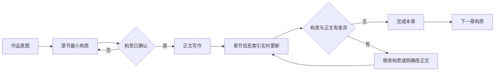

# 先构思再写作：统一工作区设计

日期：2026-11-02。状态：**研究结论已进入 v1.0.9 计划，尚未实施**。配套用例见[真实可用性用例](ideas-clues-usability-cases.md)，正式产品边界见 [v1.0.9 产品方案](../v1.0.9/README.md)。

## 1. 核心决定

下一步不再设计独立的「构思页」与「线索页」，也不把两页内容简单拼在一个长页面中。产品只保留一个写作工作区：

- 选择全书时，查看全书构思和跨章信息发展。
- 选择未开始的章节时，先完成最小章节构思。
- 选择已构思的章节时，进入正文，同时显示本章信息索引。
- 选择信息索引中的内容时，查看它在构思中的作用和正文中的准确出处。
- 对话始终围绕当前全书、章节或信息项，替换辅助区，不增加新的常驻区域。

**没有章节构思，就不能创建或打开该章的空白正文。** 这一限制的目的不是要求作者先写完整大纲，而是保证每次进入正文前，作者至少知道本章要改变什么。

## 2. 把线索、伏笔和回收合并为一条信息发展

「线索」「伏笔」「回收伏笔」不是三个需要作者分别维护的对象。它们通常是同一条信息在不同章节中的作用：

> 湿手套在第一章被看见并造成错误解释，在第五章因雪停记录受到质疑，在第八章因洗手套证词改变解释，在第二十四章完成回收。

内部可以记录每一步的作用，但作者只需要阅读自然语言：

- 第一章：让湿手套看起来像刚从雪地回来。
- 第五章：雪停时间使原解释不再充分。
- 第八章：洗手套证词给出另一种解释。
- 第二十四章：结合其他证据推翻不在场证词。

因此，统一结构采用「故事信息线」作为跨章身份；每章只保存这一章让该信息发生了什么变化。`引入 / 推进 / 转义 / 回收`可以作为内部动作，不能成为创建时必须选择的字段。

## 3. 作者看见的内容与系统维护的结构

| 层次 | 作者看见什么 | 系统负责什么 |
|---|---|---|
| 全书构思 | 一段作品意图、章节顺序、跨章信息的发展 | 保存当前正式方案和修订，不从聊天历史猜最终决定 |
| 章节构思 | 「本章要发生什么」与少量信息变化 | 保证正文开始前有明确目标，装配本章上下文 |
| 故事信息线 | 一条信息怎样被引入、误解、改变解释和回收 | 维持跨章稳定身份，关联各章计划与出处 |
| 正文绑定 | 每项信息对应的准确原句 | 保存段落锚点、版本、路径和失效原因 |
| 章节信息索引 | 本章计划、已写出处、计划外新增和差异 | 由构思与正文投影生成，不成为另一份人工账本 |

页面不展示完整内部结构，也不要求作者维护对象 ID、状态、用途、关系或时间字段。作者修改的是自然语言构思和正文，结构由系统维护。

## 4. 最小构思门槛

### 4.1 全书开始条件

新作品只要求一段可继续发展的作品意图，其中至少包含：

- 核心处境或冲突。
- 当前准备从哪里开始。

结局、真相和完整章节数可以未知。系统不能为了“构思完整”自行补造这些内容。

### 4.2 章节开始条件

每一章在创建正文前必须有：

1. 一句本章变化，例如「林砚抵达旅馆并开始怀疑管家」。
2. 至少一项信息变化，例如「湿手套让林砚误以为管家刚从雪地回来」。

这两个条件可以由作者一句自然语言同时满足。系统可以提出草案，作者只需确认或改一句话，不填写表单。

### 4.3 什么算有效的信息变化

悬疑章节不一定每章新增物证，但每章应至少发生一种变化：

- 提出新的问题。
- 出现证据或证词。
- 加强一种解释或怀疑。
- 让旧信息得到另一种解释。
- 否定旧判断。
- 回收先前安排。
- 改变角色知道、相信或隐瞒的内容。

单纯移动人物而不改变事件、关系或信息的章节，无法满足开始条件。系统应帮助作者说明这一章的作用，而不是用警告或分数判断章节价值。

### 4.4 所有创作文本都有模型路径

作者可以直接输入，也可以在同一位置选择“交给模型构思”“由模型起草”“让模型续写”或“给我下一步建议”。模型结果默认是候选，不能覆盖作者已经输入的文字；无可用模型时入口保持可见并说明设置方式。搜索、路径和模型连接等控制信息不属于创作文本。

## 5. 连续工作流程

章节信息索引贯穿写作，不是章末才生成的报告。章末只收拢仍需要作者判断的少量差异。

## 6. 正文与构思如何双向影响

### 6.1 构思影响正文

- 章节构思一经提交，立即成为本章对话、续写和修改任务的正式上下文。
- 信息索引在正文尚未出现时显示计划项，使作者知道本章还准备写什么。
- 修改构思后，已有正文只显示受影响位置，不自动改写。
- 作者明确说「同步修改正文」时，构思、正文和绑定作为一个变更提交；不能各自成功一半。

### 6.2 正文影响构思

- 已计划内容写入正文后，信息索引自动绑定准确原句并更新完成情况。
- 删除或改写原句后，旧绑定立即失效，相关跨章回收同步显示影响。
- 正文出现未计划但可能重要的信息时，索引显示「正文新增」；作者确认后才进入正式构思。
- 正文与构思冲突时，系统呈现差异，不能擅自选择正文或构思覆盖另一方。

### 6.3 「实时」的具体边界

实时指不刷新、不切换页面、始终基于最新修订，而不是每次按键都调用模型或改写其他内容。

- 已有绑定的移动、删除和恢复使用确定性锚点处理，应随正文保存立即完成。
- 由系统生成或修改的正文，在同一次提交中返回对应信息绑定。
- 作者手写的新段落只分析变化范围；停止输入或保存后进行增量语义索引，旧请求在新修订到来时取消。
- 增量分析没有完成时明确显示正在更新；失败时保留正文并显示事实，不能沿用旧结果冒充最新索引。
- 语义分析可以提出新增信息和差异，但不能自动改变正式构思。

这一设计意味着手写正文的自动语义索引需要受控的在线模型调用。实现时应合并连续编辑，只发送变化段落、本章构思和必要邻近文本，不能在每个按键后请求，也不能反复分析整本书。

## 7. 章节信息索引

章节信息索引是构思与正文的共同投影，不是新的资料页。默认只显示当前有内容的部分：

### 7.1 本章准备推进

每项使用一句自然语言说明本章作用。正文尚未落实时，显示该项尚无出处；不显示空字段。

### 7.2 已写入正文

计划项一旦有准确原句，就在原项下显示出处。点击索引定位原文，点击正文标记返回索引。一次出现对应一个出处，不能把多次出现合并掉。

### 7.3 正文新增

只显示达到信息意义阈值、但尚未进入正式构思的内容。作者可以忽略、移除提示，或用一句话说明以后如何处理。这里不出现类型选择器。

### 7.4 需要对齐

只在构思与正文确有差异时出现，说明是哪一句正文使哪项构思不再成立。它不是常驻状态列表，也不把有意谎言和信息差当作普通冲突。

章末核对只呈现「正文新增」与「需要对齐」中尚未处理的项目。已经落实的计划不重复要求确认。

## 8. 页面规划

### 8.1 顶层入口

撤除主导航中的「构思」和「线索」。作品内只保留「写作」作为日常入口；模块库、灵感等全局能力保持原位置。

写作工作区左侧目录的第一个项目是「全书构思」，下面才是章节。作者不需要先判断自己此刻是在管理构思、线索还是正文。

### 8.2 选择全书构思

主区域显示章节顺序。每章只展示本章变化和主要信息发展，不显示属性表格。选择一条故事信息后，辅助区显示它跨章的引入、变化与回收，以及各章当前出处。

全书视图承担原构思页与线索页的跨章任务，但只有一套章节和故事信息，不提供独立关系图入口。确需分析关系时，由对话基于当前选择生成一次性说明。

### 8.3 选择尚未构思的章节

主区域不显示稿纸，而显示一个简短的前置状态：

- 当前已知的全书安排。
- 一个输入位置：「这一章要改变什么？」
- 系统生成的章节构思摘要。
- 唯一主操作：「开始写作」。

作者确认后才创建正文并进入编辑器。若作者只说一句有效意图，系统直接整理成摘要，不逐项追问。

### 8.4 选择已经构思的章节

采用已经选定的连续稿纸方向。宽屏采用三部分，但信息索引不是独立管理页：

- 左侧：全书构思与章节目录。
- 中间：本章任务的一行摘要和连续正文编辑器。
- 稿纸页边：按正文段落对齐的章节信息索引；打开对话时由对话替换辅助区域，提供返回索引。

目录、索引和对话不能同时扩张正文以外的多个详情区。点击索引项直接定位正文，不再打开第四块详情。中等宽度下索引成为可开合辅助区；窄屏时信息项紧随相关段落或从正文逐层进入。

窄屏只显示一个主要区域。章节信息索引与对话从正文逐层进入，返回时保留光标、滚动位置和输入草稿。

### 8.5 完成本章

「完成本章」不是状态表单。触发后：

- 没有差异时直接完成。
- 有计划外信息或未落实构思时，只呈现需要作者判断的项目。
- 作者可修改构思、授权补写正文或删除无意内容。
- 处理后保存一份稳定的本章构思与正文修订，供下一章读取。

## 9. 上下文装配

开始或修改某章时，模型上下文默认只包含：

1. 当前正式的全书意图。
2. 当前章节构思。
3. 当前章节涉及的故事信息线及已确认的跨章步骤。
4. 当前正文和准确出处。
5. 与本章直接相关的前文原句、人物知情边界和硬约定。

不默认装入全部关系、全部章节摘要或未确认的「正文新增」。关系存在也不自动扩大读取范围。需要跨章核对时，按信息线读取相关章节，并记录实际读取的版本。

作者真相、角色说法、读者已知内容和模型建议继续分离。章节信息索引的合并只减少界面对象，不合并这些语义边界。

## 10. 状态与恢复

界面不展示一组长期状态标签。作者只会遇到三种实际页面：

- 尚未构思：先确定本章。
- 可以写作：正文与信息索引同步。
- 有少量差异：在索引中处理后继续。

内部仍需保存构思修订、正文修订、绑定修订和联合提交回执。撤销构思或正文时，同一操作重新计算信息索引；存在后续依赖时，说明具体受影响章节和可执行选择，不能只显示笼统失败。

## 11. 主要取舍

### 11.1 严格前置会增加一次确认

这是有意增加的步骤。它必须足够轻：一句话可以通过、未知内容可以保持未知、系统不能把确认变成表单。若作者在测试中频繁无视摘要直接开始，说明前置构思没有产生价值，需要改进摘要而不是增加更多字段。

### 11.2 自动信息索引需要模型成本

已知绑定可以确定性更新，计划外语义只能通过增量分析发现。为了减少作者维护对象，产品接受受控的自动分析，但必须合并编辑、取消过期请求并限制上下文。分析失败是合法状态，不能影响正文保存。

### 11.3 合并页面不等于合并数据语义

构思与正文仍是不同来源；故事信息线只提供稳定关联。若把两者存成同一段可覆盖文字，无法区分作者计划、实际写法和有意的信息差。

## 12. 第一轮原型范围

第一轮只验证从空作品到第一章完成：

1. 一句话建立全书意图。
2. 一句话形成第一章最小构思。
3. 确认后解锁正文。
4. 写入计划内容后自动出现准确出处。
5. 写入计划外内容后显示候选，但不阻断写作。
6. 完成本章时只处理少量差异。

暂不在第一轮加入关系图、时间轴、复杂筛选、批量章节生成或独立线索管理。若这六步仍不能显著降低作者的思维切换，继续增加全书能力没有意义。
