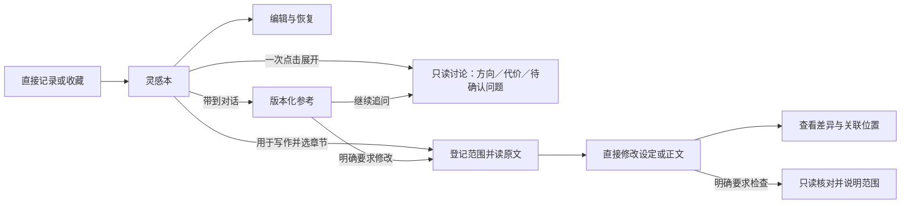

# 线簿 0.8：灵感本、全局模块库与作品装配

2026-10-25 新增：[模型自主组织与维护模块](agent-module-management.md)为设计草案，待实施。提出由模型按创作请求决定模块组织并直接生成、保存和用于当前作品；提示词、工具、前后端反馈与验收见[实施方案](../../dev-notes/v0.8/agent-module-management-plan.md)。下文当前交付状态不因本草案改变。

2026-10-25 更新：[灵感悬浮体验](ideas-companion.md)已实施。灵感移出主导航，使用可拖动的独立入口和短内容面板；下文的并列导航、列表详情层级以该更新为准。

2026-10-25 更新：[模块体验设计](module-experience.md)已实施。模块以自由内容为主，挂载直接显示在写作侧栏，作品内保存与另存到库分开；下文的类型选择、条目表单和日常发布流程以该更新为准。

日期：2026-10-24。状态：**产品方案；核心能力已接入，发布验收部分完成**。主应用与前端包版本为 `0.8.0`。
本方案记录产品目标与交互边界；实际已实现能力及未验证范围见[模块说明](../../dev-notes/v0.8/modules/README.md)
和[运行说明](../../dev-notes/v0.8/release.md)，不能仅据方案推断交付。
开发入口见 [0.8 开发文档](../../dev-notes/v0.8/README.md)。后续[前端体验与结构修复](../../dev-notes/v0.8/frontend-experience-plan.md)
已完成 H1–H6 实施与确定性回归；在线长篇和桌面打包未在本轮执行；本轮继续保持 0.8 / `0.8.0`。

## 1. 产品目标

**记下灵光一现，让想法在合适的时候进入故事。**

线簿首先帮助作者保存、修改和回看想法；作者需要时，再帮助他把选中的想法接入已有作品，
梳理人物动机、事件先后、伏笔和正文的影响。系统展示依据、改动与未覆盖范围，不承诺自动保证故事合理。

灵感本主要服务作者阅读。保存灵感不等于采用，不等于正式设定，也不等于授权模型修改正文。
正文继续是按章保存的 Markdown 文本，每章具备基础索引与语义索引状态。其他正式创作文本均为可选模块，
包括真相和线索；新作品不强制创建《真相.md》《线索.md》。模块在全局库保存，同类型可以有多份实例，
作品只固定自己使用的模块版本与关联。灵感本继续主要服务作者，本轮不额外将灵感迁移为全局模块。

## 2. 本轮确定的产品决定

| 决定 | 用户可感知的行为 |
|---|---|
| 固定入口为写作、灵感本、故事资料 | 正文、自由记录、正式资料各有位置 |
| 预设类型、多个实例、全局保存 | 可建立世界设定①②、两组人物或多条故事线，在不同作品复用 |
| 作品按确定版本装入模块 | 保存模块的新版本不自动改变其他作品 |
| 只有装入、卸下、删除，没有隐藏入口 | 卸下退出后续默认检索，不删除模块或已写正文 |
| 灵感可直接编辑、删除恢复、历史恢复 | 无模型连接也能使用；恢复一条灵感不回退正文 |
| 灵感默认不参与写作 | 只有带到对话或明确请求检索时，模型才读取本次允许的灵感 |
| 创作与整理分开 | 生成设定可以创造；正文整理只提取、核对，不编造计划 |
| 作者计划与正文记录分开保存、关联展示 | 修改正文不会让尚未兑现的计划消失 |
| 章节索引与时间线共用事件记录 | 时间线提供按章节、按故事时间两种视图，没有独立索引管理页 |
| 不恢复候选采用流程 | 明确要求保存或修改就执行；仅讨论则不落作品文件 |
| 不运行隐含模型任务 | 新建或装入模块、保存灵感、打开抽屉不触发整理或创作 |

## 3. 信息结构

```text
写作                 灵感本                 故事资料       [模块库]
章节目录              ＋记一条               本作品已装入     全局抽屉：
正文阅读              灵感列表与详情          海上城市·第1版   搜索／预览
模型对话              编辑／历史／最近删除     主角团·第2版     新建／装入
本次材料与实际读取     带到对话                密室调查·第1版   版本／另存变体
```

### 3.1 预设模块

0.8 的目标范围为以下七种预设类型，增加独立“世界设定”。预设限制类型，不限制每种类型的实例数量。
一个作品可装入同类型的多个不同实例；同一实例一次只选一个版本，互斥版本用另一作品方案比较。
分阶段交付，尚未完成的类型不显示可点击占位。不做任意类型、字段生成器或模块插件。

| 模块 | 作者内容 | 正文整理与查看 | 上下文用途 |
|---|---|---|---|
| 人物 | 小传、动机、关系、身份与披露计划 | 沿用身份披露、人物状态；别名随人物显示 | 相关人物的约束与知情依据 |
| 世界设定 | 地理、时代、技术、社会规则、地点与组织 | 对照当前作品的正文表达，观察仍归作品 | 世界约束与改编时的不适配项 |
| 线索与伏笔 | 读者可见现象、真正作用、计划埋设与回收 | 埋设、推进、回收的正文依据 | 当前事件相关、即将到期的安排 |
| 真相与事件经过 | 实际经过、手法、动机；可关联事件 | 阅读正文中如何表达，冲突以疑点呈现 | 规划伏笔、核对因果，不等于读者已知 |
| 时间线 | 作者安排的事件与先后关系 | 统一事件记录，按章节或故事时间查看 | 定位事件、前后依赖与披露位置 |
| 剧情安排 | 某章或某事件的目标、限制、后续安排 | 显示关联正文；不自动判定目标已完成 | 本次章节要求与相关未来计划 |
| 自由资料 | 纯文本说明、地点／物件／组织及可选别名 | 搜索与阅读；不自动抽成事实 | 明确选中或任务检索命中时读取 |

自由资料第一版仅支持模块库内文本，不扩大为任意本机附件或联网资料库。
名词表不再作为独立导航；地点／组织／物件的作者说明可归世界设定或自由资料，正文发现仍只属于本作品。
基础正文目录始终可用。时间线模块未装入时，章节摘要与事件检索仍可服务写作，但不自动运行生成任务。

### 3.2 模块库与装卸

- 全局模块库抽屉负责搜索、预览、新建、选择版本和装入；长内容在主区域编辑，不挤在抽屉中。
- 新建模块创建全局实例；装入只修改作品装配清单。两个动作都不自动生成内容或调用模型。
- 卸下移除作品引用，使该模块退出后续默认目录、检索与装配。内容和版本仍留在全局库，没有额外隐藏状态。
- 卸下不删除已写正文、章节索引或人物当前状态；已发生事实仍从本作品正文取得。
- 已装模块引用未装模块时提示依赖未装，不自动读取全局库。作者可装入或明确选择本轮参考。
- 删除模块是全局库的可恢复删除；不允许破坏其他作品已固定使用的历史版本。0.8 不做物理清理。
- 新作品只有正文和基础索引能力，不要求装任何模块。旧作品通过显式导入完成全局化，不能自动搬走文件。
- 资料卡显示实际装入版本和本作品使用情况，不显示“人物小传完成率”等填表指标。

### 3.3 版本、变体与复用

作品固定模块版本；编辑保存创建新版本，更新当前作品须明确选择，其他作品不跟随最新版。
“保存并用于本作品”可一次提交该意图，不增加第二道采用审批，但服务端分别记录发布和绑定结果。
不同方向使用“另存为变体”，例如主角团的侦探版与密探版，不以修改同一全局文件影响全部作品。

| 作品方案 | 人物模块 | 故事线模块 | 世界设定模块 |
|---|---|---|---|
| 海城疑案 | 主角团·第1版 | 密室调查·第1版 | 海上城市·第1版 |
| 王城疑案 | 主角团·第1版 | 密室调查·第1版 | 架空王朝·第2版 |

两部作品共用设计，正文、证据、生死状态和伏笔落实情况独立。第一版支持以当前组合创建空正文的新作品，
继承引用后选择替换项；不复制原作品派生记录，不自动改编正文。
已写正文的作品更换世界设定，只改变后续资料范围，不表示改编已完成；作者可明确要求检查影响与修改。
同作品装两种世界设定可以表示不同地区或时代；互相矛盾的替代方案应使用不同作品，系统不自动择一。
本版提供显式条目关联与缺失依赖提示，完整角色槽位映射、自动世界转换和自动解决设定冲突留待后续。

## 4. 灵感本

```text
灵感本                       [＋记一条]   [搜索]
──────────────────────────────────────────────────
老板娘其实认识死者                        今天
她一直保护死者的女儿，但不能让女儿知道。
[展开讨论] [用于写作] [带到对话] [删除]

雨夜里，有人把伞留在门外                  昨天
[编辑] [带到对话]
──────────────────────────────────────────────────
详情：原文 · 修改时间 · 收藏来源 · 曾关联第六章
```

灵感以应用外壳上的唯一悬浮面板出现：宽屏是侧栏，窄屏是近全屏容器，不占用正文页；
列表只显示正文摘要，点开后编辑完整原文。最少只输入内容；标题、标签均可不填，标题为空时用首句展示。编辑有保存／取消和未保存提示，
不在每次按键时创建永久版本。保存、编辑、删除恢复和历史恢复都不需要模型。
对话收藏复制作者选中的文字，记录消息定位与角色；不自动摘要、改写或收藏整段聊天。
原会话删除后，已收藏文字仍存在，来源链接显示不可用。

灵感没有强制采用状态，也没有待处理数量压力。使用记录是多对多关系：同一灵感可多次讨论、
用于多个位置；一次修改也可参考多条灵感。只记录已确认的定位，不把助手一句“已使用”当成落实证据。

### 4.1 修改、恢复与删除

| 动作 | 结果 | 不产生的副作用 |
|---|---|---|
| 编辑并保存 | 创建该条灵感的新修订 | 不自动同步已关联正文 |
| 取消编辑 | 丢弃本地未保存输入 | 不创建修订 |
| 恢复历史修订 | 以旧内容创建新修订，保留完整历史 | 不回退其他灵感或正文 |
| 删除 | 写入可恢复的删除标记，移至最近删除 | 不删除正文及正式设定 |
| 恢复删除 | 恢复该条记录，保留原 ID 与关联 | 不重复创建灵感 |

0.8 不做定时清空或永久删除。已使用灵感变动时只显示关联位置与“带到对话调整”。
正文的 Git 撤销继续按现有范围执行；撤销正文不会删除原始灵感。

### 4.2 从记录到创作



“带到对话”只追加参考到当前草稿，不发送、不清空草稿、不自动启用写权限。
“展开讨论”一次点击就发起只读讨论：首次发送即建独立会话，工具只放行目录、读取、搜索与
这条灵感的读取，写入、移动、删除、发布与索引整理都不在工具表里；再次点击打开同一次讨论，
不重复发送。面板里的“用于写作”先保存脏稿，再选目标章节，按普通写作用途提交，带固定修订与
当前版本，结果仍走现有写作任务和检查。
使用记录分开显示引用、展开、已核对写入与作者关联：引用与展开以受理事件为准，写入按当前正文的
指纹、区间与引文核对；正文改动后显示“该位置已变更”，那次提交被撤销则显示“已撤回”，
来源会话被删时保留记录并标为不可用。
“从灵感本找适合本章的想法”授权本轮检索，搜索结果仍不等于正式设定。
明确要求生成并保存小传等内容，沿用直接写入规则，不增加强制采用按钮。

## 5. 时间线与章节索引

本作品的章节索引与时间线共用正文事件记录，保留章节摘要；时间线另叠加已装模块版本中的作者事件。
取消独立“章节概览”导航，时间线内可切换视图；正文观察不写回全局模块：

| 事件 | 故事时间 | 正文位置 | 信息性质 |
|---|---|---|---|
| 老板娘与死者相识 | 五年前 | 第八章回忆 | 正文叙述／回忆，附出处 |
| 侦探审问老板娘 | 案发次日 | 第八章当前情节 | 正文叙述，附出处 |
| 女儿发现旧识关系 | 时间待定 | 计划第十二章 | 作者安排，尚无正文依据 |

同一事件可以在多章被提及；同一章可以包含多个时间点。只有已确认关联才归并为同一事件。
人物证词、推测、梦境与作者真相分开表达；“原文存在这句话”不证明事件真实发生。
只有明确日期或先后关系才排序；未知时间放入待定位组，不能按章序伪造故事时间。
存在相互冲突的先后关系时显示冲突，不自动改正文或删除任一依据。

作者计划可指向截止章之后；正文观察与读者披露按任务截止章过滤。
看到了幕后真相不等于可以写给读者。0.8 不建立能确定性保证无剧透的完整角色认知系统。

## 6. 渐进披露与材料反馈

索引分为全局模块索引、作品装配索引、正文索引。普通写作只查询本轮固定的已装模块版本与本作品正文。
先看模块目录，再查条目，最后读详情；基础字段程序提取，较长内容的语义摘要按明确请求生成，短条目不强制再总结。
模块库未装内容、其他作品状态和未选灵感都不进入普通目录或搜索。明确请求选模块时才开放本轮全局检索，
检索不等于装入或写权限。已发到公开对话的旧内容不能物理撤回，但后续任务需明确标注卸下后不再作为设定依据。

沿用“本轮上下文”展开区，展示用户选择、执行中检索、实际读取、过期排除和未覆盖材料。
不要求作者管理 token、索引版本或内部域名称；可以查看“本次使用第六章、老板娘小传、选中灵感”。
已有原文证据查看、截止章、活动记录与停止入口继续保留。

## 7. 核心验收旅程

1. 无模型连接时保存灵感，编辑、删除、恢复；正文和正式资料指纹不变。
2. 返回写作进行无关任务，模型输入与工具搜索中没有泄漏未授权灵感。
3. 把一条灵感带到对话，只讨论不改稿；明确要求后才在登记范围内写入。
4. 修改已经使用的灵感，正文不变；关联位置可查看、可再次带到对话。
5. 新增计划第 22 章回收的伏笔，即使正文只到第 8 章也能保存与检索。
6. 整理第八章，同一批事件既能按章节查看，也能按故事时间查看，不再生成第二份时间线事实。
7. 修改埋设章节，原文依据过期但作者计划保留；没有重新整理时也能继续写作。
8. 创建两份世界设定，在两个作品中复用同一人物和故事线；各自正文事实互不污染。
9. 保存模块新版本，另一个作品仍用原版本；卸下后普通查询无法继续读取该模块。
10. 用当前模块组合创建空正文新作品，替换世界设定；原作品文件、证据和装配清单不变。

## 8. 本版不做

不做任意模块插件、强制资料完成率、自动采用灵感、后台模型扫描、自动全书改稿、独立审批流、
完整知识图谱、向量数据库前置依赖、精确自然语言历法推理、跨文件内容事务与任意历史正文一键回退。
故事连贯性用证据、范围、确定性检查与在线语义验收共同评估，不能由“任务已完成”推断。
