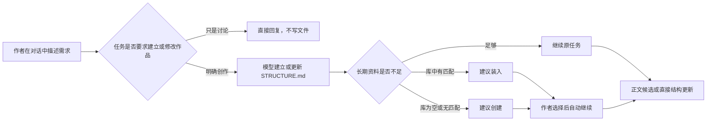

# v1.2 产品方案：单入口写作与上下文指引

日期：2026-11-03。状态：**方案确认，待实施**。目标版本：1.2.0。

## 1. 为什么要改

v1.1 已经建立 `STRUCTURE.md`、结构装配、正文台账和模块工具，但仍保留了 v1.0.9 的
“作品意图”数据与写作门槛。最近一次真实使用中，模型已经把全书结构写入
`STRUCTURE.md`，正文仍被 `BOOK_INTENT_REQUIRED` 拒绝；作者随后在对话中接受模型拟写的
作品意图，这个回答也没有进入确认接口。系统因此同时维护两份全局创作依据，并产生
“结构已存在、作品仍未起步”的半状态。

界面同时保留全书构思编辑、正文编辑、新建章节、导入正文、手动选择参考和模块装配等入口。
作者必须理解内部对象和保存顺序，偏离“对话栏是修改内容的唯一入口”和“一纸一笔”。

本版解决两个问题：

1. 只保留 `STRUCTURE.md` 作为全书唯一的语义全局提示，不再存在作品意图、设定卡入档或全书构思门槛。
2. 模型主动判断长期资料是否不足：库中有相关模块时建议装入；库为空或没有匹配模块时建议创建。

## 2. 冻结原则

1. **唯一创作入口是对话。** 作品方向、章节、标题、正文、结构和作品模块的内容变化都由对话发起；作者不能导入正文，也不能在界面直接创建正文或章节。
2. **唯一全局语义提示是 `STRUCTURE.md`。** 不再保存或注入 `BookIntent`、设定卡、`STYLE.md` 等平行全局文本。
3. **稿纸只读。** 主区用于阅读与核阅；对话是笔。章节定位、历史、撤销和设置不是创作输入。
4. **结构由模型维护。** 作者说自然语言，模型自行决定 `STRUCTURE.md` 的组织方式、章节拆分和模块分工。
5. **模块是按需资料，不是第二份结构。** 人物、世界、线索等细节进入模块；只有相关任务才注入。
6. **模块建议不是门槛。** 作者拒绝创建或装入模块后，模型必须使用当前上下文继续原任务。
7. **一次只给一个上下文决定。** 建议可以包含最多三份最小必要模块，但不逐项要求作者配置字段。
8. **结构和模块直接入档、可撤销；正文仍走候选采用。** 计划性变化有简短回执，内部记账不打扰作者。
9. **无旧数据迁移。** 新格式从新作品开始；旧格式不转换，不为兼容保留新的产品入口。

修订学习计划调整了上面的第 1—3 条：稿纸可进入修订模式亲手改稿，确认后入稿并留下修订记录；
`STYLE.md` 作为作品级写作约定恢复，每次正文生成前全文注入。对话仍是默认与统一入口，正文默认
以阅读态呈现。

## 3. “一纸一笔”界面

```text
┌──────────────────────────────────────────────────────────┐
│ 作品                                  活动记录 · 设置     │
├───────────┬───────────────────────────┬──────────────────┤
│ 只读目录  │            稿纸           │       对话       │
│           │                           │                  │
│ 第 1 章   │ 当前正文、结构或模块内容  │ 模型回复         │
│ 第 2 章   │ 只读核阅                  │                  │
│           │                           │ [说出要求……]    │
│           │                           │            发送  │
└───────────┴───────────────────────────┴──────────────────┘
```

- 新作品创建后，对话默认展开并聚焦；主区显示“先定结构，再写正文”的轻量提示和示例说法，不显示需要确认或维护对象的流程页。
- 示例只填入当前对话草稿，不自动发送、不创建会话；已有草稿不被覆盖。创作提交仍只有对话一个入口。
- 左栏顶部常驻全书结构，只读，并写明它是写正文的依据与前提；没有结构时直接给出“在对话里建立结构”的入口。章节列表仍是左栏主滚动区，模块放在次级只读入口，不与章节并列要求维护。
- 移除全书构思输入框、正文输入框、保存、模型续写、新建章节和“添加文件”等日常写入控件。
- “调整当前内容”一类按钮只能把对象带入对话并聚焦输入框，不能直接执行修改。
- 打开作品、模型设置、活动记录和撤销属于项目管理，可留在菜单中；不提供导入正文或由作者直接新建正文、建章的入口，正文只由对话产生。
- 模块库保留为独立管理页，但日常创作不要求作者进入模块库。

## 4. 空作品起步

空作品不再经过“作品意图 → 确认 → 结构”的流程。



“我要写……”“按这个开始”“你自由发挥”等明确创作表达，已经授权模型建立第一版
`STRUCTURE.md`。不再要求作者确认一份内容重复的设定卡。若作者只在比较方案、询问建议或明确说
“暂不保存”，模型不写文件。

当作品尚无结构而作者要求写正文时，模型在同一轮先建立 `STRUCTURE.md`，再提出正文候选。
系统在能力层保证正文写入不会先于本轮结构建立，但不把这个顺序作为作者需要处理的门槛。

## 5. `STRUCTURE.md` 的唯一职责

`STRUCTURE.md` 是模型每轮都读取的全书工作记忆，可以包含：

- 当前故事方向与起点；
- 不可违反的铁律和知情边界；
- 已确定、未确定和明确排除的内容；
- 全书路线与章节骨架；
- 模块索引及各模块职责；
- 当前推进位置和下一步约束。

格式由模型根据作品自选，作者不填写字段。`## 铁律` 仍作为第一个非空标题，便于常驻规则降级检查；
其余标题不做确定性格式校验。本版把内部结构预算提高到 6000 字符：足够承载长篇骨架，超出时由模型
在写入前压缩，不能要求作者删减。

装配顺序冻结为：

1. `STRUCTURE.md` 全文；
2. 当次相关模块索引与已读取原文；
3. 正文台账、目标章节与确定性对账结果；
4. 当前选中正文、选段或作者显式参考；
5. 作者本轮要求。

正文台账属于事实记录，不是第二份创作提示；模块只在相关时注入。删除 `STYLE.md` 全局空占位，后续
写作习惯要么进入结构铁律，要么成为按需模块。

## 6. 模块上下文指引

### 6.1 三种合法结果

模型在执行创作任务前判断一次上下文：

| 判断 | 行为 |
|---|---|
| 当前结构与已装模块足够 | 直接工作，不显示建议 |
| 模块库有高度相关模块 | 根据摘要定位并按需只读原文；会持续参与本作品时再建议装入 |
| 模块库为空或查询无匹配 | 只有确实需要长期资料时才建议创建；`no_match` 不能表述成库为空 |

拒绝建议后直接继续，不重复追问。相同任务最多提出一次上下文建议。

### 6.2 建议创建的判据

只有同时满足以下条件的内容才建议成为模块：

- 会跨章节或跨多轮反复使用；
- 细节较多，不适合全部放入 `STRUCTURE.md`；
- 遗漏或混淆会明显影响正文；
- 可以按任务需要选择性注入。

临时要求、单句全局规则、章节路线和作者明确说“暂不需要”的内容不创建模块。

### 6.3 作者看到的形式

不展示模块 ID、版本、字段、装配和注入术语。模型只说明价值与影响：

> 这个故事会反复使用两位主角的性格边界和吸血鬼规则。建议建立“人物小传”和“故事背景”，
> 后续写作时我会按需读取，你不需要维护它们。

主要选项只有：

- **按建议创建并继续**；
- **不创建，直接继续**。

库中已有资料时，把“创建”换成“沿用现有资料”。细节可以展开查看，但不拆成多张确认卡。
作者回答“你决定”或“自由发挥”时，按推荐的最小组合执行。

### 6.4 创建后的行为

确认后模型负责模块名称、摘要、条目和版本；内部类型不要求作者理解，也不决定模块是否可见。完成以下事务：

1. 创建模块内容；
2. 装入当前作品；
3. 更新 `STRUCTURE.md` 的模块索引；
4. 恢复被建议暂停的原始任务；
5. 回显“创建了什么、用于什么、如何撤销”。

内部会在模块提交后结束旧上下文，再用新装配自动续接原任务；界面不新增步骤，也不要求作者重输需求。

例如“西部吸血鬼”起步时，最小建议是“人物小传”和“故事背景”；线索账等到线索体系开始形成时再建议。
“雪山温泉杀人事件”当前只要求人物小传时，可建议“人物小传”和“人物关系/共同往事”，不能顺带建立
作者明确排除的作案手法、调查过程和章节情节。

## 7. 控制与失败处理

- 结构和模块的写入使用既有版本记录与整体撤销；正文候选采用前不进入正式稿。
- 上下文建议的接受记录是明确授权，可用于创建或装入建议中列出的精确模块；不能扩大到其他模块。
- 模块名称、版本摘要和条目标题自动进入只读索引；与任务相关时，模型可以按精确版本读取模块正文，
  不需要逐次授权。读取不等于装入、修改或发布。
- 建议提出后装配已变化时，旧建议失效，重新按当前状态判断。
- 内部范围错误、预算压缩和工具重试只进入活动记录；能够自动恢复时不要求作者处理。
- 若模型建议失败，原任务仍可选择不用模块继续；不能把模块系统变成写作门槛。

## 8. 不纳入

- 旧作品意图数据迁移；
- 新的结构画布、时间轴编辑器或模块配置面板；
- 自动装入未确认的全局模块；
- 每轮后台扫描并创建模块；
- 用户画像与写作习惯学习；
- 恢复正文手工编辑模式。

## 9. 成功标准

1. 从空作品粘贴一段自然提示后，只用对话即可建立结构、接受或拒绝模块建议并继续创作。
2. 作品中不存在“作品意图”字段、接口、页面、错误码或注入文本。
3. `STRUCTURE.md` 是唯一全局语义提示；没有结构时系统不会形成隐蔽的第二门槛。
4. 模块库为空时，模型能提出有价值的创建建议；拒绝后仍完成原任务。
5. 模块库有相关资料时，模型能从名称、摘要和条目标题发现它，按需只读正文；持续相关时才提出精确装入建议。
6. 主写作区只有对话输入可以改变创作内容；稿纸与目录只读。
7. 作者不需要理解文件路径、模块类型、字段、版本或注入顺序。
